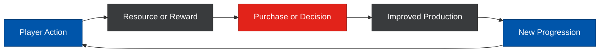

 

**Define the game before building it.**

*Establish the identity, gameplay direction and foundation of the experience.*

# 01. Game Concept

## 1.1. Objective

The game concept defines the identity, purpose and fundamental experience of a tycoon game.

Before creating maps, machines, interfaces or progression systems, the development team must understand exactly what it is building and why players would want to play it.

A strong concept should answer five questions:

1. What does the player build, manage or develop?
2. What makes the experience interesting?
3. What makes the game different from other tycoons?
4. How does the player progress?
5. What long-term objective gives the experience meaning?

The objective is not to create the biggest possible game concept. It is to create a clear and achievable foundation that can be expanded over time.

## 1.2. The Core Promise

Every tycoon should have a simple promise that communicates its main experience.

Use the following structure:

> I build **[something]** using **[mechanics or resources]** to unlock **[progression or objective]**.

Examples:

- I build a factory using automated production lines to create an industrial empire.
- I develop a restaurant by hiring workers, improving equipment and serving more customers.
- I construct a mining operation by discovering resources, upgrading machines and expanding underground.
- I develop a futuristic city by managing infrastructure, energy and population.

These examples are starting points, not complete game concepts.

The promise should be understandable without requiring a lengthy explanation.

### Concept statement

Complete the following template:

| Element | Description |
|---|---|
| Game name | [Project name] |
| Main theme | [Factory, city, restaurant, mining, etc.] |
| Player role | [What the player becomes] |
| Main activity | [What the player does most often] |
| Main resource | [What the player collects or produces] |
| Main objective | [What the player works towards] |
| Unique feature | [What differentiates the game] |

**Final promise:**

`I build __________________ using __________________ to unlock __________________.`

## 1.3. Target Audience

The target audience influences the complexity of the gameplay, the interface, the progression speed and the overall difficulty.

A game designed for casual players may require a different approach from one designed for players who enjoy complex management systems.

Define the intended audience before designing the economy.

Consider the following aspects:

| Aspect | Questions |
|---|---|
| Experience | Is the game designed for beginners or experienced tycoon players? |
| Session length | Should players make progress in short sessions or long sessions? |
| Complexity | How many systems can players reasonably understand? |
| Competition | Is the experience cooperative, competitive or individual? |
| Social interaction | Does playing with friends improve the experience? |
| Accessibility | Can players understand the game without external explanations? |

Avoid designing for everyone at once.

A clear target audience makes design decisions easier and helps prevent unnecessary features.

## 1.4. Player Fantasy

The player fantasy describes the role and experience the player should feel while playing.

It is not simply the game's visual theme.

For example, a factory tycoon can offer several different fantasies:

- Becoming a wealthy industrial owner.
- Designing an efficient automated production system.
- Managing a growing workforce.
- Building a massive industrial complex.
- Discovering increasingly advanced technologies.

The same theme can therefore produce very different gameplay experiences.

### Define the player fantasy

Answer these questions:

1. What should the player feel when starting the game?
2. What should the player feel after their first major upgrade?
3. What should the player feel when unlocking a new area?
4. What should the player feel after reaching a major milestone?
5. What should the player be proud of showing to others?

The answers should influence the game's progression, rewards, visuals and social systems.

## 1.5. Differentiation

A recognizable theme is not enough to make a game unique.

Many Roblox experiences use similar mechanics: collecting currency, purchasing droppers, upgrading machines and unlocking new areas.

These mechanics can be useful foundations, but the project needs a reason for players to choose it over alternatives.

### Identify three distinctive elements

A useful concept should contain at least three design elements that reinforce its identity.

| Element | Purpose | Example |
|---|---|---|
| Gameplay distinction | Changes how the player interacts with the game | Machines can be connected and reorganized |
| Progression distinction | Changes how the player develops | New technologies unlock alternative production methods |
| World distinction | Makes the environment recognizable | Different regions contain unique resources and challenges |

These are examples only. The final elements must be chosen according to the actual project.

### Competitor analysis

Study existing Roblox experiences in the same genre.

For each competitor, document:

- Its main gameplay loop.
- Its strongest progression mechanic.
- Its monetization approach.
- Its social features.
- Its most recognizable visual elements.
- Its weaknesses or opportunities for improvement.

Do not copy another game's identity or mechanics without understanding their purpose.

The objective is to identify established conventions and find opportunities to offer a different experience.

## 1.6. Core Gameplay Identity

The concept must translate into actions that the player can perform.

A game can have an interesting theme but still fail if the player does not have meaningful activities.

Define the following:

| Category | Design question |
|---|---|
| Primary action | What does the player do repeatedly? |
| Secondary action | What additional activities support the main loop? |
| Main reward | What does the player receive for playing? |
| Progression | How does the player's situation improve? |
| Decision-making | What choices can influence the outcome? |
| Long-term objective | What gives players a reason to continue? |

A useful concept should connect these elements into one coherent experience.

### Conceptual gameplay structure

This is a conceptual model, not a required implementation. The actual gameplay loop must reflect the game's mechanics.

## 1.7. Scope and Minimum Viable Product

A common development mistake is attempting to build the complete game immediately.

A large tycoon can eventually contain multiple worlds, hundreds of machines, complex economies, quests, companions, rebirth systems and social features.

Building everything before validating the core gameplay creates unnecessary technical and design risks.

Start with a Minimum Viable Product (MVP).

The MVP is the smallest playable version that demonstrates the game's fundamental experience.

### Recommended MVP scope

| System | Minimum implementation |
|---|---|
| Player interaction | Basic movement and interaction |
| Tycoon ownership | One player can access their own tycoon |
| Economy | One primary currency |
| Production | One functional production machine |
| Progression | A small number of purchasable upgrades |
| Environment | One playable area |
| Interface | Currency display and purchase feedback |
| Saving | A defined persistence plan before public progression testing |

The exact implementation depends on the project.

Do not add complex systems simply because other tycoon games contain them.

### MVP validation

Before expanding the project, verify that:

- A new player understands what to do.
- The first purchase is easy to discover.
- Production works consistently.
- Rewards are understandable.
- Progression feels meaningful.
- The player has a reason to make another purchase.
- The experience remains understandable without developer assistance.

## 1.8. Development Constraints

Every feature has a cost.

The cost is not limited to the time required to implement it. Features also create maintenance, performance, security and balancing requirements.

Evaluate important systems before committing to them.

| Constraint | What to evaluate |
|---|---|
| Development time | How long will implementation take? |
| Technical complexity | Does it require advanced Roblox systems? |
| Performance | Could it increase server or client workload? |
| Maintenance | Will it require frequent adjustments? |
| Scalability | Can it support future content? |
| Security | Can the feature be abused by exploiters? |
| Accessibility | Can different players use it comfortably? |

For multiplayer systems, identify which operations must be controlled by the server.

Never rely on client-side values as the authoritative source for currency, purchases or valuable progression.

Official reference: [Roblox security and cheat mitigation](https://create.roblox.com/docs/scripting/security/security-tactics).

## 1.9. Concept Validation

A concept should be validated through observation rather than assumptions.

Give a playable prototype to people who have not participated in its development.

Avoid explaining the intended gameplay before the test.

Observe whether players can discover the main objective independently.

### Questions for testers

1. What do you think the objective of this game is?
2. What did you do first?
3. Was it clear how to earn currency?
4. Did you understand how to purchase an upgrade?
5. What made you want to continue playing?
6. What felt confusing or unnecessary?
7. What would you like to unlock next?
8. What makes this game different from other tycoons?

### Signs of a promising concept

- Players understand the objective without assistance.
- Players discover the main gameplay loop naturally.
- Players can explain what makes the experience distinctive.
- Players show interest in future progression.
- Players can identify confusing or frustrating elements.

A positive reaction alone does not prove that the concept is successful.

Record observations and use them to improve the prototype.

## 1.10. Concept Design Worksheet

Complete this worksheet before starting full production.

### Project identity

| Question | Decision |
|---|---|
| What is the game called? | |
| What is its main theme? | |
| What role does the player have? | |
| Who is the intended audience? | |
| What is the central objective? | |

### Gameplay

| Question | Decision |
|---|---|
| What is the primary player action? | |
| What is the main resource? | |
| How does the player earn rewards? | |
| What can the player purchase? | |
| What are the first three progression milestones? | |

### Differentiation

| Question | Decision |
|---|---|
| What makes the game recognizable? | |
| What are its three distinctive elements? | |
| Which genre conventions will it use? | |
| Which conventions will it improve or avoid? | |

### Scope

| Question | Decision |
|---|---|
| What must exist in the MVP? | |
| What can be postponed? | |
| What is too expensive for the initial release? | |
| What systems need technical validation? | |

### Validation

| Question | Decision |
|---|---|
| Who will test the prototype? | |
| What must testers understand? | |
| What observations will be recorded? | |
| What results would justify continuing? | |

## 1.11. Common Mistakes

### Starting with an oversized concept

Trying to create several worlds, dozens of systems and hundreds of upgrades before validating the main loop increases development time and makes problems harder to identify.

**Better approach:** Build one complete and understandable gameplay loop first.

### Choosing a theme without defining gameplay

A factory, restaurant or mining operation is only a setting.

**Better approach:** Define what the player actually does and why those actions are enjoyable.

### Copying existing tycoons

Reproducing familiar mechanics without a distinct identity makes it difficult to create a recognizable experience.

**Better approach:** Study existing games, identify their conventions and introduce a meaningful distinction.

### Designing progression without testing it

A progression system can look attractive on paper but feel too slow, too fast or repetitive in practice.

**Better approach:** Test the first progression milestones with real players.

### Adding monetization before gameplay is validated

Monetization cannot compensate for an uninteresting core experience.

**Better approach:** Prioritize gameplay quality and make paid options compatible with a fair free experience.

## 1.12. Definition of Done

The concept phase can be considered complete when the following conditions are satisfied:

- [ ] The central game promise is written.
- [ ] The target audience is defined.
- [ ] The player fantasy is documented.
- [ ] The main gameplay actions are identified.
- [ ] Three distinctive elements are documented.
- [ ] Competitor research has been completed.
- [ ] The MVP scope is defined.
- [ ] Major technical constraints are identified.
- [ ] The concept worksheet is completed.
- [ ] The first prototype can be tested.
- [ ] Test observations are documented.
- [ ] The team knows which features are postponed.

Do not treat this checklist as a requirement to design every future feature in detail.

The purpose is to establish a stable direction while keeping room for iteration.

## 1.13. Decision Record

Important concept decisions should be documented so that future development remains consistent.

Use this format whenever a significant design decision is made.

| Field | Description |
|---|---|
| Decision | What was decided? |
| Reason | Why was this option selected? |
| Alternatives | Which other options were considered? |
| Evidence | What observations or tests support the decision? |
| Consequences | What changes because of this decision? |
| Validation | How will the decision be evaluated later? |

Keep decisions that are still relevant. Update them when new evidence justifies a change.

## 1.14. Reference Documentation

### Roblox official documentation

- [Roblox Creator Hub](https://create.roblox.com/docs)
- [Roblox production documentation](https://create.roblox.com/docs/production)
- [Roblox experience discovery](https://create.roblox.com/docs/discovery)
- [Roblox analytics](https://create.roblox.com/docs/production/analytics)
- [Roblox performance optimization](https://create.roblox.com/docs/performance-optimization)
- [Roblox security documentation](https://create.roblox.com/docs/scripting/security)

These resources provide technical and platform guidance. They do not replace playtesting or project-specific design decisions.

## Acknowledgements

This guide uses the official Roblox Creator Hub as its primary platform reference.

**Platform**

[Roblox](https://www.roblox.com/)

**Development documentation**

[Roblox Creator Hub](https://create.roblox.com/docs/)

**Production guidance**

[Roblox Production Documentation](https://create.roblox.com/docs/production)

**Visual resources**

[Shields.io](https://shields.io/) for the project badges.  
[Mermaid](https://mermaid.js.org/) for the gameplay flow diagram.

 

01 / GAME CONCEPT

ROBLOX TYCOON BLUEPRINT · DESIGN / BUILD / TEST / IMPROVE

