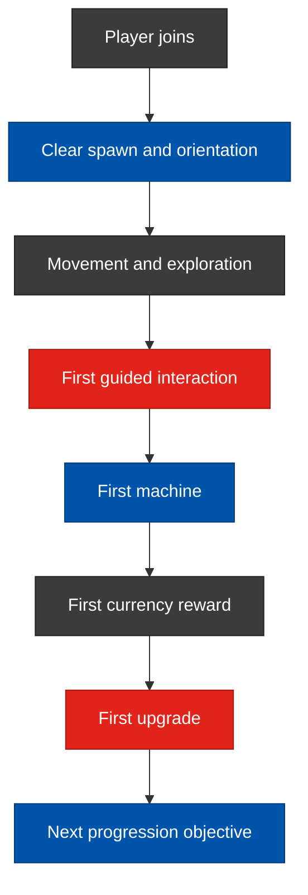

**Make the first five minutes understandable, rewarding and memorable.**

*Guide the player from their first interaction to their first meaningful progression milestone.*

# 02. First 5 Minutes

## 2.1. Objective

The first five minutes should teach the player how to act, give them a first visible result and show them an achievable next objective.

This initial experience should establish the basic understanding required to continue playing.

The player should progressively discover:

- Where they are and what they can do.
- How to perform the first interaction.
- How to obtain their first machine.
- How to earn their first currency.
- How to purchase their first upgrade.
- What they can work towards next.

The objective is not to explain every system immediately. It is to make the first actions understandable and rewarding.

## 2.2. The First Five-Minute Sequence

Prepare a clear sequence that progressively introduces the main gameplay elements.

| Stage | Experience | Intended result |
|---|---|---|
| 1. Arrival | Clear spawn location | The player understands where to begin |
| 2. Movement | Comfortable camera and movement | The player can navigate easily |
| 3. First interaction | Guided initial action | The player learns the interaction system |
| 4. First machine | A machine is obtained quickly | The player sees the first progression result |
| 5. First upgrade | The player improves their production | The player understands the upgrade process |
| 6. Next objective | A medium-term goal is presented | The player has a reason to continue |

The sequence should feel natural rather than like a list of mandatory instructions.

### Suggested progression flow

This sequence is a design reference. The actual implementation should match the game's mechanics.

## 2.3. What the Player Must Understand

Each initial action should teach something useful.

| Element | What the player should understand |
|---|---|
| Spawn | Where they are and where to begin |
| Camera | How to look around comfortably |
| Movement | How to navigate the environment |
| Interaction | How to activate or use an object |
| Machine | What the machine does |
| Currency | How the player earns money |
| Upgrade | How to spend money to improve progression |
| Next objective | What they can unlock or achieve next |

Avoid introducing several unfamiliar systems at the same time.

The player should have enough information to act without needing to read a long explanation.

## 2.4. Tutorial Design

The tutorial should help the player understand the game without interrupting the experience.

A long text-based introduction can delay the first meaningful action.

Prefer contextual instructions that appear when they become relevant.

### Tutorial principles

- Explain one action at a time.
- Use short and understandable instructions.
- Show the player where to interact.
- Give immediate feedback after successful actions.
- Avoid displaying the entire shop before the player understands the game.
- Remove tutorial guidance once the player has mastered the action.

### Contextual guidance

A contextual hint should answer three questions:

1. What should the player do?
2. Where should the player do it?
3. What happens after completing the action?

The guidance should disappear when it is no longer necessary.

## 2.5. First Reward and First Upgrade

The first machine and first upgrade are important early milestones.

They should demonstrate the relationship between player actions, rewards and progression.

The first upgrade should be reachable without excessive waiting or unnecessary complexity.

### Design considerations

| Element | Design question |
|---|---|
| First machine | Can the player obtain it quickly? |
| First reward | Is the result immediately understandable? |
| First currency | Does the player understand how it is earned? |
| First purchase | Is the purchase easy to discover? |
| Upgrade feedback | Can the player see what improved? |
| Next objective | Is there another achievable goal? |

Avoid making the first improvement too expensive.

The initial experience should demonstrate that actions lead to visible progress.

## 2.6. Common Mistakes

### Long instruction screens

Large blocks of text can prevent players from reaching the gameplay quickly.

**Better approach:** Use short contextual instructions.

### Showing the shop too early

A shop displayed before the player understands the game can create confusion.

**Better approach:** Introduce purchases when the player has enough context to understand their purpose.

### Making the first upgrade too expensive

Excessive waiting before the first meaningful improvement can weaken the initial experience.

**Better approach:** Make the first upgrade accessible and easy to understand.

### Overloading the tutorial

Explaining every mechanic during the first session can make the game feel complicated.

**Better approach:** Introduce systems progressively, when the player needs them.

### Keeping guidance visible for too long

Instructions that remain after the player understands an action become unnecessary interruptions.

**Better approach:** Remove or reduce guidance once the action has been mastered.

## 2.7. Measurement and Playtesting

The first five minutes should be evaluated through observation and measurable results.

Do not assume that players understand the experience simply because the development team does.

Observe new players without explaining the intended actions.

### Metrics to monitor

| Metric | What it helps identify |
|---|---|
| Time until first purchase | Whether the first purchase is easy to reach |
| Players blocked | Whether an interaction or instruction is unclear |
| Early departures | When players stop playing |
| Tutorial completion | Whether the guidance is understandable |
| First upgrade completion | Whether the first progression milestone is accessible |

These measurements should help identify where the initial experience needs improvement.

### Playtesting questions

- Did the player understand where to start?
- Could the player move and interact comfortably?
- Did the player discover the first machine?
- Did the player understand how to earn currency?
- Was the first purchase clear?
- Did the player understand what to do next?
- At what point did the player become confused or stop progressing?

Use contextual hints to resolve problems rather than adding a more intrusive tutorial.

## 2.8. Design Worksheet

Document the initial player experience before implementation.

### Arrival and movement

| Question | Decision |
|---|---|
| Where does the player appear? | |
| Is the starting location immediately understandable? | |
| Is the camera comfortable? | |
| Are the movement controls clear? | |

### First interaction

| Question | Decision |
|---|---|
| What is the first interaction? | |
| How is the player guided towards it? | |
| What feedback confirms success? | |

### First progression

| Question | Decision |
|---|---|
| What is the first machine? | |
| How does the player obtain it? | |
| How does the player earn their first currency? | |
| What is the first upgrade? | |
| How quickly can the player reach it? | |

### Future objective

| Question | Decision |
|---|---|
| What is the next objective? | |
| How is it presented? | |
| Why should the player continue? | |

## 2.9. General Design Questions

Before implementing the system, answer the following questions:

- What problem of the player does this system solve?
- What is the minimum version that can be tested?
- What is its technical and maintenance cost?
- How does the system work for a free player?
- What data can verify its usefulness?

These questions help keep the first-session experience focused and avoid unnecessary complexity.

## 2.10. Definition of Done

The first-session design can be considered ready for validation when:

- [ ] The spawn location is clearly understandable.
- [ ] Camera and movement are comfortable.
- [ ] The first interaction is discoverable.
- [ ] The first machine can be obtained quickly.
- [ ] The player understands how to earn currency.
- [ ] The first upgrade is accessible.
- [ ] The next objective is visible or understandable.
- [ ] Tutorial instructions are short and contextual.
- [ ] Unnecessary guidance disappears after use.
- [ ] Playtesting observations are recorded.
- [ ] Early progression metrics can be evaluated.

## 2.11. Reference Documentation

### Roblox official documentation

- [Roblox Creator Hub](https://create.roblox.com/docs)
- [Roblox Production Documentation](https://create.roblox.com/docs/production)

These resources provide platform and production guidance. The design of the first five minutes should still be validated through actual player testing.

## Acknowledgements

This section uses the official Roblox documentation as its platform reference.

**Platform**

[Roblox](https://www.roblox.com/)

**Development documentation**

[Roblox Creator Hub](https://create.roblox.com/docs)

**Production guidance**

[Roblox Production Documentation](https://create.roblox.com/docs/production)

**Visual resources**

[Shields.io](https://shields.io/) for project badges.  
[Mermaid](https://mermaid.js.org/) for the progression flow diagram.

 

02 / FIRST 5 MINUTES

ROBLOX TYCOON BLUEPRINT · DESIGN / BUILD / TEST / IMPROVE

