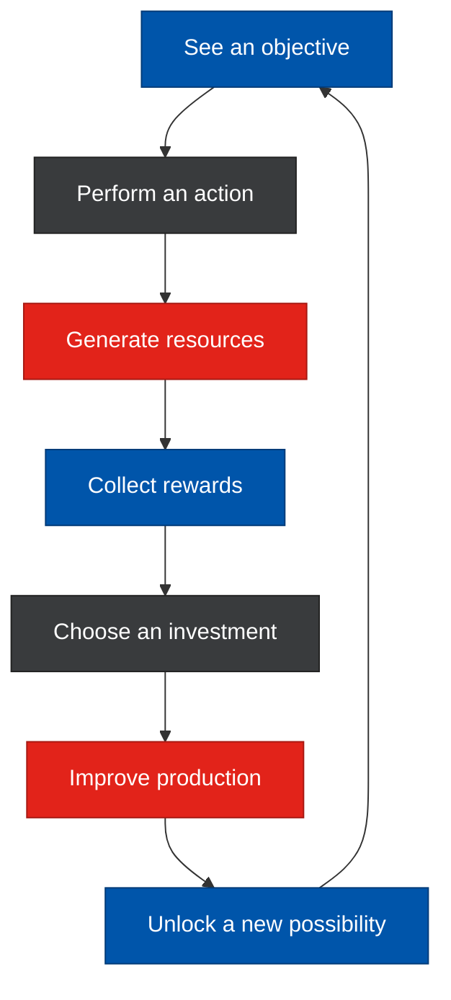
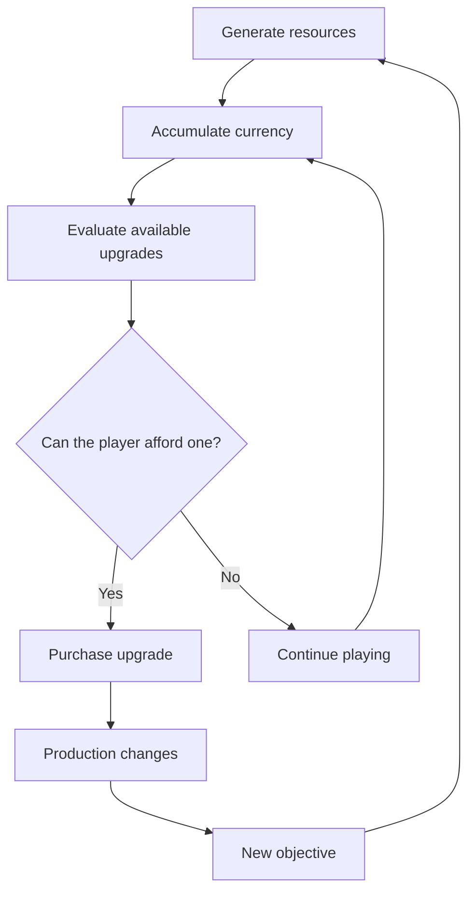

 <div align="center">





**Build a gameplay loop that makes every action count.**

*Design satisfying repetitions, meaningful decisions and a progression system that keeps creating new possibilities.*

</div>


# 03. Core Gameplay Loop

## 3.1. Objective

The core gameplay loop is the repeated sequence of actions that defines the player's moment-to-moment experience.

In a tycoon, this sequence often revolves around producing resources, collecting rewards, spending currency and improving production.

However, a loop should not be considered successful simply because it works.

A player must have a reason to repeat it.

The objective is to create a system where:

- Every important action has a clear purpose.
- Rewards are understandable and satisfying.
- Progression creates new possibilities.
- Repetition does not become meaningless.
- The player has opportunities to make decisions.
- Automation improves the experience without removing every reason to play.
- The loop remains understandable as the game becomes more complex.

A strong loop connects the player's actions to visible results and then uses those results to create the next objective.


## 3.2. Understanding the Core Loop

A basic tycoon loop can be divided into six stages.

| Stage | Player experience | Intended result |
|---|---|---|
| 1. Objective | The player sees something they want to unlock | A reason to act |
| 2. Action | The player interacts with a machine or system | Participation |
| 3. Production | Resources are generated | Visible activity |
| 4. Collection | The player receives the reward | Immediate satisfaction |
| 5. Investment | Currency is spent on an improvement | Progression |
| 6. Expansion | A new machine, area or capability becomes available | A new objective |

### Core loop diagram



This is a conceptual model, not a mandatory implementation sequence.

Some games automatically collect resources. Others require players to transport items, activate machines or complete additional tasks.

The important part is that the player understands the relationship between an action and its result.

### The difference between an action and a loop

An action is something the player does once.

A loop is a complete sequence that gives the player a reason to perform another action.

For example:

- Pressing a button is an action.
- Purchasing a machine, generating currency, buying an upgrade and unlocking another machine is a loop.

A collection of actions does not automatically create an enjoyable gameplay loop.


## 3.3. Resource Generation and Collection

Resource generation is one of the foundations of most tycoon games.

The player invests in a production system and receives resources over time or through direct interaction.

The relationship between production and collection must be easy to understand.

### Resource generation

A production system should clearly communicate:

- What produces the resource.
- How much is produced.
- How frequently production occurs.
- Where the resource goes.
- What the player must do to receive it.

For example, a machine might produce one item every few seconds.

The player can then collect that item or allow it to travel through a production line.

### Collection methods

| Method | Description | Design consideration |
|---|---|---|
| Manual collection | The player interacts with a collection point | Encourages direct participation |
| Automatic collection | Resources are transferred automatically | Reduces repetitive interaction |
| Physical collection | Items move through the world before being collected | Makes production visible |
| Shared collection | Several machines contribute to one collection system | Requires clear feedback |
| Conditional collection | A player must complete an action before receiving a reward | Adds an additional decision |

Different collection methods create different experiences.

A physical production line can make a factory feel alive, while automatic collection can make the experience faster and more convenient.

Neither method is universally better.

The correct choice depends on the role of collection in the game.

### Important design questions

- Is collection an enjoyable action or unnecessary friction?
- Does the player understand where resources are going?
- Can production be observed without constantly checking the interface?
- Does collection interrupt another important activity?
- Can multiple machines contribute without creating confusion?
- What happens when a collection point reaches its capacity?

### Avoid unnecessary repetition

If the player must perform the same interaction hundreds of times without making a decision, the action may become a chore.

Consider introducing automation, better collection systems or additional choices as progression develops.


## 3.4. Spending and Upgrade Cycles

The player needs meaningful ways to use the resources they generate.

Spending should create a noticeable change in the experience.

An upgrade that only changes a number is not necessarily a meaningful reward.

### Common upgrade categories

| Upgrade type | Example | Possible effect |
|---|---|---|
| Production | Better machine | More resources generated |
| Speed | Faster production cycle | Reduced production time |
| Capacity | Larger storage | More resources before collection |
| Efficiency | Reduced operating cost | Better resource management |
| Automation | Automatic collection | Less manual interaction |
| Expansion | New production area | More available systems |
| Specialization | Machine variant | Different production strategy |

### Incremental improvements

An upgrade should communicate what changes after purchase.

For example:

```text
Before upgrade:
Machine production: 5 resources / cycle

After upgrade:
Machine production: 8 resources / cycle

Improvement:
+3 resources / cycle
```

This example illustrates the importance of clear feedback. The values are illustrative, not recommended balance settings.

### Upgrade feedback

After a purchase, consider showing:

- A visible machine transformation.
- A short animation.
- A clear production increase.
- A currency change.
- A confirmation message.
- A newly available objective.

The player should not have to guess whether an upgrade worked.

### The investment cycle



The loop should avoid creating long periods where the player has no useful decision.

If an upgrade is too expensive, the player should still have something meaningful to do while working towards it.


## 3.5. Reward Feedback and Player Satisfaction

A reward is more than a number added to the player's balance.

The player needs to understand that an action produced a result.

Feedback makes the connection between action and reward visible.

### Types of feedback

| Feedback | Example | Purpose |
|---|---|---|
| Visual | Machine lights up | Shows that something happened |
| Numerical | Currency counter increases | Communicates the reward |
| Audio | Short collection sound | Reinforces the action |
| Animation | Item moves through a conveyor | Makes production understandable |
| Environmental | New section opens | Shows progression |
| Interface | Upgrade becomes available | Presents the next decision |

### Feedback principles

**Immediate:** Important actions should receive a response without unnecessary delay.

**Understandable:** The player should know what caused the result.

**Consistent:** Similar actions should produce recognizable feedback.

**Proportional:** Small rewards should not create overwhelming effects.

**Non-intrusive:** Feedback should not obscure gameplay or prevent other actions.

### Reward anticipation

A player can be motivated by seeing a reward before obtaining it.

Examples include:

- A machine that is visible but still locked.
- A new floor that can be reached after a milestone.
- An upgrade preview showing its future effect.
- A production area that becomes available after expansion.

The player should understand what is required to obtain the reward.

Do not rely on vague promises or hidden requirements to create anticipation.


## 3.6. Automation and Player Involvement

Automation is particularly important in tycoon games.

As the player progresses, systems can become faster, more efficient and less dependent on manual actions.

However, automation creates a design challenge.

If every meaningful action becomes automatic, the player may have little reason to remain involved.

### Automation progression

A possible progression model is:

| Stage | Production | Player involvement |
|---|---|---|
| Early game | Mostly manual | Frequent interaction |
| Early expansion | Partially automated | Collect and upgrade |
| Mid game | Automated production | Manage and optimize |
| Advanced game | Highly automated | Make strategic decisions |
| Endgame | Complex production systems | Pursue mastery and new objectives |

This is a possible design direction, not a universal progression formula.

### What should automation improve?

Automation can:

- Reduce unnecessary repetitive actions.
- Make production more efficient.
- Allow players to focus on larger objectives.
- Connect multiple machines.
- Support more complex production systems.
- Make progression feel increasingly powerful.

### What should automation not remove?

Automation should not automatically eliminate:

- Meaningful decisions.
- The need to understand the production system.
- Interesting upgrade choices.
- Exploration and discovery.
- Long-term objectives.
- Opportunities for player mastery.

### Active and passive gameplay

A good tycoon can combine active and passive systems.

| Gameplay type | Description | Example |
|---|---|---|
| Active | Requires direct player participation | Activating a machine or completing a task |
| Passive | Progress happens without constant input | Automatic resource production |
| Strategic | Requires a decision | Choosing which machine to upgrade |
| Exploratory | Rewards discovery | Finding a hidden production bonus |
| Social | Involves other players | Visiting another factory or cooperating |

The goal is not to maximize the amount of time a player spends pressing buttons.

The goal is to make the player's involvement worthwhile.


## 3.7. Repetition, Variation and Long-Term Engagement

A core loop must be repeatable, but repetition alone is not enough.

If every cycle is identical, the experience can become predictable.

Variation gives the player new reasons to interact with familiar systems.

### Sources of variation

| Source | Example | What it adds |
|---|---|---|
| New machines | Different production behavior | New interactions |
| Machine upgrades | New production capabilities | More progression |
| Production choices | Prioritize speed or capacity | Decision-making |
| New areas | Different production environments | Exploration |
| Challenges | Complete a production objective | Short-term goals |
| Quests | Perform a specific sequence | Direction |
| Specialization | Choose a production path | Player identity |
| Events | Temporary objectives | Additional activity |

### Introduce variation progressively

Do not introduce every mechanic at the beginning.

A useful structure is:

1. Teach the basic production loop.
2. Allow the player to repeat it comfortably.
3. Introduce the first meaningful upgrade.
4. Add a new production possibility.
5. Introduce a decision between different improvements.
6. Expand the loop with additional systems.
7. Give advanced players objectives that require mastery.

Each new system should have a clear purpose.

Adding complexity simply to make the game larger can make the experience harder to understand.

### Repetition versus progression

Ask the following questions:

- What changes after each cycle?
- Does the player gain a new capability?
- Is there a new decision to make?
- Does the environment evolve?
- Does the player become more efficient?
- Is the next objective different from the previous one?

If the only answer is that the player receives a larger amount of currency, the loop may need more variation.


## 3.8. Balancing the Gameplay Loop

A loop can be functional but poorly balanced.

For example, production might be too slow, collection might require too much effort or upgrades might be too expensive.

Balancing should consider the entire sequence.

### Useful measurements

| Measurement | What it reveals |
|---|---|
| Time between rewards | How frequently the player receives feedback |
| Time to first upgrade | How quickly the loop demonstrates progression |
| Production rate | How much the system generates |
| Collection frequency | How often the player must interact |
| Upgrade cost | How much investment is required |
| Upgrade payback time | How long an upgrade takes to recover its cost |
| Idle time | How often the player has nothing meaningful to do |
| Loop completion rate | Whether players complete the intended sequence |

### Upgrade payback time

A useful way to evaluate an upgrade is to compare its cost with the additional production it creates.

For a simple linear production system:

\[
\text{Payback Time} =
\frac{\text{Upgrade Cost}}{\text{Additional Production per Second}}
\]

Example:

- Upgrade cost: 120 currency.
- Previous production: 5 currency per second.
- New production: 8 currency per second.
- Additional production: 3 currency per second.

\[
\text{Payback Time} = \frac{120}{3} = 40 \text{ seconds}
\]

The upgrade recovers its cost after 40 seconds of production under these assumptions.

This is a simplified model. Real economies may include caps, multipliers, collection delays, operating costs and other bonuses.

### Balance questions

- Does the player receive rewards often enough?
- Are upgrades worth their cost?
- Does production scale too quickly?
- Does the player spend too much time waiting?
- Are early upgrades still useful later?
- Does automation make progression too fast?
- Can different play styles remain viable?

Do not balance the entire game using one production value.

Test the interaction between all sources of income, costs and progression systems.


## 3.9. Common Mistakes

### Automating the entire loop too early

When the player has nothing meaningful to do, the game can feel passive.

**Better approach:** Introduce automation progressively and replace repetitive actions with more interesting decisions.

### Making collection unnecessarily repetitive

Repeatedly collecting small rewards can become frustrating.

**Better approach:** Evaluate whether collection is an important part of the experience or simply an obstacle.

### Giving upgrades no visible impact

A purchase that changes an invisible value may feel unrewarding.

**Better approach:** Show the effect through production, visuals or clear interface feedback.

### Increasing prices without adding possibilities

A more expensive machine is not automatically a more interesting objective.

**Better approach:** Use upgrades to introduce new capabilities, choices or production systems.

### Creating long periods without decisions

Players may lose interest when they are waiting for currency without anything useful to do.

**Better approach:** Introduce alternative objectives, meaningful upgrades or optional activities.

### Making every machine identical

If every machine produces the same result in the same way, progression can become repetitive.

**Better approach:** Give machines different roles while keeping their behavior understandable.

### Overloading the player with mechanics

Too many systems can make the main loop difficult to understand.

**Better approach:** Introduce mechanics gradually and connect each one to something the player already knows.

### Making automation remove the entire experience

If the player can obtain every reward without meaningful interaction, there may be little reason to continue.

**Better approach:** Let automation improve efficiency while preserving strategic and exploratory gameplay.


## 3.10. Gameplay Loop Design Worksheet

Use this worksheet before implementing a new loop or changing an existing one.

### A. Main loop

| Question | Decision |
|---|---|
| What is the player's main objective? | |
| What action starts the loop? | |
| What produces the reward? | |
| How does the player collect it? | |
| How is the reward spent? | |
| What becomes available afterwards? | |
| What makes the player repeat the loop? | |

### B. Resource generation

| Question | Decision |
|---|---|
| What resources are generated? | |
| Which systems generate them? | |
| How frequently are they generated? | |
| Are resources collected manually or automatically? | |
| Can production be interrupted? | |
| Are there storage limits? | |

### C. Upgrades and progression

| Question | Decision |
|---|---|
| What can the player upgrade? | |
| What changes after an upgrade? | |
| Is the improvement visible? | |
| What is the upgrade cost? | |
| What is the expected payback time? | |
| Does the upgrade unlock another possibility? | |

### D. Automation

| Question | Decision |
|---|---|
| Which actions are automated? | |
| At what progression stage is automation introduced? | |
| What manual actions remain useful? | |
| Does automation reduce unnecessary repetition? | |
| Does the player still make meaningful decisions? | |

### E. Player experience

| Question | Decision |
|---|---|
| What feedback does the player receive? | |
| How frequently does the player receive a reward? | |
| Are there periods without meaningful activity? | |
| What creates variation? | |
| Does the loop work for a solo player? | |
| Is the experience understandable on mobile? | |


## 3.11. Measurement and Playtesting

A gameplay loop should be tested with actual players.

Developers often understand their own systems because they already know how everything works.

New players do not have that knowledge.

Observe players without explaining every interaction.

### Playtesting checklist

- [ ] The player understands the main objective.
- [ ] The player can identify the first useful action.
- [ ] Resource generation is understandable.
- [ ] Collection works as intended.
- [ ] The player understands how to spend currency.
- [ ] Upgrades produce visible results.
- [ ] The player has a reason to repeat the loop.
- [ ] Automation is introduced at an appropriate time.
- [ ] New mechanics do not make the loop confusing.
- [ ] The player has meaningful activities between purchases.

### Questions to ask testers

- What do you think the main objective is?
- What action do you perform most often?
- Do you understand where your resources come from?
- Which upgrade would you purchase next?
- Is there anything you find unnecessarily repetitive?
- What would you like to unlock next?
- At what point did you feel that you had nothing useful to do?

### Interpreting results

A metric should help answer a specific design question.

For example, a long time between purchases might indicate that an upgrade is too expensive, but it could also mean that players do not understand how to earn currency.

Do not change values before understanding the cause.

Record the observation, the hypothesis, the change and the result of the next test.


## 3.12. Definition of Done

The core gameplay loop is ready for validation when:

- [ ] The main gameplay sequence is documented.
- [ ] The player understands the purpose of each important action.
- [ ] Resource generation works consistently.
- [ ] Collection behavior is clear.
- [ ] Spending creates meaningful improvements.
- [ ] Upgrade effects are communicated.
- [ ] The player has a visible next objective.
- [ ] Repetition does not rely exclusively on increasing numbers.
- [ ] Automation is introduced progressively.
- [ ] Active and passive gameplay are balanced.
- [ ] The loop has been tested with new players.
- [ ] Problems and design decisions are documented.
- [ ] The loop remains understandable as new systems are introduced.

## 3.13. General Design Questions

Before implementing or modifying the core loop, answer these questions:

- What problem or desire does this system address for the player?
- What is the smallest version that can be tested?
- What makes the loop satisfying?
- What is its technical and maintenance cost?
- How does it work for a free player?
- What happens when the player is alone?
- What happens when several players interact with the same system?
- Which actions should remain manual?
- Which actions should eventually become automated?
- What data can verify that the system is useful?
- How will the loop evolve during future updates?

These questions should guide design decisions rather than force every tycoon to use the same mechanics.


## 3.14. Reference Documentation

### Roblox official documentation

- [Roblox Creator Hub](https://create.roblox.com/docs)
- [Roblox Production Documentation](https://create.roblox.com/docs/production)
- [Roblox Analytics](https://create.roblox.com/docs/production/analytics)

Use official documentation when a gameplay design decision depends on platform behavior, implementation details or available analytics.

The documentation in this section describes design principles. It does not replace implementation testing or player research.


<div align="center">

## Acknowledgements

This section builds on the original project material and uses the following references and resources.

**Platform**

[Roblox](https://www.roblox.com/)

**Development documentation**

[Roblox Creator Hub](https://create.roblox.com/docs)

**Production guidance**

[Roblox Production Documentation](https://create.roblox.com/docs/production)

**Analytics documentation**

[Roblox Analytics](https://create.roblox.com/docs/production/analytics)

**Visual resources**

[Shields.io](https://shields.io/) for project badges.

[Mermaid](https://mermaid.js.org/) for gameplay flow diagrams.

<br>


<sub>03 / CORE GAMEPLAY LOOP</sub>

<sub>ROBLOX TYCOON BLUEPRINT · DESIGN / BUILD / TEST / IMPROVE</sub>

</div>
