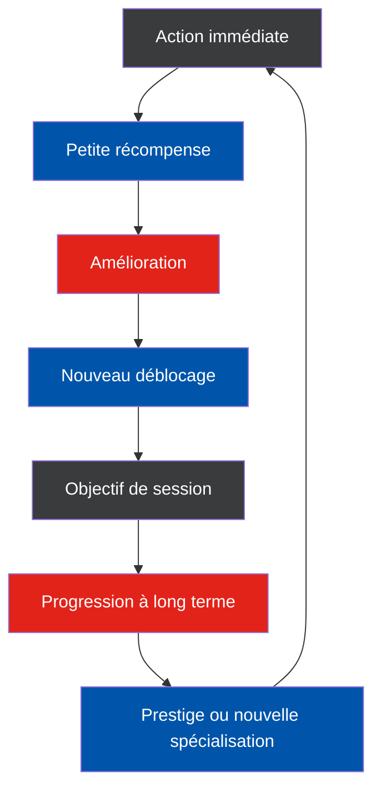
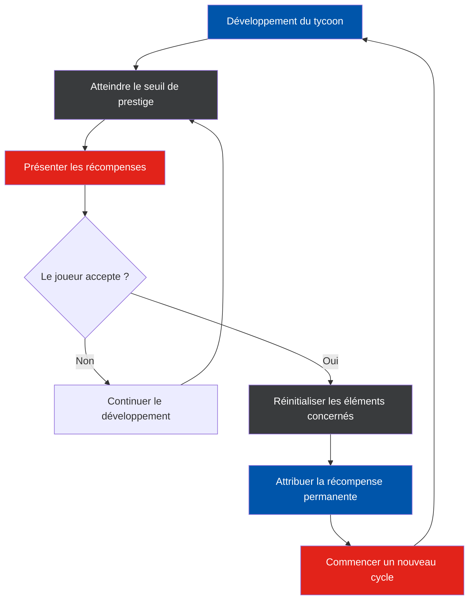

<div align="center">





**Make every milestone lead to something worth pursuing.**

*Design a progression system that rewards effort, introduces new possibilities and gives players reasons to return.*

</div>


# 04. Progression System

## 4.1. Objectif

La progression transforme les actions présentes en objectifs futurs.

Elle donne une direction au joueur, lui permet de mesurer ses améliorations et lui présente régulièrement de nouvelles possibilités.

Dans un tycoon, acheter une machine, améliorer sa production ou débloquer une nouvelle zone sont des étapes de progression. Mais une progression réussie ne se limite pas à accumuler des machines ou à augmenter des nombres.

Chaque étape doit apporter une valeur identifiable à l'expérience.

Le système doit permettre au joueur de :

- Comprendre ce qu'il peut obtenir ensuite.
- Identifier les actions nécessaires pour progresser.
- Observer les résultats de ses investissements.
- Atteindre des objectifs à différentes échelles de temps.
- Découvrir progressivement de nouvelles mécaniques.
- Faire des choix qui influencent son développement.
- Ressentir une évolution entre ses premières minutes et ses sessions avancées.

La progression doit être suffisamment régulière pour maintenir l'intérêt, sans devenir tellement rapide qu'elle vide le contenu disponible.

**Principe central : chaque palier doit apporter une nouvelle raison de jouer.**


## 4.2. Les différents horizons de progression

Une progression efficace utilise plusieurs échelles de temps.

Le joueur doit pouvoir avancer immédiatement tout en poursuivant des objectifs plus importants.

### Les cinq horizons

| Horizon | Durée indicative | Exemples | Fonction |
|---|---|---|---|
| Micro-progression | Quelques secondes | Collecter une récompense, terminer une action | Feedback immédiat |
| Progression courte | Quelques minutes | Acheter une amélioration | Récompense accessible |
| Progression de session | Une session de jeu | Débloquer une machine ou une zone | Donner une direction |
| Progression longue | Plusieurs sessions | Compléter une usine, collectionner des objets | Créer un objectif durable |
| Progression permanente | Plusieurs cycles de jeu | Prestige, spécialisations, collections complètes | Donner une raison de recommencer |

Ces durées sont des repères de conception, pas des valeurs universelles.

Elles doivent être ajustées selon le rythme réel du jeu et les résultats des tests.

### Pourquoi plusieurs horizons sont nécessaires

Si tous les objectifs sont très courts, le joueur peut rapidement manquer de choses à poursuivre.

Si tous les objectifs sont très longs, il peut avoir l'impression de ne jamais avancer.

La combinaison des deux permet de créer une continuité.




## 4.3. Les types de progression

Toutes les améliorations ne doivent pas avoir le même rôle.

Un système intéressant combine plusieurs formes de progression complémentaires.

### Progression économique

Le joueur augmente ses revenus et sa capacité à investir.

Exemples :

- Améliorer le rendement d'une machine.
- Augmenter la vitesse de production.
- Réduire les coûts de fonctionnement.
- Augmenter la capacité de stockage.
- Débloquer de nouvelles sources de revenus.

### Progression fonctionnelle

Le joueur obtient de nouvelles capacités.

Exemples :

- Automatisation d'une machine.
- Déblocage d'un nouveau type de production.
- Accès à des outils supplémentaires.
- Possibilité de gérer plusieurs lignes de production.
- Déblocage d'un système de transport.

### Progression spatiale

Le joueur développe son espace de jeu.

Exemples :

- Achat d'une nouvelle salle.
- Déblocage d'un étage.
- Agrandissement de l'usine.
- Accès à une nouvelle île ou région.
- Déblocage d'une zone spécialisée.

### Progression de maîtrise

Le joueur apprend à mieux utiliser les systèmes disponibles.

Exemples :

- Optimiser une chaîne de production.
- Découvrir des combinaisons efficaces.
- Réussir des défis.
- Utiliser des spécialisations.
- Atteindre des objectifs techniques.

### Progression de collection

Le joueur complète des ensembles d'éléments.

Exemples :

- Collection de machines.
- Variantes visuelles.
- Récompenses d'événements.
- Objets rares.
- Succès et trophées.

Une collection peut être un objectif secondaire ou un élément central du jeu. Elle ne doit pas être obligatoire pour comprendre le fonctionnement principal du tycoon.


## 4.4. Les jalons et les déblocages

Un jalon est un objectif important qui marque une étape dans la progression.

Il peut être atteint grâce à une quantité de monnaie, un nombre d'améliorations, une action particulière ou une combinaison de conditions.

### Exemples de jalons

| Jalon | Condition possible | Récompense |
|---|---|---|
| Première production | Produire une ressource | Débloquer le premier achat |
| Première expansion | Acheter plusieurs améliorations | Accès à une nouvelle machine |
| Automatisation | Atteindre un niveau de production | Débloquer une fonction automatique |
| Nouvelle zone | Atteindre un objectif économique | Accès à un nouvel espace |
| Maîtrise | Terminer une série de défis | Récompense spéciale |
| Prestige | Atteindre une condition avancée | Accès à un nouveau cycle |

### Un déblocage doit avoir une utilité

Débloquer une machine supplémentaire qui fonctionne exactement comme les précédentes peut donner une impression de progression superficielle.

Un bon déblocage peut :

- Introduire une nouvelle mécanique.
- Modifier la manière de produire.
- Créer une nouvelle décision.
- Améliorer une activité existante.
- Donner accès à un nouvel environnement.
- Permettre de poursuivre un objectif jusque-là inaccessible.

Il n'est pas nécessaire que chaque déblocage introduise une mécanique entièrement nouvelle.

Il doit cependant avoir une raison d'exister dans le système.

### Prévisibilité des déblocages

Le joueur doit pouvoir comprendre ce qui lui manque pour obtenir une récompense.

Exemple :

```text
NEXT UNLOCK

Advanced Generator

Required:
- 2,500 Coins
- 3 Purchased Machines

Reward:
- New production system
- Access to the second floor
```

L'exemple est illustratif. Les conditions réelles doivent être définies selon l'économie du jeu.


## 4.5. Concevoir une courbe de progression

La courbe de progression détermine la manière dont les coûts, les revenus et les récompenses évoluent.

Elle influence directement le rythme du jeu.

Une progression trop rapide peut épuiser le contenu. Une progression trop lente peut donner l'impression que les efforts du joueur ne sont pas récompensés.

### Progression linéaire

Les valeurs augmentent selon une quantité relativement constante.

Exemple :

```text
Upgrade 1: 100 Coins
Upgrade 2: 200 Coins
Upgrade 3: 300 Coins
Upgrade 4: 400 Coins
```

Cette méthode est simple à comprendre et à équilibrer.

Elle peut toutefois devenir prévisible si elle est utilisée seule.

### Progression multiplicative

Les coûts augmentent selon un multiplicateur.

Exemple :

```text
Upgrade 1: 100 Coins
Upgrade 2: 150 Coins
Upgrade 3: 225 Coins
Upgrade 4: 338 Coins
```

Cette approche peut créer une montée en difficulté plus rapide.

Elle nécessite un contrôle attentif pour éviter une inflation excessive.

### Progression hybride

Une progression hybride combine plusieurs méthodes.

Par exemple :

- Coûts relativement accessibles au début.
- Augmentation progressive pendant la phase intermédiaire.
- Paliers plus importants lors des déblocages majeurs.
- Nouvelles sources de revenus pour soutenir les coûts avancés.

Cette méthode permet de contrôler le rythme tout en donnant de l'importance aux grands jalons.

### Comparaison

| Modèle | Avantage | Risque |
|---|---|---|
| Linéaire | Facile à comprendre | Peut manquer de profondeur |
| Multiplicatif | Permet une croissance importante | Peut créer une inflation excessive |
| Hybride | Offre davantage de contrôle | Plus complexe à équilibrer |

Il n'existe pas de courbe universellement optimale.

Le choix dépend du nombre de systèmes, de la durée des sessions et des objectifs du jeu.


## 4.6. Coûts, revenus et temps de progression

Chaque palier doit être évalué selon le rapport entre son coût et les revenus disponibles.

Un tableau de progression permet de détecter les problèmes avant même les tests avec des joueurs.

### Exemple de tableau économique

Les valeurs ci-dessous sont fictives et servent uniquement à illustrer la méthode.

| Palier | Coût | Revenu par seconde | Temps théorique |
|---|---:|---:|---:|
| Machine 1 | 100 | 2 | 50 s |
| Machine 2 | 300 | 5 | 60 s |
| Machine 3 | 800 | 12 | 66,7 s |
| Machine 4 | 2 000 | 30 | 66,7 s |
| Machine 5 | 5 000 | 65 | 76,9 s |

Le temps théorique est calculé en supposant que le revenu indiqué est disponible en continu.

Dans un jeu réel, le temps nécessaire peut être différent selon les bonus, les autres sources de revenus, les dépenses intermédiaires et les actions demandées.

### Formule de temps d'achat

\[
T = \frac{C}{R}
\]

Avec :

- \(T\) : temps nécessaire.
- \(C\) : coût de l'amélioration.
- \(R\) : revenu net disponible par seconde.

### Exemple

Une amélioration coûte 900 Coins.

Le joueur génère 15 Coins par seconde.

\[
T = \frac{900}{15} = 60
\]

Il lui faut théoriquement 60 secondes pour obtenir cette somme.

### Attention au revenu net

Si le joueur possède déjà plusieurs dépenses ou doit acheter des éléments intermédiaires, le revenu brut ne représente pas forcément sa capacité réelle à progresser.

Il faut également prendre en compte :

- Les coûts obligatoires.
- Les revenus automatiques.
- Les bonus temporaires.
- Les limites de stockage.
- Les interruptions de production.
- Les achats facultatifs.
- Les différentes sources de monnaie.

Le modèle économique doit refléter le fonctionnement réel du jeu.


## 4.7. Récompenser sans rendre la progression automatique

Une progression réussie récompense les efforts sans supprimer toutes les décisions.

Si chaque récompense est simplement donnée au joueur après un délai, il peut finir par ne plus avoir de raison d'interagir.

Il faut conserver un équilibre entre accessibilité et participation.

### Les récompenses possibles

| Récompense | Exemple | Rôle |
|---|---|---|
| Économique | Coins supplémentaires | Accélérer la progression |
| Fonctionnelle | Nouvelle capacité | Modifier le gameplay |
| Visuelle | Apparence de machine | Personnalisation |
| Spatiale | Nouvelle zone | Exploration |
| Sociale | Titre ou classement | Reconnaissance |
| Permanente | Bonus de prestige | Progression longue |

### Récompenses garanties et récompenses facultatives

Les récompenses principales doivent être suffisamment prévisibles pour que le joueur comprenne sa progression.

Les récompenses secondaires peuvent offrir des objectifs supplémentaires.

Exemples :

- Une amélioration garantie après un certain nombre d'achats.
- Une décoration obtenue après un défi.
- Un trophée pour avoir terminé une collection.
- Une récompense spéciale liée à un événement.

Ne rends pas les fonctionnalités essentielles dépendantes d'une récompense aléatoire.

Le hasard peut enrichir une expérience, mais il ne doit pas remplacer la progression lisible.


## 4.8. Le prestige et les cycles de progression

Le prestige permet au joueur de recommencer une partie du développement en échange d'une récompense permanente ou d'un nouvel avantage.

C'est un système particulièrement utilisé dans les jeux incrémentaux et les tycoons.

### Fonctionnement général

1. Le joueur atteint un objectif avancé.
2. Le système lui présente les conditions du prestige.
3. Le joueur décide de recommencer ou de continuer.
4. Les éléments définis par le système sont réinitialisés.
5. Le joueur reçoit une récompense permanente.
6. Le nouveau cycle propose une progression différente ou plus rapide.

### Exemple de structure



### Ce qui peut être réinitialisé

- Machines achetées.
- Améliorations temporaires.
- Monnaie de la partie.
- Zones débloquées pendant le cycle.
- Progression de certaines missions.

### Ce qui peut être conservé

- Récompenses de prestige.
- Collections permanentes.
- Succès.
- Titres.
- Personnalisations.
- Déblocages permanents.
- Historique de progression.

La décision doit être clairement communiquée avant la confirmation.

Le joueur doit comprendre ce qu'il perd et ce qu'il gagne.

### Éviter un prestige obligatoire

Le prestige doit apporter une nouvelle perspective au jeu.

Si le joueur doit recommencer uniquement parce que sa progression normale devient impossible, le système risque d'être perçu comme une obligation plutôt que comme une récompense.


## 4.9. Progression et expérience du joueur

La progression doit rester compréhensible à chaque étape.

Un joueur débutant ne doit pas être confronté à toutes les mécaniques avancées dès son arrivée.

### Introduction progressive des systèmes

| Phase | Ce que le joueur découvre |
|---|---|
| Début | Monnaie, première machine et première amélioration |
| Développement | Production, nouvelles machines et expansion |
| Intermédiaire | Automatisation, optimisation et nouvelles zones |
| Avancé | Spécialisations, défis et systèmes complexes |
| Long terme | Prestige, collections et objectifs permanents |

Chaque phase doit préparer la suivante.

Un système avancé peut être visible avant d'être accessible, à condition que le joueur comprenne qu'il s'agit d'un objectif futur.

### Interface de progression

L'interface doit communiquer les informations essentielles :

- Objectif actuel.
- Prochaine récompense.
- Conditions de déblocage.
- Progression vers le prochain jalon.
- Coût des améliorations.
- Effets des achats.
- État du prestige.

Évite d'afficher toutes les informations possibles en permanence.

Présente d'abord ce qui aide le joueur à prendre sa prochaine décision.


## 4.10. Erreurs fréquentes

### Des coûts qui augmentent sans nouvelle mécanique

Augmenter les prix sans enrichir le gameplay peut transformer la progression en simple attente.

**Approche recommandée :** associer les grands paliers à de nouvelles capacités, de nouveaux choix ou de nouvelles activités.

### Des niveaux qui n'apportent rien

Un niveau supplémentaire n'a pas de valeur automatique.

**Approche recommandée :** chaque niveau important doit débloquer une amélioration, une récompense ou un objectif.

### Une progression trop rapide

Le joueur peut terminer le contenu disponible avant que les systèmes avancés soient prêts.

**Approche recommandée :** tester le rythme avec des profils de joueurs différents et mesurer le temps d'accès aux principaux jalons.

### Une progression trop lente

Les joueurs peuvent perdre leur motivation si les objectifs deviennent trop éloignés.

**Approche recommandée :** introduire des objectifs intermédiaires et des récompenses secondaires utiles.

### Des déblocages purement numériques

Une augmentation de 5 % peut être intéressante, mais elle ne doit pas représenter systématiquement toute la progression.

**Approche recommandée :** varier les récompenses entre économie, fonctionnalités, espace et personnalisation.

### Un prestige mal expliqué

Réinitialiser une grande partie de la progression sans expliquer les conséquences peut frustrer le joueur.

**Approche recommandée :** présenter clairement les éléments réinitialisés, conservés et obtenus.

### Des objectifs impossibles à comprendre

Un joueur ne peut pas poursuivre efficacement un objectif dont il ignore les conditions.

**Approche recommandée :** afficher les conditions et les étapes restantes.

### Une progression déséquilibrée entre joueurs

Les joueurs actifs, occasionnels et gratuits peuvent rencontrer des rythmes très différents.

**Approche recommandée :** tester plusieurs profils et vérifier que les systèmes principaux restent accessibles sans achat obligatoire.


## 4.11. Méthode de conception

Avant d'implémenter le système, construis un document de progression.

### Étape 1 : définir les objectifs

Liste les principaux jalons du jeu.

Ne commence pas par créer des centaines d'améliorations.

Définis d'abord les grandes étapes de l'expérience.

### Étape 2 : définir les récompenses

Pour chaque jalon, indique ce que le joueur obtient.

Classe les récompenses selon leur fonction :

- Économique.
- Fonctionnelle.
- Spatiale.
- Visuelle.
- Sociale.
- Permanente.

### Étape 3 : définir les conditions

Détermine les conditions nécessaires à chaque déblocage.

Exemples :

- Posséder une quantité de monnaie.
- Acheter un nombre de machines.
- Atteindre une production minimale.
- Terminer une mission.
- Débloquer une zone précédente.

### Étape 4 : calculer les coûts

Construis un tableau coût/revenu/temps estimé.

Vérifie que les coûts restent cohérents avec les revenus réellement accessibles.

### Étape 5 : construire un prototype

Implémente quelques paliers représentatifs.

Teste le système avant d'ajouter tout le contenu.

### Étape 6 : observer les joueurs

Mesure les temps de progression et identifie les endroits où les joueurs ralentissent ou abandonnent.

### Étape 7 : ajuster

Modifie les coûts, les récompenses et les conditions selon les observations.

Conserve les raisons de chaque changement pour éviter de perdre l'historique des décisions.


## 4.12. Mesure et playtesting

Les impressions des développeurs ne suffisent pas à valider une progression.

Il faut observer ce que les joueurs font réellement.

### Indicateurs utiles

| Indicateur | Question à laquelle il répond |
|---|---|
| Temps jusqu'au premier achat | Le début est-il suffisamment accessible ? |
| Temps entre deux jalons | Le rythme est-il cohérent ? |
| Taux de déblocage | Les joueurs atteignent-ils les objectifs ? |
| Temps passé sur une étape | Certains paliers sont-ils trop longs ? |
| Taux d'abandon par étape | Où les joueurs quittent-ils la progression ? |
| Achats d'améliorations | Les améliorations sont-elles suffisamment intéressantes ? |
| Utilisation du prestige | Le système donne-t-il envie de recommencer ? |
| Retour après prestige | Le nouveau cycle conserve-t-il son intérêt ? |

### Questions pour les testeurs

- Quel est ton prochain objectif ?
- Sais-tu comment l'atteindre ?
- Quelle amélioration souhaites-tu acheter ?
- As-tu l'impression de progresser suffisamment vite ?
- Quel déblocage t'a le plus intéressé ?
- Y a-t-il une étape qui t'a semblé inutile ?
- Comprends-tu ce que le prestige réinitialise ?
- As-tu envie de poursuivre après avoir atteint un jalon important ?

### Interpréter les résultats

Un faible taux de déblocage ne signifie pas nécessairement que le coût est trop élevé.

Le joueur peut également :

- Ne pas connaître l'objectif.
- Ne pas comprendre les conditions.
- Préférer une activité secondaire.
- Ne pas apprécier la récompense.
- Rencontrer un problème technique.

Identifie la cause avant de modifier les valeurs économiques.


## 4.13. Progression et joueurs gratuits

La progression principale doit rester accessible sans paiement obligatoire.

Les achats peuvent proposer des avantages ou des éléments supplémentaires, mais ils ne doivent pas rendre la progression normale inutile.

### Principes à respecter

- Les objectifs principaux restent atteignables gratuitement.
- Les récompenses payantes sont clairement présentées.
- Les achats ne doivent pas créer de confusion sur les chances ou les conditions d'obtention.
- Les joueurs gratuits doivent pouvoir découvrir les mécaniques importantes.
- Les avantages payants ne doivent pas détruire l'équilibre de l'économie.
- Le jeu doit rester intéressant sans achat.

Une progression équilibrée doit récompenser le temps, les décisions et la maîtrise du joueur.

Elle ne doit pas faire dépendre toute la satisfaction du jeu de la dépense d'argent.


## 4.14. Progression Design Worksheet

Utilise cette fiche pour documenter un système avant son développement.

### A. Structure générale

| Question | Décision |
|---|---|
| Quel est l'objectif principal du joueur ? | |
| Quels sont les grands jalons ? | |
| Combien d'horizons de progression existent ? | |
| Quelle est la prochaine récompense visible ? | |
| Qu'est-ce qui change entre deux paliers ? | |

### B. Récompenses

| Question | Décision |
|---|---|
| Quelles récompenses sont économiques ? | |
| Quelles récompenses débloquent de nouvelles fonctions ? | |
| Quelles récompenses ouvrent de nouvelles zones ? | |
| Quelles récompenses sont permanentes ? | |
| Quels objectifs secondaires existent ? | |

### C. Économie

| Question | Décision |
|---|---|
| Quel est le coût de chaque palier ? | |
| Quels sont les revenus disponibles ? | |
| Quel est le temps théorique nécessaire ? | |
| Comment les coûts évoluent-ils ? | |
| Quels bonus peuvent modifier le calcul ? | |

### D. Prestige

| Question | Décision |
|---|---|
| À partir de quand le prestige devient-il disponible ? | |
| Quelles conditions faut-il remplir ? | |
| Quels éléments sont réinitialisés ? | |
| Quels éléments sont conservés ? | |
| Quelle récompense permanente est attribuée ? | |
| Pourquoi le joueur voudrait-il recommencer ? | |

### E. Validation

| Question | Décision |
|---|---|
| Quels indicateurs seront mesurés ? | |
| Quels profils de joueurs seront testés ? | |
| Quel est le premier palier à valider ? | |
| Quels problèmes sont considérés comme bloquants ? | |
| Comment les résultats seront-ils documentés ? | |


## 4.15. Definition of Done

Le système de progression est prêt pour validation lorsque :

- [ ] Les différents horizons de progression sont définis.
- [ ] Les principaux jalons sont documentés.
- [ ] Chaque jalon possède une condition identifiable.
- [ ] Les récompenses ont une utilité claire.
- [ ] Les coûts sont cohérents avec les revenus disponibles.
- [ ] Le temps de progression a été estimé.
- [ ] Les déblocages introduisent des possibilités intéressantes.
- [ ] Les systèmes avancés sont introduits progressivement.
- [ ] Le prestige est clairement expliqué.
- [ ] Les joueurs gratuits peuvent accéder au contenu principal.
- [ ] Les informations essentielles sont visibles dans l'interface.
- [ ] Les premiers paliers ont été testés.
- [ ] Les problèmes de rythme ont été documentés.
- [ ] Les modifications économiques sont justifiées par des observations.


## 4.16. Questions à documenter

Avant de valider une nouvelle mécanique de progression, pose-toi les questions suivantes :

- Quel problème du joueur ce système résout-il ?
- Quelle est la version minimale à tester ?
- Quel est le coût technique et de maintenance ?
- Comment le système fonctionne-t-il pour un joueur gratuit ?
- Quelles données permettent de vérifier son utilité ?
- Quel comportement le système encourage-t-il ?
- Quelle récompense rend le palier intéressant ?
- Comment cette progression s'intègre-t-elle à l'économie ?
- Que se passe-t-il si le joueur quitte pendant cette étape ?
- Comment la progression est-elle sauvegardée ?
- Quelles conséquences une modification des coûts peut-elle avoir sur les autres systèmes ?

Les décisions importantes doivent être documentées afin de conserver une cohérence entre les différentes parties du jeu.


## 4.17. Liens de référence

### Documentation officielle Roblox

- [Roblox Creator Hub](https://create.roblox.com/docs)
- [Roblox Production Documentation](https://create.roblox.com/docs/production)

La documentation officielle doit être consultée pour les comportements de la plateforme, les systèmes de production et les outils d'analyse.

Les modèles économiques présentés ici sont des exemples de conception. Ils doivent être adaptés et testés dans le contexte réel du jeu.


<div align="center">

## Acknowledgements

Cette section conserve les références initiales et s'appuie sur les ressources suivantes.

**Platform**

[Roblox](https://www.roblox.com/)

**Official documentation**

[Roblox Creator Hub](https://create.roblox.com/docs)

[Roblox Production Documentation](https://create.roblox.com/docs/production)

**Visual and documentation tools**

[Shields.io](https://shields.io/) for project badges.

[Mermaid](https://mermaid.js.org/) for progression diagrams.

<br>


<sub>04 / PROGRESSION SYSTEM</sub>

<sub>ROBLOX TYCOON BLUEPRINT · DESIGN / BUILD / TEST / IMPROVE</sub>

</div>
