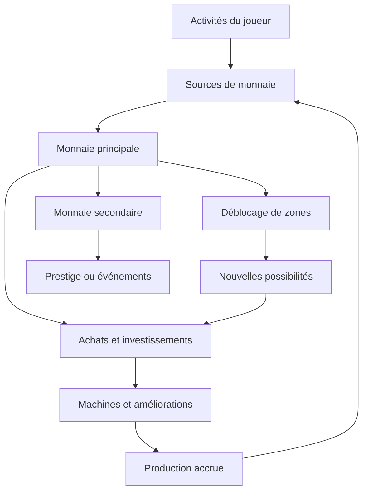

 

### Readme

---

# 05. Economy Design

## 5.1. Objectif

L'économie détermine la vitesse de progression, la valeur des décisions et le rythme général d'un tycoon.

Elle doit donner au joueur une raison de continuer à produire, collecter et investir. Chaque achat doit représenter une décision compréhensible et apporter une amélioration perceptible.

Une économie bien conçue doit répondre à plusieurs objectifs :

- Donner une valeur claire à chaque ressource.
- Maintenir une progression régulière.
- Récompenser les investissements du joueur.
- Créer des choix intéressants entre plusieurs achats.
- Éviter les périodes d'attente excessives.
- Conserver un équilibre entre joueurs gratuits et joueurs payants.

L'objectif n'est pas de rendre chaque achat immédiatement accessible. Il est de faire en sorte que le temps nécessaire pour l'obtenir soit cohérent avec la récompense proposée.

## 5.2. Les fondations de l'économie

Avant de définir les prix, il faut comprendre comment l'argent entre et sort du système.

Une économie repose sur deux catégories principales.

| Catégorie | Fonction | Exemples |
|---|---|---|
| Sources | Introduisent de la monnaie | Machines, quêtes, récompenses |
| Dépenses | Retirent de la monnaie | Machines, améliorations, zones |

Chaque source doit avoir une utilité précise. Chaque dépense doit apporter une valeur identifiable au joueur.

### Sources de monnaie

Les sources représentent toutes les activités qui permettent au joueur de gagner des ressources.

Exemples :

- Production automatique des machines.
- Collecte manuelle.
- Récompenses de quêtes.
- Succès et objectifs.
- Événements temporaires.
- Récompenses de progression.

Il faut surveiller les sources qui génèrent de la monnaie sans demander de décision ou d'effort particulier. Une production automatique trop puissante peut rapidement rendre les autres activités inutiles.

### Dépenses de monnaie

Les dépenses permettent de contrôler la circulation des ressources et de proposer de nouveaux objectifs.

Exemples :

- Achat de nouvelles machines.
- Amélioration de la production.
- Déblocage de nouvelles zones.
- Achat de fonctionnalités.
- Accès à certains systèmes de progression.
- Investissements liés aux événements.

Une dépense intéressante ne doit pas seulement retirer de l'argent. Elle doit modifier quelque chose dans l'expérience de jeu.

## 5.3. Concevoir les monnaies

Pour commencer, une seule monnaie principale est généralement suffisante.

Ajouter plusieurs monnaies augmente la complexité de l'interface, de l'équilibrage et de la compréhension du joueur.

### Monnaie principale

Elle sert aux achats courants et à la progression normale.

Exemples :

- Acheter une machine.
- Améliorer une production.
- Débloquer une nouvelle partie du tycoon.

### Monnaie secondaire

Une deuxième monnaie peut être utile si elle remplit une fonction réellement différente.

Exemples :

- Points de prestige obtenus après une renaissance.
- Jetons gagnés pendant un événement.
- Ressources rares utilisées pour des améliorations spécifiques.

Une monnaie secondaire doit avoir une identité claire. Elle ne doit pas simplement remplacer la monnaie principale avec un autre nom.

### Questions à poser avant d'ajouter une monnaie

- Quelle activité permet de l'obtenir ?
- Quels achats nécessitent cette monnaie ?
- Pourquoi la monnaie principale ne suffit-elle pas ?
- Le joueur comprend-il facilement sa fonction ?
- Son existence apporte-t-elle une nouvelle décision intéressante ?

Si ces questions ne permettent pas de justifier son existence, il vaut mieux ne pas l'ajouter.

## 5.4. Définir le rythme des achats

Le prix d'un achat ne doit pas être choisi au hasard.

Il faut définir le temps que le joueur devrait normalement attendre avant de pouvoir acheter une amélioration.

Exemple de progression fictive :

| Type d'achat | Temps cible |
|---|---:|
| Premier achat | 10 à 30 secondes |
| Première amélioration | 30 à 60 secondes |
| Nouvelle machine | 1 à 3 minutes |
| Amélioration importante | 3 à 6 minutes |
| Déblocage d'une nouvelle zone | 8 à 15 minutes |

Ces valeurs sont des points de départ pour un prototype, pas des règles universelles. Elles doivent être ajustées après des tests avec de vrais joueurs.

Le rythme dépend notamment :

- De la vitesse de production.
- Du nombre de machines disponibles.
- Du niveau d'automatisation.
- Des récompenses supplémentaires.
- De la durée moyenne d'une session.
- De la progression déjà accomplie.

Un bon rythme alterne entre des récompenses fréquentes et des objectifs plus importants.

## 5.5. Calculer la production et le retour sur investissement

Pour équilibrer une économie, il faut pouvoir mesurer la production réelle des machines.

### Revenu par seconde

Pour une machine qui produit une quantité fixe à intervalles réguliers :

\[
R = \frac{G}{T}
\]

- \(R\) : revenu moyen par seconde.
- \(G\) : monnaie produite par cycle.
- \(T\) : durée d'un cycle en secondes.

Exemple :

Une machine produit 120 pièces toutes les 6 secondes.

\[
R = \frac{120}{6} = 20
\]

La machine produit donc 20 pièces par seconde en moyenne.

### Temps de retour sur investissement

Le retour sur investissement indique combien de temps une machine doit fonctionner pour générer l'équivalent de son prix.

\[
ROI = \frac{C}{R}
\]

- \(ROI\) : temps de retour sur investissement.
- \(C\) : coût de l'achat.
- \(R\) : revenu supplémentaire par seconde.

Exemple :

Une amélioration coûte 600 pièces et augmente la production de 10 pièces par seconde.

\[
ROI = \frac{600}{10} = 60 \text{ secondes}
\]

Il faut donc environ une minute pour récupérer le coût de cette amélioration grâce au revenu supplémentaire.

**Attention :** le calcul doit utiliser le revenu supplémentaire apporté par l'achat, et non forcément le revenu total de la machine.

### Tableau de suivi

| Machine | Coût | Production / seconde | ROI |
|---|---:|---:|---:|
| Machine A | 100 | 5 | 20 s |
| Machine B | 500 | 15 | 33,3 s |
| Machine C | 1 500 | 30 | 50 s |
| Machine D | 5 000 | 75 | 66,7 s |

Ces valeurs sont fictives et servent uniquement à illustrer le calcul.

## 5.6. Construire une courbe de prix

Les prix doivent évoluer avec la progression du joueur.

Si les coûts restent trop faibles, les achats perdent rapidement leur valeur. S'ils augmentent trop vite, le joueur peut avoir l'impression que sa progression est bloquée.

Trois approches sont particulièrement utiles.

### Progression linéaire

Le prix augmente d'une quantité fixe.

\[
C_n = C_0 + n \times d
\]

- \(C_0\) : prix initial.
- \(n\) : numéro de l'amélioration.
- \(d\) : augmentation fixe.

Cette approche est facile à comprendre et à équilibrer, mais elle peut devenir trop prévisible.

### Progression multiplicative

Le prix augmente selon un multiplicateur.

\[
C_n = C_0 \times r^n
\]

- \(C_0\) : prix initial.
- \(r\) : multiplicateur.
- \(n\) : numéro de l'amélioration.

Cette approche permet de créer une progression plus rapide, mais elle peut provoquer une inflation excessive.

### Progression hybride

Elle combine une augmentation fixe et une augmentation multiplicative.

\[
C_n = C_0 \times r^n + n \times d
\]

Elle peut être utile pour contrôler plus précisément le rythme de progression.

Aucune formule ne garantit un bon équilibrage. Les prix doivent toujours être comparés aux revenus réellement accessibles au joueur.

## 5.7. Éviter l'inflation économique

L'inflation apparaît lorsque la quantité de monnaie disponible augmente plus vite que les possibilités de la dépenser.

Dans un tycoon, cela peut provoquer plusieurs problèmes :

- Les joueurs accumulent des sommes inutiles.
- Les achats deviennent insignifiants.
- Les anciennes machines perdent tout intérêt.
- Les nouvelles améliorations doivent coûter des sommes toujours plus importantes.
- Les récompenses ne procurent plus de satisfaction.

### Solutions possibles

- Introduire de nouvelles possibilités d'investissement.
- Donner une utilité aux anciennes ressources.
- Contrôler les bonus de production.
- Ajouter des améliorations fonctionnelles.
- Éviter les récompenses monétaires excessives.
- Surveiller les gains générés par les systèmes automatiques.

Il ne faut pas simplement augmenter tous les prix pour ralentir la progression. Il faut comprendre pourquoi le joueur gagne trop rapidement de l'argent.

## 5.8. Équilibrer les différents profils de joueurs

Tous les joueurs ne progressent pas de la même manière.

Un système économique doit être testé avec plusieurs comportements.

| Profil | Comportement | Risque à surveiller |
|---|---|---|
| Occasionnel | Joue peu de temps | Progression trop lente |
| Régulier | Joue plusieurs sessions | Répétition excessive |
| Optimisateur | Cherche les achats les plus rentables | Stratégie dominante |
| Actif | Joue longtemps | Inflation et accumulation |
| Nouveau joueur | Découvre les mécaniques | Mauvaise compréhension |

Il faut également tester les joueurs qui ne connaissent pas les meilleures stratégies.

Une économie équilibrée ne doit pas uniquement fonctionner pour les joueurs qui comprennent immédiatement toutes les mécaniques.

## 5.9. Économie et automatisation

L'automatisation est un élément central de nombreux tycoons.

Elle permet de transformer les investissements du joueur en production régulière.

Cependant, chaque automatisation doit avoir une conséquence mesurable.

Exemples :

- Une machine produit automatiquement des ressources.
- Un collecteur récupère les ressources sans intervention.
- Une amélioration augmente la vitesse de production.
- Un système de transport réduit les manipulations nécessaires.

L'automatisation ne doit pas supprimer toutes les décisions du joueur.

Le joueur doit toujours avoir des raisons de choisir ses investissements, de débloquer de nouveaux systèmes et d'optimiser son installation.

### Questions d'équilibrage

- Combien de temps faut-il pour rentabiliser une automatisation ?
- Quelle activité manuelle reste utile ?
- L'automatisation rend-elle les autres machines inutiles ?
- Le joueur dispose-t-il encore de décisions intéressantes ?
- La production reste-t-elle équilibrée lorsque plusieurs améliorations sont combinées ?

## 5.10. Économie et monétisation

La monétisation ne doit pas détruire l'équilibre de l'économie.

Les achats payants peuvent proposer des avantages, mais ils ne doivent pas rendre la progression gratuite inutile ou transformer le jeu en obligation de paiement.

Exemples de fonctionnalités monétisables :

- Options de personnalisation.
- Effets visuels.
- Animations supplémentaires.
- Confort d'utilisation.
- Bonus temporaires raisonnables.
- Fonctionnalités sociales ou cosmétiques.

Les avantages payants doivent être évalués dans le contexte de l'économie complète.

Il faut notamment vérifier qu'un bonus ne rend pas obsolètes les machines, améliorations ou objectifs accessibles gratuitement.

Les achats et les récompenses doivent également respecter les règles Roblox applicables aux fonctionnalités payantes et aux achats intégrés.

## 5.11. Visualiser les flux économiques

Un schéma simple permet de comprendre comment la monnaie circule dans le jeu.

Le schéma représente une économie simplifiée. Les monnaies secondaires ne doivent être ajoutées que si elles ont une fonction distincte.

## 5.12. Méthode de conception

Pour concevoir une économie, il est préférable de travailler progressivement.

### Étape 1 : identifier les ressources

Liste toutes les monnaies et ressources du jeu.

Pour chacune, précise :

- Son nom.
- Son rôle.
- Ses sources.
- Ses dépenses.
- Sa méthode d'obtention.

### Étape 2 : identifier les achats

Liste les machines, améliorations, zones et fonctionnalités disponibles.

Chaque achat doit avoir :

- Un coût.
- Un effet.
- Une condition de déblocage.
- Une valeur pour le joueur.

### Étape 3 : définir les temps cibles

Détermine combien de temps le joueur devrait attendre pour chaque catégorie d'achat.

### Étape 4 : calculer les revenus

Mesure la production de chaque machine et le revenu supplémentaire apporté par chaque amélioration.

### Étape 5 : simuler plusieurs parcours

Teste plusieurs profils de joueurs, avec différentes durées de session et stratégies d'achat.

### Étape 6 : ajuster les valeurs

Modifie les prix, revenus et récompenses en fonction des résultats.

### Étape 7 : tester en jeu

Les calculs permettent de préparer l'équilibrage, mais seuls les tests permettent de vérifier l'expérience réelle.

## 5.13. Mesurer et tester l'économie

Une économie doit être suivie à l'aide de données.

Indicateurs utiles :

| Indicateur | Ce qu'il permet d'observer |
|---|---|
| Temps avant le premier achat | Accessibilité du début |
| Temps entre deux achats | Rythme de progression |
| Revenus par minute | Vitesse de génération |
| Dépenses par minute | Utilisation de la monnaie |
| Solde moyen | Accumulation de ressources |
| Machine la plus achetée | Attractivité des investissements |
| Machine rarement achetée | Prix ou utilité potentiellement problématique |
| Temps avant un blocage | Difficulté de progression |

Il faut également observer les comportements inattendus.

Un joueur peut trouver une stratégie qui génère beaucoup plus de monnaie que prévu. Une seule stratégie dominante peut suffire à déséquilibrer toute l'économie.

### Tests recommandés

- Un nouveau joueur qui découvre le jeu.
- Un joueur régulier qui connaît les mécaniques.
- Un joueur qui optimise chaque achat.
- Un joueur qui privilégie les améliorations plutôt que les nouvelles machines.
- Un joueur qui joue pendant une longue session.

Les résultats doivent être comparés aux objectifs définis pendant la conception.

## 5.14. Erreurs fréquentes

| Erreur | Conséquence | Correction |
|---|---|---|
| Trop de monnaies | Confusion | Commencer avec une monnaie principale |
| Prix arbitraires | Progression incohérente | Calculer les temps d'achat |
| Revenus trop élevés | Inflation | Contrôler les sources |
| Prix qui explosent | Blocage | Ajuster la courbe de progression |
| Achats sans intérêt | Décisions inutiles | Donner un effet concret à chaque achat |
| Automatisation excessive | Perte d'interactivité | Conserver des décisions intéressantes |
| Bonus payants trop puissants | Déséquilibre | Tester les parcours gratuits et payants |
| Aucun test de longue durée | Problèmes tardifs | Simuler plusieurs sessions |

## 5.15. Fiche de conception économique

Utilise cette fiche pour documenter chaque nouvelle économie ou modification importante.

| Question | Réponse |
|---|---|
| Nom de la monnaie | |
| Fonction principale | |
| Sources de revenus | |
| Dépenses possibles | |
| Production moyenne | |
| Premier achat | |
| Temps cible du premier achat | |
| Achat le plus important | |
| Temps cible de progression | |
| Risques d'inflation | |
| Interactions avec l'automatisation | |
| Interactions avec le prestige | |
| Impact sur les joueurs gratuits | |
| Données à surveiller | |

### Fiche de simulation

| Achat | Coût | Revenu supplémentaire / seconde | ROI | Temps cible |
|---|---:|---:|---:|---:|
| Achat 1 | | | | |
| Achat 2 | | | | |
| Achat 3 | | | | |
| Achat 4 | | | | |
| Achat 5 | | | | |

## 5.16. Critères de validation

L'économie peut être considérée comme prête pour une première version lorsque :

- [ ] Chaque monnaie possède une fonction clairement définie.
- [ ] Toutes les sources de revenus sont documentées.
- [ ] Toutes les dépenses principales sont documentées.
- [ ] Les coûts sont cohérents avec les revenus.
- [ ] Les temps d'attente correspondent aux objectifs de progression.
- [ ] Les achats apportent une amélioration identifiable.
- [ ] Les machines restent utiles à différentes étapes.
- [ ] Les stratégies dominantes ont été identifiées.
- [ ] L'économie a été testée avec plusieurs profils de joueurs.
- [ ] La progression reste possible sans achat payant.
- [ ] Les risques d'inflation ont été évalués.
- [ ] Les données nécessaires à l'équilibrage peuvent être collectées.

## 5.17. Questions à documenter

Avant de valider une modification économique, réponds aux questions suivantes :

1. Quel problème du joueur ce système résout-il ?
2. Quelle est la version minimale à tester ?
3. Quel est son coût technique et de maintenance ?
4. Comment fonctionne-t-il pour un joueur gratuit ?
5. Quelles données permettent de vérifier son utilité ?
6. Quel impact aura-t-il sur les anciennes machines ?
7. Peut-il créer une stratégie trop puissante ?
8. Comment évoluera-t-il après plusieurs heures de jeu ?

## 5.18. Documentation de référence

- [Roblox Creator Hub](https://create.roblox.com/docs)
- [Roblox Creator Documentation - Production](https://create.roblox.com/docs/production)

Ces ressources servent de référence pour le développement et la publication du système. Les formules et méthodes d'équilibrage présentées dans ce document constituent des outils de conception à adapter au jeu.

---

### Acknowledgements

Thanks to **Roblox** for the platform and development ecosystem.

Thanks to the **Roblox Creator Hub** and **Roblox Creator Documentation** for the official development references.

Thanks to **Shields.io** for the project badges and **Mermaid** for the architecture diagrams.

Document: `05-Economy-Design/README.md` · Part of Roblox Tycoon Blueprint

