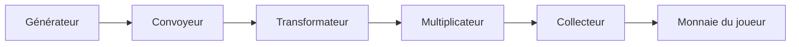

<div align="center">


### Readme


</div>

---

<div align="center">



</div>

# 06. Tycoon Mechanics

## 6.1. Objectif

Les machines donnent une forme physique à la progression du joueur. Elles transforment les investissements en production, en automatisation et en nouvelles possibilités.

Dans un tycoon, les machines ne doivent pas être de simples objets décoratifs. Chacune doit remplir une fonction identifiable et contribuer au fonctionnement général de l'installation.

Une bonne mécanique de machine doit :

- Avoir un rôle clairement défini.
- Produire un effet compréhensible.
- Posséder une valeur économique cohérente.
- Interagir correctement avec les autres machines.
- Être améliorée de manière perceptible.
- Fonctionner de façon fiable sur le serveur.
- Rester suffisamment optimisée pour accueillir plusieurs joueurs.

L'objectif est de créer une chaîne de production lisible, intéressante et évolutive.

## 6.2. Les différents rôles des machines

Chaque machine doit avoir une fonction spécifique.

Il est préférable de commencer avec quelques catégories simples plutôt que de créer immédiatement de nombreux objets presque identiques.

### Générateur

<text color="secondary" size="sm">Fonction : créer des ressources.</text>

Le générateur constitue généralement le point de départ de la production.

Exemples :

- Dropper qui crée des objets.
- Extracteur qui récolte une ressource.
- Machine qui génère directement une quantité numérique.

Paramètres importants :

- Fréquence de production.
- Quantité produite.
- Coût d'achat.
- Améliorations disponibles.

### Convoyeur

<text color="secondary" size="sm">Fonction : transporter les ressources.</text>

Le convoyeur déplace les objets entre les différentes machines.

Il peut être utilisé pour :

- Transporter les objets produits.
- Relier plusieurs machines.
- Créer une chaîne de production visible.
- Donner une représentation physique du fonctionnement du tycoon.

Il faut éviter les convoyeurs trop longs ou complexes lorsqu'ils n'apportent aucune valeur au gameplay.

### Transformateur

<text color="secondary" size="sm">Fonction : modifier les ressources.</text>

Le transformateur change les caractéristiques d'une ressource.

Exemples :

- Augmenter sa valeur.
- Convertir une ressource en une autre.
- Combiner plusieurs ressources.
- Produire un objet de meilleure qualité.

Cette catégorie permet de créer des chaînes de production plus intéressantes que la simple génération de monnaie.

### Multiplicateur

<text color="secondary" size="sm">Fonction : améliorer le rendement.</text>

Le multiplicateur augmente la valeur ou la quantité produite.

Exemple :

Une ressource d'une valeur de 10 reçoit un multiplicateur de 2.

\[
10 \times 2 = 20
\]

Il faut définir précisément si le multiplicateur s'applique à la valeur, à la quantité ou à la fréquence de production.

Plusieurs multiplicateurs combinés peuvent rapidement déséquilibrer l'économie.

### Stockage

<text color="secondary" size="sm">Fonction : conserver les ressources.</text>

Le stockage permet de retenir des ressources avant leur collecte ou leur transformation.

Paramètres possibles :

- Capacité maximale.
- Vitesse de remplissage.
- Vitesse de transfert.
- Capacité d'amélioration.

Un stockage plein doit produire un comportement compréhensible : arrêt de la production, attente ou transfert vers une autre destination.

### Collecteur

<text color="secondary" size="sm">Fonction : récupérer les ressources.</text>

Le collecteur représente généralement le point final d'une chaîne de production.

Il peut :

- Convertir les objets en monnaie.
- Ajouter les revenus au solde du joueur.
- Vider un stockage.
- Déclencher un effet visuel ou sonore.

Le joueur doit comprendre clairement quand une ressource est collectée et quelle récompense il reçoit.

## 6.3. Construire une chaîne de production

Une chaîne de production relie plusieurs machines pour transformer une ressource en récompense.

Exemple classique :



Chaque étape doit avoir une fonction utile.

Si une machine ne modifie ni la ressource, ni sa valeur, ni son transport, ni la décision du joueur, il faut se demander si elle est réellement nécessaire.

### Exemple de chaîne

| Machine | Action | Résultat |
|---|---|---|
| Générateur | Produit un objet | Ressource brute |
| Convoyeur | Déplace l'objet | Transport |
| Transformateur | Modifie sa valeur | Ressource transformée |
| Multiplicateur | Augmente sa valeur | Ressource améliorée |
| Collecteur | Convertit l'objet | Monnaie |

Cette organisation constitue une base. Les chaînes plus avancées peuvent intégrer des embranchements, des stockages et plusieurs types de ressources.

## 6.4. Concevoir les améliorations

Une machine doit pouvoir évoluer avec la progression du joueur.

Les améliorations doivent avoir des effets compréhensibles et suffisamment différents pour justifier les achats.

### Amélioration de vitesse

Réduit le temps entre deux productions.

\[
T_{\text{nouveau}} = \frac{T_{\text{initial}}}{M}
\]

- \(T\) : intervalle entre deux productions.
- \(M\) : multiplicateur de vitesse.

Exemple : une machine produit toutes les 4 secondes. Avec un multiplicateur de vitesse de 2, elle produit toutes les 2 secondes.

### Amélioration de valeur

Augmente la valeur de chaque ressource.

\[
V_{\text{nouvelle}} = V_{\text{initial}} \times M
\]

### Amélioration de capacité

Augmente la quantité de ressources pouvant être stockées.

### Amélioration d'automatisation

Réduit les interventions manuelles nécessaires.

### Amélioration de qualité

Modifie le type ou la qualité de la ressource produite.

### Tableau des améliorations

| Type | Effet | Impact |
|---|---|---|
| Vitesse | Produit plus rapidement | Augmentation du débit |
| Valeur | Ressource plus rentable | Augmentation des revenus |
| Capacité | Stocke davantage | Moins de blocages |
| Automatisation | Réduit les actions manuelles | Plus de confort |
| Qualité | Produit une meilleure ressource | Nouvelles possibilités |

Chaque amélioration doit afficher son coût et son effet avant l'achat.

## 6.5. Rendre les machines lisibles

Le joueur doit comprendre rapidement ce que fait une machine.

Une machine importante doit idéalement présenter :

- Son nom.
- Son niveau.
- Son prix.
- Sa production.
- Son effet actuel.
- Son prochain effet après amélioration.

Exemple d'affichage :

| Information | Valeur fictive |
|---|---|
| Machine | Advanced Dropper |
| Niveau | 3 |
| Production | 15 objets / minute |
| Valeur | 20 pièces / objet |
| Prochaine amélioration | 25 objets / minute |
| Coût | 1 500 pièces |

Les informations doivent être accessibles sans surcharger l'écran.

Les effets visuels peuvent renforcer la compréhension :

- Animation pendant la production.
- Indicateur lorsqu'une machine est active.
- Effet visuel lors d'une amélioration.
- Signal lorsque le stockage est plein.
- Animation de collecte.

L'interface doit compléter la machine, pas remplacer sa fonction.

## 6.6. Production physique ou numérique

Toutes les machines ne nécessitent pas forcément de créer des objets physiques.

Il existe deux approches principales.

### Production physique

Les ressources sont représentées par de véritables objets dans le monde.

Avantages :

- Production visible.
- Sensation de fonctionnement.
- Possibilités de mise en scène.
- Interactions physiques.

Inconvénients :

- Davantage d'objets à gérer.
- Coût de calcul et de réplication.
- Risque de collisions inutiles.
- Gestion plus complexe des objets perdus ou bloqués.

### Production numérique

La production est calculée sous forme de valeurs numériques.

Avantages :

- Moins d'objets physiques.
- Calculs plus simples.
- Meilleur contrôle des revenus.
- Gestion plus facile des grandes quantités.

Inconvénients :

- Production moins visible.
- Moins d'interactions physiques.
- Nécessité de créer des retours visuels.

### Approche hybride

Pour un tycoon, une approche hybride peut être particulièrement adaptée.

Le serveur calcule les revenus et la production avec des valeurs numériques. Des objets physiques peuvent être affichés pour représenter visuellement une partie de cette production.

Ainsi, l'expérience reste visuellement satisfaisante sans dépendre entièrement de milliers d'objets physiques.

## 6.7. Architecture technique des machines

Une machine doit séparer sa configuration, son apparence et sa logique.

Une organisation possible :

```text
ServerScriptService/
└── Services/
    └── MachineService.server.lua

ReplicatedStorage/
└── Shared/
    ├── MachineConfig.lua
    └── MachineTypes.lua

Workspace/
└── Tycoons/
    └── Tycoon_01/
        └── Machines/
            ├── Dropper_01/
            ├── Conveyor_01/
            └── Collector_01/
```

Cette arborescence est un exemple d'organisation, pas une structure obligatoire.

### Configuration

Les caractéristiques des machines peuvent être centralisées dans un module partagé.

Exemple simplifié en Luau :

```lua
local MachineConfig = {
    BasicDropper = {
        DisplayName = "Basic Dropper",
        Price = 100,
        ProductionInterval = 4,
        ValuePerItem = 10,
        MaxLevel = 5,
    },

    AdvancedDropper = {
        DisplayName = "Advanced Dropper",
        Price = 500,
        ProductionInterval = 2,
        ValuePerItem = 25,
        MaxLevel = 10,
    },
}

return MachineConfig
```

Cette configuration permet de modifier les valeurs sans devoir rechercher chaque machine dans plusieurs scripts.

Dans un projet plus avancé, il faudra également définir les validations des valeurs et les règles d'amélioration.

### Service de machines

Le service serveur est responsable de la logique :

- Vérifier les machines appartenant à un joueur.
- Gérer leur activation.
- Calculer la production.
- Appliquer les améliorations.
- Contrôler les interactions.
- Transmettre les informations nécessaires à l'interface.

Il ne faut pas laisser le client décider seul de la quantité de monnaie produite.

## 6.8. Sécurité et autorité du serveur

Les systèmes économiques et les machines doivent être contrôlés par le serveur.

Un client peut demander une action, mais il ne doit jamais pouvoir imposer directement son résultat.

Par exemple, lorsqu'un joueur veut acheter une machine, le serveur doit vérifier :

1. L'identité du joueur.
2. La propriété du tycoon.
3. L'existence de la machine.
4. Les conditions de déblocage.
5. Le solde disponible.
6. L'absence d'un achat déjà effectué.
7. Le coût réel défini par le serveur.

Le client ne doit jamais envoyer un prix qu'il choisit lui-même.

### Exemple de principe sécurisé

```lua
local function PurchaseMachine(player, machineId, config, playerData)
    local machine = config[machineId]

    if not machine then
        return false
    end

    if playerData.OwnedMachines[machineId] then
        return false
    end

    if playerData.Cash < machine.Price then
        return false
    end

    playerData.Cash -= machine.Price
    playerData.OwnedMachines[machineId] = true

    return true
end
```

Cet exemple illustre uniquement la logique de validation. Un système de production réel doit également gérer les données persistantes, les erreurs, les accès concurrents et les mises à jour de l'interface.

Il faut aussi éviter de faire confiance aux valeurs envoyées par un `RemoteEvent` ou un `RemoteFunction`.

## 6.9. Optimisation des machines

Un tycoon peut rapidement contenir de nombreuses machines et de nombreux objets physiques.

Il faut donc penser aux performances dès le prototype.

### Objets physiques

- Limiter les objets générés simultanément.
- Détruire ou recycler les ressources qui ne sont plus nécessaires.
- Éviter les collisions inutiles.
- Utiliser des collisions simplifiées.
- Éviter de créer des objets uniquement pour afficher une valeur.
- Prévoir une limite de production physique.

### Calculs

- Éviter de créer une boucle indépendante pour chaque machine sans nécessité.
- Centraliser les mises à jour lorsque c'est pertinent.
- Éviter les calculs répétés inutilement.
- Contrôler les intervalles de production.
- Éviter les mises à jour trop fréquentes de l'interface.

### Réseau

- Limiter les événements réseau inutiles.
- Ne pas transmettre constamment des informations identiques.
- Garder les calculs économiques côté serveur.
- Envoyer uniquement les informations nécessaires aux clients.

### Streaming et visibilité

Pour les grands tycoons, il faut également réfléchir à la visibilité des machines et à la gestion des zones éloignées.

Les mécanismes de streaming Roblox peuvent aider à gérer les environnements importants, mais ils doivent être testés avec l'architecture du jeu.

## 6.10. Gestion des blocages et des erreurs

Une chaîne de production doit pouvoir réagir lorsqu'une machine ne fonctionne plus normalement.

Exemples de problèmes :

- Convoyeur bloqué.
- Stockage plein.
- Collecteur désactivé.
- Ressource perdue.
- Machine supprimée.
- Joueur qui quitte la partie.
- Machine qui appartient à un autre tycoon.

Chaque situation doit avoir un comportement défini.

| Problème | Comportement attendu |
|---|---|
| Stockage plein | Arrêter ou ralentir la production |
| Collecteur désactivé | Conserver ou bloquer les ressources selon les règles |
| Machine supprimée | Arrêter sa production |
| Joueur déconnecté | Nettoyer les ressources temporaires |
| Ressource perdue | Éviter une production bloquée définitivement |
| Machine non possédée | Refuser son activation |

Il est préférable de prévoir ces situations dès le début plutôt que de les corriger après l'ajout de nombreuses machines.

## 6.11. Créer des machines intéressantes

Des machines intéressantes ne se distinguent pas uniquement par leurs prix et leurs statistiques.

Elles peuvent introduire de nouvelles décisions.

Exemples :

- Une machine rapide mais peu rentable.
- Une machine lente avec une forte valeur par ressource.
- Une machine qui transforme plusieurs ressources.
- Une machine qui augmente la production des machines voisines.
- Une machine qui nécessite un stockage plus important.
- Une machine qui produit une ressource rare.

Ces différences permettent de créer plusieurs stratégies.

Il faut cependant éviter qu'une seule machine soit systématiquement meilleure que toutes les autres dans chaque situation.

## 6.12. Méthode de développement

Pour développer les mécaniques, il est préférable de procéder par étapes.

### Étape 1 : prototype numérique

Créer une machine qui produit une valeur numérique côté serveur.

Vérifier :

- La fréquence de production.
- Le calcul des revenus.
- La propriété du tycoon.
- Le fonctionnement des améliorations.

### Étape 2 : première représentation physique

Ajouter un objet visible pour représenter la production.

Vérifier :

- Son apparition.
- Son déplacement.
- Sa collecte.
- Sa suppression.

### Étape 3 : chaîne de production

Ajouter un convoyeur et un collecteur.

Vérifier que les ressources suivent correctement le parcours prévu.

### Étape 4 : améliorations

Ajouter les améliorations de vitesse, valeur ou capacité.

Vérifier que chaque amélioration modifie réellement le comportement de la machine.

### Étape 5 : interface

Afficher le niveau, le coût et les statistiques.

Vérifier que le joueur comprend les changements.

### Étape 6 : optimisation

Tester avec plusieurs machines et plusieurs joueurs.

Mesurer les performances avant d'ajouter davantage de contenu.

## 6.13. Mesures et tests

Les machines doivent être évaluées à la fois sur leur fonctionnement et sur leur intérêt pour le joueur.

| Indicateur | Objectif |
|---|---|
| Production par minute | Vérifier le rendement |
| Temps de cycle | Vérifier la fréquence |
| Temps de retour sur investissement | Évaluer la rentabilité |
| Nombre d'objets physiques actifs | Surveiller les performances |
| Nombre de ressources bloquées | Identifier les problèmes de chaîne |
| Taux d'utilisation des machines | Mesurer leur utilité |
| Améliorations achetées | Identifier les choix populaires |
| Erreurs serveur | Détecter les problèmes techniques |

### Tests recommandés

- Acheter une machine pour la première fois.
- Améliorer une machine plusieurs fois.
- Construire une chaîne complète.
- Remplir volontairement un stockage.
- Désactiver un collecteur.
- Quitter une partie pendant la production.
- Tester plusieurs tycoons simultanément.
- Vérifier qu'un joueur ne peut pas acheter ou modifier les machines d'un autre.

## 6.14. Erreurs fréquentes

| Erreur | Conséquence | Solution |
|---|---|---|
| Machines identiques | Progression répétitive | Donner un rôle distinct à chaque machine |
| Trop d'objets physiques | Problèmes de performances | Limiter et recycler les objets |
| Calculs côté client | Exploitation possible | Garder l'autorité économique côté serveur |
| Améliorations peu visibles | Récompense peu perceptible | Afficher les changements |
| Machines trop complexes | Développement difficile | Commencer avec un prototype simple |
| Aucune gestion des blocages | Production interrompue | Définir les comportements d'erreur |
| Production déséquilibrée | Économie instable | Mesurer les revenus réels |
| Interface surchargée | Mauvaise lisibilité | Afficher les informations essentielles |

## 6.15. Fiche de conception d'une machine

Utilise cette fiche pour documenter chaque nouvelle machine.

| Question | Réponse |
|---|---|
| Nom de la machine | |
| Catégorie | |
| Fonction principale | |
| Ressource utilisée | |
| Ressource produite | |
| Prix | |
| Production par cycle | |
| Durée du cycle | |
| Améliorations disponibles | |
| Niveau maximum | |
| Conditions de déblocage | |
| Interactions avec les autres machines | |
| Comportement en cas de blocage | |
| Données à mesurer | |

## 6.16. Critères de validation

Une mécanique de machine peut être considérée comme prête pour une première version lorsque :

- [ ] Son rôle est clairement défini.
- [ ] Son coût et son effet sont documentés.
- [ ] Sa production fonctionne correctement.
- [ ] Ses interactions avec les autres machines sont définies.
- [ ] Les améliorations modifient réellement son comportement.
- [ ] Les informations essentielles sont visibles.
- [ ] La logique économique est contrôlée par le serveur.
- [ ] Les interactions client-serveur sont validées.
- [ ] Les ressources bloquées ou perdues sont gérées.
- [ ] Les objets physiques inutiles sont limités.
- [ ] Les performances ont été vérifiées avec plusieurs machines.
- [ ] La mécanique a été testée avec plusieurs joueurs.

## 6.17. Questions à documenter

Avant de valider une nouvelle mécanique, réponds aux questions suivantes :

1. Quel problème du joueur cette machine résout-elle ?
2. Quelle est sa fonction exacte dans la chaîne ?
3. Quelle est la version minimale à tester ?
4. Quel est son coût technique et de maintenance ?
5. Comment fonctionne-t-elle pour un joueur gratuit ?
6. Quelles données permettent de vérifier son utilité ?
7. Peut-elle provoquer un déséquilibre économique ?
8. Que se passe-t-il si elle est bloquée ou supprimée ?
9. Est-il réellement nécessaire de représenter sa production avec des objets physiques ?

## 6.18. Documentation de référence

- [Roblox Creator Hub](https://create.roblox.com/docs)
- [Roblox Creator Documentation - Production](https://create.roblox.com/docs/production)
- [Roblox Creator Documentation - Scripting](https://create.roblox.com/docs/scripting)
- [Roblox Creator Documentation - Security and Cheat Mitigation](https://create.roblox.com/docs/scripting/security/security-tactics)

Ces ressources permettent d'approfondir les aspects techniques liés aux scripts, aux interactions client-serveur et à la sécurité.

---

<div align="center">


### Acknowledgements

Thanks to **Roblox** for the platform and development ecosystem.

Thanks to the **Roblox Creator Hub** and **Roblox Creator Documentation** for the official development references.

Thanks to **Shields.io** for the project badges and **Mermaid** for the architecture diagrams.


<sub>Document: `06-Tycoon-Mechanics/README.md` · Part of Roblox Tycoon Blueprint</sub>

</div>
