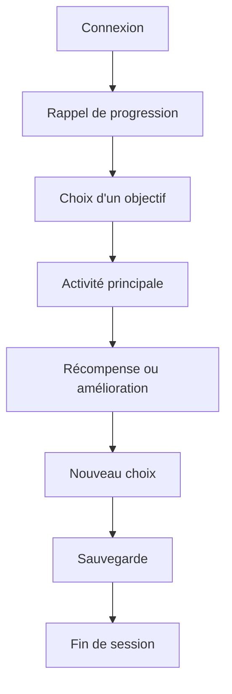

### Readme

---

# 07. Player Psychology

## 7.1. Objectif

La psychologie du joueur permet de comprendre pourquoi une personne commence à jouer, continue sa progression et décide de revenir.

Un tycoon ne doit pas uniquement proposer des machines, des améliorations et des récompenses. Il doit donner au joueur des raisons de s'investir dans son expérience.

L'objectif est de construire une expérience motivante sans exploiter la frustration, la culpabilité ou la pression sociale.

Une bonne conception psychologique doit :

- Donner au joueur des objectifs compréhensibles.
- Lui laisser une liberté de décision.
- Rendre ses progrès visibles.
- Valoriser ses efforts.
- Créer des moments de satisfaction.
- Favoriser les interactions sociales positives.
- Respecter son temps et sa liberté de quitter le jeu.

Le joueur doit avoir envie de continuer parce que l'expérience lui plaît, et non parce qu'il craint de perdre quelque chose.

## 7.2. Les trois besoins fondamentaux

Un cadre utile pour concevoir une expérience motivante consiste à considérer trois besoins psychologiques : l'autonomie, la compétence et la relation sociale.

Ces principes sont notamment associés à la théorie de l'autodétermination.

### Autonomie

Le joueur doit avoir le sentiment de contrôler ses décisions.

Dans un tycoon, cela peut se traduire par :

- Plusieurs chemins de progression.
- Le choix des machines à acheter.
- La personnalisation de son installation.
- Des stratégies économiques différentes.
- La possibilité de jouer à son propre rythme.

Si chaque joueur doit suivre exactement le même parcours sans aucune décision, la progression peut devenir mécanique.

### Compétence

Le joueur doit pouvoir constater qu'il apprend et qu'il devient meilleur.

Exemples :

- Comprendre le fonctionnement des machines.
- Réussir à optimiser une chaîne de production.
- Débloquer une mécanique avancée.
- Atteindre un objectif difficile.
- Construire une installation plus efficace.

La progression doit montrer que les efforts du joueur ont un effet concret.

### Relation sociale

Le joueur doit pouvoir créer des interactions positives avec les autres.

Exemples :

- Visiter les tycoons des autres joueurs.
- Comparer les constructions.
- Participer à des événements collectifs.
- Aider un autre joueur.
- Coopérer pour atteindre un objectif.

Les interactions sociales doivent encourager la participation sans imposer une présence permanente.

### Application dans un tycoon

| Besoin | Exemple de mécanique | Résultat recherché |
|---|---|---|
| Autonomie | Plusieurs améliorations possibles | Liberté de décision |
| Compétence | Progression et objectifs | Sentiment de maîtrise |
| Relation | Visites et coopération | Connexion sociale |

## 7.3. La motivation intrinsèque et extrinsèque

Il existe plusieurs façons de motiver un joueur.

### Motivation intrinsèque

Le joueur agit parce que l'activité lui plaît.

Exemples :

- Construire une installation.
- Tester différentes stratégies.
- Découvrir de nouvelles mécaniques.
- Optimiser une production.
- Explorer le monde.

Cette motivation est particulièrement intéressante pour la durée de vie d'un jeu.

### Motivation extrinsèque

Le joueur agit pour obtenir une récompense extérieure à l'activité.

Exemples :

- Gagner de la monnaie.
- Débloquer une machine.
- Obtenir un badge.
- Recevoir une récompense de quête.
- Débloquer un objet cosmétique.

Les récompenses extrinsèques peuvent soutenir la motivation, mais elles ne doivent pas devenir la seule raison de jouer.

### Trouver un équilibre

Un bon tycoon combine les deux.

Le joueur peut commencer par vouloir obtenir une nouvelle machine, puis découvrir qu'il apprécie également la construction, l'optimisation ou la compétition amicale.

Il faut donc créer des mécaniques qui restent intéressantes même lorsque la récompense immédiate n'est pas importante.

## 7.4. Les objectifs et leur visibilité

Un joueur doit comprendre ce qu'il peut faire ensuite.

Les objectifs doivent être organisés selon plusieurs horizons temporels.

| Horizon | Exemple | Fonction |
|---|---|---|
| Immédiat | Acheter une amélioration | Donner une direction |
| Court terme | Débloquer une machine | Encourager la progression |
| Moyen terme | Construire une nouvelle zone | Créer un objectif de session |
| Long terme | Terminer un ensemble de machines | Donner une raison de revenir |
| Très long terme | Atteindre un prestige | Proposer une nouvelle progression |

Un objectif doit être suffisamment clair pour que le joueur comprenne ce qu'il doit accomplir.

Il ne faut pas afficher simultanément trop d'objectifs importants. Une interface surchargée peut rendre la progression difficile à comprendre.

### Bon objectif

« Produire 500 ressources pour débloquer le transformateur avancé. »

Le joueur comprend :

- Ce qu'il doit produire.
- La quantité nécessaire.
- La récompense attendue.

### Objectif peu clair

« Continue de progresser pour découvrir la suite. »

Cette formulation ne donne aucune information concrète.

## 7.5. Le sentiment de progression

La progression doit être perceptible.

Un joueur peut gagner beaucoup de monnaie sans avoir l'impression d'avancer si rien ne change visuellement ou fonctionnellement.

Pour rendre les progrès visibles :

- Afficher les améliorations obtenues.
- Montrer les nouvelles machines.
- Débloquer progressivement de nouvelles zones.
- Faire évoluer visuellement le tycoon.
- Présenter les statistiques importantes.
- Donner des retours lors des étapes importantes.

La progression doit également être cohérente.

Une récompense importante doit provoquer un changement suffisamment visible pour justifier les efforts nécessaires.

## 7.6. Le feedback et la satisfaction

Chaque action importante doit produire un retour compréhensible.

Le joueur doit savoir si son action a réussi, échoué ou produit un résultat inattendu.

Exemples :

| Action | Feedback possible |
|---|---|
| Acheter une machine | Animation de construction |
| Améliorer une production | Changement visuel et statistique |
| Collecter une récompense | Son et affichage du gain |
| Débloquer une zone | Animation d'ouverture |
| Terminer une quête | Résumé de la récompense |
| Atteindre un objectif | Indicateur de progression complétée |

Un bon feedback est :

- Rapide.
- Compréhensible.
- Proportionné à l'action.
- Cohérent avec l'identité visuelle du jeu.

Il faut éviter de transformer chaque petite action en animation longue ou en écran intrusif.

## 7.7. Les récompenses et leur valeur psychologique

Toutes les récompenses n'ont pas la même valeur.

Une récompense peut être intéressante pour différentes raisons :

- Sa valeur économique.
- Sa rareté.
- Son apparence.
- Son utilité.
- Son caractère symbolique.
- La difficulté nécessaire pour l'obtenir.

Une récompense rare n'est pas automatiquement intéressante.

Elle doit avoir une valeur compréhensible pour le joueur.

### Catégories de récompenses

| Catégorie | Exemple | Intérêt |
|---|---|---|
| Économique | Monnaie | Progression |
| Fonctionnelle | Nouvelle machine | Nouvelles possibilités |
| Cosmétique | Apparence spéciale | Personnalisation |
| Sociale | Titre visible | Reconnaissance |
| Exploratoire | Nouvelle zone | Découverte |
| Symbolique | Succès rare | Accomplissement |

Il est intéressant d'alterner les récompenses afin d'éviter que toute la progression repose uniquement sur l'argent.

## 7.8. Le sentiment de maîtrise

Un joueur doit progressivement comprendre les mécaniques du jeu.

Au début, les systèmes doivent être simples et lisibles.

Plus tard, le jeu peut introduire :

- Des chaînes de production complexes.
- Plusieurs stratégies économiques.
- Des machines spécialisées.
- Des choix d'amélioration.
- Des systèmes de prestige.
- Des objectifs demandant une meilleure organisation.

Cette évolution permet au joueur de passer de la découverte à la maîtrise.

Il faut éviter de confondre complexité et profondeur.

Une mécanique peut être facile à comprendre tout en offrant de nombreuses possibilités d'optimisation.

## 7.9. La frustration et les obstacles

La difficulté peut rendre une progression intéressante, mais elle doit rester compréhensible et proportionnée.

Un obstacle est acceptable lorsqu'il représente un défi que le joueur peut surmonter.

Il devient problématique lorsqu'il semble artificiel ou conçu uniquement pour provoquer une dépense.

### Frustrations fréquentes

- Attentes excessivement longues.
- Prix qui augmentent sans justification.
- Objectifs impossibles à comprendre.
- Progression bloquée sans explication.
- Récompenses décevantes.
- Perte injustifiée de progression.
- Interface qui ne communique pas les erreurs.
- Mécaniques payantes indispensables.

### Méthode de résolution

Pour chaque frustration observée :

1. Identifier l'action qui provoque le problème.
2. Comprendre pourquoi le joueur rencontre cette difficulté.
3. Déterminer si l'obstacle est intentionnel.
4. Vérifier s'il apporte une valeur réelle.
5. Tester une solution alternative.
6. Comparer les retours des joueurs.

Il ne faut pas supprimer tous les obstacles. Il faut supprimer ceux qui n'apportent rien à l'expérience.

## 7.10. Le respect du temps du joueur

Le joueur doit pouvoir interrompre sa session sans subir une pénalité disproportionnée.

Les mécaniques de progression doivent respecter son rythme.

Bonnes pratiques :

- Sauvegarder correctement la progression.
- Permettre de reprendre facilement une activité.
- Éviter les tutoriels répétitifs.
- Ne pas imposer des connexions quotidiennes.
- Éviter les pénalités excessives en cas d'absence.
- Proposer des objectifs réalisables pendant différentes durées de session.

### Récompenses quotidiennes

Les récompenses quotidiennes peuvent être utilisées pour encourager le retour des joueurs.

Elles doivent cependant rester raisonnables.

Éviter :

- Les séries impossibles à interrompre.
- La perte de récompenses importantes après une absence.
- Les messages culpabilisants.
- Les bonus qui rendent les joueurs absents durablement désavantagés.

Une récompense de connexion doit être un avantage facultatif, pas une obligation.

## 7.11. La curiosité et la découverte

La curiosité peut encourager un joueur à explorer le monde et ses mécaniques.

Un tycoon peut introduire progressivement des éléments à découvrir :

- Machines inconnues.
- Zones verrouillées.
- Ressources rares.
- Décorations cachées.
- Quêtes secondaires.
- Interactions avec l'environnement.
- Nouveaux systèmes de progression.

Il faut donner suffisamment d'informations pour susciter l'intérêt sans tout révéler immédiatement.

La découverte doit être récompensée par un contenu réel, pas seulement par une animation ou une promesse.

## 7.12. La comparaison sociale

Les joueurs aiment parfois comparer leurs résultats et leurs constructions.

Cette comparaison peut créer une motivation supplémentaire.

Exemples :

- Classements de production.
- Présentation des tycoons.
- Collections visibles.
- Titres et récompenses.
- Visites d'installations.
- Défis communautaires.

Cependant, la comparaison sociale doit rester facultative.

Un classement permanent basé uniquement sur le temps de jeu ou les dépenses peut désavantager certains profils.

Il est préférable de proposer plusieurs formes de reconnaissance :

- Créativité.
- Progression.
- Optimisation.
- Participation.
- Coopération.

Le but est de valoriser plusieurs styles de jeu plutôt que de désigner un seul type de joueur comme supérieur.

## 7.13. La rétention sans manipulation

La rétention représente la capacité d'un jeu à donner envie aux joueurs de revenir.

Elle doit être construite autour de la qualité de l'expérience.

### Bonnes pratiques

- Ajouter du contenu réellement intéressant.
- Donner des objectifs à long terme.
- Sauvegarder correctement la progression.
- Proposer des activités variées.
- Créer des événements accessibles.
- Encourager les interactions positives.
- Corriger les frustrations techniques.
- Maintenir une progression cohérente.

### Pratiques à éviter

| Pratique | Problème |
|---|---|
| Fausses urgences | Pression artificielle |
| FOMO agressif | Peur de manquer du contenu |
| Pénalités d'absence | Culpabilisation |
| Récompenses opaques | Manque de transparence |
| Attente artificiellement prolongée | Frustration |
| Obstacles payants indispensables | Progression injuste |
| Notifications excessives | Intrusion |

Une bonne rétention est une conséquence d'une expérience appréciée, pas un objectif à atteindre par n'importe quel moyen.

## 7.14. Concevoir des sessions satisfaisantes

Une session de jeu doit avoir une structure compréhensible.

Le joueur doit pouvoir commencer une activité, progresser et terminer avec un sentiment d'accomplissement.

Exemple de structure :

Cette structure n'impose pas une durée fixe.

Un joueur qui dispose de cinq minutes doit pouvoir accomplir quelque chose, tout comme un joueur qui souhaite rester plus longtemps.

## 7.15. Comprendre les différents profils

Les joueurs ne recherchent pas tous la même expérience.

| Profil | Motivation possible | Mécaniques intéressantes |
|---|---|---|
| Constructeur | Créer une installation | Personnalisation et construction |
| Optimisateur | Améliorer les performances | Statistiques et stratégies |
| Collectionneur | Compléter des ensembles | Collections et découvertes |
| Explorateur | Découvrir le monde | Zones et secrets |
| Social | Interagir avec les autres | Visites et coopération |
| Compétiteur | Comparer ses résultats | Défis et classements |
| Occasionnel | Profiter de sessions courtes | Objectifs rapides et sauvegarde |

Ces profils ne sont pas des catégories fixes. Un même joueur peut rechercher plusieurs expériences selon son humeur ou sa progression.

Il faut donc éviter de concevoir tout le jeu autour d'un seul comportement.

## 7.16. Mesurer la satisfaction

Les données quantitatives permettent de comprendre certains comportements, mais elles ne suffisent pas à mesurer le plaisir.

Un joueur qui reste longtemps peut être satisfait, mais il peut également être bloqué ou attendre une récompense.

Il faut combiner plusieurs méthodes.

### Données quantitatives

| Indicateur | Ce qu'il peut révéler |
|---|---|
| Rétention J1 | Retour après la première session |
| Rétention J7 | Retour après plusieurs jours |
| Durée moyenne de session | Temps passé dans le jeu |
| Progression des objectifs | Accessibilité des mécaniques |
| Taux d'abandon d'une quête | Difficulté ou manque d'intérêt |
| Utilisation des machines | Attractivité des systèmes |
| Participation aux événements | Intérêt pour le contenu proposé |

Ces indicateurs doivent être interprétés avec prudence.

Une augmentation du temps de jeu ne prouve pas automatiquement une augmentation de la satisfaction.

### Données qualitatives

Les retours directs des joueurs permettent de comprendre leurs motivations.

Questions utiles :

- Qu'est-ce qui t'a donné envie de commencer ?
- Quelle mécanique as-tu préférée ?
- À quel moment t'es-tu senti bloqué ?
- Quelle récompense t'a semblé la plus satisfaisante ?
- Qu'aimerais-tu pouvoir faire ensuite ?
- Y a-t-il quelque chose qui t'a frustré ?
- As-tu eu l'impression de progresser ?

Les réponses doivent être comparées aux comportements observés, sans supposer que tous les joueurs pensent de la même manière.

## 7.17. Méthode de test

Pour tester la psychologie d'une mécanique :

### Étape 1 : définir l'objectif

Déterminer le comportement ou le besoin que la mécanique doit soutenir.

Exemple : donner davantage de liberté dans le choix des améliorations.

### Étape 2 : créer une version minimale

Développer uniquement les éléments nécessaires pour tester l'idée.

### Étape 3 : observer les joueurs

Regarder comment ils utilisent la mécanique sans leur expliquer immédiatement son fonctionnement.

### Étape 4 : recueillir les impressions

Demander ce qu'ils ont apprécié, ignoré ou trouvé frustrant.

### Étape 5 : comparer les résultats

Vérifier si la mécanique produit réellement l'effet recherché.

### Étape 6 : ajuster

Modifier la conception en fonction des observations.

## 7.18. Erreurs fréquentes

| Erreur | Conséquence | Correction |
|---|---|---|
| Trop d'objectifs simultanés | Confusion | Hiérarchiser les objectifs |
| Récompenses sans valeur | Perte d'intérêt | Donner une utilité claire |
| FOMO agressif | Pression | Favoriser le choix |
| Progression invisible | Impression de stagnation | Montrer les changements |
| Comparaison excessive | Frustration | Valoriser plusieurs styles |
| Sessions obligatoires | Perte de liberté | Respecter le rythme |
| Feedback insuffisant | Actions incomprises | Communiquer les résultats |
| Temps de jeu comme seul indicateur | Mauvaises conclusions | Combiner données et retours |

## 7.19. Fiche de conception psychologique

Utilise cette fiche pour documenter une mécanique liée à l'expérience du joueur.

| Question | Réponse |
|---|---|
| Nom de la mécanique | |
| Besoin psychologique ciblé | |
| Objectif du joueur | |
| Liberté de décision | |
| Compétence développée | |
| Interaction sociale | |
| Récompense proposée | |
| Feedback fourni | |
| Frustrations possibles | |
| Impact sur les joueurs occasionnels | |
| Impact sur les joueurs gratuits | |
| Données à observer | |
| Méthode de test | |

## 7.20. Critères de validation

Une mécanique psychologique peut être considérée comme prête pour une première version lorsque :

- [ ] Son objectif est clairement défini.
- [ ] Elle soutient au moins un besoin du joueur.
- [ ] Les objectifs sont compréhensibles.
- [ ] Les récompenses sont proportionnées.
- [ ] Les actions importantes possèdent un feedback clair.
- [ ] Le joueur conserve une liberté de décision.
- [ ] La mécanique ne repose pas sur une pression artificielle.
- [ ] Les joueurs peuvent interrompre leur session.
- [ ] La progression reste accessible sans paiement.
- [ ] Les interactions sociales restent positives.
- [ ] La satisfaction est évaluée avec des retours directs.
- [ ] Les données sont interprétées avec prudence.

## 7.21. Questions à documenter

Avant de valider une nouvelle mécanique, réponds aux questions suivantes :

1. Quel problème du joueur ce système résout-il ?
2. Quelle est la version minimale à tester ?
3. Quel est son coût technique et de maintenance ?
4. Comment le système fonctionne-t-il pour un joueur gratuit ?
5. Quelles données permettent de vérifier son utilité ?
6. Le joueur conserve-t-il le contrôle de ses décisions ?
7. La récompense est-elle proportionnée à l'effort ?
8. La mécanique respecte-t-elle le temps du joueur ?
9. Comment mesurer la satisfaction réelle ?

## 7.22. Documentation de référence

- [Roblox Creator Hub](https://create.roblox.com/docs)
- [Roblox Creator Documentation - Production](https://create.roblox.com/docs/production)
- [Roblox Community Standards](https://about.roblox.com/community-standards)

Les principes de motivation présentés dans ce document constituent des outils de conception. Ils ne permettent pas de prédire automatiquement le comportement de tous les joueurs. Chaque mécanique doit être évaluée dans le contexte réel du jeu.

---

### Acknowledgements

Thanks to **Roblox** for the platform and development ecosystem.

Thanks to the **Roblox Creator Hub**, **Roblox Creator Documentation** and **Roblox Community Standards** for the official development and community references.

Thanks to **Shields.io** for the project badges and **Mermaid** for the architecture diagrams.

Document: `07-Player-Psychology/README.md` · Part of Roblox Tycoon Blueprint

