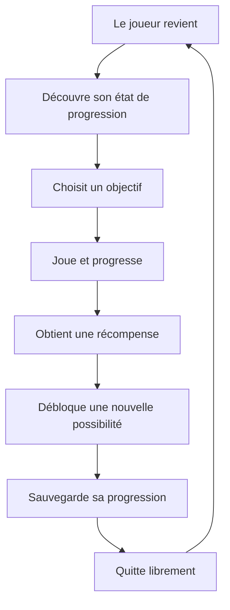
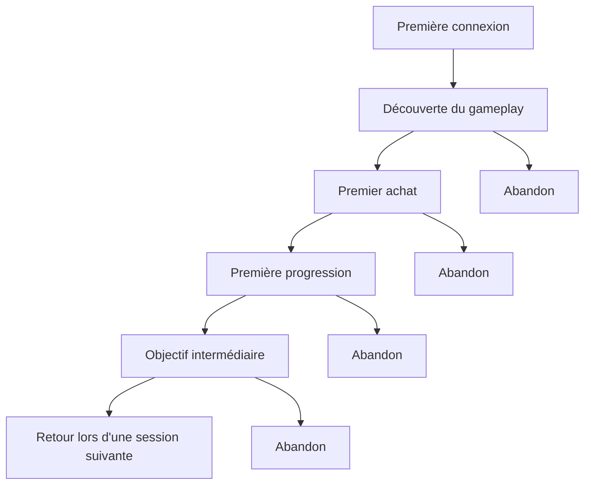

### Readme

---

# 08. Retention Systems

## 8.1. Objectif

La rétention représente la capacité d'un jeu à donner envie aux joueurs de revenir après leur première session.

Elle dépend avant tout de la qualité de l'expérience. Les systèmes de progression, les événements, les quêtes et les récompenses peuvent renforcer cette envie, mais ils ne remplacent pas un gameplay intéressant.

Un bon système de rétention doit :

- Donner des raisons de revenir.
- Proposer des objectifs sur différentes durées.
- Renouveler régulièrement les activités.
- Valoriser les progrès déjà accomplis.
- Respecter le temps et les disponibilités du joueur.
- Éviter les pénalités artificielles en cas d'absence.
- Fonctionner sans imposer d'achat payant.

La rétention ne doit pas être obtenue en rendant le jeu obligatoire. Le joueur doit revenir parce qu'il apprécie l'expérience et souhaite découvrir la suite.

## 8.2. Comprendre les différentes formes de rétention

La rétention peut être étudiée selon plusieurs périodes.

| Mesure | Signification | Question principale |
|---|---|---|
| D1 | Retour le lendemain | Le début du jeu donne-t-il envie de revenir ? |
| D7 | Retour après sept jours | Le jeu propose-t-il des objectifs durables ? |
| D30 | Retour après trente jours | L'expérience conserve-t-elle son intérêt ? |

Ces indicateurs sont des mesures de comportement. Ils ne prouvent pas à eux seuls que les joueurs sont satisfaits.

Il faut également distinguer :

- Le retour après une première découverte.
- Le retour après une progression importante.
- Le retour pour participer à un événement.
- Le retour après une mise à jour.
- Le retour régulier lié à l'intérêt pour le gameplay.

Comprendre ces différences permet de choisir les bonnes améliorations.

## 8.3. Les raisons de revenir

Un joueur peut revenir pour plusieurs raisons.

### Progression

Il souhaite atteindre un objectif commencé pendant une session précédente.

Exemples :

- Acheter une nouvelle machine.
- Terminer une zone.
- Améliorer son installation.
- Débloquer un système avancé.

### Découverte

Il souhaite découvrir du contenu qu'il n'a pas encore exploré.

Exemples :

- Une nouvelle zone.
- Une nouvelle mécanique.
- Une collection.
- Une quête secondaire.

### Collection

Il souhaite compléter un ensemble d'objets ou de récompenses.

Exemples :

- Décorations.
- Machines spéciales.
- Objets cosmétiques.
- Badges.
- Titres.

### Social

Il souhaite retrouver d'autres joueurs.

Exemples :

- Visiter les installations de ses amis.
- Participer à un événement collectif.
- Comparer ses constructions.
- Aider d'autres joueurs.

### Nouveauté

Il souhaite découvrir les changements apportés par une mise à jour.

Exemples :

- Nouvelles machines.
- Nouveaux objectifs.
- Événements saisonniers.
- Améliorations de l'expérience.

Un système de rétention solide combine plusieurs raisons de revenir plutôt que de dépendre d'une seule mécanique.

## 8.4. Organiser les objectifs dans le temps

Les objectifs doivent être répartis sur différentes durées.

| Horizon | Exemple | Fonction |
|---|---|---|
| Quelques minutes | Acheter une amélioration | Objectif immédiat |
| Une session | Débloquer une machine | Progression de session |
| Plusieurs sessions | Terminer une collection | Objectif intermédiaire |
| Une semaine | Terminer une série de quêtes | Activité régulière |
| Plusieurs semaines | Débloquer une zone avancée | Progression longue |
| Plusieurs mois | Compléter une collection rare | Objectif durable |

Il ne faut pas transformer tous ces objectifs en obligations.

Le joueur doit pouvoir choisir ce qu'il souhaite poursuivre.

## 8.5. Les quêtes et missions récurrentes

Les quêtes permettent de renouveler les activités sans modifier constamment les mécaniques principales.

### Quêtes quotidiennes

Elles proposent de petites activités réalisables pendant une session courte.

Exemples :

- Collecter une certaine quantité de ressources.
- Améliorer une machine.
- Acheter un équipement.
- Visiter un autre tycoon.

Elles doivent être faciles à comprendre et relativement rapides à terminer.

### Quêtes hebdomadaires

Elles peuvent demander davantage de progression.

Exemples :

- Produire une quantité importante de ressources.
- Débloquer plusieurs améliorations.
- Terminer une série de missions.
- Participer à une activité communautaire.

Elles permettent de proposer un objectif plus important sans obliger le joueur à se connecter tous les jours.

### Quêtes permanentes

Elles restent disponibles jusqu'à leur accomplissement.

Exemples :

- Construire toutes les machines d'une zone.
- Atteindre un niveau de production.
- Découvrir tous les environnements.
- Compléter une collection.

Les quêtes permanentes sont particulièrement utiles pour les joueurs qui ne souhaitent pas suivre un calendrier quotidien.

### Comparaison

| Type | Durée indicative | Disponibilité |
|---|---|---|
| Quotidienne | Courte | Renouvelée régulièrement |
| Hebdomadaire | Moyenne | Renouvelée chaque semaine |
| Permanente | Variable | Toujours disponible |

Les durées doivent être adaptées au rythme réel du jeu.

## 8.6. Les collections

Les collections offrent des objectifs indépendants de la progression économique.

Elles peuvent encourager l'exploration, la découverte et la participation aux événements.

Exemples :

- Collection de machines.
- Collection de décorations.
- Collection de ressources.
- Collection de titres.
- Collection d'objets saisonniers.

### Concevoir une collection

Une collection doit présenter clairement :

- Les objets déjà obtenus.
- Les objets manquants.
- Les méthodes d'obtention.
- Les récompenses de complétion.
- Les éventuelles conditions de déblocage.

Une collection ne doit pas cacher des conditions essentielles ou promettre des récompenses impossibles à obtenir pour certains joueurs.

Il faut également éviter de rendre les objets essentiels à la progression exclusivement disponibles pendant une période limitée.

## 8.7. Les événements

Les événements permettent de renouveler temporairement l'expérience.

Ils peuvent introduire :

- Des ressources spéciales.
- Des machines temporaires.
- Des quêtes thématiques.
- Des décorations.
- Des défis communautaires.
- De nouvelles activités.

### Types d'événements

| Type | Exemple | Objectif |
|---|---|---|
| Saisonnier | Événement d'hiver | Renouveler l'ambiance |
| Communautaire | Objectif collectif | Favoriser la coopération |
| Compétitif | Défi de production | Proposer une compétition |
| Exploration | Zone temporaire | Encourager la découverte |
| Progression | Série de missions | Donner de nouveaux objectifs |

### Événements raisonnables

Un événement doit rester accessible et compréhensible.

Bonnes pratiques :

- Annoncer clairement sa durée.
- Présenter les récompenses.
- Proposer des objectifs réalisables.
- Éviter les exigences de connexion permanente.
- Ne pas pénaliser les joueurs absents.
- Prévoir une alternative pour les joueurs qui arrivent tardivement lorsque cela est pertinent.

Les événements doivent ajouter de la valeur au jeu, pas créer une obligation de connexion.

## 8.8. La progression hors ligne

La progression hors ligne permet au joueur de recevoir une partie des revenus générés pendant son absence.

Dans un tycoon, elle peut être cohérente avec le fonctionnement des machines automatiques.

Elle doit toutefois être contrôlée.

### Paramètres à définir

- Temps maximal pris en compte.
- Taux de production hors ligne.
- Machines concernées.
- Limites de stockage.
- Conditions de récupération.
- Interaction avec les améliorations.

### Exemple

Un joueur possède une production théorique de 100 pièces par minute.

Le jeu applique un taux hors ligne de 50 % pendant une période maximale de 120 minutes.

\[
G = R \times T \times M
\]

Avec :

- \(R = 100\) pièces par minute.
- \(T = 120\) minutes.
- \(M = 0,5\).

\[
G = 100 \times 120 \times 0,5 = 6000
\]

Le joueur récupère 6 000 pièces à son retour.

Ces chiffres sont fictifs. Le taux et la durée doivent être équilibrés avec l'économie du jeu.

### Pourquoi limiter la progression hors ligne ?

Sans limite, les revenus accumulés peuvent rendre les achats trop faciles et déséquilibrer la progression.

Il faut également éviter qu'une absence prolongée donne un avantage disproportionné.

La progression hors ligne doit compléter le gameplay actif, pas le remplacer.

## 8.9. Les récompenses quotidiennes

Les récompenses quotidiennes peuvent encourager le retour des joueurs.

Elles doivent cependant rester facultatives.

Exemples :

- Petite quantité de monnaie.
- Objet cosmétique.
- Progression dans une collection.
- Bonus temporaire raisonnable.
- Ressource secondaire.

### Éviter les systèmes punitifs

Les systèmes de séries de connexion peuvent devenir frustrants lorsqu'une absence entraîne une perte importante.

À éviter :

- Réinitialiser toute la progression après une journée manquée.
- Réserver les récompenses importantes aux connexions quotidiennes.
- Créer des messages culpabilisants.
- Rendre les récompenses essentielles impossibles à récupérer.
- Augmenter artificiellement les pertes liées à l'absence.

Une récompense quotidienne doit être un bonus, jamais une punition pour absence.

## 8.10. Les notifications et rappels

Les notifications peuvent informer les joueurs des nouveautés ou des événements.

Elles doivent être utiles et limitées.

Exemples :

- Annonce d'une nouvelle mise à jour.
- Information sur un événement.
- Rappel d'une activité commencée.
- Notification d'une récompense disponible.

Une notification doit transmettre une information pertinente.

Éviter :

- Les messages répétitifs.
- Les fausses urgences.
- Les rappels culpabilisants.
- Les messages qui interrompent inutilement le gameplay.

Les systèmes de communication doivent également respecter les règles et fonctionnalités Roblox applicables.

## 8.11. Le contenu permanent et temporaire

Un bon jeu doit proposer du contenu qui reste intéressant après la fin d'un événement.

| Contenu | Durée | Utilité |
|---|---|---|
| Progression principale | Permanente | Objectif fondamental |
| Collections | Permanente | Objectif secondaire |
| Quêtes permanentes | Permanente | Activité flexible |
| Événements | Limitée | Renouvellement |
| Défis saisonniers | Limitée ou récurrente | Activité thématique |

Il faut éviter de baser toute la rétention sur du contenu temporaire.

Un joueur qui revient après plusieurs semaines doit toujours trouver des objectifs intéressants.

## 8.12. Les mises à jour comme outil de rétention

Les mises à jour permettent de renouveler le jeu et de corriger les problèmes rencontrés par les joueurs.

Elles peuvent ajouter :

- De nouvelles zones.
- De nouvelles machines.
- Des systèmes de progression.
- Des quêtes.
- Des collections.
- Des améliorations de qualité de vie.
- Des corrections techniques.

Chaque mise à jour doit avoir un objectif précis.

Ajouter du contenu sans vérifier son utilité peut augmenter la complexité du jeu sans améliorer l'expérience.

Il est préférable de proposer des mises à jour cohérentes plutôt que d'ajouter continuellement des fonctionnalités sans direction.

## 8.13. Concevoir une boucle de rétention

Une boucle de rétention peut être représentée de la manière suivante :

Cette boucle doit rester naturelle.

Le joueur doit pouvoir interrompre sa session après avoir accompli un objectif sans perdre une récompense essentielle.

## 8.14. Mesurer la rétention

La rétention doit être mesurée à partir de groupes de joueurs comparables.

Une cohorte correspond à un groupe de joueurs ayant commencé à une période donnée.

### Rétention D1

Pourcentage des joueurs d'une cohorte qui reviennent le jour suivant.

\[
D1 = \frac{\text{Joueurs revenus à J+1}}{\text{Joueurs de la cohorte}} \times 100
\]

### Rétention D7

Pourcentage des joueurs qui reviennent au septième jour.

\[
D7 = \frac{\text{Joueurs revenus à J+7}}{\text{Joueurs de la cohorte}} \times 100
\]

### Rétention D30

Pourcentage des joueurs qui reviennent au trentième jour.

\[
D30 = \frac{\text{Joueurs revenus à J+30}}{\text{Joueurs de la cohorte}} \times 100
\]

Il faut définir précisément la méthode de calcul utilisée.

Par exemple, un indicateur de retour exact à J+7 ne mesure pas la même chose qu'un indicateur de retour au moins une fois pendant les jours 7 à 13.

### Exemple de tableau

| Cohorte | Joueurs initiaux | Retours D1 | Retours D7 | Retours D30 |
|---|---:|---:|---:|---:|
| Semaine A | 1 000 | 350 | 180 | 90 |
| Semaine B | 1 200 | 420 | 240 | 120 |
| Semaine C | 900 | 315 | 162 | 81 |

Ces valeurs sont fictives et illustrent uniquement la présentation des données.

## 8.15. Identifier les moments d'abandon

Une bonne analyse ne se limite pas à observer combien de joueurs reviennent.

Il faut comprendre à quel moment les joueurs arrêtent de jouer.

Exemples :

- Après le tutoriel.
- Avant le premier achat.
- Lorsqu'une amélioration devient trop coûteuse.
- Après avoir terminé une zone.
- Pendant une période sans nouveau contenu.
- Après une mauvaise expérience technique.

### Analyse du parcours

Chaque étape doit être mesurée pour identifier les difficultés.

Une baisse de rétention peut avoir plusieurs causes. Il ne faut pas ajouter immédiatement une récompense quotidienne sans comprendre le problème initial.

## 8.16. Interroger les joueurs

Les données quantitatives montrent ce qui se passe. Les retours directs peuvent aider à comprendre pourquoi.

Il est utile d'interroger les joueurs qui reviennent comme ceux qui ne reviennent pas.

### Questions pour les joueurs actifs

- Pourquoi continues-tu à jouer ?
- Quelle mécanique préfères-tu ?
- Quels objectifs souhaites-tu atteindre ?
- Qu'aimerais-tu voir dans une prochaine mise à jour ?
- Qu'est-ce qui rend une session satisfaisante ?

### Questions pour les joueurs inactifs

- À quel moment as-tu arrêté de jouer ?
- Qu'est-ce qui t'a le plus frustré ?
- As-tu compris comment progresser ?
- Manquait-il quelque chose à ton expérience ?
- Qu'est-ce qui pourrait te donner envie de revenir ?

Les réponses doivent être analysées avec prudence. Un petit groupe de testeurs ne représente pas nécessairement l'ensemble de la communauté.

## 8.17. Tester un système de rétention

Pour tester une nouvelle mécanique :

### Étape 1 : identifier le problème

Exemple : les joueurs terminent leur première session mais ne trouvent pas de nouvel objectif.

### Étape 2 : formuler une hypothèse

Exemple : une quête permanente pourrait leur donner une nouvelle direction.

### Étape 3 : créer une version minimale

Ajouter une quête simple avec un objectif clair et une récompense proportionnée.

### Étape 4 : définir les indicateurs

Observer :

- Le nombre de joueurs qui commencent la quête.
- Le nombre de joueurs qui la terminent.
- Le temps nécessaire à son accomplissement.
- Les retours des testeurs.
- Le comportement lors des sessions suivantes.

### Étape 5 : comparer les résultats

Comparer les cohortes ou les périodes de test en tenant compte des différences entre les groupes.

### Étape 6 : décider

Conserver, modifier ou supprimer la mécanique selon les résultats.

Une amélioration de la rétention ne doit pas être considérée comme positive si elle repose sur une pression artificielle ou une expérience dégradée.

## 8.18. Erreurs fréquentes

| Erreur | Conséquence | Correction |
|---|---|---|
| Séries de connexion punitives | Frustration | Récompenses facultatives |
| Récompenses quotidiennes trop importantes | Gameplay secondaire | Valoriser les activités principales |
| Trop de quêtes | Surcharge | Limiter les objectifs actifs |
| Contenu uniquement temporaire | Exclusion des absents | Développer du contenu permanent |
| Progression hors ligne illimitée | Déséquilibre économique | Ajouter des plafonds |
| Notifications excessives | Intrusion | Communiquer uniquement les informations utiles |
| Aucun suivi par cohorte | Mauvaises conclusions | Mesurer D1, D7 et D30 |
| Rétention basée sur la peur | Perte de confiance | Favoriser la satisfaction |

## 8.19. Fiche de conception d'un système de rétention

| Question | Réponse |
|---|---|
| Nom du système | |
| Problème identifié | |
| Type de joueur concerné | |
| Objectif proposé | |
| Durée de progression | |
| Récompense | |
| Fréquence de renouvellement | |
| Conditions d'accès | |
| Conséquence d'une absence | |
| Fonctionnement gratuit | |
| Coût technique | |
| Données à collecter | |
| Méthode de test | |

## 8.20. Critères de validation

Un système de rétention peut être considéré comme prêt pour une première version lorsque :

- [ ] Il possède un objectif clairement défini.
- [ ] Il apporte une raison réelle de revenir.
- [ ] Il propose des objectifs adaptés à plusieurs durées.
- [ ] Les récompenses sont compréhensibles.
- [ ] Les récompenses quotidiennes restent facultatives.
- [ ] Les absences ne provoquent pas de pénalité excessive.
- [ ] La progression hors ligne est équilibrée lorsqu'elle existe.
- [ ] Le contenu permanent reste intéressant.
- [ ] Les notifications sont pertinentes.
- [ ] Les joueurs gratuits peuvent progresser normalement.
- [ ] Les indicateurs D1, D7 et D30 sont définis.
- [ ] Les cohortes sont analysées.
- [ ] Les retours des joueurs actifs et inactifs sont pris en compte.
- [ ] Le système ne repose pas sur une pression artificielle.

## 8.21. Questions à documenter

Avant de valider une nouvelle mécanique, réponds aux questions suivantes :

1. Quel problème du joueur ce système résout-il ?
2. Quelle est la version minimale à tester ?
3. Quel est son coût technique et de maintenance ?
4. Comment le système fonctionne-t-il pour un joueur gratuit ?
5. Quelles données permettent de vérifier son utilité ?
6. Quelle raison concrète donne-t-il au joueur de revenir ?
7. Que se passe-t-il lorsqu'un joueur manque plusieurs jours ?
8. Le système conserve-t-il son intérêt sur plusieurs semaines ?
9. Comment mesurer son effet sur la satisfaction et la rétention ?

## 8.22. Documentation de référence

- [Roblox Creator Hub](https://create.roblox.com/docs)
- [Roblox Creator Documentation - Production](https://create.roblox.com/docs/production)
- [Roblox Analytics](https://create.roblox.com/docs/production/analytics)

Ces ressources permettent d'approfondir la conception, la publication et le suivi des expériences Roblox. Les indicateurs doivent être définis de manière cohérente avant toute comparaison.

---

### Acknowledgements

Thanks to **Roblox** for the platform and development ecosystem.

Thanks to the **Roblox Creator Hub**, **Roblox Creator Documentation** and **Roblox Analytics** for the official development and analytics references.

Thanks to **Shields.io** for the project badges and **Mermaid** for the architecture diagrams.

Document: `08-Retention-Systems/README.md` · Part of Roblox Tycoon Blueprint

