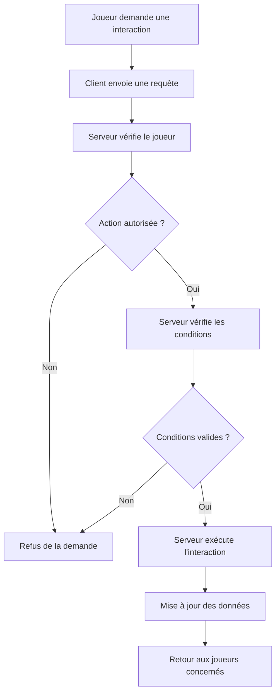

 <div align="center">


### Readme


</div>

---



# Social Gameplay

## 9.1 Objectif

Les systèmes sociaux donnent une valeur supplémentaire à la présence d'autres joueurs. Ils peuvent transformer un tycoon individuel en un espace vivant où les joueurs visitent leurs créations, s'entraident, participent à des objectifs communs et se mesurent les uns aux autres.

Le multijoueur ne doit cependant pas être une obligation. Un joueur doit pouvoir profiter de la progression principale sans dépendre de ses amis, d'une invitation ou de la disponibilité d'autres personnes.

Un bon système social doit répondre à trois questions :

- Qu'est-ce que la présence d'un autre joueur apporte ?
- Quelle interaction donne envie de revenir ou de rester ?
- Comment préserver une expérience équitable et agréable pour tous ?

## 9.2 Les différents types d'interactions sociales

Il existe plusieurs façons d'intégrer le social dans un tycoon. Chaque système doit avoir une fonction identifiable.

| Type | Fonction | Exemple |
|---|---|---|
| Visite | Découvrir les créations | Visiter le tycoon d'un ami |
| Coopération | Atteindre un objectif commun | Produire une quantité collective |
| Compétition | Comparer des résultats | Classement de production |
| Entraide | Faciliter une action | Aider à activer une machine |
| Collection sociale | Montrer ses accomplissements | Exposer des récompenses |
| Événement de groupe | Réunir plusieurs joueurs | Défi communautaire temporaire |

Il n'est pas nécessaire d'implémenter toutes ces possibilités dès la première version. Quelques interactions bien conçues sont préférables à une grande quantité de fonctionnalités peu utilisées.

## 9.3 Les visites de tycoons

Les visites permettent aux joueurs de découvrir les constructions et la progression des autres.

Elles peuvent donner une raison de personnaliser son espace et de montrer les résultats de ses efforts.

Idées de fonctionnalités :

- Accéder au tycoon d'un ami.
- Découvrir des créations proposées par le jeu.
- Observer les machines et les améliorations débloquées.
- Utiliser un système de réactions prédéfinies.
- Récompenser la découverte sans imposer une visite quotidienne.
- Permettre au propriétaire de contrôler l'accès à son espace.

Une visite doit rester intéressante même lorsqu'elle ne donne aucune récompense. La curiosité, la décoration et la comparaison des constructions peuvent constituer des motivations suffisantes.

### Questions de conception

- Le joueur peut-il visiter sans interrompre sa propre progression ?
- Le propriétaire peut-il limiter les accès ?
- Les visiteurs peuvent-ils modifier ou utiliser les machines ?
- Comment empêcher les interactions abusives ?
- Le système fonctionne-t-il lorsque le propriétaire est absent ?

## 9.4 La coopération

La coopération donne aux joueurs une raison de participer à une activité commune.

Exemples :

- Produire collectivement une quantité de ressources.
- Participer à la construction d'une structure communautaire.
- Activer plusieurs mécanismes simultanément.
- Terminer un objectif de groupe.
- Contribuer à un événement temporaire.

Les objectifs doivent être accessibles aux joueurs qui participent réellement, même s'ils disposent de moins de ressources ou de temps.

### Récompenses coopératives

Une récompense collective peut être distribuée selon plusieurs méthodes :

| Méthode | Avantage | Risque |
|---|---|---|
| Participation minimale | Simple à comprendre | Participation artificielle |
| Contribution individuelle | Valorise l'effort | Favorise les joueurs avancés |
| Récompense identique | Équitable et lisible | Peut encourager l'inactivité |
| Récompense par paliers | Valorise plusieurs niveaux d'effort | Plus complexe à équilibrer |

Une bonne approche consiste à combiner une récompense de participation avec des objectifs personnels facultatifs.

Les récompenses de groupe doivent rester plafonnées et ne pas devenir indispensables à la progression principale.

## 9.5 La compétition amicale

La compétition peut donner des objectifs supplémentaires aux joueurs qui aiment comparer leurs performances.

Exemples :

- Production totale pendant une période.
- Nombre de machines améliorées.
- Progression pendant un événement.
- Défis de construction.
- Classements entre amis.
- Records personnels.

Un classement doit mesurer une performance compréhensible et comparable.

### Concevoir un classement équilibré

Évite de comparer directement des joueurs qui n'ont pas les mêmes possibilités de progression.

Un classement basé uniquement sur la richesse totale risque de favoriser les joueurs qui possèdent déjà le plus de temps de jeu ou les avantages payants.

Privilégie plusieurs catégories :

- Meilleure progression pendant la semaine.
- Plus grande amélioration de production.
- Meilleure participation à un événement.
- Meilleur résultat dans un défi indépendant de la richesse.
- Record personnel.

Les classements saisonniers permettent de renouveler les objectifs sans rendre les anciens résultats inutiles.

### Réinitialisation des classements

Avant de créer un classement saisonnier, définis :

- Sa durée.
- Les statistiques utilisées.
- Les conditions de participation.
- La méthode de validation des résultats.
- Le traitement des égalités.
- Les récompenses.
- La conservation ou non des anciens records.

Les données du classement doivent être validées côté serveur. Une valeur envoyée directement par un client ne doit jamais être considérée comme fiable.

## 9.6 Les récompenses sociales

Les récompenses peuvent encourager les interactions sans les rendre obligatoires.

Exemples :

- Petit bonus pour une première visite.
- Récompense limitée pour un objectif collectif.
- Décoration obtenue lors d'un événement communautaire.
- Titre affichant une participation.
- Badge lié à un accomplissement social.

### Principes à respecter

1. Une récompense sociale ne doit pas être indispensable.
2. Les joueurs seuls doivent conserver une progression complète.
3. Les récompenses ne doivent pas pousser au spam d'invitations.
4. Les bonus doivent être plafonnés.
5. Les avantages payants ne doivent pas déterminer automatiquement les classements.
6. Les joueurs doivent comprendre pourquoi ils reçoivent une récompense.

La valeur d'une interaction ne doit pas dépendre uniquement de la récompense qu'elle distribue.

## 9.7 Les invitations et les relations entre joueurs

Les invitations peuvent faciliter les sessions entre amis, mais elles ne doivent pas devenir une condition de progression.

À éviter :

- Réclamer une récompense uniquement après avoir invité plusieurs personnes.
- Bloquer une amélioration derrière une invitation.
- Récompenser les invitations répétées au même joueur.
- Afficher des sollicitations intrusives.
- Pénaliser les joueurs qui préfèrent jouer seuls.

Prévois des alternatives pour chaque objectif qui pourrait autrement dépendre d'une invitation.

Le système social doit respecter les paramètres de confidentialité et les restrictions de communication de chaque joueur.

## 9.8 Sécurité des interactions sociales

Toute fonctionnalité permettant à deux joueurs d'interagir doit être pensée avec la sécurité en priorité.

### Communication

Pour les conversations entre joueurs, utilise les systèmes officiels Roblox, notamment `TextChatService`.

Ne crée pas un système de chat parallèle qui contourne les règles de filtrage, de confidentialité ou de modération.

Les textes personnalisés visibles par d'autres joueurs doivent également respecter les exigences de filtrage et de limitation de fréquence applicables.

### Échanges et transferts

Si le jeu propose des échanges d'objets ou de ressources :

- Vérifie les deux participants côté serveur.
- Contrôle la propriété des objets.
- Vérifie les quantités disponibles.
- Empêche les transferts négatifs ou impossibles.
- Confirme les deux côtés de la transaction.
- Empêche les doubles validations.
- Prévois une annulation claire.
- Enregistre les transactions importantes.

Un échange ne doit jamais être exécuté uniquement parce qu'un client affirme qu'il possède un objet ou qu'une transaction a été acceptée.

### RemoteEvents et RemoteFunctions

Les communications client-serveur doivent être validées côté serveur.

Le serveur doit vérifier notamment :

- L'identité du joueur.
- Les permissions nécessaires.
- La distance entre les joueurs si elle est pertinente.
- La validité de la cible.
- Les ressources disponibles.
- Les délais entre les demandes.
- La cohérence de l'action demandée.

Ne fais jamais confiance aux valeurs économiques ou aux permissions envoyées par le client.

## 9.9 Confidentialité et contrôle du joueur

Les joueurs doivent pouvoir contrôler leur exposition aux autres.

Prévois, selon les fonctionnalités proposées :

- Un accès privé ou réservé aux amis.
- La possibilité de refuser une interaction.
- Des options pour masquer certaines informations.
- Une gestion claire des invitations.
- Le respect des paramètres de communication Roblox.
- Des moyens de signaler les comportements inappropriés.

Une fonctionnalité sociale qui ne peut pas être contrôlée par le joueur risque de devenir une source de frustration.

## 9.10 Les événements communautaires

Les événements peuvent réunir plusieurs joueurs autour d'un objectif limité dans le temps.

Exemples :

- Produire une quantité collective de ressources.
- Débloquer une décoration communautaire.
- Participer à un défi de construction.
- Atteindre un objectif global.
- Découvrir une nouvelle zone pendant un événement.

### Concevoir un événement accessible

Un événement doit proposer une contribution adaptée aux différents profils de joueurs.

| Profil | Participation possible |
|---|---|
| Nouveau joueur | Objectif simple et accessible |
| Joueur régulier | Plusieurs étapes de contribution |
| Joueur avancé | Défis supplémentaires |
| Joueur occasionnel | Participation courte et récompense proportionnée |

Les événements ne doivent pas rendre les absences coûteuses. Un joueur qui revient après la fin d'un événement doit pouvoir continuer à profiter du jeu.

## 9.11 Les espaces sociaux dans le tycoon

L'environnement peut encourager naturellement les interactions.

Quelques possibilités :

- Une zone centrale pour rencontrer les autres joueurs.
- Des espaces d'exposition pour les constructions.
- Des zones de visite clairement identifiées.
- Des panneaux présentant les records.
- Des espaces dédiés aux événements.
- Des points de rassemblement.

Le placement des espaces sociaux doit rester cohérent avec le gameplay principal.

Un joueur ne devrait pas être obligé de traverser une zone sociale pour accéder à une fonction essentielle de son tycoon.

## 9.12 Mesurer l'utilisation des fonctionnalités sociales

Le nombre de joueurs présents dans un serveur ne suffit pas à mesurer la qualité du multijoueur.

Il faut distinguer la présence passive des interactions volontaires.

| Indicateur | Ce qu'il permet d'observer |
|---|---|
| Visites par session | Utilisation des visites |
| Visiteurs uniques | Diversité des interactions |
| Participation coopérative | Intérêt pour les objectifs communs |
| Taux de participation aux événements | Attractivité des activités |
| Interactions acceptées | Volonté de participer |
| Interactions refusées | Friction ou manque d'intérêt |
| Retours après une activité sociale | Valeur à long terme |

### Exemples de calculs

**Taux de participation coopérative**

```text
Joueurs ayant participé à un objectif
------------------------------------- × 100
Joueurs ayant vu cet objectif
```

**Taux d'utilisation des visites**

```text
Joueurs ayant effectué une visite
--------------------------------- × 100
Joueurs ayant accès à la fonctionnalité
```

**Taux de participation aux événements**

```text
Joueurs ayant contribué à l'événement
------------------------------------- × 100
Joueurs éligibles à l'événement
```

Ces indicateurs doivent être interprétés avec leur contexte. Une interaction fréquente n'est pas automatiquement une interaction appréciée.

## 9.13 Tester le gameplay social

Les tests doivent couvrir plusieurs configurations.

| Test | Objectif |
|---|---|
| Joueur seul | Vérifier que le jeu reste complet |
| Deux joueurs | Vérifier les interactions directes |
| Petit groupe | Tester la coopération |
| Serveur plus rempli | Observer les problèmes de performance |
| Joueurs de progression différente | Vérifier l'équilibre |
| Joueur avec communication limitée | Vérifier les solutions alternatives |
| Connexion interrompue | Vérifier les transactions et récompenses |

Utilise les outils de simulation multiclient de Roblox Studio pour observer le comportement de plusieurs joueurs.

Les tests doivent également vérifier les actions malveillantes : demandes répétées, valeurs incorrectes, accès non autorisés et tentatives de duplication de récompenses.

## 9.14 Erreurs fréquentes

| Erreur | Conséquence | Solution |
|---|---|---|
| Inviter des amis pour progresser | Frustration des joueurs seuls | Ajouter une alternative |
| Classement basé uniquement sur la richesse | Avantage disproportionné | Créer plusieurs catégories |
| Récompenses sans limite | Exploitation du système | Plafonner les gains |
| Échanges non validés | Fraude et duplication | Validation serveur |
| Chat personnalisé non conforme | Risque de modération | Utiliser TextChatService |
| Visites sans intérêt | Fonctionnalité ignorée | Donner une raison de découvrir |
| Trop de notifications | Fatigue sociale | Limiter les sollicitations |
| Coopération obligatoire | Blocage de progression | Garder une voie solo |

## 9.15 Méthode de conception

Pour chaque fonctionnalité sociale, suis cette méthode :

1. Définir le besoin du joueur.
2. Identifier l'interaction attendue.
3. Décrire le fonctionnement en solo.
4. Définir les règles de participation.
5. Déterminer les récompenses et leurs limites.
6. Définir les permissions et validations serveur.
7. Prévoir les cas de refus et de déconnexion.
8. Construire un prototype minimal.
9. Tester avec plusieurs joueurs.
10. Mesurer les interactions volontaires.
11. Corriger les problèmes d'équilibre et de sécurité.

### Exemple de fiche de conception

| Élément | Exemple |
|---|---|
| Fonctionnalité | Visite d'un tycoon |
| Besoin | Découvrir les constructions des autres |
| Interaction | Entrer dans un espace accessible |
| Récompense | Réaction ou petit bonus plafonné |
| Limite | Une récompense par visite éligible |
| Sécurité | Accès contrôlé par le serveur |
| Alternative solo | Galerie de constructions |
| Indicateur | Visites uniques par session |

## 9.16 Architecture d'une interaction sociale

Une interaction sociale doit suivre un flux où le serveur garde le contrôle de l'action.



Le client peut demander une action et afficher son résultat, mais il ne doit pas décider seul de l'attribution d'une récompense ou de la modification d'une donnée importante.

## 9.17 Version minimale à développer

Pour un premier tycoon, le système social peut rester simple.

Fonctionnalités prioritaires :

- Voir les autres joueurs dans le monde.
- Visiter un tycoon accessible.
- Afficher quelques informations publiques.
- Proposer une interaction de réaction prédéfinie.
- Prévoir un objectif collectif facultatif.

Fonctionnalités à envisager plus tard :

- Classements saisonniers.
- Événements communautaires.
- Récompenses de groupe.
- Systèmes d'échange.
- Personnalisation des espaces sociaux.
- Défis entre amis.

Il est préférable de commencer par des visites et des interactions simples avant de développer une économie sociale ou un système d'échange complexe.

## 9.18 Fiche de conception

Avant d'implémenter une fonctionnalité sociale, documente les points suivants.

| Question | Réponse |
|---|---|
| Quel besoin du joueur est résolu ? | À définir |
| Quel type d'interaction est proposé ? | À définir |
| La fonctionnalité est-elle facultative ? | Oui / Non |
| Quelle est l'alternative solo ? | À définir |
| Quelles sont les récompenses ? | À définir |
| Existe-t-il un risque d'exploitation ? | À définir |
| Quelles validations serveur sont nécessaires ? | À définir |
| Quels paramètres de confidentialité s'appliquent ? | À définir |
| Quel est le coût de maintenance ? | À définir |
| Quelles données seront mesurées ? | À définir |

## 9.19 Critères de validation

La fonctionnalité sociale est prête à être intégrée lorsque :

- Le joueur comprend son utilité.
- L'interaction apporte une valeur réelle.
- Le jeu reste jouable sans participation sociale.
- Les récompenses sont équilibrées et plafonnées.
- Les classements ne donnent pas un avantage automatique aux joueurs payants.
- Les demandes sont validées côté serveur.
- Les permissions et paramètres de confidentialité sont respectés.
- Les déconnexions et refus sont correctement gérés.
- Les tests multijoueurs ne révèlent pas de problème bloquant.
- Les indicateurs permettent d'évaluer son utilisation.

## 9.20 Questions générales à documenter

- Quel problème du joueur ce système résout-il ?
- Quelle est la version minimale à tester ?
- Quel est le coût technique et de maintenance ?
- Comment le système fonctionne-t-il pour un joueur gratuit ?
- Quelles données permettent de vérifier son utilité ?
- Quelle est la valeur ajoutée par rapport au jeu en solo ?
- Quels risques de fraude ou d'abus faut-il anticiper ?

## 9.21 Documentation de référence

- [Roblox Creator Hub](https://create.roblox.com/docs)
- [Roblox Production Documentation](https://create.roblox.com/docs/production)
- [Chat System Guidelines](https://create.roblox.com/docs/chat/guidelines)
- [Text Chat Overview](https://create.roblox.com/docs/chat/in-experience-text-chat)
- [Leaderboards](https://create.roblox.com/docs/players/leaderboards)
- [Remote Events and Callbacks](https://create.roblox.com/docs/scripting/events/remote)
- [Roblox Safety Documentation](https://create.roblox.com/docs/safety)
- [Studio Testing Modes](https://create.roblox.com/docs/studio/testing-modes)

---

<div align="center">

### Acknowledgements

This section is based on official Roblox Creator documentation and development resources.

[Roblox](https://www.roblox.com/) · [Roblox Creator Hub](https://create.roblox.com/docs) · [Roblox Production Documentation](https://create.roblox.com/docs/production)

Visual and documentation resources: [Shields.io](https://shields.io/) · [Mermaid](https://mermaid.js.org/)


<sub>Document: `09-Social-Gameplay/README.md` · Part of Roblox Tycoon Blueprint</sub>

</div>
