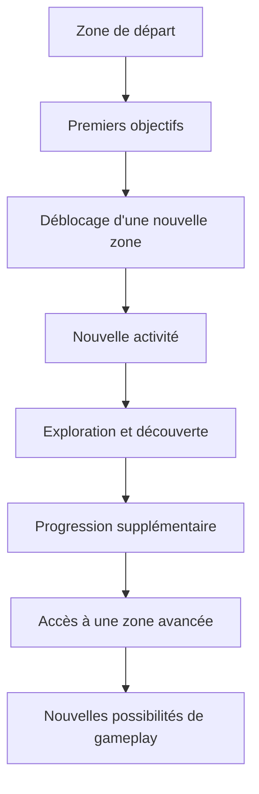

 <div align="center">


### Readme


</div>

---



# World Design

## 10.1 Objectif

Le monde est le cadre dans lequel le joueur découvre, construit et développe son tycoon.

Il ne doit pas être uniquement décoratif. Son organisation influence directement la compréhension du jeu, la progression, l'exploration et les déplacements.

Un monde bien conçu doit :

- Guider naturellement le joueur vers ses objectifs.
- Rendre les progrès visibles.
- Donner une identité à chaque zone.
- Récompenser la découverte.
- Faciliter les déplacements.
- Introduire progressivement de nouvelles possibilités de gameplay.

L'objectif est de créer un environnement agréable à parcourir, sans obliger le joueur à traverser de grandes distances inutiles.

## 10.2 Les principes fondamentaux du level design

Chaque élément du monde doit avoir une raison d'exister.

| Principe | Fonction |
|---|---|
| Lisibilité | Comprendre rapidement l'environnement |
| Orientation | Savoir où aller |
| Progression | Montrer les prochaines possibilités |
| Exploration | Encourager la découverte |
| Identité visuelle | Distinguer les zones |
| Accessibilité | Éviter les déplacements frustrants |
| Cohérence | Relier le décor au gameplay |

Un bon environnement peut transmettre des informations sans utiliser de longs textes explicatifs.

Par exemple, une grande porte fermée, une machine visible au loin ou une zone construite différemment peuvent suggérer un objectif futur.

## 10.3 Organiser le monde en zones

Les zones permettent de structurer la progression et de donner des objectifs géographiques au joueur.

Chaque zone doit avoir une fonction identifiable.

Exemple de structure pour un tycoon :

| Zone | Fonction | Contenu possible |
|---|---|---|
| Zone de départ | Apprentissage | Premières machines |
| Zone industrielle | Production | Machines avancées |
| Zone commerciale | Économie | Améliorations et ventes |
| Zone technologique | Automatisation | Systèmes complexes |
| Zone secrète | Exploration | Découvertes facultatives |
| Zone avancée | Progression | Nouveaux défis |

Ces zones ne doivent pas forcément être séparées par de grandes distances. Elles peuvent être organisées autour d'un espace central ou reliées par des chemins courts.

### Questions à poser pour chaque zone

- Quelle est sa fonction ?
- Qu'est-ce qui la différencie visuellement ?
- Quand le joueur peut-il y accéder ?
- Quelle nouvelle activité propose-t-elle ?
- Comment le joueur comprend-il son utilité ?
- Peut-elle être parcourue sans ralentir inutilement le gameplay ?

## 10.4 Les silhouettes et l'identité visuelle

La silhouette d'une zone doit permettre de la reconnaître à distance.

Quelques éléments peuvent servir de repères :

- Une grande structure.
- Une tour ou un bâtiment distinctif.
- Une couleur dominante.
- Une forme architecturale particulière.
- Une machine imposante.
- Un élément naturel remarquable.

Les zones doivent rester visuellement distinctes sans donner l'impression d'appartenir à des jeux différents.

### Exemple de différenciation

| Zone | Identité visuelle possible |
|---|---|
| Départ | Architecture simple et lumineuse |
| Industrielle | Métal, tuyaux et structures massives |
| Commerciale | Bâtiments ouverts et enseignes |
| Technologique | Matériaux propres et éclairage bleu |
| Naturelle | Végétation et reliefs |
| Avancée | Structures imposantes et détails complexes |

La palette visuelle doit soutenir l'identité du jeu et ne pas nuire à la lisibilité des interactions.

## 10.5 Guider le joueur naturellement

Le joueur doit comprendre où aller sans devoir constamment consulter une interface.

Plusieurs techniques permettent de guider ses déplacements.

### Repères visuels

- Chemins clairement visibles.
- Éclairage orienté vers les objectifs.
- Structures remarquables.
- Contrastes entre les zones accessibles et inaccessibles.
- Signalétique cohérente.
- Objets qui attirent naturellement le regard.

### Hiérarchie visuelle

Tous les éléments ne doivent pas attirer l'attention avec la même intensité.

Il faut distinguer :

1. Les objectifs importants.
2. Les points d'intérêt secondaires.
3. Les éléments décoratifs.

Si chaque bâtiment utilise des couleurs très vives et des effets lumineux, le joueur ne sait plus où regarder.

### Test d'orientation

Montre une zone à un nouveau joueur sans lui expliquer le chemin.

Demande-lui :

- Où irais-tu en premier ?
- Qu'est-ce qui attire ton attention ?
- Où se trouve l'objectif principal ?
- Quel élément te semble accessible ?
- Qu'est-ce qui te paraît bloqué ?

Observe son comportement avant de lui donner des indications.

## 10.6 Les chemins et les déplacements

Les chemins doivent relier les points importants de manière compréhensible.

Évite les détours qui n'apportent aucune valeur.

Un chemin peut avoir plusieurs fonctions :

- Relier deux zones.
- Guider vers un objectif.
- Faire découvrir un point d'intérêt.
- Créer une séparation visuelle.
- Donner une impression de progression.

### Choisir une structure de circulation

| Structure | Avantage | Risque |
|---|---|---|
| Circulaire | Orientation simple autour d'un centre | Répétition visuelle |
| Linéaire | Progression facile à comprendre | Exploration limitée |
| En branches | Plusieurs choix | Risque de confusion |
| Hub central | Accès rapide aux zones | Centre surchargé |
| Ouverte | Liberté de déplacement | Objectifs moins visibles |

Pour un tycoon, un espace central avec plusieurs zones accessibles peut être une bonne base.

La structure définitive dépend toutefois du nombre de systèmes de gameplay et de la taille du monde.

## 10.7 Débloquer de nouvelles zones

L'accès à une nouvelle zone peut représenter une étape importante de progression.

Le déblocage doit avoir une justification claire.

Exemples :

- Atteindre un certain niveau.
- Acheter une amélioration.
- Terminer un objectif.
- Construire une machine spécifique.
- Accumuler une ressource.
- Terminer une série de missions.

Une nouvelle zone doit apporter quelque chose de nouveau.

Débloquer un espace plus grand sans nouvelle activité risque de donner une impression de progression artificielle.

### Définir le contenu d'une zone

Avant de créer une zone, documente :

| Élément | Question |
|---|---|
| Condition d'accès | Comment le joueur la débloque-t-il ? |
| Nouvelle activité | Que peut-il faire de nouveau ? |
| Récompense | Qu'obtient-il en la découvrant ? |
| Durée | Combien de temps faut-il pour l'explorer ? |
| Identité | Qu'est-ce qui la rend reconnaissable ? |
| Connexion | Comment rejoint-il les autres zones ? |

## 10.8 L'exploration et les secrets

L'exploration doit récompenser la curiosité.

Un joueur peut découvrir :

- Des zones cachées.
- Des objets de collection.
- Des références visuelles.
- Des raccourcis.
- Des éléments décoratifs rares.
- Des interactions facultatives.
- Des informations sur l'univers du jeu.

Les secrets doivent être découvrables sans être obligatoires.

Un joueur qui préfère se concentrer sur son tycoon ne doit pas perdre l'accès à une progression essentielle parce qu'il n'a pas trouvé un passage caché.

### Concevoir un secret

Un bon secret possède généralement trois caractéristiques :

1. Un indice qui attire l'attention.
2. Une découverte qui demande une petite observation ou action.
3. Une récompense proportionnée à l'effort.

La récompense peut être visuelle ou symbolique. Elle n'a pas besoin d'être économique.

## 10.9 Les points d'intérêt

Un point d'intérêt est un élément qui donne une raison de s'arrêter ou de regarder autour de soi.

Exemples :

- Une grande statue.
- Une machine unique.
- Un bâtiment remarquable.
- Un panorama.
- Un espace communautaire.
- Une structure mystérieuse.
- Une zone de démonstration.

Les points d'intérêt peuvent également servir de repères pour aider les joueurs à se situer.

Évite toutefois d'en placer partout. Leur valeur dépend aussi de leur rareté.

## 10.10 Le monde au service du gameplay

Le décor doit soutenir les actions du joueur.

Dans un tycoon, l'environnement peut montrer visuellement :

- La taille de l'entreprise.
- Le niveau de production.
- Les machines débloquées.
- Les zones développées.
- Les améliorations obtenues.
- Les objectifs encore inaccessibles.

La progression ne doit pas uniquement apparaître dans les chiffres de l'interface.

Un joueur doit pouvoir regarder son environnement et constater qu'il a construit quelque chose.

### Décor fonctionnel et décor esthétique

| Type | Exemple | Fonction |
|---|---|---|
| Fonctionnel | Machine de production | Gameplay |
| Informatif | Panneau d'objectif | Orientation |
| Progression | Bâtiment débloqué | Montrer une réussite |
| Esthétique | Arbre décoratif | Ambiance |
| Exploratoire | Passage secret | Découverte |

Un objet peut remplir plusieurs fonctions, mais il faut éviter de surcharger chaque élément.

## 10.11 La densité du monde

Un monde trop vide donne peu de raisons d'explorer. Un monde trop chargé rend les déplacements et la lecture difficiles.

La densité doit être adaptée à la fonction de chaque espace.

| Espace | Densité recommandée |
|---|---|
| Zone de départ | Faible à moyenne |
| Zone de production | Fonctionnelle et lisible |
| Zone commerciale | Moyenne |
| Zone d'exploration | Variable |
| Espace central | Moyenne à élevée |
| Zone de déplacement | Faible |

La densité ne dépend pas uniquement du nombre d'objets. Elle dépend aussi de leur taille, de leur espacement et de leur importance visuelle.

## 10.12 L'échelle et les distances

La taille du monde influence directement le rythme du jeu.

Une grande carte n'est pas nécessairement une meilleure carte.

Des distances excessives peuvent :

- Ralentir la progression.
- Rendre les déplacements répétitifs.
- Décourager les visites.
- Augmenter les temps d'attente.
- Rendre certaines fonctionnalités moins utilisées.

Avant d'agrandir le monde, vérifie si l'espace supplémentaire apporte une nouvelle expérience.

### Mesurer les déplacements

Observe le temps nécessaire pour rejoindre les principaux points d'intérêt.

| Trajet | Question |
|---|---|
| Spawn vers objectif principal | Le joueur comprend-il où aller ? |
| Tycoon vers boutique | L'achat reste-t-il rapide ? |
| Zone de départ vers zone avancée | La distance paraît-elle justifiée ? |
| Hub vers espace social | L'interaction est-elle facile d'accès ? |

Les moyens de déplacement rapides peuvent être utiles dans les mondes plus grands, mais ils ne doivent pas masquer une mauvaise organisation de la carte.

## 10.13 Les environnements et les performances

Un monde riche peut devenir coûteux à afficher et à maintenir.

La conception doit prendre en compte les performances dès le début.

Points à surveiller :

- Nombre de Parts et de MeshParts.
- Complexité des modèles.
- Textures et matériaux.
- Effets lumineux et particules.
- Scripts exécutés en continu.
- Collisions inutiles.
- Chargement des zones éloignées.
- Réplication des objets entre clients et serveur.

### Bonnes pratiques

- Réutiliser les modèles lorsque c'est pertinent.
- Éviter les objets invisibles qui ne servent à rien.
- Limiter les effets coûteux.
- Utiliser les paramètres de collision adaptés.
- Tester sur des appareils moins puissants.
- Étudier le streaming des zones pour les grands environnements.
- Mesurer les performances avant d'ajouter des détails.

Roblox propose notamment des outils de profilage et des systèmes de streaming pour gérer les expériences plus importantes.

## 10.14 Construire une première zone

La première zone doit être suffisamment petite pour être testée rapidement.

Elle doit contenir :

- Un point d'apparition compréhensible.
- Un objectif principal visible.
- Les premières interactions.
- Un chemin évident.
- Quelques repères visuels.
- Un espace adapté au tycoon.
- Une indication de la prochaine étape.

Ne commence pas par construire toute la carte.

Développe une zone complète, teste-la, puis utilise les résultats pour définir les zones suivantes.

### Ordre de construction

1. Définir les limites de la zone.
2. Placer le point d'apparition.
3. Définir le parcours principal.
4. Placer les objectifs et interactions.
5. Ajouter les repères visuels.
6. Construire les éléments fonctionnels.
7. Ajouter les éléments décoratifs.
8. Tester les déplacements.
9. Optimiser les performances.

## 10.15 Tester le monde

Les tests doivent vérifier que les joueurs comprennent l'espace sans explication permanente.

### Tests d'observation

| Test | Objectif |
|---|---|
| Nouveau joueur | Vérifier la compréhension du départ |
| Joueur expérimenté | Vérifier l'efficacité des déplacements |
| Joueur qui explore | Observer les découvertes naturelles |
| Joueur pressé | Identifier les détours inutiles |
| Petit écran | Vérifier la lisibilité |
| Appareil peu puissant | Vérifier les performances |

### Questions à poser

- Où pensais-tu devoir aller ?
- As-tu trouvé facilement l'objectif ?
- Quel endroit as-tu préféré ?
- As-tu découvert quelque chose par hasard ?
- Quelle distance t'a semblé trop longue ?
- As-tu eu l'impression de tourner en rond ?

Ne te limite pas aux réponses. Observe les déplacements et les hésitations.

## 10.16 Mesurer l'efficacité du monde

Les données peuvent aider à identifier les zones ignorées ou difficiles à comprendre.

| Indicateur | Utilité |
|---|---|
| Temps avant la première interaction | Comprendre l'efficacité du départ |
| Temps entre deux objectifs | Mesurer les déplacements |
| Visites par zone | Identifier les espaces utilisés |
| Taux de découverte | Observer l'exploration |
| Zones abandonnées | Repérer les problèmes d'intérêt |
| Retours en arrière | Détecter une orientation confuse |
| Performance par zone | Repérer les problèmes techniques |

### Exemple de mesure

```text
Taux de découverte d'une zone

Joueurs ayant visité la zone
---------------------------- × 100
Joueurs ayant débloqué la zone
```

Les données doivent être analysées avec le contexte du joueur. Une zone facultative peut naturellement être moins fréquentée qu'une zone nécessaire à la progression.

## 10.17 Erreurs fréquentes

| Erreur | Conséquence | Solution |
|---|---|---|
| Carte trop grande et vide | Déplacements inutiles | Réduire les distances |
| Chemins confus | Perte d'orientation | Renforcer les repères |
| Zones trop similaires | Monde peu mémorable | Donner une identité à chaque zone |
| Secrets obligatoires | Frustration | Garder les secrets facultatifs |
| Décor sans fonction | Charge de production | Justifier chaque espace |
| Trop de détails | Lisibilité réduite | Hiérarchiser les éléments |
| Nouveaux espaces sans gameplay | Progression artificielle | Ajouter une nouvelle activité |
| Optimisation tardive | Problèmes de performance | Tester dès le prototype |

## 10.18 Schéma de progression du monde

Le monde peut accompagner la progression du joueur de manière visible.



Chaque nouvelle étape doit apporter une évolution perceptible, pas simplement une nouvelle portion de terrain.

## 10.19 Fiche de conception d'une zone

Avant de commencer la construction, documente les éléments suivants.

| Élément | Réponse |
|---|---|
| Nom de la zone | À définir |
| Fonction principale | À définir |
| Identité visuelle | À définir |
| Condition d'accès | À définir |
| Objectif du joueur | À définir |
| Nouvelle activité | À définir |
| Points d'intérêt | À définir |
| Chemins et connexions | À définir |
| Secrets éventuels | À définir |
| Récompenses | À définir |
| Risques de performance | À définir |
| Données à mesurer | À définir |

## 10.20 Critères de validation

Une zone est prête à être intégrée lorsque :

- Le joueur comprend sa fonction.
- Les chemins principaux sont lisibles.
- Les points d'intérêt sont reconnaissables.
- Les déplacements sont proportionnés à l'activité.
- La zone possède une identité visuelle.
- Les objectifs sont visibles ou découvrables naturellement.
- L'exploration apporte une valeur réelle.
- Les secrets restent facultatifs.
- Les performances sont acceptables sur les appareils ciblés.
- Les tests ne révèlent pas de problème majeur d'orientation.

## 10.21 Questions générales à documenter

- Quel problème du joueur cette zone résout-elle ?
- Quelle est sa fonction dans la progression ?
- Quelle est la version minimale à tester ?
- Quel est le coût de construction et de maintenance ?
- Comment la zone fonctionne-t-elle pour un joueur gratuit ?
- Quelles données permettent de vérifier son utilité ?
- Quelle nouvelle activité apporte-t-elle ?
- Comment s'intègre-t-elle au reste du monde ?

## 10.22 Documentation de référence

- [Roblox Creator Hub](https://create.roblox.com/docs)
- [Roblox Production Documentation](https://create.roblox.com/docs/production)
- [Environment Art](https://create.roblox.com/docs/art)
- [Terrain Editor](https://create.roblox.com/docs/parts/terrain)
- [Instance Streaming](https://create.roblox.com/docs/workspace/streaming)
- [Performance Optimization](https://create.roblox.com/docs/performance-optimization)
- [MicroProfiler](https://create.roblox.com/docs/performance-optimization/microprofiler)

---

<div align="center">

### Acknowledgements

This section is based on Roblox Creator documentation and environment design resources.

[Roblox](https://www.roblox.com/) · [Roblox Creator Hub](https://create.roblox.com/docs) · [Roblox Production Documentation](https://create.roblox.com/docs/production)

Visual and documentation resources: [Shields.io](https://shields.io/) · [Mermaid](https://mermaid.js.org/)


<sub>Document: `10-World-Design/README.md` · Part of Roblox Tycoon Blueprint</sub>

</div>
