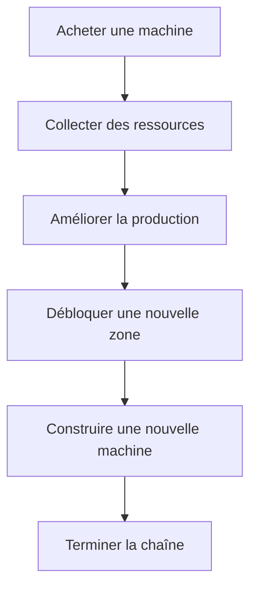

 <div align="center">


### Readme


</div>

---



# Quests and Achievements

## 11.1 Objectif

Les quêtes et les succès donnent une structure aux activités du joueur.

Ils permettent de transformer les actions du gameplay en objectifs compréhensibles, de guider la progression et de reconnaître les accomplissements.

Ces deux systèmes ont des fonctions différentes :

- Les quêtes proposent des objectifs à accomplir.
- Les succès reconnaissent des actions ou des étapes importantes.
- Les défis testent la maîtrise du gameplay.
- Les collections permettent de suivre des accomplissements sur la durée.

Un bon système doit donner une direction sans transformer chaque action en obligation.

## 11.2 Les différents types de quêtes

Chaque catégorie de quête doit avoir une utilité identifiable.

| Type | Objectif | Exemple |
|---|---|---|
| Tutoriel | Apprendre une mécanique | Acheter sa première machine |
| Progression | Accompagner le développement | Atteindre un niveau de production |
| Quotidienne | Proposer une activité courte | Collecter des ressources |
| Hebdomadaire | Encourager un objectif plus long | Améliorer plusieurs machines |
| Exploration | Découvrir le monde | Trouver une zone cachée |
| Maîtrise | Tester les compétences | Produire une quantité en temps limité |
| Communautaire | Participer à un objectif collectif | Contribuer à une construction |
| Secrète | Récompenser la curiosité | Découvrir une interaction cachée |

Il n'est pas nécessaire de proposer toutes ces catégories dès la première version.

Commence avec les quêtes qui accompagnent directement le gameplay principal.

## 11.3 Les quêtes de tutoriel

Les premières quêtes doivent apprendre au joueur les mécaniques essentielles.

Elles remplacent avantageusement un long tutoriel composé de textes et de fenêtres explicatives.

Une série de cinq quêtes peut suffire pour introduire les bases d'un tycoon.

### Exemple de première série

| Ordre | Quête | Mécanique enseignée |
|---|---|---|
| 1 | Découvrir son terrain | Comprendre son espace |
| 2 | Acheter sa première machine | Effectuer un achat |
| 3 | Collecter ses premières ressources | Comprendre la production |
| 4 | Améliorer une machine | Utiliser les améliorations |
| 5 | Débloquer un nouvel équipement | Comprendre la progression |

Chaque quête doit enseigner ou célébrer quelque chose.

Évite de demander au joueur de réaliser cinq fois la même action uniquement pour prolonger le tutoriel.

## 11.4 Les quêtes de progression

Ces quêtes accompagnent le joueur pendant le développement de son tycoon.

Elles peuvent être liées à :

- La production totale.
- Le nombre de machines possédées.
- Les améliorations achetées.
- Les zones débloquées.
- Les revenus générés.
- Les objectifs principaux terminés.

Les objectifs doivent évoluer avec la progression.

Un joueur débutant ne devrait pas recevoir une quête nécessitant des équipements qu'il ne peut pas encore obtenir.

### Progression par étapes

Exemple :

| Étape | Objectif |
|---|---|
| 1 | Posséder une machine |
| 2 | Améliorer une machine |
| 3 | Posséder trois machines |
| 4 | Débloquer une nouvelle zone |
| 5 | Automatiser une partie de la production |

Les objectifs peuvent être présentés sous forme de chaîne, mais le joueur doit conserver une certaine liberté dans l'ordre des activités lorsque cela est possible.

## 11.5 Les quêtes quotidiennes et hebdomadaires

Les quêtes récurrentes proposent des objectifs supplémentaires aux joueurs qui souhaitent revenir.

### Quêtes quotidiennes

Elles doivent être courtes et faciles à comprendre.

Exemples :

- Collecter des ressources.
- Acheter une amélioration.
- Visiter une zone.
- Utiliser une machine.
- Terminer une activité facultative.

### Quêtes hebdomadaires

Elles peuvent demander un investissement plus important.

Exemples :

- Débloquer plusieurs améliorations.
- Atteindre un objectif de production.
- Participer à un événement.
- Explorer différentes zones.
- Terminer une série de défis.

### Règles de conception

- Évite les objectifs trop longs pour une quête quotidienne.
- Affiche clairement le temps restant.
- Ne pénalise pas les absences.
- Propose des objectifs réalisables pour les joueurs gratuits.
- Évite les répétitions excessives.
- Ne bloque pas la progression principale derrière les quêtes récurrentes.

Les quêtes quotidiennes doivent rester un bonus, pas une obligation.

## 11.6 Les défis de maîtrise

Les défis de maîtrise récompensent la compréhension du gameplay plutôt que le simple temps passé.

Exemples :

- Atteindre une production cible avec un nombre limité de machines.
- Terminer un objectif sans utiliser de bonus.
- Optimiser une chaîne de production.
- Réaliser plusieurs améliorations dans un ordre précis.
- Atteindre un record personnel.

Ces défis peuvent proposer plusieurs niveaux de difficulté.

| Niveau | Exemple |
|---|---|
| Bronze | Atteindre une production de base |
| Argent | Améliorer cette production |
| Or | Atteindre un objectif avancé |

Les niveaux doivent représenter une difficulté réelle et non simplement demander de répéter une action un grand nombre de fois.

## 11.7 Les succès et les accomplissements

Les succès reconnaissent des moments importants de l'expérience.

Sur Roblox, les badges peuvent également être attribués pour célébrer les accomplissements des joueurs et apparaître sur leur profil.

Il faut distinguer les badges Roblox des succès internes au jeu :

| Système | Fonction |
|---|---|
| Badge Roblox | Reconnaissance visible sur la plateforme |
| Succès interne | Progression et collection dans le jeu |
| Titre | Personnalisation de l'identité du joueur |
| Récompense cosmétique | Personnalisation visuelle |
| Record personnel | Reconnaissance d'une performance |

Les succès internes peuvent être beaucoup plus nombreux que les badges Roblox.

Il est donc inutile de créer un badge Roblox pour chaque petite action.

## 11.8 Les catégories de succès

Les succès doivent reconnaître plusieurs styles de jeu.

| Catégorie | Exemple |
|---|---|
| Progression | Débloquer la première zone |
| Production | Générer une quantité importante |
| Collection | Obtenir plusieurs objets |
| Exploration | Découvrir un lieu secret |
| Construction | Développer son tycoon |
| Maîtrise | Réussir un défi avancé |
| Social | Participer à un objectif collectif |
| Long terme | Atteindre une étape importante |

Un joueur qui aime explorer doit pouvoir obtenir des accomplissements intéressants sans être obligé de se concentrer uniquement sur la production.

## 11.9 Les succès cachés

Les succès cachés récompensent la curiosité et les découvertes inattendues.

Exemples :

- Trouver une zone secrète.
- Interagir avec un objet inhabituel.
- Découvrir une référence cachée.
- Réussir une action peu évidente.
- Observer un événement particulier.

Le joueur ne doit pas être obligé de consulter un guide externe pour comprendre les conditions des succès importants.

Les succès cachés peuvent rester mystérieux, mais leur obtention doit être cohérente et fiable.

## 11.10 Définir les conditions d'une quête

Chaque quête doit avoir une condition précise et vérifiable.

Une description vague entraîne des incompréhensions.

Exemple :

<badge color="success">Condition claire</badge>

Acheter trois améliorations de machines.

<badge color="danger">Condition ambiguë</badge>

Améliorer suffisamment ton entreprise.

### Structure d'une quête

| Élément | Description |
|---|---|
| Identifiant | Identifiant unique |
| Nom | Titre affiché |
| Description | Action demandée |
| Condition | Valeur ou événement attendu |
| Progression | Avancement actuel |
| Objectif | Valeur à atteindre |
| Récompense | Gain obtenu |
| Statut | Disponible, active ou terminée |
| Prérequis | Conditions d'accès |
| Répétition | Unique ou récurrente |

Une quête doit être compréhensible sans explication supplémentaire.

## 11.11 Afficher la progression

Le joueur doit savoir où il en est à tout moment.

L'interface peut afficher :

- Le nom de la quête.
- Sa description.
- La progression actuelle.
- L'objectif final.
- La récompense.
- Les conditions d'accès.
- Le statut de la quête.

Exemple :

```text
FIRST STEPS

Purchase 3 machine upgrades

Progress: 2 / 3

Reward: 250 Coins
```

La progression doit être mise à jour lorsque le joueur réalise une action pertinente.

Évite de demander au joueur de consulter constamment un menu pour savoir si une action a été prise en compte.

## 11.12 Concevoir les récompenses

Les récompenses donnent une valeur supplémentaire aux objectifs.

Elles peuvent être économiques, visuelles ou symboliques.

| Récompense | Fonction |
|---|---|
| Monnaie principale | Accélérer légèrement la progression |
| Monnaie secondaire | Alimenter un système distinct |
| Objet cosmétique | Personnaliser le tycoon |
| Décoration | Montrer un accomplissement |
| Titre | Reconnaître un style de jeu |
| Badge | Valoriser une étape importante |
| Accès facultatif | Débloquer une activité supplémentaire |

### Équilibrage économique

Les récompenses ne doivent pas détruire l'équilibre de l'économie.

Avant de définir une récompense, compare sa valeur avec :

- Le revenu moyen du joueur.
- Le prix des améliorations.
- Le temps nécessaire pour atteindre l'objectif.
- La progression actuelle.
- Les autres sources de récompenses.

Une quête ne doit pas devenir la seule manière raisonnable d'obtenir une ressource essentielle.

## 11.13 Les chaînes de quêtes

Les chaînes de quêtes permettent de construire des objectifs plus longs.

Une quête peut débloquer la suivante lorsque certaines conditions sont remplies.

Exemple :



Les chaînes doivent introduire progressivement de nouvelles mécaniques.

Évite les chaînes trop longues composées uniquement d'objectifs répétitifs.

## 11.14 Les quêtes facultatives et la liberté du joueur

Les quêtes doivent guider sans remplacer la liberté.

Un joueur peut préférer :

- Construire son tycoon.
- Explorer le monde.
- Optimiser sa production.
- Collectionner des objets.
- Participer aux activités sociales.

Les systèmes de quêtes doivent reconnaître ces différentes approches.

Toutes les activités ne doivent pas être transformées en objectifs obligatoires.

Les quêtes facultatives peuvent proposer des récompenses intéressantes, mais elles ne doivent pas contenir des avantages indispensables à la progression normale.

## 11.15 Les quêtes répétables

Certaines quêtes peuvent être répétées après leur validation.

Elles doivent cependant posséder des limites claires.

Exemples :

- Une quête quotidienne réinitialisée à une heure définie.
- Une quête hebdomadaire renouvelée chaque semaine.
- Un défi répétable avec un record personnel.
- Une mission répétable avec des récompenses plafonnées.

Documente précisément :

- La fréquence de répétition.
- Les conditions de réinitialisation.
- Les récompenses.
- Les limites de gains.
- Le traitement des déconnexions.
- Le comportement lors d'un changement de serveur.

Ne réinitialise pas une quête simplement parce que le joueur change de serveur.

## 11.16 Architecture technique des quêtes

Le système doit séparer la définition des quêtes, le suivi de progression, la validation et l'attribution des récompenses.

Une organisation possible :

```text
QuestsAndAchievements/
├── Config/
│   ├── QuestDefinitions
│   └── AchievementDefinitions
├── Services/
│   ├── QuestService
│   ├── AchievementService
│   └── RewardService
├── Data/
│   └── PlayerProgress
└── UI/
    ├── QuestPanel
    └── AchievementPanel
```

Cette structure est un exemple d'organisation, pas une structure imposée par Roblox.

### Responsabilités

| Élément | Responsabilité |
|---|---|
| QuestDefinitions | Définir les objectifs |
| QuestService | Gérer les quêtes actives |
| AchievementService | Vérifier les accomplissements |
| RewardService | Valider les récompenses |
| PlayerProgress | Conserver les données |
| QuestPanel | Afficher les quêtes |
| AchievementPanel | Afficher les succès |

Le serveur doit contrôler les conditions importantes et les récompenses.

Le client peut afficher la progression et envoyer des demandes, mais il ne doit pas décider seul qu'une quête est terminée.

## 11.17 Sauvegarde et sécurité

Les données importantes doivent être conservées correctement.

Exemples de données :

- Identifiants des quêtes terminées.
- Progression des quêtes actives.
- Date de dernière réinitialisation.
- Succès internes débloqués.
- Records personnels.
- Récompenses déjà distribuées.

### Règles de sécurité

- Vérifier les conditions côté serveur.
- Refuser les progressions négatives ou impossibles.
- Empêcher les récompenses multiples pour une quête unique.
- Contrôler les réinitialisations.
- Éviter de faire confiance aux données envoyées par le client.
- Gérer les erreurs de sauvegarde.
- Utiliser des opérations de sauvegarde adaptées aux données persistantes.

Pour les badges Roblox, utilise `BadgeService:AwardBadgeAsync()` depuis un script serveur et gère les erreurs avec une protection adaptée.

Les méthodes d'attribution doivent également vérifier que le badge est activé et que le joueur remplit les conditions.

## 11.18 Mesurer l'efficacité des quêtes

Les statistiques permettent de comprendre si les objectifs sont utiles.

| Indicateur | Ce qu'il mesure |
|---|---|
| Taux de démarrage | Joueurs qui commencent une quête |
| Taux de complétion | Joueurs qui terminent une quête |
| Temps de complétion | Durée nécessaire |
| Taux d'abandon | Quêtes laissées inachevées |
| Récompenses distribuées | Impact économique |
| Quêtes ignorées | Objectifs peu attractifs |
| Retour après une quête | Intérêt à poursuivre |

### Exemple de calcul

**Taux de complétion**

```text
Joueurs ayant terminé la quête
------------------------------ × 100
Joueurs ayant commencé la quête
```

**Taux d'abandon**

```text
Joueurs ayant abandonné la quête
-------------------------------- × 100
Joueurs ayant commencé la quête
```

**Temps moyen de complétion**

```text
Somme des durées de complétion
------------------------------
Nombre de quêtes terminées
```

Ces données doivent être analysées par type de joueur et par étape de progression.

Un taux de complétion faible ne signifie pas automatiquement qu'une quête est mauvaise. Elle peut simplement être facultative ou destinée aux joueurs avancés.

## 11.19 Tester les quêtes et les succès

Les tests doivent couvrir plusieurs situations.

| Test | Objectif |
|---|---|
| Nouveau joueur | Vérifier la compréhension |
| Joueur avancé | Vérifier la difficulté |
| Joueur gratuit | Vérifier l'accessibilité |
| Déconnexion pendant une quête | Vérifier la sauvegarde |
| Changement de serveur | Vérifier la continuité |
| Récompense déjà obtenue | Éviter les doublons |
| Condition impossible | Vérifier la gestion d'erreur |
| Réinitialisation | Vérifier les périodes |
| Progression rapide | Vérifier les limites |

Teste également les actions répétées et les requêtes malformées envoyées au serveur.

## 11.20 Erreurs fréquentes

| Erreur | Conséquence | Solution |
|---|---|---|
| Quêtes répétitives | Ennui | Varier les objectifs |
| Conditions ambiguës | Incompréhension | Décrire précisément les actions |
| Récompenses trop élevées | Économie déséquilibrée | Calculer leur valeur |
| Objectifs impossibles | Abandon | Tester avec plusieurs profils |
| Trop de quêtes simultanées | Surcharge de l'interface | Limiter les objectifs affichés |
| Succès basés uniquement sur le temps | Peu de diversité | Reconnaître plusieurs styles de jeu |
| Récompenses indispensables | Progression forcée | Proposer des alternatives |
| Progression sauvegardée côté client | Exploitation | Validation serveur |
| Quêtes quotidiennes punitives | Frustration | Éviter les pertes liées aux absences |

## 11.21 Version minimale à développer

Pour une première version du tycoon, commence avec un système simple.

Fonctionnalités prioritaires :

1. Cinq quêtes de tutoriel.
2. Quelques quêtes de progression.
3. Un panneau affichant l'objectif actuel.
4. Une barre ou un compteur de progression.
5. Une récompense validée côté serveur.
6. Une sauvegarde des quêtes terminées.
7. Quelques succès internes.

À développer plus tard :

- Quêtes quotidiennes et hebdomadaires.
- Succès cachés.
- Chaînes de quêtes avancées.
- Défis de maîtrise.
- Badges Roblox.
- Événements communautaires.
- Collections de récompenses.

Le premier objectif est de vérifier que les joueurs comprennent les quêtes et apprécient les accomplissements.

## 11.22 Fiche de conception

Avant de développer une quête, documente les points suivants.

| Question | Réponse |
|---|---|
| Nom de la quête | À définir |
| Type de quête | À définir |
| Objectif du joueur | À définir |
| Condition exacte | À définir |
| Progression affichée | À définir |
| Prérequis | À définir |
| Récompense | À définir |
| Répétition | À définir |
| Sauvegarde nécessaire | À définir |
| Validation serveur | À définir |
| Risques d'exploitation | À définir |
| Données à mesurer | À définir |

## 11.23 Critères de validation

Le système est prêt à être intégré lorsque :

- Chaque quête possède un objectif compréhensible.
- Les conditions sont précises et vérifiables.
- La progression est visible.
- Les récompenses sont équilibrées.
- Les quêtes enseignent ou célèbrent quelque chose.
- Plusieurs styles de jeu sont reconnus.
- Les objectifs facultatifs restent réellement facultatifs.
- Les données sont sauvegardées correctement.
- Les récompenses ne peuvent pas être distribuées plusieurs fois abusivement.
- Les validations importantes sont effectuées côté serveur.
- Les tests couvrent les déconnexions et les changements de serveur.

## 11.24 Questions générales à documenter

- Quel problème du joueur ce système résout-il ?
- Quelle est la version minimale à tester ?
- Quel est le coût technique et de maintenance ?
- Comment le système fonctionne-t-il pour un joueur gratuit ?
- Quelles données permettent de vérifier son utilité ?
- Quelles mécaniques le joueur doit-il apprendre ?
- Quels styles de jeu sont reconnus ?
- Comment éviter les récompenses abusives ?
- Comment les objectifs évoluent-ils avec la progression ?

## 11.25 Documentation de référence

- [Roblox Creator Hub](https://create.roblox.com/docs)
- [Roblox Production Documentation](https://create.roblox.com/docs/production)
- [Badges](https://create.roblox.com/docs/production/publishing/badges)
- [BadgeService](https://create.roblox.com/docs/reference/engine/classes/BadgeService)
- [Data Stores](https://create.roblox.com/docs/cloud-services/data-stores)
- [Remote Events and Callbacks](https://create.roblox.com/docs/scripting/events/remote)

---

<div align="center">

### Acknowledgements

This section is based on official Roblox Creator documentation and development resources.

[Roblox](https://www.roblox.com/) · [Roblox Creator Hub](https://create.roblox.com/docs) · [Roblox Production Documentation](https://create.roblox.com/docs/production)

Visual and documentation resources: [Shields.io](https://shields.io/) · [Mermaid](https://mermaid.js.org/)


<sub>Document: `11-Quests-And-Achievements/README.md` · Part of Roblox Tycoon Blueprint</sub>

</div>
