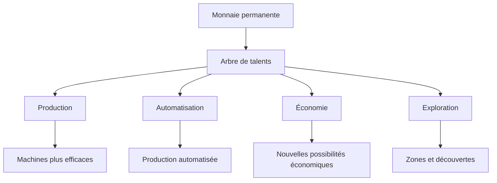

 <div align="center">


### Readme


</div>

---



# Rebirth and Prestige

## 12.1 Objectif

Le rebirth et le prestige permettent de renouveler la progression après avoir atteint certaines étapes importantes.

Le joueur accepte de perdre une partie de ses acquis immédiats en échange d'un avantage durable, d'une nouvelle mécanique ou d'un accès à du contenu supplémentaire.

Ces systèmes prolongent la durée de vie du jeu, mais ils doivent apporter une évolution réelle au gameplay.

Un bon système de rebirth doit :

- Donner une raison de recommencer.
- Présenter clairement les pertes et les gains.
- Récompenser la progression précédente.
- Introduire de nouvelles possibilités.
- Préserver la valeur du temps investi.
- Éviter de rendre les rebirths obligatoires pour progresser normalement.

## 12.2 Différence entre rebirth et prestige

Les deux termes sont parfois utilisés pour désigner le même système. Pour ce projet, il est utile de leur attribuer des fonctions distinctes.

| Système | Fonction |
|---|---|
| Rebirth | Recommencer une partie de la progression en conservant un avantage |
| Prestige | Atteindre un niveau supérieur de progression avec des récompenses plus rares ou des systèmes supplémentaires |

### Exemple

Un rebirth peut réinitialiser le tycoon et attribuer une monnaie permanente.

Le prestige peut ensuite utiliser cette monnaie pour débloquer un arbre de talents, de nouvelles zones ou des améliorations spéciales.

Cette distinction n'est pas une règle universelle. Elle doit être définie dans les règles du jeu et rester cohérente dans l'interface.

## 12.3 Pourquoi proposer un rebirth ?

Le rebirth répond à un problème de progression : le joueur finit par atteindre un stade où les améliorations deviennent trop lentes, trop répétitives ou moins intéressantes.

Il permet de renouveler les objectifs.

Exemples de motivations :

- Recommencer avec une production plus efficace.
- Débloquer une nouvelle stratégie.
- Accéder à des machines spéciales.
- Obtenir une monnaie permanente.
- Découvrir une nouvelle zone.
- Compléter une collection.
- Atteindre des objectifs de progression plus avancés.

Le rebirth ne doit pas simplement augmenter un chiffre. Il doit modifier les possibilités du joueur.

## 12.4 Le moment idéal pour le premier rebirth

Le premier rebirth est une étape importante.

S'il arrive trop tôt, le joueur risque de ne pas avoir compris les systèmes de base. S'il arrive trop tard, la progression peut devenir répétitive avant que le système soit découvert.

Avant de proposer le premier rebirth, vérifie que le joueur maîtrise :

- La production de ressources.
- Les achats et améliorations.
- Les principales machines.
- La progression de son tycoon.
- Les objectifs économiques.
- Les conditions du rebirth.

Le joueur doit comprendre pourquoi il recommence et ce qu'il va obtenir.

### Questions à se poser

- Combien de temps faut-il pour atteindre le premier rebirth ?
- Le joueur a-t-il déjà découvert les mécaniques essentielles ?
- La progression commence-t-elle à ralentir ?
- Le gain proposé est-il suffisamment intéressant ?
- Le joueur peut-il continuer sans effectuer de rebirth ?

## 12.5 Définir ce qui est réinitialisé

La règle la plus importante est la transparence.

Avant de confirmer un rebirth, le joueur doit savoir précisément ce qu'il perd et ce qu'il conserve.

### Exemple de réinitialisation

| Élément | Réinitialisation possible |
|---|---|
| Monnaie principale | Oui |
| Machines du tycoon | Oui |
| Améliorations temporaires | Oui |
| Terrain construit | Oui |
| Zones débloquées | Selon le système |
| Monnaie permanente | Non |
| Succès | Non |
| Cosmétiques permanents | Non |
| Progression des collections | Selon le système |
| Récompenses de prestige | Non |

Ce tableau est un exemple de conception. Les règles définitives doivent être adaptées à l'économie et à la structure du jeu.

### Règle essentielle

Ne réinitialise jamais une donnée sans que le joueur ait pu comprendre cette conséquence.

Une confirmation doit afficher les pertes, les éléments conservés et les gains prévus.

## 12.6 Les récompenses du rebirth

La récompense doit être proportionnelle à l'effort nécessaire.

Elle peut prendre plusieurs formes.

| Récompense | Fonction |
|---|---|
| Multiplicateur permanent | Accélérer la progression future |
| Monnaie spéciale | Acheter des améliorations durables |
| Machine exclusive | Modifier la production |
| Arbre de talents | Personnaliser sa stratégie |
| Nouvelle zone | Étendre le contenu |
| Bonus de capacité | Améliorer les possibilités du tycoon |
| Objet cosmétique | Reconnaître le rebirth |
| Titre | Afficher un accomplissement |

Une récompense intéressante n'est pas nécessairement un bonus économique.

Un nouveau choix stratégique peut avoir davantage de valeur qu'un multiplicateur supplémentaire.

## 12.7 Concevoir la monnaie permanente

Une monnaie de rebirth permet de transformer une progression temporaire en progression durable.

Elle doit avoir une fonction clairement définie.

Exemples d'utilisations :

- Acheter des améliorations permanentes.
- Débloquer des machines spéciales.
- Accéder à de nouvelles zones.
- Améliorer des capacités.
- Débloquer des éléments cosmétiques.
- Acheter des bonus limités.

### Éviter l'inflation

Si la monnaie permanente est distribuée trop facilement, les améliorations deviennent rapidement sans valeur.

Si elle est trop difficile à obtenir, le rebirth peut sembler inutile.

Il faut donc définir :

- Les conditions d'obtention.
- Les gains par rebirth.
- Le coût des améliorations.
- Les limites éventuelles.
- La progression attendue.
- Les usages de cette monnaie sur le long terme.

Une monnaie qui ne possède aucune utilisation intéressante ne devrait pas être ajoutée.

## 12.8 Calculer la récompense

La récompense peut dépendre de plusieurs facteurs :

- La production atteinte.
- La progression économique.
- Les objectifs terminés.
- Les machines débloquées.
- Le niveau atteint.

Exemple fictif de formule :

\[
R = \left\lfloor \sqrt{\frac{P}{K}} \right\rfloor
\]

Avec :

- \(R\) : récompense en monnaie de rebirth.
- \(P\) : valeur de progression retenue.
- \(K\) : constante d'équilibrage.

Cette formule illustre une croissance progressive. Elle n'est pas une formule recommandée universellement.

Une formule linéaire peut produire une inflation trop rapide, tandis qu'une formule trop restrictive peut rendre les premiers rebirths peu intéressants.

### Exemple fictif

| Progression retenue | Récompense |
|---:|---:|
| 100 | 1 |
| 400 | 2 |
| 900 | 3 |
| 1 600 | 4 |
| 2 500 | 5 |

Les valeurs sont uniquement illustratives. Elles doivent être ajustées après simulation et tests.

## 12.9 Les multiplicateurs permanents

Les multiplicateurs peuvent accélérer les cycles suivants.

Ils doivent cependant être équilibrés pour éviter une progression qui devient instantanée après quelques rebirths.

Exemple :

| Rebirths | Multiplicateur fictif |
|---:|---:|
| 0 | x1 |
| 1 | x1.2 |
| 2 | x1.4 |
| 3 | x1.6 |
| 4 | x1.8 |

Une progression modérée peut préserver l'intérêt des achats et des améliorations.

Il faut aussi décider quelles mécaniques sont affectées :

- Production.
- Vitesse des machines.
- Valeur des ressources.
- Capacité de stockage.
- Coût des améliorations.

Un multiplicateur qui affecte toutes les valeurs peut rendre l'économie difficile à contrôler.

## 12.10 Le prestige et les systèmes avancés

Le prestige peut introduire une progression supplémentaire après plusieurs rebirths.

Il doit représenter une évolution importante, pas simplement une nouvelle remise à zéro.

Exemples :

- Arbre de talents permanent.
- Machines spécialisées.
- Nouvelles zones.
- Défis avancés.
- Systèmes de collection.
- Modificateurs de gameplay.
- Objectifs de maîtrise.

### Exemple d'organisation

| Niveau | Système | Fonction |
|---|---|---|
| Progression normale | Tycoon | Construire et produire |
| Rebirth | Monnaie permanente | Renforcer les prochains cycles |
| Prestige | Arbre de talents | Définir une stratégie |
| Prestige avancé | Nouveaux défis | Tester la maîtrise |
| Progression longue | Collections | Reconnaître les accomplissements |

Les systèmes avancés doivent être introduits progressivement.

## 12.11 L'arbre de talents permanent

Un arbre de talents permet au joueur de choisir comment améliorer sa progression.

Exemples de branches :

- Production.
- Automatisation.
- Économie.
- Capacité.
- Exploration.
- Collection.

Chaque branche doit proposer des avantages distincts.

Exemple :



L'objectif est de proposer des choix intéressants.

Si une branche est systématiquement meilleure que les autres, le système perd une partie de son intérêt.

## 12.12 Donner le choix au joueur

Un rebirth ne doit pas être déclenché automatiquement.

Le joueur doit décider quand il souhaite recommencer.

Avant la confirmation, affiche :

- Le niveau actuel.
- Les conditions remplies.
- Les ressources qui seront perdues.
- Les éléments conservés.
- La récompense estimée.
- Les nouvelles possibilités.
- Le nombre de rebirths après validation.

### Exemple d'interface

```text
REBIRTH AVAILABLE

Current progression: 100%

You will receive:
+ 3 Rebirth Tokens
+ Permanent production bonus

You will lose:
- Current coins
- Machines and upgrades
- Temporary progression

You will keep:
- Achievements
- Permanent upgrades
- Cosmetics

[CONFIRM REBIRTH]  [CANCEL]
```

Les valeurs affichées doivent être calculées et vérifiées par le serveur avant l'exécution.

## 12.13 L'expérience après un rebirth

Le joueur doit immédiatement comprendre ce qui a changé.

Après la réinitialisation :

1. Afficher la récompense obtenue.
2. Présenter les nouvelles possibilités.
3. Montrer les améliorations permanentes disponibles.
4. Restaurer les données conservées.
5. Permettre de recommencer rapidement.
6. Éviter de répéter inutilement tout le tutoriel.

Le nouveau cycle doit être plus fluide sans supprimer toutes les décisions intéressantes.

## 12.14 Éviter les cycles répétitifs

Un risque majeur est de transformer le rebirth en une simple répétition du même parcours.

Pour éviter cela, chaque cycle peut introduire une évolution :

- Une nouvelle machine.
- Un nouveau choix de progression.
- Une amélioration permanente.
- Un défi supplémentaire.
- Une zone facultative.
- Une nouvelle stratégie économique.

Le joueur doit sentir qu'il progresse même lorsqu'il recommence une partie de son tycoon.

## 12.15 Équilibrer la progression entre les rebirths

Le premier rebirth doit être accessible après la compréhension des mécaniques de base.

Les suivants peuvent demander davantage de progression, mais le temps nécessaire ne doit pas augmenter sans raison.

Exemple de tableau de conception :

| Cycle | Objectif | Évolution |
|---|---|---|
| 0 | Découvrir le tycoon | Apprentissage |
| 1 | Premier rebirth | Monnaie permanente |
| 2 | Deuxième rebirth | Première spécialisation |
| 3 | Troisième rebirth | Nouvelle machine |
| 4 | Premier prestige | Arbre de talents |
| 5+ | Progression avancée | Nouveaux défis |

Ce tableau représente une structure possible, pas une obligation de développement.

## 12.16 Architecture technique

Le système doit séparer les conditions du rebirth, le calcul des récompenses, la réinitialisation et la sauvegarde.

Exemple d'organisation :

```text
RebirthSystem/
├── Config/
│   ├── RebirthConfig
│   └── PrestigeConfig
├── Services/
│   ├── RebirthService
│   ├── PrestigeService
│   ├── RewardService
│   └── ResetService
├── Data/
│   └── PlayerProgress
└── UI/
    ├── RebirthPanel
    └── PrestigePanel
```

Cette structure est un exemple d'organisation. Elle doit être adaptée à l'architecture réelle du jeu.

### Responsabilités

| Élément | Responsabilité |
|---|---|
| RebirthConfig | Conditions et récompenses |
| PrestigeConfig | Règles du prestige |
| RebirthService | Validation du rebirth |
| PrestigeService | Gestion du prestige |
| RewardService | Calcul et attribution des gains |
| ResetService | Réinitialisation des données |
| PlayerProgress | Données de progression |
| RebirthPanel | Interface de confirmation |

## 12.17 Sécurité et validation serveur

Le rebirth modifie des données économiques importantes.

Il doit être exécuté et validé côté serveur.

Le client peut demander un rebirth, mais le serveur doit vérifier :

- Les conditions de progression.
- Les ressources nécessaires.
- Le nombre de rebirths.
- La récompense autorisée.
- Les données à conserver.
- Les données à réinitialiser.
- L'absence d'une opération déjà en cours.

Ne fais jamais confiance à une récompense calculée ou à un niveau envoyé directement par le client.

### Prévenir les abus

- Refuser les demandes répétées pendant une opération.
- Empêcher les doubles récompenses.
- Valider les valeurs économiques.
- Utiliser une opération de sauvegarde cohérente.
- Gérer les erreurs de sauvegarde.
- Éviter les réinitialisations partielles.
- Tester les déconnexions pendant le processus.

Le système doit éviter qu'un joueur perde ses données ou reçoive plusieurs fois la même récompense.

## 12.18 Sauvegarde des données

Les données doivent distinguer la progression temporaire et la progression permanente.

Exemple conceptuel :

```lua
local PlayerData = {
    Coins = 0,
    Machines = {},
    Upgrades = {},

    Rebirths = 0,
    RebirthTokens = 0,
    PermanentUpgrades = {},

    PrestigeLevel = 0,
    PrestigeTalents = {}
}
```

Cette structure est illustrative. Elle ne constitue pas une implémentation complète du système de sauvegarde.

Les données doivent être validées et manipulées côté serveur.

Utilise les Data Stores Roblox pour conserver la progression entre les sessions et prévois une gestion des erreurs adaptée.

## 12.19 Mesurer l'efficacité du rebirth

Les statistiques permettent de comprendre si le système apporte réellement de la valeur.

| Indicateur | Utilité |
|---|---|
| Temps avant premier rebirth | Mesurer l'accessibilité |
| Taux de premier rebirth | Mesurer l'intérêt |
| Taux de rebirth suivant | Observer la progression |
| Abandon après rebirth | Identifier les problèmes |
| Temps de reprise | Mesurer la fluidité du nouveau cycle |
| Utilisation des améliorations permanentes | Observer les choix |
| Progression après rebirth | Vérifier l'équilibre |

### Exemples de calcul

**Taux de premier rebirth**

```text
Joueurs ayant effectué un premier rebirth
----------------------------------------- × 100
Joueurs ayant atteint les conditions du rebirth
```

**Taux d'abandon après rebirth**

```text
Joueurs n'ayant pas repris leur progression
------------------------------------------- × 100
Joueurs ayant effectué un rebirth
```

Ces mesures doivent être analysées par cohorte et par profil de joueur.

Un taux de rebirth faible peut indiquer un problème d'équilibrage, mais aussi simplement que les joueurs préfèrent continuer leur progression normale.

## 12.20 Tester le système

Teste plusieurs situations avant de publier le système.

| Test | Objectif |
|---|---|
| Premier rebirth | Vérifier la compréhension |
| Rebirth répété | Éviter les doubles récompenses |
| Conditions non remplies | Refuser correctement l'action |
| Déconnexion pendant le rebirth | Préserver les données |
| Reconnexion | Restaurer les éléments conservés |
| Plusieurs demandes simultanées | Éviter les opérations concurrentes |
| Progression élevée | Vérifier les calculs |
| Joueur gratuit | Vérifier l'équilibre |
| Achat permanent | Vérifier la sauvegarde |

Vérifie également les valeurs extrêmes et les erreurs de calcul.

## 12.21 Erreurs fréquentes

| Erreur | Conséquence | Solution |
|---|---|---|
| Réinitialisation surprise | Perte de confiance | Confirmation détaillée |
| Bonus trop faible | Rebirth peu intéressant | Récompenser l'effort |
| Bonus trop puissant | Progression déséquilibrée | Limiter les multiplicateurs |
| Rebirth obligatoire | Frustration | Garder une progression normale |
| Aucun nouveau contenu | Répétition | Introduire de nouvelles possibilités |
| Récompenses mal calculées | Exploitation économique | Validation serveur |
| Sauvegarde incomplète | Perte de progression | Tester les transitions |
| Prestige sans fonction | Complexité inutile | Définir son utilité |

## 12.22 Version minimale à développer

Pour une première version du tycoon, commence avec un système de rebirth simple.

Fonctionnalités prioritaires :

1. Une condition de progression claire.
2. Un bouton de rebirth.
3. Un écran de confirmation.
4. Une liste des éléments réinitialisés.
5. Une liste des éléments conservés.
6. Une récompense permanente.
7. Une réinitialisation validée côté serveur.
8. Une sauvegarde fiable.
9. Un retour visuel après l'opération.

À développer plus tard :

- Plusieurs niveaux de rebirth.
- Arbre de talents.
- Prestige avancé.
- Machines spéciales.
- Zones supplémentaires.
- Défis de prestige.
- Collections permanentes.

Le premier objectif est de vérifier que le rebirth donne envie de recommencer.

## 12.23 Fiche de conception

Avant de développer le système, documente les éléments suivants.

| Question | Réponse |
|---|---|
| Conditions du rebirth | À définir |
| Éléments réinitialisés | À définir |
| Éléments conservés | À définir |
| Récompenses | À définir |
| Monnaie permanente | À définir |
| Utilisation de la monnaie | À définir |
| Temps estimé avant le premier rebirth | À définir |
| Progression après rebirth | À définir |
| Conditions du prestige | À définir |
| Validation serveur | À définir |
| Sauvegarde nécessaire | À définir |
| Indicateurs à mesurer | À définir |

## 12.24 Critères de validation

Le système est prêt à être intégré lorsque :

- Le joueur comprend pourquoi il peut effectuer un rebirth.
- Les pertes et les gains sont affichés clairement.
- Le premier rebirth arrive après l'apprentissage des systèmes de base.
- La récompense apporte une valeur réelle.
- Les nouveaux cycles restent intéressants.
- Le prestige introduit une évolution distincte.
- Le rebirth reste facultatif.
- Les données permanentes sont protégées.
- La réinitialisation est exécutée côté serveur.
- Les récompenses ne peuvent pas être dupliquées.
- Les déconnexions et erreurs de sauvegarde sont prises en compte.

## 12.25 Questions générales à documenter

- Quel problème du joueur ce système résout-il ?
- Quelle est la version minimale à tester ?
- Quel est le coût technique et de maintenance ?
- Comment le système fonctionne-t-il pour un joueur gratuit ?
- Quelles données permettent de vérifier son utilité ?
- Quels éléments sont réinitialisés ?
- Quels éléments restent permanents ?
- Quelle est la valeur réelle de la récompense ?
- Quelle nouvelle stratégie le joueur peut-il découvrir ?
- Comment éviter que les cycles deviennent répétitifs ?

## 12.26 Documentation de référence

- [Roblox Creator Hub](https://create.roblox.com/docs)
- [Roblox Production Documentation](https://create.roblox.com/docs/production)
- [Data Stores](https://create.roblox.com/docs/cloud-services/data-stores)
- [Data Store Best Practices](https://create.roblox.com/docs/cloud-services/data-stores/best-practices)
- [Remote Events and Callbacks](https://create.roblox.com/docs/scripting/events/remote)
- [Analytics](https://create.roblox.com/docs/production/analytics)

---

<div align="center">

### Acknowledgements

This section is based on Roblox Creator documentation and development resources.

[Roblox](https://www.roblox.com/) · [Roblox Creator Hub](https://create.roblox.com/docs) · [Roblox Production Documentation](https://create.roblox.com/docs/production)

Visual and documentation resources: [Shields.io](https://shields.io/) · [Mermaid](https://mermaid.js.org/)


<sub>Document: `12-Rebirth-And-Prestige/README.md` · Part of Roblox Tycoon Blueprint</sub>

</div>
