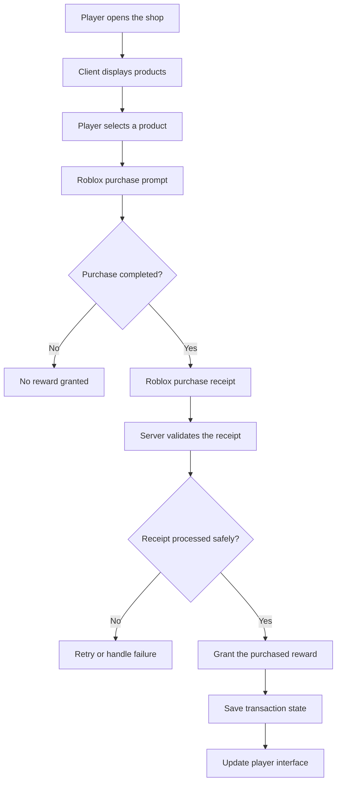

 <div align="center">


### MONETIZATION GUIDE


</div>

---

<div align="center">



**Build a sustainable game. Never make payment a requirement for enjoyment.**

</div>



# 13. Monetization

## 13.1 Objectif

La monétisation permet de financer le développement, les mises à jour et la maintenance du jeu.

Elle doit cependant respecter une règle fondamentale : **un joueur doit pouvoir profiter pleinement du jeu sans dépenser de Robux.**

Les achats doivent apporter une valeur identifiable, être présentés honnêtement et rester facultatifs. Ils ne doivent pas servir à réparer artificiellement une progression trop lente ou une expérience volontairement frustrante.

Pour Roblox Tycoon Blueprint, la monétisation doit soutenir trois objectifs :

| Objectif | Résultat attendu |
|---|---|
| Financement | Générer des revenus pour soutenir le développement |
| Personnalisation | Permettre aux joueurs de personnaliser leur expérience |
| Soutien | Donner aux joueurs satisfaits la possibilité de soutenir le projet |

<details>
<summary><strong>Principe de conception</strong></summary>

Un achat doit améliorer ou personnaliser une expérience déjà satisfaisante. Il ne doit pas rendre acceptable une expérience qui aurait été volontairement dégradée pour pousser à payer.

</details>


## 13.2 Les différents types d'achats Roblox

Roblox propose plusieurs systèmes de monétisation. Ils ne répondent pas tous au même besoin.

### Passes

Un Pass permet d'acheter une seule fois un avantage ou un privilège permanent dans une expérience.

Exemples adaptés à un tycoon :

- Accès à une zone cosmétique VIP.
- Effets visuels exclusifs.
- Thèmes spéciaux pour les machines.
- Emotes ou animations supplémentaires.
- Titres et éléments de personnalisation.
- Options de confort clairement facultatives.

Un Pass convient lorsqu'un avantage doit rester accessible après son acquisition.

### Developer Products

Un Developer Product peut être acheté plusieurs fois.

Exemples :

- Packs de monnaie.
- Boost temporaire de production.
- Accélération temporaire.
- Ressources consommables.
- Objets utilisables plusieurs fois.

Ces produits nécessitent une attention particulière : leur valeur doit être équilibrée avec l'économie normale du jeu.

### Subscriptions

Les abonnements permettent de proposer des avantages récurrents en échange d'un paiement périodique.

Ils peuvent être envisagés lorsque le jeu possède suffisamment de contenu et de services pour justifier des avantages continus.

Exemples possibles :

- Pack mensuel de cosmétiques.
- Récompenses périodiques supplémentaires.
- Accès à des options de personnalisation renouvelées.
- Avantages de confort clairement décrits.

Un abonnement implique une responsabilité supplémentaire : les avantages annoncés doivent être maintenus pendant la période payée.

### Comparaison

| Système | Fréquence | Utilisation |
|---|---|---|
| Pass | Achat unique | Avantage durable |
| Developer Product | Achats répétés | Consommables et monnaie |
| Subscription | Récurrente | Avantages renouvelés |
| Paid Access | Achat d'accès | Accès payant à l'expérience |

**Choix recommandé pour le MVP :** commencer avec quelques Passes cosmétiques et un petit nombre de Developer Products facultatifs. Les abonnements et l'accès payant ne sont pas prioritaires.


## 13.3 Construire une boutique cohérente

La boutique doit être compréhensible sans interrompre le gameplay.

Chaque produit doit présenter :

- Son nom.
- Son illustration.
- Son prix affiché par Roblox.
- Son contenu exact.
- Sa durée, lorsqu'il s'agit d'un avantage temporaire.
- Son type d'achat.
- Son état de possession, lorsque cela s'applique.

### Organisation proposée

| Catégorie | Exemples | Type conseillé |
|---|---|---|
| Cosmétiques | Skins, couleurs, effets | Pass |
| Personnalisation | Thèmes de machines, décorations | Pass |
| Identité | Titres, emotes, effets de profil | Pass |
| Soutien | Pack de soutien avec récompense cosmétique | Pass |
| Monnaie | Packs de monnaie | Developer Product |
| Boosts | Production accélérée pendant une durée définie | Developer Product |
| Consommables | Ressources utilisables | Developer Product |

### Exemple d'interface

```text
+------------------------------------------+
|                 GAME SHOP                |
+------------------------------------------+
|                                          |
|  COSMETICS                               |
|  [ Neon Machines ]       [ View Pass ]   |
|  [ Golden Theme  ]       [ View Pass ]   |
|                                          |
|  SUPPORT THE GAME                        |
|  [ Supporter Pack ]      [ View Pass ]   |
|                                          |
|  BOOSTS                                  |
|  [ Production Boost ]    [ View Item ]   |
|                                          |
+------------------------------------------+
|  All purchases are optional.             |
+------------------------------------------+
```

Cette représentation est un exemple de structure, pas une capture de l'interface finale.

### Règles d'interface

- Ne pas afficher de fenêtre d'achat à chaque connexion.
- Ne pas ouvrir automatiquement une demande de paiement.
- Ne pas confondre un bouton d'information avec un bouton d'achat.
- Ne pas masquer le bouton de fermeture.
- Ne pas rendre le prix difficile à trouver.
- Ne pas utiliser de faux compte à rebours.
- Ne pas annoncer une réduction permanente comme une promotion temporaire.


## 13.4 Concevoir des achats qui apportent une vraie valeur

Chaque produit doit avoir une raison d'exister.

Une boutique composée uniquement de multiplicateurs de production risque de transformer l'ensemble du jeu en comparaison entre joueurs payants et gratuits.

Il faut donc diversifier les propositions.

### A. Personnalisation

La personnalisation est une piste prioritaire, car elle permet de proposer des achats sans modifier directement l'équilibre économique.

Exemples :

- Machines avec apparence futuriste.
- Convoyeurs lumineux.
- Effets de collecte.
- Thèmes de base.
- Animations de prestige.
- Effets visuels de rebirth.

### B. Confort

Les avantages de confort doivent rester raisonnables.

Exemples :

- Options supplémentaires d'organisation.
- Préférences d'affichage.
- Raccourcis d'interface.
- Fonctions de gestion plus pratiques.

Un avantage de confort ne doit pas corriger une interface volontairement pénible pour les joueurs gratuits.

### C. Accélération

Les boosts peuvent être proposés comme achats facultatifs.

Cependant :

- La progression normale doit rester équilibrée.
- Les boosts ne doivent pas devenir nécessaires pour suivre le contenu.
- Leur durée et leurs effets doivent être visibles.
- Leur activation doit être compréhensible.
- Les gains ne doivent pas rendre les autres systèmes économiques inutiles.

### D. Soutien du projet

Un pack de soutien peut remercier les joueurs qui souhaitent contribuer au développement.

Il peut inclure :

- Un titre de profil.
- Un badge visuel.
- Une décoration exclusive.
- Un effet cosmétique.
- Un message de remerciement facultatif.

Le soutien ne doit jamais devenir une obligation sociale. Les joueurs qui ne dépensent pas doivent être traités de la même manière.


## 13.5 Équilibrer les avantages payants

La monétisation ne doit pas détruire les systèmes conçus dans les sections précédentes.

Elle doit notamment respecter :

- La progression.
- L'économie.
- Les mécaniques de tycoon.
- Le rebirth.
- Les systèmes sociaux.
- La rétention.

### Exemple de comparaison

Imaginons deux joueurs qui commencent avec les mêmes ressources.

| Situation | Joueur gratuit | Joueur avec boost |
|---|---:|---:|
| Production normale | 100/s | 100/s |
| Production avec boost | 100/s | 150/s |
| Temps de jeu | Identique | Identique |
| Accès aux zones | Normal | Normal |
| Progression principale | Complète | Complète |

Dans cet exemple, le boost augmente temporairement la production de 50 %.

Il ne doit pas débloquer une zone inaccessible autrement ni supprimer toute difficulté de progression.

<caption>Valeurs fictives utilisées uniquement pour illustrer un système de boost.</caption>

### Questions d'équilibrage

- Combien de temps un joueur gratuit met-il pour atteindre un objectif ?
- Combien de temps un joueur utilisant un boost met-il ?
- Le boost rend-il les autres achats inutiles ?
- Le joueur gratuit peut-il atteindre tous les contenus principaux ?
- L'avantage reste-t-il raisonnable dans les interactions sociales ?


## 13.6 La psychologie derrière les achats

La boutique doit informer et présenter des possibilités. Elle ne doit pas manipuler les joueurs.

### Bonnes pratiques

- Présenter les avantages sans exagération.
- Montrer le contenu avant l'achat.
- Laisser le joueur prendre son temps.
- Permettre de fermer facilement la boutique.
- Respecter les joueurs qui refusent une offre.
- Éviter les sollicitations répétées.

### Pratiques à éviter

| Pratique | Pourquoi l'éviter |
|---|---|
| Faux compte à rebours | Crée une urgence trompeuse |
| Fausses réductions | Déforme la perception du prix |
| Pop-ups répétitifs | Interrompt volontairement le jeu |
| Achat accidentel facilité | Ne respecte pas le choix du joueur |
| Avantages indispensables | Dégrade l'expérience gratuite |
| Humiliation des non-acheteurs | Crée une pression sociale |
| Récompenses payantes aléatoires non conformes | Peut enfreindre les règles Roblox |

### Une règle simple

Un joueur doit pouvoir refuser une proposition sans recevoir de pénalité, perdre une récompense normale ou être relancé constamment.


## 13.7 Architecture technique des achats

La monétisation doit être construite de manière sécurisée.

Le client affiche la boutique et demande l'ouverture d'une fenêtre d'achat. Le serveur reste responsable de la validation et de l'attribution des récompenses.

### Flux général



### Responsabilités

| Élément | Responsabilité |
|---|---|
| Client | Afficher la boutique et demander l'achat |
| MarketplaceService | Gérer les interactions avec le système d'achat Roblox |
| Serveur | Valider et attribuer les récompenses |
| ProcessReceipt | Traiter les reçus des Developer Products |
| DataStoreService | Conserver les données nécessaires |
| Interface | Afficher le résultat de l'achat |

### Règles de sécurité

1. Ne jamais faire confiance au client pour confirmer un achat.
2. Ne jamais attribuer une récompense uniquement parce qu'un bouton a été cliqué.
3. Traiter les Developer Products avec `MarketplaceService.ProcessReceipt`.
4. Ne pas utiliser `PromptProductPurchaseFinished` comme confirmation définitive d'un achat.
5. Prévoir les tentatives répétées de traitement d'un reçu.
6. Éviter de distribuer deux fois la même récompense.
7. Enregistrer les données importantes de manière fiable.
8. Gérer les erreurs de stockage et les interruptions.

### Idempotence des reçus

Le traitement d'un achat doit être conçu pour supporter plusieurs tentatives sans attribuer plusieurs fois la même récompense.

Exemple conceptuel :

```lua
local function processPurchase(player, receiptInfo)
    local purchaseId = receiptInfo.PurchaseId

    -- Check whether this purchase was already processed.
    -- Grant the reward only once.
    -- Persist the purchase state safely.

    -- Return the appropriate receipt decision.
end
```

Ce code illustre uniquement la structure attendue. Il ne constitue pas une implémentation complète de `ProcessReceipt`.

**Important :** le système de sauvegarde doit tenir compte des interruptions, des erreurs temporaires et des tentatives de traitement répétées. Un achat ne doit pas être considéré comme correctement livré simplement parce que le joueur a vu une animation de confirmation.


## 13.8 Données et suivi des achats

Les données permettent de comprendre si les produits proposés sont utiles et si la boutique est correctement équilibrée.

### Données à suivre

| Indicateur | Utilité |
|---|---|
| Vues de la boutique | Mesurer l'intérêt pour la boutique |
| Ouvertures de produits | Identifier les produits consultés |
| Achats terminés | Mesurer les conversions |
| Achats annulés | Identifier les problèmes éventuels |
| Revenus par produit | Comparer les performances |
| Joueurs acheteurs | Comprendre la proportion d'acheteurs |
| Réachats | Mesurer l'intérêt pour les produits répétables |
| Remboursements ou problèmes de livraison | Détecter les problèmes de fiabilité |

### Indicateurs de base

**Taux de conversion**

\[
Conversion = \frac{Acheteurs}{Joueurs\ exposés} \times 100
\]

**Revenu moyen par acheteur**

\[
ARPPU = \frac{Revenu\ total}{Nombre\ d'acheteurs}
\]

**Revenu moyen par joueur**

\[
ARPU = \frac{Revenu\ total}{Nombre\ de\ joueurs}
\]

Ces indicateurs doivent être analysés avec le contexte : durée de la période, population observée et nombre de joueurs exposés à la boutique.

Un taux de conversion élevé ne signifie pas automatiquement que la monétisation est saine.

### Vie privée

Ne collecter que les informations nécessaires à l'analyse et au fonctionnement du jeu. Ne jamais enregistrer de données de paiement sensibles que Roblox gère déjà.


## 13.9 Concevoir le MVP de monétisation

La première version ne doit pas contenir une boutique immense.

Il faut d'abord vérifier que le jeu fonctionne correctement sans achat.

### Proposition de MVP

| Produit | Type | Objectif |
|---|---|---|
| Neon Machine Theme | Pass | Personnalisation |
| Supporter Title | Pass | Soutien du projet |
| Special Collection Effect | Pass | Personnalisation |
| Small Production Boost | Developer Product | Accélération temporaire |

Cette sélection est une proposition de conception, pas une liste de produits déjà créés.

### Ordre de développement

<list marker="number" gap={2}>
  <list-item>
    **Établir l'économie gratuite**

    Vérifier que les joueurs peuvent progresser sans acheter.
  </list-item>
  <list-item>
    **Créer les produits**

    Définir leur prix, leur contenu et leur durée.
  </list-item>
  <list-item>
    **Construire la boutique**

    Présenter les produits de manière claire.
  </list-item>
  <list-item>
    **Développer le traitement serveur**

    Valider les achats et attribuer les récompenses.
  </list-item>
  <list-item>
    **Tester les scénarios d'erreur**

    Annulation, reconnexion, reçu répété et problème de sauvegarde.
  </list-item>
  <list-item>
    **Analyser les résultats**

    Observer les achats, les retours des joueurs et l'équilibre du jeu.
  </list-item>
</list>


## 13.10 Tester la monétisation

Les tests doivent inclure des joueurs qui ne dépensent rien.

### Scénarios de test

- [ ] La boutique s'ouvre correctement.
- [ ] Les prix et descriptions sont visibles.
- [ ] Chaque produit présente son contenu exact.
- [ ] Un joueur peut fermer la boutique sans acheter.
- [ ] Une annulation ne donne aucune récompense.
- [ ] Un achat validé donne la bonne récompense.
- [ ] Un Developer Product ne peut pas être attribué deux fois.
- [ ] Une reconnexion ne fait pas perdre une récompense acquise.
- [ ] Un Pass déjà possédé est correctement reconnu.
- [ ] Les avantages temporaires expirent correctement.
- [ ] La progression gratuite reste viable.
- [ ] Les joueurs ne reçoivent pas de sollicitations abusives.

### Tests avec différents profils

| Profil | Ce qu'il faut vérifier |
|---|---|
| Nouveau joueur | Comprend-il la boutique sans être interrompu ? |
| Joueur régulier | Les produits ont-ils une utilité réelle ? |
| Joueur gratuit | Peut-il profiter du jeu entièrement ? |
| Joueur acheteur | Comprend-il exactement son achat ? |
| Joueur expérimenté | Les avantages payants déséquilibrent-ils le jeu ? |


## 13.11 Erreurs fréquentes

| Erreur | Conséquence | Correction |
|---|---|---|
| Trop de produits au lancement | Boutique confuse | Commencer petit |
| Prix sans justification | Faible confiance | Montrer une valeur claire |
| Achat obligatoire pour progresser | Expérience frustrante | Garder une progression gratuite complète |
| Récompenses trop puissantes | Économie déséquilibrée | Tester les effets |
| Achats non sauvegardés | Perte de récompenses | Fiabiliser le traitement |
| Vérification côté client | Exploitation possible | Validation serveur |
| Promotions artificielles | Pression trompeuse | Promotions réelles et transparentes |
| Trop de boosts | Progression dévalorisée | Limiter leur impact |


## 13.12 Questions de conception

Avant d'intégrer un produit, répondre aux questions suivantes.

| Question | Réponse attendue |
|---|---|
| Quel problème du joueur ce système résout-il ? | Une utilité identifiable |
| Quelle est la version minimale à tester ? | Un produit et un parcours d'achat complet |
| Quel est le coût technique et de maintenance ? | Scripts, stockage, tests et suivi |
| Comment le système fonctionne-t-il pour un joueur gratuit ? | Accès complet à la progression principale |
| Quelles données permettent de vérifier son utilité ? | Vues, achats, erreurs et retours |
| L'achat est-il compréhensible ? | Contenu, prix et durée visibles |
| Le serveur valide-t-il la récompense ? | Attribution sécurisée |
| Le produit respecte-t-il les règles Roblox ? | Vérification des politiques applicables |


## 13.13 Definition of Done

La section Monétisation est considérée comme prête lorsque :

- [ ] Les types de produits sont clairement définis.
- [ ] La boutique possède une structure compréhensible.
- [ ] Les produits ont un contenu et un prix clairement présentés.
- [ ] Les achats sont facultatifs.
- [ ] Le jeu reste complet sans paiement.
- [ ] Les avantages payants ne détruisent pas l'équilibrage.
- [ ] Les Developer Products sont traités côté serveur.
- [ ] Les reçus sont gérés de manière fiable.
- [ ] Les récompenses ne sont pas attribuées plusieurs fois.
- [ ] Les données importantes sont sauvegardées.
- [ ] Les scénarios d'annulation et d'erreur sont testés.
- [ ] Les règles Roblox applicables sont respectées.
- [ ] Les retours de joueurs gratuits ont été pris en compte.


## 13.14 Documentation officielle

Les références suivantes doivent être consultées avant l'implémentation. Les API et les politiques Roblox peuvent évoluer.

| Ressource | Utilité |
|---|---|
| [Monetization](https://create.roblox.com/docs/production/monetization) | Vue d'ensemble des systèmes de monétisation |
| [Passes](https://create.roblox.com/docs/production/monetization/passes) | Création et gestion des Passes |
| [Developer Products](https://create.roblox.com/docs/production/monetization/developer-products) | Produits répétables et traitement des achats |
| [Subscriptions](https://create.roblox.com/docs/production/monetization/subscriptions) | Abonnements |
| [MarketplaceService](https://create.roblox.com/docs/reference/engine/classes/MarketplaceService) | API de gestion des achats |
| [DataStoreService](https://create.roblox.com/docs/reference/engine/classes/DataStoreService) | Stockage des données |
| [PolicyService](https://create.roblox.com/docs/reference/engine/classes/PolicyService) | Restrictions et éligibilité selon les politiques |
| [Analytics](https://create.roblox.com/docs/production/analytics) | Analyse des performances du jeu |

---

<div align="center">


## Acknowledgements

**Built with the official Roblox creator ecosystem.**

[](https://create.roblox.com/)
[](https://create.roblox.com/docs)
[](https://shields.io/)
[](https://mermaid.js.org/)

Special thanks to the Roblox documentation and creator resources for the technical foundations and platform guidelines referenced in this section.

---


<sub>Document: `13-Monetization/README.md` · Part of Roblox Tycoon Blueprint</sub>

<sub>Build · Learn · Share · Improve</sub>

</div>
