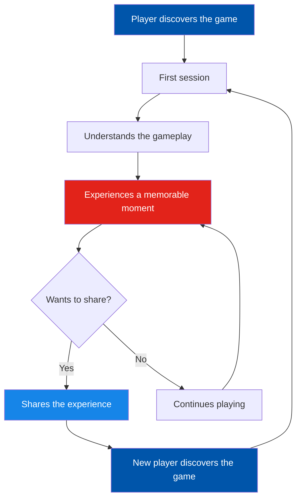
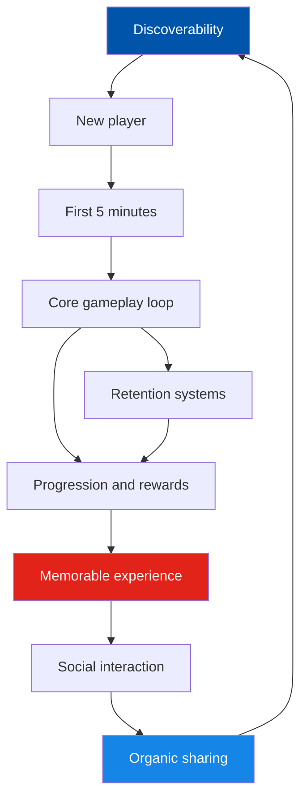

<div align="center">


### VIRAL GROWTH GUIDE


</div>

---

<div align="center">



**Create experiences worth sharing. Let players become the reason others discover the game.**

</div>


# 14. Viral Growth

## 14.1 Objectif

La croissance organique consiste à attirer de nouveaux joueurs grâce à l'expérience que les joueurs actuels apprécient et souhaitent partager.

Un jeu ne devient pas viral simplement parce qu'il possède un bouton d'invitation ou une récompense pour chaque nouvel utilisateur.

Il doit d'abord proposer quelque chose qui mérite d'être montré.

Pour notre tycoon, cela peut être :

- Une usine devenue immense et impressionnante.
- Une base entièrement personnalisée.
- Une machine particulièrement rare.
- Une transformation spectaculaire après un rebirth.
- Une compétition amicale entre plusieurs joueurs.
- Une visite qui révèle une construction originale.
- Un événement communautaire mémorable.

**Principe fondamental : la viralité doit être une conséquence de la qualité de l'expérience, pas une obligation imposée aux joueurs.**

### Les trois piliers

| Pilier | Objectif | Exemple |
|---|---|---|
| Shareability | Donner envie de montrer le jeu | Une usine impressionnante |
| Social gameplay | Donner envie de jouer ensemble | Visites et défis coopératifs |
| Discoverability | Faciliter la découverte | Liens de partage et contenu communautaire |


## 14.2 Comprendre la croissance organique

La croissance organique repose sur plusieurs étapes.

Un joueur découvre le jeu, commence à jouer, trouve une raison de continuer, puis peut décider de le partager.



Cette boucle n'est pas automatique. Tous les joueurs ne partageront pas le jeu, et ce n'est pas nécessaire.

L'objectif est de créer suffisamment de moments intéressants pour que le partage puisse se produire naturellement.

### Pourquoi un joueur partage-t-il un jeu ?

| Motivation | Exemple |
|---|---|
| Fierté | Montrer une usine développée |
| Curiosité | Faire découvrir une mécanique originale |
| Compétition | Comparer deux tycoons |
| Coopération | Construire ou accomplir un objectif ensemble |
| Humour | Partager une situation amusante |
| Collection | Montrer un objet rare |
| Découverte | Présenter une nouvelle zone |


## 14.3 Créer des moments partageables

Le jeu doit régulièrement produire des situations dont les joueurs peuvent être fiers ou qu'ils trouvent intéressantes.

Ces moments ne doivent pas nécessairement être rares ou difficiles à obtenir.

### A. Les transformations de base

Une transformation visuelle permet de montrer rapidement les progrès réalisés.

Exemples :

- Une petite usine devient un complexe industriel.
- Une machine basique devient une installation futuriste.
- Une zone vide devient une base personnalisée.
- Une nouvelle aile apparaît après un rebirth.

### B. Les moments spectaculaires

Les moments visuellement marquants sont faciles à partager.

Exemples :

- Activation d'une machine géante.
- Déblocage d'une zone secrète.
- Apparition d'un effet spécial.
- Construction d'une chaîne de production complète.
- Démonstration d'une machine rare.

### C. Les accomplissements personnels

Les joueurs doivent aussi pouvoir montrer des réussites qui ne dépendent pas uniquement de leur richesse.

Exemples :

- Collection complète.
- Défi de maîtrise terminé.
- Base organisée de manière originale.
- Succès difficile obtenu.
- Record personnel.

### D. Les événements communautaires

Un événement peut créer un moment collectif.

Exemples :

- Construction d'une usine communautaire.
- Défi de production à plusieurs.
- Événement saisonnier.
- Objectif collectif débloquant une décoration.
- Visite guidée des meilleures bases.

### Tableau de conception

| Moment | Émotion recherchée | Possibilité de partage |
|---|---|---|
| Première grosse machine | Fierté | Capture d'écran |
| Nouveau rebirth | Progression | Avant/après |
| Objet rare | Surprise | Présentation de collection |
| Défi coopératif | Appartenance | Vidéo ou souvenir |
| Base personnalisée | Créativité | Visite d'un ami |


## 14.4 Concevoir des fonctionnalités sociales partageables

Les fonctionnalités sociales doivent apporter une vraie valeur au gameplay.

Elles ne doivent pas simplement exister pour augmenter le nombre d'invitations.

### 1. Visites de tycoons

Permettre aux joueurs de visiter les bases des autres.

Fonctionnalités possibles :

- Voir les machines installées.
- Observer les différentes étapes de progression.
- Découvrir les décorations.
- Consulter les accomplissements publics.
- Laisser une réaction prédéfinie.
- Ajouter une base à ses favoris, si le système est pertinent.

La visite doit rester possible sans obligation d'acheter ou de participer à une compétition.

### 2. Comparaison amicale

Les joueurs peuvent comparer leurs progrès sans créer de pression excessive.

Exemples :

- Production par seconde.
- Nombre de machines débloquées.
- Nombre de collections terminées.
- Niveau de prestige.
- Meilleur temps sur un défi.

Les classements doivent être conçus pour éviter que les joueurs les plus dépensiers dominent automatiquement toutes les catégories.

### 3. Coopération

Certains objectifs peuvent être plus intéressants à plusieurs.

Exemples :

- Alimenter une machine collective.
- Participer à un événement de production.
- Compléter un objectif de groupe.
- Débloquer une récompense commune.
- Réaliser une visite guidée.

### 4. Partage de créations

Les joueurs peuvent avoir envie de montrer :

- Leur disposition de machines.
- Leur décoration.
- Leur collection.
- Leur progression.
- Leur stratégie de production.

Toute fonctionnalité de partage doit respecter les possibilités techniques et les règles de sécurité de Roblox.


## 14.5 Les invitations et les récompenses de parrainage

Les invitations peuvent aider à faire découvrir le jeu, mais elles ne doivent pas devenir une mécanique de spam.

Roblox propose des outils de referral permettant notamment de suivre les invitations et de gérer des récompenses pour les joueurs concernés.

Il faut distinguer les invitations normales des systèmes de parrainage et vérifier les conditions applicables à chaque fonctionnalité avant de les intégrer.

### Récompenses possibles

- Petite quantité de monnaie secondaire.
- Décoration temporaire.
- Titre cosmétique.
- Effet visuel.
- Progression vers une récompense communautaire.

### Règles de conception

1. La récompense doit rester modeste.
2. Le joueur invité doit recevoir une information claire.
3. Le joueur ne doit pas être obligé d'inviter quelqu'un.
4. Aucun message ne doit être envoyé automatiquement à ses amis.
5. Les invitations répétées ne doivent pas être nécessaires.
6. Les récompenses ne doivent pas déstabiliser l'économie.
7. Les abus et les tentatives de fraude doivent être pris en compte.

### Exemple de système

| Action | Récompense possible |
|---|---|
| Un joueur partage volontairement le jeu | Aucune récompense obligatoire |
| Un nouvel utilisateur rejoint via un lien éligible | Suivi de l'acquisition |
| Le nouvel utilisateur atteint un objectif réel | Récompense modeste, si autorisée |
| Les deux joueurs participent à une activité | Bonus communautaire facultatif |

**Attention :** ne pas construire un système de récompenses de parrainage sans vérifier les conditions officielles Roblox. Les programmes de referral disposent de règles spécifiques concernant notamment les abus, l'auto-parrainage et le spam.


## 14.6 Faciliter le partage sans interrompre le jeu

Le partage doit être accessible au bon moment.

Il ne doit pas être imposé pendant le tutoriel ou après chaque récompense.

### Moments appropriés

- Après une amélioration importante.
- Après la construction d'une nouvelle zone.
- Après l'obtention d'un objet rare.
- Après un défi collectif.
- Lorsqu'un joueur termine une collection.

### Exemples de messages

| Situation | Message |
|---|---|
| Nouvelle machine | « Ta nouvelle machine est opérationnelle. » |
| Base terminée | « Ta base est prête à être visitée. » |
| Défi terminé | « Défi terminé. Consulte ton résultat. » |
| Événement collectif | « La communauté a atteint son objectif. » |

Ces messages informent le joueur. Ils ne doivent pas déclencher automatiquement une invitation ou une publication.

### Interface de partage

```text
+------------------------------------------+
|             YOUR TYCOON                  |
+------------------------------------------+
|                                          |
|        [ BASE PREVIEW / SCREENSHOT ]     |
|                                          |
|  Your factory has reached a new level!  |
|                                          |
|  [ View Base ]      [ Share ]            |
|                                          |
|  You can continue playing without       |
|  sharing anything.                      |
|                                          |
+------------------------------------------+
```

Cette maquette est une proposition de conception, pas une capture réelle de Roblox.


## 14.7 Les liens de partage Roblox

Roblox propose des liens de partage qui permettent de suivre l'acquisition provenant de différentes sources externes.

Ces liens sont particulièrement utiles pour comprendre quels canaux amènent de nouveaux joueurs réellement intéressés.

### Utilisations possibles

- Lien partagé dans une vidéo.
- Lien associé à une publication.
- Lien utilisé dans une campagne communautaire.
- Lien distribué à des créateurs de contenu.
- Lien utilisé lors d'une présentation du jeu.

Il est possible de créer des liens distincts pour comparer les performances de différents canaux.

### Exemple d'organisation

| Campagne | Source | Objectif |
|---|---|---|
| `youtube-launch` | YouTube | Mesurer les visites depuis une vidéo |
| `tiktok-preview` | TikTok | Mesurer l'intérêt pour un teaser |
| `community-update` | Communauté | Mesurer les visites depuis une annonce |
| `creator-collab` | Créateur partenaire | Évaluer une collaboration |

Ces noms sont des exemples de conventions de suivi. Ils ne correspondent pas à des liens réellement créés.

### Utilisation de LaunchData

Les liens de partage Roblox peuvent être associés à des données de lancement personnalisées.

Cela permet notamment de transmettre un contexte au jeu lors de l'arrivée d'un utilisateur.

Cependant, ces données ne doivent jamais être considérées comme une preuve suffisante pour attribuer une récompense.

Le serveur doit vérifier les conditions nécessaires et respecter les règles du programme utilisé.


## 14.8 Contenu communautaire et créateurs

Les joueurs peuvent devenir une source de découverte grâce au contenu qu'ils créent.

Il ne faut pas chercher à contrôler chaque publication. Il faut plutôt donner aux joueurs des raisons de produire du contenu intéressant.

### Formats de contenu possibles

| Format | Exemple |
|---|---|
| Vidéo courte | Transformation d'une petite usine |
| Tutoriel | Présentation d'une stratégie de progression |
| Comparaison | Deux configurations de production |
| Défi | Construire une base avec une contrainte |
| Présentation | Visite d'un tycoon impressionnant |
| Collection | Présentation d'objets rares |
| Actualité | Découverte d'une nouvelle zone |

### Relations avec les créateurs

Une collaboration peut permettre de faire découvrir le jeu à une nouvelle communauté.

Avant de collaborer :

- Vérifier que le public correspond au jeu.
- Présenter honnêtement le contenu.
- Donner accès à une version suffisamment stable.
- Ne pas demander de faux avis positifs.
- Ne pas imposer de promesses trompeuses.
- Respecter les obligations de transparence applicables.

### Préparer le jeu pour les vidéos

Quelques éléments peuvent faciliter la création de contenu :

- Effets visuels lisibles.
- Machines facilement reconnaissables.
- Animations de progression.
- Zones intéressantes à visiter.
- Résultats et accomplissements visibles.
- Interface qui ne masque pas inutilement l'action.


## 14.9 Boucles de croissance et rétention

Attirer un nouveau joueur ne suffit pas.

Si le joueur quitte immédiatement le jeu, l'acquisition n'aura pas créé une croissance durable.

La croissance doit donc être liée aux systèmes étudiés dans les sections précédentes.



### Les liens avec les autres sections

| Section | Contribution à la croissance |
|---|---|
| 02 - First 5 Minutes | Convertir les nouveaux joueurs en joueurs actifs |
| 03 - Core Gameplay Loop | Donner une raison de continuer |
| 04 - Progression System | Créer des objectifs visibles |
| 07 - Player Psychology | Construire une expérience motivante |
| 08 - Retention Systems | Donner envie de revenir |
| 09 - Social Gameplay | Encourager les interactions |
| 10 - World Design | Donner envie d'explorer |
| 11 - Quests and Achievements | Créer des accomplissements partageables |
| 12 - Rebirth and Prestige | Créer des transformations marquantes |
| 13 - Monetization | Soutenir le développement sans bloquer la progression |


## 14.10 Mesurer la croissance

Les impressions et les visites ne racontent pas toute l'histoire.

Il faut comprendre d'où viennent les joueurs et ce qu'ils font après leur arrivée.

### Indicateurs importants

| Indicateur | Ce qu'il mesure |
|---|---|
| New Users | Nombre de nouveaux utilisateurs |
| Acquisition Source | Origine des nouveaux joueurs |
| Link Visits | Visites provenant des liens de partage |
| Play Through Rate | Conversion entre exposition et lancement |
| D1 Retention | Retour après la première journée |
| D7 Retention | Retour après plusieurs jours |
| Session Time | Temps passé dans le jeu |
| 7D Playtime | Temps cumulé sur les premiers jours |
| Referral Activity | Activité provenant du système de parrainage |

### Formules utiles

**Taux de conversion**

\[
Conversion = \frac{Nouveaux\ joueurs}{Impressions} \times 100
\]

**Taux de rétention**

\[
Retention = \frac{Joueurs\ revenus}{Joueurs\ de\ la\ cohorte} \times 100
\]

**Croissance nette**

\[
Croissance = Nouveaux\ joueurs - Joueurs\ perdus
\]

Ces formules sont des représentations simplifiées. Les définitions exactes des indicateurs doivent suivre celles utilisées par le tableau de bord Roblox.

### Analyser les sources

Un canal peut attirer beaucoup de visiteurs, mais peu de joueurs réellement intéressés.

Exemple fictif :

| Source | Nouveaux joueurs | Rétention D7 |
|---|---:|---:|
| Vidéo A | 1 000 | 8 % |
| Vidéo B | 400 | 18 % |
| Communauté | 250 | 24 % |

La vidéo A apporte davantage de joueurs au départ, mais la communauté attire une population qui revient davantage.

Il ne faut donc pas juger une campagne uniquement sur le nombre de visites.


## 14.11 Expérimenter et améliorer

La croissance doit être travaillée progressivement.

Chaque modification doit répondre à une hypothèse.

### Exemple d'expérimentation

**Hypothèse :** les joueurs partagent davantage leur base lorsqu'ils peuvent la présenter avec une vue propre et un aperçu visuel.

Test :

1. Observer les joueurs qui terminent une amélioration importante.
2. Leur permettre d'ouvrir une présentation de leur base.
3. Mesurer l'utilisation volontaire de la fonctionnalité.
4. Recueillir leurs commentaires.
5. Comparer avec le comportement précédent.

### Fiche d'expérimentation

| Élément | Description |
|---|---|
| Hypothèse | Une présentation de base encourage le partage |
| Modification | Ajouter un aperçu visuel |
| Population | Joueurs ayant terminé une amélioration |
| Mesure principale | Utilisation volontaire du partage |
| Mesures secondaires | Rétention et retours des joueurs |
| Décision | Conserver, modifier ou supprimer |

Ne pas conclure trop rapidement à partir d'un petit échantillon. Les différences peuvent être dues à la période, au contenu ou à la composition des joueurs.


## 14.12 Erreurs fréquentes

| Erreur | Conséquence | Solution |
|---|---|---|
| Forcer les invitations | Rejet de la fonctionnalité | Laisser le choix |
| Récompenser le spam | Abus et mauvaise expérience | Récompenses limitées et conformes |
| Miser uniquement sur les créateurs | Dépendance à une source externe | Construire une expérience solide |
| Ignorer la rétention | Acquisition peu durable | Analyser D1 et D7 |
| Créer des classements pay-to-win | Découragement des joueurs | Diversifier les catégories |
| Partage sans intérêt | Fonctionnalité ignorée | Créer des moments mémorables |
| Récompenses sociales excessives | Économie déséquilibrée | Limiter leur valeur |
| Ignorer les joueurs solo | Expérience incomplète | Garder des objectifs accessibles seul |
| Copier une tendance sans identité | Jeu facilement oubliable | Développer une identité reconnaissable |
| Négliger la sécurité | Abus et comportements nuisibles | Prévoir modération et contrôles |


## 14.13 Proposition de MVP

La première version ne doit pas chercher à intégrer toutes les fonctionnalités sociales possibles.

Il faut commencer avec des systèmes simples et faciles à tester.

### Version minimale

| Fonctionnalité | Priorité | Objectif |
|---|---|---|
| Présentation visuelle de la base | Haute | Donner envie de montrer sa progression |
| Visite d'un autre tycoon | Haute | Encourager la découverte |
| Réactions prédéfinies | Moyenne | Faciliter les interactions |
| Événement collectif simple | Moyenne | Créer un moment communautaire |
| Liens de partage | Moyenne | Mesurer l'acquisition externe |
| Système de parrainage | Basse | À envisager après validation du reste |

### Ordre de développement

1. Construire une expérience suffisamment intéressante à montrer.
2. Ajouter la visite des bases.
3. Ajouter des interactions sociales simples.
4. Préparer les événements communautaires.
5. Configurer les liens de partage Roblox.
6. Analyser les sources d'acquisition.
7. Envisager un système de parrainage conforme aux règles applicables.


## 14.14 Questions de conception

Avant d'ajouter une fonctionnalité destinée à la croissance, répondre aux questions suivantes.

| Question | Résultat attendu |
|---|---|
| Quel problème du joueur ce système résout-il ? | Une raison claire de partager ou de jouer ensemble |
| Quelle est la version minimale à tester ? | Une fonctionnalité simple |
| Quel est le coût technique et de maintenance ? | Une estimation réaliste |
| Comment le système fonctionne-t-il pour un joueur gratuit ? | Une expérience complète sans paiement |
| Quelles données permettent de vérifier son utilité ? | Des indicateurs mesurables |
| Le partage est-il facultatif ? | Aucun comportement forcé |
| Les joueurs seuls sont-ils respectés ? | Une progression solo viable |
| Les récompenses sont-elles équilibrées ? | Aucun avantage excessif |
| Les règles Roblox sont-elles respectées ? | Fonctionnalité conforme |


## 14.15 Definition of Done

La section Viral Growth est considérée comme prête lorsque :

- [ ] Le jeu possède des moments naturellement partageables.
- [ ] Les joueurs peuvent présenter leur progression.
- [ ] Les visites de bases apportent une vraie valeur.
- [ ] Les interactions sociales restent facultatives.
- [ ] Les joueurs solo conservent une expérience complète.
- [ ] Les récompenses sociales sont équilibrées.
- [ ] Les invitations ne créent pas de spam.
- [ ] Les fonctionnalités de partage respectent les règles Roblox.
- [ ] Les liens de partage sont correctement suivis.
- [ ] Les sources d'acquisition peuvent être comparées.
- [ ] La rétention est analysée avec l'acquisition.
- [ ] Les retours des joueurs influencent les améliorations.
- [ ] Les fonctionnalités sociales disposent de protections adaptées.


## 14.16 Documentation officielle

Les références suivantes servent de base à la conception et à l'implémentation. Les fonctionnalités et règles de Roblox peuvent évoluer.

| Ressource | Utilité |
|---|---|
| [Roblox Creator Hub](https://create.roblox.com/docs) | Documentation générale |
| [Acquisition](https://create.roblox.com/docs/production/analytics/acquisition) | Sources d'acquisition et conversion |
| [Share Links](https://create.roblox.com/docs/production/promotion/share-links) | Liens de partage traçables |
| [Friend Referral System](https://create.roblox.com/docs/production/promotion/referral-system) | Système de parrainage |
| [Social Media Links](https://create.roblox.com/docs/production/promotion/social-media-links) | Liens sociaux sur la page du jeu |
| [Analytics](https://create.roblox.com/docs/production/analytics) | Mesure des performances |
| [Discovery](https://create.roblox.com/docs/discovery) | Découverte des expériences |
| [Community Standards](https://about.roblox.com/community-standards) | Règles de la communauté |

---

<div align="center">


## Acknowledgements

**Built with the official Roblox creator ecosystem.**

[](https://create.roblox.com/)
[](https://create.roblox.com/docs)
[](https://create.roblox.com/docs/production/analytics)
[](https://shields.io/)
[](https://mermaid.js.org/)

Special thanks to Roblox Creator Hub and its official documentation for the acquisition, sharing, referral and analytics concepts referenced in this section.

---


<sub>Document: `14-Viral-Growth/README.md` · Part of Roblox Tycoon Blueprint</sub>

<sub>Build · Learn · Share · Improve</sub>

</div>
