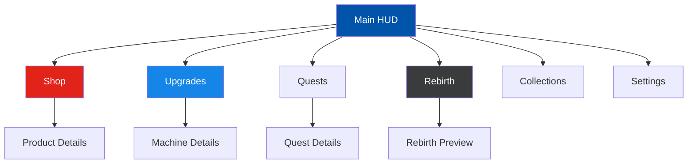
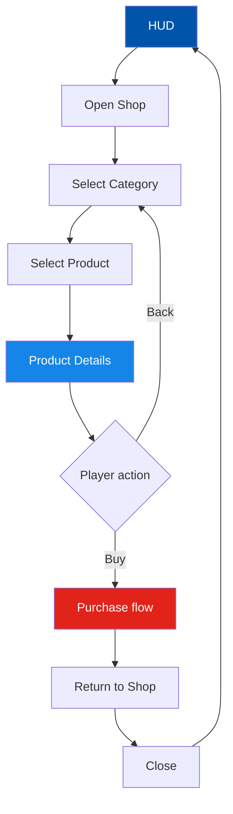

<div align="center">


### UI / UX DESIGN GUIDE


</div>

---

<div align="center">



**Make every action understandable, every decision accessible and every screen useful.**

</div>


# 15. UI / UX Design

## 15.1 Objectif

L'interface utilisateur, ou UI, représente tous les éléments visuels avec lesquels le joueur interagit : boutons, menus, compteurs, fenêtres, inventaires et indicateurs.

L'expérience utilisateur, ou UX, concerne la manière dont le joueur comprend ces éléments, prend ses décisions et navigue entre les différentes fonctionnalités.

Une interface réussie ne doit pas simplement être esthétique. Elle doit permettre au joueur de comprendre rapidement :

- Combien d'argent il possède.
- Combien sa base produit.
- Quel est son objectif actuel.
- Quelle amélioration il peut acheter.
- Comment accéder aux différentes fonctionnalités.
- Comment revenir facilement au gameplay.

Pour notre tycoon, l'interface doit compléter le monde 3D sans le masquer.

### Les quatre objectifs

| Objectif | Résultat attendu |
|---|---|
| Lisibilité | Les informations importantes sont immédiatement compréhensibles |
| Navigation | Les fonctionnalités sont faciles à trouver |
| Réactivité | Les actions donnent un retour visuel clair |
| Adaptabilité | L'interface fonctionne sur les plateformes prises en charge |

**Règle fondamentale : chaque élément affiché doit avoir une fonction identifiable.**


## 15.2 Construire une hiérarchie visuelle

Toutes les informations ne possèdent pas la même importance.

Le joueur doit pouvoir identifier les données essentielles sans devoir parcourir toute l'interface.

### Hiérarchie recommandée

| Priorité | Information | Raison |
|---|---|---|
| 1 | Argent disponible | Décisions économiques |
| 2 | Production actuelle | Comprendre les revenus |
| 3 | Objectif actuel | Savoir quoi faire |
| 4 | Prochaine amélioration | Connaître la progression |
| 5 | Navigation | Accéder aux systèmes secondaires |
| 6 | Informations complémentaires | Détails facultatifs |

Cette hiérarchie peut évoluer selon la situation.

Par exemple, lorsqu'un joueur ouvre la boutique, les informations relatives aux produits deviennent prioritaires. Lorsqu'il joue normalement, elles doivent laisser la place au monde et aux objectifs immédiats.

### Les outils de hiérarchie

- **Taille :** les informations importantes occupent davantage d'espace.
- **Contraste :** les éléments interactifs se distinguent du fond.
- **Espacement :** les groupes d'informations restent séparés.
- **Position :** les informations fréquentes sont faciles à trouver.
- **Mouvement :** les animations attirent l'attention uniquement lorsqu'elles sont utiles.

Éviter de rendre tous les éléments lumineux, animés ou colorés. Si tout attire l'attention, rien ne se distingue.


## 15.3 Concevoir le HUD principal

Le HUD, ou Heads-Up Display, regroupe les informations visibles pendant le gameplay.

Il doit donner les informations essentielles sans empêcher le joueur d'observer sa base.

### Proposition de HUD

```text
+----------------------------------------------------------+
|                                                          |
|  [LOGO]      CASH: 12,450       INCOME: +125/s    [MENU] |
|                                                          |
|                                                          |
|                                                          |
|                  TYCOON WORLD                            |
|                                                          |
|                  [3D GAMEPLAY]                           |
|                                                          |
|                                                          |
|  CURRENT OBJECTIVE                                      |
|  Buy the next machine                       [VIEW]       |
|                                                          |
|  [SHOP]   [UPGRADES]   [REBIRTH]   [QUESTS]   [MORE]     |
|                                                          |
+----------------------------------------------------------+
```

Cette maquette illustre la répartition des informations. Ce n'est pas une capture réelle du jeu ni une disposition définitive.

### Les composants du HUD

| Composant | Fonction |
|---|---|
| Logo | Identifier le jeu |
| Cash | Afficher la monnaie principale |
| Income | Montrer la production actuelle |
| Menu | Accéder aux paramètres |
| Objective | Afficher la prochaine action recommandée |
| Shop | Accéder aux achats |
| Upgrades | Améliorer les machines |
| Rebirth | Accéder à la progression avancée |
| Quests | Consulter les objectifs |
| More | Regrouper les fonctionnalités secondaires |

### Informations contextuelles

Le HUD ne doit pas afficher toutes les données en permanence.

Exemples :

- Les détails d'une machine apparaissent lorsque le joueur la sélectionne.
- Les informations d'une quête apparaissent lorsqu'il ouvre le panneau correspondant.
- Les commandes d'interaction apparaissent à proximité d'un objet utilisable.
- Les informations de récompense apparaissent lorsqu'une action est terminée.


## 15.4 Construire un système de navigation

Le joueur doit pouvoir passer d'une fonctionnalité à une autre sans perdre le fil de son activité.

La navigation doit être cohérente dans tout le jeu.

### Organisation proposée



### Règles de navigation

1. Les boutons principaux doivent rester faciles à trouver.
2. Les menus secondaires doivent être organisés par catégorie.
3. Une fenêtre doit pouvoir être fermée facilement.
4. Les menus ne doivent pas s'empiler inutilement.
5. Les actions importantes doivent demander une confirmation adaptée.
6. Le joueur doit pouvoir revenir au gameplay rapidement.
7. La navigation à la manette doit être prévue dès la conception.

### Structure des menus

| Niveau | Exemple | Contenu |
|---|---|---|
| Principal | HUD | Informations et accès directs |
| Secondaire | Shop | Catégories de produits |
| Détail | Product Details | Description et prix |
| Confirmation | Purchase / Rebirth | Résumé et validation |
| Paramètres | Settings | Audio, interface et préférences |


## 15.5 Concevoir les boutons et interactions

Un bouton doit communiquer clairement son action.

Le joueur doit pouvoir comprendre :

- Ce qui va se passer.
- Si l'action est disponible.
- Si une condition manque.
- Si l'action est temporaire ou permanente.
- Si une confirmation est nécessaire.

### États d'un bouton

| État | Apparence | Comportement |
|---|---|---|
| Normal | Apparence standard | Disponible |
| Hover | Mise en évidence | Souris au-dessus |
| Pressed | Apparence enfoncée | Interaction en cours |
| Disabled | Apparence atténuée | Action indisponible |
| Loading | Indicateur de chargement | Traitement en cours |
| Success | Retour positif | Action terminée |
| Error | Message explicite | Action échouée |

Un bouton désactivé ne doit pas être incompréhensible. Si possible, expliquer pourquoi l'action est indisponible.

Exemple :

```text
+--------------------------------+
|          BUY MACHINE           |
|                                |
|        Cost: 5,000             |
|        Cash: 3,200             |
|                                |
|        NOT ENOUGH CASH         |
+--------------------------------+
```

### Feedback après interaction

Chaque action doit produire une réponse adaptée.

| Action | Feedback |
|---|---|
| Achat réussi | Animation et confirmation |
| Achat impossible | Raison clairement affichée |
| Menu ouvert | Transition courte |
| Quête terminée | Récompense visible |
| Erreur de sauvegarde | Message explicatif |
| Rebirth confirmé | Présentation du changement |

Éviter les animations longues qui ralentissent les actions répétées.


## 15.6 Fenêtres et panneaux

Les fenêtres permettent de présenter davantage d'informations sans surcharger le HUD.

Elles doivent cependant rester organisées.

### Catégories de fenêtres

| Fenêtre | Fonction |
|---|---|
| Shop | Achats et produits |
| Upgrades | Améliorations |
| Inventory | Objets possédés |
| Quests | Objectifs |
| Collections | Objets à obtenir |
| Rebirth | Progression permanente |
| Settings | Préférences |
| Machine Details | Informations d'une machine |

### Règles de conception

- Une fenêtre doit avoir un titre clair.
- Les informations doivent être regroupées.
- Le bouton de fermeture doit être identifiable.
- Le contenu doit rester lisible.
- Les actions importantes doivent être séparées des actions secondaires.
- Les fenêtres ne doivent pas cacher inutilement les informations nécessaires.
- Les transitions doivent rester courtes.

### Éviter l'empilement

Il vaut mieux remplacer une fenêtre par une autre ou utiliser des panneaux internes plutôt que d'ouvrir continuellement de nouvelles fenêtres.




## 15.7 Identité visuelle et design system

Une interface cohérente doit utiliser les mêmes règles visuelles dans tout le jeu.

Les couleurs, espacements, tailles de texte, icônes et animations doivent appartenir à un système commun.

### Palette proposée

<details>
<summary><strong>Palette de couleurs du projet</strong></summary>

| Couleur | Code | Utilisation |
|---|---|---|
| Roblox Red | `#E2231A` | Actions principales et accents |
| Technical Blue | `#0055AA` | Navigation et éléments secondaires |
| Bright Blue | `#1685E8` | Informations et interactions |
| Dark Gray | `#393B3D` | Fonds et panneaux |
| Light Gray | `#E5E5E5` | Séparateurs et textes secondaires |
| White | `#FFFFFF` | Texte principal sur fond sombre |

</details>

### Règles de couleurs

- Rouge : attirer l'attention sur une action importante.
- Bleu : identifier les fonctionnalités et informations.
- Gris : organiser les éléments secondaires.
- Blanc : garantir la lisibilité.

Ne pas utiliser la couleur comme unique indicateur d'état. Ajouter un texte, une icône ou une forme complémentaire.

### Typographie

Utiliser une hiérarchie stable :

| Niveau | Utilisation |
|---|---|
| Display | Titres importants |
| Heading | Titres de panneaux |
| Body | Descriptions |
| Label | Boutons et catégories |
| Caption | Informations secondaires |

Les polices et tailles exactes devront être validées dans Roblox Studio sur les appareils ciblés.

### Formes et composants

Définir des règles communes pour :

- Rayon des coins.
- Épaisseur des bordures.
- Ombres.
- Espacement intérieur.
- Dimensions des boutons.
- Icônes.
- États interactifs.

Le joueur doit reconnaître immédiatement les composants déjà rencontrés.


## 15.8 Design responsive et multiplateforme

Roblox est utilisé sur plusieurs types d'appareils. L'interface doit s'adapter à la taille de l'écran et à la méthode d'entrée.

Une interface conçue uniquement pour un écran PC risque d'être inutilisable sur téléphone ou console.

### PC

Priorités :

- Utiliser l'espace disponible.
- Permettre une navigation rapide à la souris.
- Afficher les raccourcis clavier pertinents.
- Éviter les panneaux trop grands.
- Conserver une bonne visibilité du monde 3D.

### Mobile

Priorités :

- Boutons adaptés au toucher.
- Textes lisibles.
- Menus compacts.
- Zones d'interaction accessibles aux pouces.
- Respect des zones occupées par les contrôles Roblox.
- Éviter les interactions trop précises.

### Console

Priorités :

- Navigation à la manette.
- Focus visuel clairement identifiable.
- Parcours entre les boutons prévisible.
- Contrôles et raccourcis affichés.
- Fenêtres accessibles sans souris.

### Comparaison

| Élément | PC | Mobile | Console |
|---|---|---|---|
| Navigation | Souris / clavier | Toucher | Manette |
| Boutons | Compacts | Plus grands | Focusables |
| Menus | Plusieurs panneaux possibles | Organisation condensée | Navigation séquentielle |
| Indications | Raccourcis clavier | Gestes / toucher | Boutons de manette |
| HUD | Plus d'informations | Priorité aux essentiels | Lisibilité à distance |

### Règle importante

Ne pas simplement réduire toute l'interface pour mobile.

Il faut réorganiser les informations et les interactions en fonction de l'espace disponible.


## 15.9 Adapter l'interface aux différents écrans

La taille des éléments doit être définie avec une logique responsive.

Dans Roblox, plusieurs propriétés et systèmes peuvent aider à construire des interfaces adaptatives.

### Éléments techniques utiles

| Élément Roblox | Utilisation |
|---|---|
| `UDim2` | Positionnement et dimensions |
| `AnchorPoint` | Définir le point d'ancrage |
| `UIListLayout` | Organiser une liste |
| `UIGridLayout` | Organiser une grille |
| `UIScale` | Adapter l'échelle |
| `UITextSizeConstraint` | Encadrer la taille du texte |
| `UISizeConstraint` | Limiter les dimensions |
| `UIAspectRatioConstraint` | Conserver un ratio |
| `GuiService` | Accéder à certaines informations d'interface |
| `UserInputService` | Détecter les types d'entrée |

### Zones de sécurité

Les éléments importants ne doivent pas être placés dans les zones occupées par les contrôles tactiles ou les éléments système Roblox.

Il faut notamment vérifier :

- Les bords de l'écran.
- Les encoches des appareils.
- Les contrôles virtuels.
- Les boutons d'interaction.
- Les zones de navigation.

### Exemple de logique responsive

```lua
local GuiService = game:GetService("GuiService")

local function updateInterface()
    local displaySize = GuiService.ViewportDisplaySize

    if displaySize == Enum.ViewportDisplaySize.Small then
        -- Compact mobile or handheld layout
    elseif displaySize == Enum.ViewportDisplaySize.Medium then
        -- Standard desktop layout
    else
        -- Large display layout
    end
end
```

Cet exemple illustre une approche basée sur la taille d'affichage. Il doit être adapté et testé avec les propriétés et événements disponibles dans la version de Roblox Studio utilisée.


## 15.10 Accessibilité et lisibilité

Une interface doit rester utilisable par des joueurs ayant des capacités visuelles et motrices différentes.

### Bonnes pratiques

- Contraste suffisant entre texte et arrière-plan.
- Taille de texte adaptée à l'écran.
- Boutons suffisamment grands.
- Icônes accompagnées de libellés lorsque nécessaire.
- Informations importantes non basées uniquement sur la couleur.
- Animations courtes et non excessives.
- Messages d'erreur compréhensibles.
- Navigation possible avec les entrées prises en charge.

### Exemple de mauvais affichage

```text
[ GREEN ] = SUCCESS
[ RED   ] = FAILURE
```

Ce système dépend uniquement de la couleur.

### Version améliorée

```text
[✓] PURCHASE COMPLETED
[!] NOT ENOUGH CASH
```

L'icône et le texte communiquent l'information même si les couleurs sont difficiles à distinguer.

### Texte et lisibilité

Les informations suivantes doivent être particulièrement lisibles :

- Prix.
- Quantités.
- Revenus.
- Objectifs.
- Durées.
- Messages de confirmation.
- Conditions d'achat.


## 15.11 Animations et transitions

Les animations renforcent le feedback et rendent l'interface plus agréable.

Elles doivent toutefois rester fonctionnelles.

### Animations utiles

| Situation | Animation |
|---|---|
| Achat | Confirmation courte |
| Gain d'argent | Mise à jour du compteur |
| Ouverture de menu | Transition légère |
| Amélioration | Effet visuel sur le bouton |
| Nouvelle récompense | Présentation de l'objet |
| Rebirth | Animation de transition |
| Erreur | Feedback discret |

### Règles d'animation

1. L'animation doit accompagner une action.
2. Elle ne doit pas ralentir le joueur.
3. Elle doit rester courte pour les interactions répétées.
4. Elle ne doit pas empêcher de cliquer sur les éléments suivants.
5. Elle doit être testée sur les appareils moins puissants.
6. Les effets visuels doivent rester lisibles.

### Durées indicatives

| Type | Durée de départ à tester |
|---|---:|
| Feedback de bouton | 0,08 à 0,15 s |
| Ouverture de panneau | 0,15 à 0,25 s |
| Notification | 0,2 à 0,4 s |
| Animation de récompense | 0,4 à 0,8 s |

Ces valeurs sont des points de départ pour le prototype, pas des normes imposées par Roblox.


## 15.12 Architecture technique de l'interface

L'interface doit être organisée en composants indépendants.

Une modification du HUD ne devrait pas nécessiter de réécrire toute la boutique.

### Organisation conceptuelle

```text
StarterGui
|
+-- MainHUD
|   |
|   +-- CurrencyPanel
|   +-- IncomePanel
|   +-- ObjectivePanel
|   +-- NavigationBar
|
+-- Windows
|   |
|   +-- ShopWindow
|   +-- UpgradeWindow
|   +-- QuestWindow
|   +-- InventoryWindow
|   +-- RebirthWindow
|   +-- SettingsWindow
|
+-- Notifications
|
+-- Components
    |
    +-- Buttons
    +-- Cards
    +-- Tooltips
    +-- ProgressBars
    +-- Icons
```

Cette arborescence est une proposition d'organisation. Elle devra être adaptée à la structure réelle du projet.

### Responsabilités

| Composant | Responsabilité |
|---|---|
| MainHUD | Informations principales |
| Windows | Gestion des panneaux |
| Components | Éléments réutilisables |
| Notifications | Messages temporaires |
| UIController | Coordination des interactions |
| Data layer | Réception des données nécessaires |
| Server systems | Validation des actions sensibles |

### Séparer affichage et logique

L'interface ne doit pas être responsable de calculer ou de valider les récompenses.

Exemple :

- Le client demande l'achat d'une amélioration.
- Le serveur vérifie les ressources et les conditions.
- Le serveur effectue la modification.
- Le client reçoit les données actualisées.
- L'interface affiche le nouveau résultat.

Les valeurs affichées côté client ne doivent jamais être considérées comme une preuve de paiement, de propriété ou de progression.


## 15.13 États, chargement et erreurs

Une interface doit prévoir les situations où une action ne se déroule pas immédiatement.

### États à prévoir

| Situation | Comportement attendu |
|---|---|
| Chargement | Indicateur visible |
| Données indisponibles | Message explicatif |
| Action en cours | Éviter les clics répétés |
| Achat réussi | Confirmation |
| Achat refusé | Message adapté |
| Déconnexion | Information claire |
| Sauvegarde en attente | État visible si pertinent |

### Exemple

```text
+--------------------------------+
|          UPGRADING...          |
|                                |
|       Please wait              |
|                                |
|       [ LOADING ]              |
+--------------------------------+
```

Éviter les fenêtres qui restent bloquées sans explication.

Une erreur doit permettre au joueur de comprendre ce qui s'est passé et, lorsque c'est possible, de réessayer.


## 15.14 Tester l'expérience utilisateur

Une interface ne doit pas être validée uniquement parce qu'elle paraît belle au développeur.

Il faut observer de vrais joueurs qui essaient d'effectuer des actions.

### Tests d'utilisation

Demander à un joueur de :

1. Trouver son argent actuel.
2. Identifier son revenu par seconde.
3. Acheter une amélioration.
4. Trouver une quête.
5. Ouvrir la boutique.
6. Fermer une fenêtre.
7. Accéder aux paramètres.
8. Comprendre pourquoi un achat est indisponible.

Ne pas expliquer immédiatement comment faire.

Observer :

- Les hésitations.
- Les mauvais clics.
- Les retours en arrière.
- Les éléments ignorés.
- Les textes incompris.
- Les actions abandonnées.

### Tests par plateforme

| Plateforme | Vérifications |
|---|---|
| PC | Souris, clavier, résolution et navigation |
| Mobile | Toucher, orientation et zones accessibles |
| Console | Manette, focus et navigation |
| Écran large | Lisibilité et proportions |
| Petit écran | Priorisation et adaptation |

### Questions à poser aux testeurs

- As-tu compris ce que tu pouvais faire ?
- As-tu trouvé facilement les informations importantes ?
- Quel bouton t'a semblé ambigu ?
- As-tu eu du mal à fermer un menu ?
- As-tu compris pourquoi une action était impossible ?
- Quelle information était inutile ou manquante ?


## 15.15 Mesurer les performances de l'interface

Les données peuvent révéler des problèmes que les observations seules ne montrent pas.

### Indicateurs utiles

| Indicateur | Utilité |
|---|---|
| Menu Open Rate | Identifier les menus utilisés |
| Purchase Flow Completion | Repérer les abandons dans un parcours d'achat |
| Failed Interactions | Identifier les actions qui échouent |
| Time to First Upgrade | Mesurer la facilité de la première amélioration |
| Navigation Time | Évaluer la rapidité d'accès aux fonctionnalités |
| Menu Exit Rate | Repérer les fenêtres qui interrompent l'activité |
| Task Completion Rate | Mesurer la réussite des tâches |

### Taux de réussite d'une tâche

\[
Task\ Completion = \frac{Tâches\ terminées}{Tâches\ commencées} \times 100
\]

### Temps moyen d'exécution

\[
Average\ Time = \frac{Somme\ des\ durées}{Nombre\ de\ tentatives}
\]

Les mesures doivent être associées à des tests qualitatifs. Un joueur peut terminer une tâche tout en ayant trouvé l'interface frustrante.


## 15.16 Erreurs fréquentes

| Erreur | Conséquence | Correction |
|---|---|---|
| Trop de fenêtres | Interface encombrée | Réduire et organiser |
| Textes minuscules | Mauvaise lisibilité | Adapter les tailles |
| Couleurs sans contraste | Informations difficiles à lire | Améliorer le contraste |
| HUD trop imposant | Monde masqué | Prioriser les informations |
| Boutons trop petits | Mauvaise interaction tactile | Agrandir les zones interactives |
| Menus PC uniquement | Expérience mobile dégradée | Concevoir plusieurs dispositions |
| Navigation manette oubliée | Console difficile à utiliser | Prévoir le focus |
| Animations excessives | Ralentissement des actions | Limiter les transitions |
| États désactivés incompréhensibles | Frustration | Expliquer les conditions |
| Informations répétées | Surcharge visuelle | Afficher le contexte utile |
| Logique sensible côté client | Risque d'exploitation | Validation serveur |


## 15.17 Proposition de MVP

La première version doit contenir uniquement les éléments nécessaires au gameplay principal.

### Interface minimale

| Composant | Priorité | Objectif |
|---|---|---|
| HUD monnaie | Haute | Afficher les ressources |
| HUD production | Haute | Afficher les revenus |
| Objectif actuel | Haute | Guider le joueur |
| Menu améliorations | Haute | Acheter des upgrades |
| Boutique | Haute | Accéder aux produits |
| Notifications | Moyenne | Signaler les événements |
| Paramètres | Moyenne | Gérer les préférences |
| Quêtes | Moyenne | Suivre les objectifs |
| Rebirth | Selon progression | Accéder au prestige |

### Ordre de développement

1. Définir la hiérarchie des informations.
2. Créer un wireframe du HUD.
3. Construire les composants réutilisables.
4. Développer la navigation.
5. Ajouter les fenêtres principales.
6. Adapter les layouts aux différentes tailles.
7. Ajouter les états et animations.
8. Tester avec de vrais joueurs.
9. Corriger les problèmes de lisibilité et d'interaction.


## 15.18 Questions de conception

Avant de développer un nouvel élément d'interface, répondre aux questions suivantes.

| Question | Résultat attendu |
|---|---|
| Quel problème du joueur ce système résout-il ? | Une fonction claire |
| Quelle est la version minimale à tester ? | Un wireframe ou prototype |
| Quel est le coût technique et de maintenance ? | Une estimation réaliste |
| Comment le système fonctionne-t-il pour un joueur gratuit ? | Accès complet aux fonctions essentielles |
| Quelles données permettent de vérifier son utilité ? | Mesures d'utilisation et retours |
| Est-il utilisable sur mobile ? | Interaction tactile adaptée |
| Est-il utilisable à la manette ? | Navigation complète |
| Est-il accessible ? | Contraste et lisibilité suffisants |
| Le joueur comprend-il les erreurs ? | Feedback explicite |


## 15.19 Definition of Done

La section UI / UX Design est considérée comme prête lorsque :

- [ ] La hiérarchie des informations est définie.
- [ ] Le HUD affiche les informations essentielles.
- [ ] Les menus sont organisés.
- [ ] Les boutons possèdent des états cohérents.
- [ ] Les actions importantes affichent un feedback.
- [ ] Les erreurs sont compréhensibles.
- [ ] Les fenêtres peuvent être fermées facilement.
- [ ] Le système visuel est cohérent.
- [ ] Les interfaces s'adaptent aux tailles d'écran ciblées.
- [ ] Les contrôles mobiles sont accessibles.
- [ ] La navigation à la manette fonctionne.
- [ ] Les textes restent lisibles.
- [ ] Les informations ne reposent pas uniquement sur la couleur.
- [ ] Les animations ne ralentissent pas le gameplay.
- [ ] Les actions sensibles sont validées côté serveur.
- [ ] Des tests utilisateurs ont été réalisés sur les plateformes prises en charge.


## 15.20 Documentation officielle

Les références suivantes servent de base à la conception et à l'implémentation de l'interface.

| Ressource | Utilité |
|---|---|
| [UI and UX Design](https://create.roblox.com/docs/production/game-design/ui-ux-design) | Principes de conception UI et UX |
| [User Interface](https://create.roblox.com/docs/ui) | Objets et composants d'interface |
| [Cross-platform Development](https://create.roblox.com/docs/projects/cross-platform) | Adaptation multiplateforme |
| [Adaptive Design Guidelines](https://create.roblox.com/docs/production/publishing/adaptive-design) | Design adaptatif |
| [Input](https://create.roblox.com/docs/input) | Gestion des entrées |
| [Mobile Input](https://create.roblox.com/docs/input/mobile) | Interaction tactile |
| [Position and Size](https://create.roblox.com/docs/ui/position-and-size) | Dimensions et positionnement |
| [UI Design Curriculum](https://create.roblox.com/docs/tutorials/curriculums/user-interface-design) | Wireframes et réalisation d'interfaces |

---

<div align="center">


## Acknowledgements

**Built with the official Roblox creator ecosystem.**

[](https://create.roblox.com/)
[](https://create.roblox.com/docs/ui)
[](https://create.roblox.com/docs/projects/cross-platform)
[](https://shields.io/)
[](https://mermaid.js.org/)

Special thanks to Roblox Creator Hub and its official documentation for the UI, UX, interface, input and cross-platform design resources referenced in this section.

---


<sub>Document: `15-UI-UX-Design/README.md` · Part of Roblox Tycoon Blueprint</sub>

<sub>Build · Learn · Share · Improve</sub>

</div>
