 <div align="center">


### Readme


</div>

---

<div align="center">



**Donner du poids aux actions. Rendre les récompenses lisibles. Construire une identité audiovisuelle reconnaissable.**

</div>

---

# 16. Audio and Visuals

## 16.1 Objectif

Le son et les effets visuels donnent du poids aux actions du joueur. Ils permettent de comprendre ce qui vient de se produire, de reconnaître une récompense et de ressentir la progression.

Dans un tycoon, une machine qui démarre, une amélioration achetée, une nouvelle zone débloquée ou un rebirth doivent produire un retour suffisamment clair pour que le joueur comprenne l'événement sans devoir lire un long message.

L'objectif n'est pas d'ajouter un effet à chaque élément. Chaque effet doit avoir une fonction identifiable.

Un bon système audiovisuel doit :

- Confirmer les actions importantes.
- Rendre les interactions compréhensibles.
- Renforcer la satisfaction des récompenses.
- Donner une identité cohérente au jeu.
- Rester lisible sur PC, mobile et console.
- Respecter les performances des appareils modestes.
- Proposer des réglages adaptés aux préférences du joueur.

---

## 16.2 Les trois fonctions du feedback audiovisuel

Chaque effet doit répondre à au moins une fonction.

| Fonction | Objectif | Exemple |
|---|---|---|
| Information | Expliquer ce qui vient de se passer | Son de confirmation après un achat |
| Récompense | Renforcer la satisfaction | Animation et son lors d'un rebirth |
| Identité | Rendre le jeu reconnaissable | Signature sonore des machines |

Un même effet peut remplir plusieurs fonctions, mais il doit rester compréhensible.

**Règle de conception :** si retirer un effet ne change ni la compréhension, ni la satisfaction, ni l'identité du jeu, cet effet n'est probablement pas prioritaire.

---

## 16.3 Construire une identité audiovisuelle

Avant de produire des dizaines de sons et d'animations, il faut définir une direction artistique.

L'identité audiovisuelle doit correspondre à l'univers du tycoon, à son rythme et à son public.

### Questions de direction artistique

- Le jeu doit-il paraître calme, énergique, industriel, futuriste ou cartoon ?
- Les machines doivent-elles produire des sons mécaniques réalistes ou stylisés ?
- Les récompenses doivent-elles être discrètes ou spectaculaires ?
- Les effets doivent-ils privilégier la simplicité ou le détail ?
- Quelle palette de couleurs représente les différentes étapes de progression ?
- Quels sons doivent être immédiatement reconnaissables ?

### Exemple de direction audiovisuelle

| Élément | Direction possible |
|---|---|
| Machines | Sons mécaniques courts et répétitifs |
| Achats | Confirmation sonore légère |
| Upgrades | Son montant en intensité selon l'amélioration |
| Zones | Ambiance distincte par environnement |
| Rebirth | Sonorité plus marquante et animation dédiée |
| Récompenses rares | Signature visuelle et sonore particulière |

Ces exemples constituent une base de conception, pas une liste obligatoire.

---

## 16.4 Concevoir les effets sonores

Les sons doivent aider le joueur à identifier les événements sans créer de fatigue auditive.

### Catégories de sons

| Catégorie | Événements concernés | Priorité |
|---|---|---|
| Interface | Boutons, menus, confirmations | Haute |
| Économie | Achat, collecte, vente | Haute |
| Progression | Upgrade, déblocage, rebirth | Haute |
| Machines | Démarrage, production, transport | Moyenne |
| Environnement | Ambiance des zones | Moyenne |
| Récompenses | Succès, événements rares | Variable |

### Règles de conception

- Utiliser des sons courts pour les interactions fréquentes.
- Réserver les sons longs aux événements importants.
- Éviter de jouer plusieurs sons identiques simultanément.
- Prévoir une limite pour les sons répétitifs des machines.
- Ne pas utiliser le volume maximal comme indicateur de récompense.
- Différencier les sons de confirmation, d'erreur et d'information.
- Éviter les fréquences agressives et les changements brutaux de volume.

### Fréquence des événements

Un tycoon peut déclencher des centaines d'événements par minute. Les sons ne doivent donc pas tous être joués à chaque occurrence.

Exemple :

| Événement | Comportement sonore |
|---|---|
| Chaque objet produit | Pas nécessairement de son |
| Collecte manuelle | Son court |
| Achat d'une machine | Son de confirmation |
| Upgrade important | Son distinct |
| Déblocage d'une zone | Son spécial |
| Rebirth | Séquence dédiée |

Le son doit accompagner le rythme du jeu, pas le saturer.

---

## 16.5 Musique et ambiance sonore

La musique définit une partie de l'atmosphère du jeu. Elle doit soutenir l'expérience sans gêner les interactions.

### Musique de fond

Une musique de fond peut :

- Donner une identité à une zone.
- Accompagner les sessions longues.
- Renforcer l'ambiance générale.
- Marquer une transition entre plusieurs environnements.

### Ambiances par zone

Les zones peuvent posséder des ambiances différentes, à condition que les transitions restent cohérentes.

Exemple :

| Zone | Ambiance possible |
|---|---|
| Zone de départ | Musique légère et accessible |
| Zone industrielle | Ambiance mécanique |
| Zone avancée | Musique plus dynamique |
| Zone spéciale | Identité sonore distincte |

### Règles

- La musique doit pouvoir être désactivée.
- Les transitions ne doivent pas produire de coupure brutale.
- Les sons d'interface doivent rester audibles.
- Les ambiances ne doivent pas être plus fortes que les événements importants.
- Les boucles doivent éviter les coupures perceptibles.

---

## 16.6 Effets visuels et feedback des actions

Les effets visuels doivent montrer clairement l'importance d'une action.

Ils peuvent prendre plusieurs formes :

| Effet | Utilisation |
|---|---|
| Particules | Collecte, production, récompense |
| Lumière | Activation, déblocage, événement |
| Animation | Achat, ouverture, transformation |
| Transition | Changement de zone ou de menu |
| Indicateur | Progression, gain, objectif terminé |
| Post-traitement | Mise en valeur ponctuelle d'un événement |

### Hiérarchie visuelle

Tous les événements ne doivent pas recevoir la même intensité visuelle.

| Importance | Exemple | Intensité recommandée |
|---|---|---|
| Faible | Collecte répétitive | Discrète |
| Moyenne | Achat ou amélioration | Visible mais courte |
| Élevée | Nouvelle zone | Animation plus marquée |
| Exceptionnelle | Rebirth ou récompense rare | Signature visuelle dédiée |

Cette hiérarchie évite que les événements ordinaires attirent autant l'attention que les moments importants.

---

## 16.7 Feedback par action

Chaque action principale du tycoon doit posséder un retour cohérent.

| Action | Feedback visuel | Feedback sonore |
|---|---|---|
| Collecter | Indicateur de gain | Son court |
| Acheter | Confirmation sur l'objet ou l'interface | Son de validation |
| Améliorer | Modification visible de la machine | Son d'amélioration |
| Débloquer une zone | Animation de transition | Son de déblocage |
| Terminer une quête | Mise en évidence de la récompense | Son de réussite |
| Effectuer un rebirth | Présentation du gain et du reset | Signature sonore |
| Échouer à un achat | État d'erreur compréhensible | Son discret d'erreur |

Le feedback doit être immédiat et cohérent avec le résultat réel de l'action.

Un effet ne doit jamais annoncer une récompense que le joueur n'a pas reçue.

---

## 16.8 Effets visuels des machines

Les machines représentent une grande partie de l'identité d'un tycoon.

Elles doivent être visuellement compréhensibles et donner une impression de fonctionnement.

### Éléments possibles

- Pièces mobiles.
- Lumières d'activité.
- Particules de production.
- Convoyeurs animés.
- Indicateurs de fonctionnement.
- Effets de transformation.
- Animations d'amélioration.

### Lisibilité

Une machine doit communiquer son état sans obliger le joueur à interpréter une animation complexe.

Exemple :

| État | Indication possible |
|---|---|
| Inactive | Aucun mouvement |
| En production | Animation mécanique |
| Améliorée | Modification visuelle identifiable |
| Bloquée | Indicateur d'erreur |
| Débloquée récemment | Animation de découverte |

Les effets permanents doivent être justifiés. Une machine n'a pas besoin de produire des dizaines de particules en continu pour paraître active.

---

## 16.9 Particules, lumières et post-traitement

Les effets visuels avancés peuvent améliorer l'ambiance, mais ils doivent être utilisés avec modération.

### Particules

Les ParticleEmitter peuvent représenter :

- De la fumée.
- Des étincelles.
- Des objets collectés.
- Des effets de récompense.
- Des éléments d'environnement.

Points de vigilance :

- Limiter le nombre d'émetteurs actifs.
- Réduire les émissions répétitives.
- Éviter les couches excessives de transparence.
- Préférer des effets courts aux effets permanents.
- Tester les scènes avec beaucoup de machines actives.

### Lumières

Les sources lumineuses peuvent signaler une activité, un objet spécial ou une zone importante.

Elles ne doivent pas être utilisées partout. Une accumulation de lumières dynamiques peut augmenter le coût de rendu.

### Post-traitement

Les effets comme le Bloom, le Blur ou la correction des couleurs doivent servir un objectif précis.

Ils ne doivent pas rendre l'interface illisible ou masquer les informations importantes.

---

## 16.10 Architecture du système audiovisuel

Les effets doivent être organisés pour éviter de disperser la logique sonore et visuelle dans tous les scripts du jeu.

Une architecture centralisée facilite la maintenance et les réglages.

### Organisation conceptuelle

```text
ReplicatedStorage
└── Shared
    └── AudioVisual
        ├── AudioConfig
        ├── VisualConfig
        └── EffectDefinitions

SoundService
└── AudioGroups
    ├── Music
    ├── SFX
    └── Ambience

StarterPlayer
└── StarterPlayerScripts
    └── AudioVisualController

ServerScriptService
└── Gameplay
    └── GameplayEvents
```

Cette structure est une proposition d'organisation. Elle ne représente pas l'arborescence actuelle d'un projet Roblox particulier.

### Responsabilités

| Composant | Responsabilité |
|---|---|
| AudioConfig | Références et paramètres audio |
| VisualConfig | Paramètres des effets visuels |
| EffectDefinitions | Définition des effets disponibles |
| AudioVisualController | Lecture et déclenchement côté client |
| GameplayEvents | Événements de gameplay validés côté serveur |

### Séparation client / serveur

Le serveur doit rester responsable des résultats du gameplay :

- Achat validé.
- Récompense accordée.
- Upgrade appliqué.
- Zone débloquée.
- Rebirth effectué.

Le client peut ensuite afficher les effets associés à ces événements.

Les effets visuels et sonores ne doivent jamais servir de preuve qu'une action économique a réellement été validée.

---

## 16.11 Réglages audio et visuels

Le joueur doit pouvoir adapter l'expérience à ses préférences et à son appareil.

### Réglages audio

| Réglage | Fonction |
|---|---|
| Volume général | Contrôle de tous les sons |
| Musique | Contrôle de la musique |
| Effets sonores | Contrôle des interactions |
| Ambiance | Contrôle des sons environnementaux |

### Réglages visuels

| Réglage | Fonction |
|---|---|
| Effets réduits | Limite les effets secondaires |
| Particules réduites | Diminue les particules affichées |
| Flashs réduits | Limite les changements lumineux intenses |
| Animations réduites | Réduit les mouvements non essentiels |

Les réglages doivent être compréhensibles, faciles à trouver et conservés entre les sessions lorsque le système de sauvegarde le permet.

### Accessibilité

Prévoir des alternatives aux informations transmises uniquement par le son ou la couleur.

Exemples :

- Une erreur doit aussi être identifiable visuellement.
- Une récompense ne doit pas être signalée uniquement par un son.
- Les couleurs doivent être accompagnées d'icônes ou de textes lorsque c'est nécessaire.
- Les animations importantes doivent rester compréhensibles avec les effets réduits.

---

## 16.12 Performance et appareils modestes

Les effets audiovisuels peuvent rapidement devenir coûteux lorsque le joueur possède de nombreuses machines.

Le système doit être conçu pour évoluer avec la quantité d'objets présents dans le tycoon.

### Principaux risques

| Risque | Conséquence possible |
|---|---|
| Trop de particules | Charge GPU plus importante |
| Trop de lumières | Coût de rendu accru |
| Trop d'animations simultanées | Charge de calcul supplémentaire |
| Sons répétitifs | Saturation sonore et traitement inutile |
| Trop d'objets visibles | Augmentation des appels de rendu |
| Effets non nettoyés | Accumulation d'instances inutiles |

### Optimisations

- Réutiliser les effets lorsque c'est pertinent.
- Limiter la fréquence des événements visuels.
- Arrêter les effets qui ne sont plus nécessaires.
- Éviter les effets permanents sur chaque machine.
- Réduire les détails des effets secondaires.
- Prévoir un mode avec effets réduits.
- Tester avec un grand nombre de machines actives.
- Comparer les performances sur plusieurs niveaux de qualité graphique.

La documentation Roblox signale notamment que les particules et les objets graphiques peuvent augmenter le nombre d'appels de rendu. Les changements de propriétés des ParticleEmitter peuvent également avoir un impact notable sur les performances.

---

## 16.13 Gestion des ressources et des droits

Les sons, musiques, images, textures et modèles utilisés dans le jeu doivent être autorisés.

### Sources possibles

- Ressources créées par l'équipe.
- Ressources du Creator Store dont les conditions permettent l'utilisation prévue.
- Ressources obtenues avec une licence adaptée.
- Commandes réalisées par des artistes ou compositeurs.

### Vérifications obligatoires

Avant d'intégrer une ressource :

1. Identifier son créateur.
2. Vérifier les conditions d'utilisation.
3. Vérifier les droits nécessaires pour l'expérience.
4. Vérifier les éventuelles restrictions de redistribution.
5. Conserver les crédits lorsque la licence ou le créateur l'exige.
6. Vérifier que l'asset est accessible à l'expérience.

Ne pas considérer qu'un fichier trouvé sur Internet est libre d'utilisation.

La documentation Roblox précise que les créateurs doivent disposer des droits légaux sur les ressources audio importées. Le système de confidentialité des assets peut également limiter les expériences autorisées à utiliser un asset.

---

## 16.14 Organisation d'une bibliothèque audiovisuelle

Une bibliothèque centralisée évite les doublons et facilite les modifications.

Exemple de classement :

```text
AudioVisualAssets
├── Audio
│   ├── UI
│   ├── Economy
│   ├── Machines
│   ├── Progression
│   └── Ambience
│
├── Visual
│   ├── Particles
│   ├── Lights
│   ├── Rewards
│   ├── Machines
│   └── Transitions
│
└── Documentation
    ├── AssetCredits
    ├── AudioGuidelines
    └── VisualGuidelines
```

Pour chaque ressource, documenter :

- Son nom.
- Son rôle.
- Son emplacement.
- Son créateur ou sa source.
- Ses conditions d'utilisation.
- Les endroits où elle est utilisée.
- Les éventuelles limites techniques.

---

## 16.15 Méthode de production

Le système doit être construit progressivement.

### Étape 1 : Identifier les événements importants

Lister les actions qui nécessitent un retour visuel ou sonore.

### Étape 2 : Définir une identité

Choisir les styles sonores, les couleurs, les animations et les intensités.

### Étape 3 : Créer un prototype

Ajouter un seul effet à chaque action prioritaire.

### Étape 4 : Tester la compréhension

Demander à un joueur de réaliser une action sans explication.

Observer s'il comprend ce qui vient de se passer.

### Étape 5 : Tester la répétition

Faire fonctionner plusieurs machines simultanément et observer la saturation.

### Étape 6 : Ajouter les réglages

Prévoir les volumes audio et les options de réduction des effets.

### Étape 7 : Optimiser

Mesurer les performances sur les appareils ciblés et réduire les effets inutiles.

---

## 16.16 Tests et critères de validation

| Test | Résultat attendu |
|---|---|
| Achat d'une machine | Confirmation claire |
| Upgrade | Changement perceptible |
| Collecte répétée | Pas de saturation sonore |
| Plusieurs machines actives | Effets toujours lisibles |
| Rebirth | Événement distinct et compréhensible |
| Musique désactivée | Les autres sons restent contrôlables |
| Effets réduits | Le gameplay reste compréhensible |
| Appareil mobile | Interface et effets restent utilisables |
| Qualité graphique faible | Informations importantes conservées |
| Ressource externe | Droits et permissions vérifiés |

### Tests avec des joueurs

Questions à poser :

- As-tu compris ce qui vient de se passer ?
- Le son était-il utile ?
- L'effet était-il trop visible ou trop discret ?
- As-tu remarqué une baisse de fluidité ?
- Les réglages étaient-ils faciles à trouver ?
- As-tu pu jouer confortablement sans musique ?

Ne pas confondre un effet spectaculaire avec un effet efficace.

---

## 16.17 Indicateurs de qualité

Les effets audiovisuels ne doivent pas être évalués uniquement par leur apparence.

| Indicateur | Ce qu'il permet d'observer |
|---|---|
| Compréhension des actions | Le joueur identifie les événements |
| Erreurs d'interprétation | Les effets ne créent pas de confusion |
| Utilisation des réglages | Les options sont accessibles et utiles |
| Fréquence des sons | Les sons répétitifs ne deviennent pas envahissants |
| Fluidité | Les effets ne dégradent pas l'expérience |
| Retours des joueurs | Les effets sont perçus comme utiles |

Les mesures de performance doivent être réalisées avec des outils adaptés et sur les appareils ciblés. Les impressions visuelles seules ne suffisent pas.

---

## 16.18 Erreurs fréquentes

| Erreur | Pourquoi l'éviter |
|---|---|
| Ajouter un son à chaque événement | Crée une saturation |
| Utiliser des flashs excessifs | Peut gêner certains joueurs |
| Garder des particules permanentes partout | Augmente le coût de rendu |
| Multiplier les styles visuels | Affaiblit l'identité du jeu |
| Utiliser une musique trop forte | Masque les sons utiles |
| Négliger les réglages | Réduit le confort de jeu |
| Utiliser des assets sans autorisation | Crée un risque juridique et de modération |
| Déclencher les effets avant validation serveur | Peut donner une fausse information |
| Tester uniquement sur un PC puissant | Masque les problèmes des appareils modestes |

---

## 16.19 Version minimale à produire

Pour le premier prototype du tycoon, le système audiovisuel peut rester volontairement limité.

### Priorités du MVP

- Un son de confirmation d'achat.
- Un son d'amélioration.
- Un son de collecte.
- Un son de récompense importante.
- Une identité visuelle cohérente.
- Un effet visuel pour les actions principales.
- Un réglage du volume général.
- Des options pour réduire les effets.
- Une vérification des droits sur chaque ressource.

Les effets avancés, les ambiances spécifiques et les animations complexes peuvent être ajoutés progressivement.

---

## 16.20 Fiche de conception

À remplir avant de développer un nouvel effet.

| Question | Réponse |
|---|---|
| Nom de l'effet | |
| Action associée | |
| Fonction | Information / Récompense / Identité |
| Type | Son / Particule / Lumière / Animation |
| Durée | |
| Fréquence de déclenchement | |
| Peut-il être désactivé ? | |
| Impact sur les performances | |
| Source de la ressource | |
| Droits vérifiés | |
| Résultat des tests | |

---

## 16.21 Definition of Done

Un système audiovisuel est prêt lorsque :

- [ ] Les actions principales possèdent un feedback compréhensible.
- [ ] Les sons importants sont distincts.
- [ ] Les effets respectent une hiérarchie visuelle.
- [ ] La direction artistique est cohérente.
- [ ] Les volumes sont réglables.
- [ ] Les effets peuvent être réduits.
- [ ] Les informations essentielles restent accessibles sans son.
- [ ] Les effets inutiles sont arrêtés ou nettoyés.
- [ ] Les performances ont été vérifiées sur les appareils ciblés.
- [ ] Les ressources utilisées disposent des autorisations nécessaires.
- [ ] Les effets ne remplacent jamais la validation réelle du gameplay.

---

## 16.22 Questions à documenter

Pour chaque évolution du système :

- Quel problème du joueur ce système résout-il ?
- Quelle est la version minimale à tester ?
- Quel est le coût technique et de maintenance ?
- Comment le système fonctionne-t-il pour un joueur gratuit ?
- Quelles données permettent de vérifier son utilité ?
- Le système reste-t-il lisible avec les effets réduits ?
- Les ressources sont-elles autorisées ?
- Quel est son impact sur les appareils modestes ?

---

## 16.23 Documentation officielle

- [Roblox Creator Hub](https://create.roblox.com/docs)
- [Audio](https://create.roblox.com/docs/audio)
- [Audio assets](https://create.roblox.com/docs/audio/assets)
- [Audio objects](https://create.roblox.com/docs/audio/objects)
- [Audio effects](https://create.roblox.com/docs/audio/effects)
- [Effects](https://create.roblox.com/docs/effects)
- [Lighting and effects](https://create.roblox.com/docs/environment)
- [Post-processing effects](https://create.roblox.com/docs/environment/post-processing-effects)
- [Improve performance](https://create.roblox.com/docs/performance-optimization/improve)
- [Creator Store](https://create.roblox.com/docs/production/creator-store)
- [Asset permissions](https://create.roblox.com/docs/projects/assets)

---

<div align="center">

### Acknowledgements

Thanks to the teams and creators who maintain the tools and documentation used to build this guide.

[](https://create.roblox.com/docs)
[](https://shields.io)

**Roblox Creator Hub** - Official technical documentation and development resources.

**Shields.io** - Badge generation.

</div>

---

<div align="center">


<sub>Document: `16-Audio-And-Visuals/README.md` · Part of Roblox Tycoon Blueprint</sub>

</div>
