<div align="center">


### Readme


</div>

---

<div align="center">



**Faire évoluer le jeu. Maintenir sa stabilité. Donner aux joueurs de bonnes raisons de revenir.**

</div>

---

# 17. Live Operations and Updates

## 17.1 Objectif

Les Live Operations, souvent appelées Live Ops, regroupent les activités nécessaires pour maintenir et faire évoluer un jeu après son lancement.

Le lancement n'est pas la fin du développement. C'est le début d'une nouvelle phase pendant laquelle l'équipe doit :

- Corriger les problèmes rencontrés par les joueurs.
- Améliorer les systèmes existants.
- Ajouter du contenu progressivement.
- Organiser des événements.
- Maintenir une communication claire.
- Surveiller les performances.
- Préserver les données des joueurs.
- Adapter la feuille de route aux résultats observés.

Une bonne stratégie Live Ops ne consiste pas à publier du contenu en permanence.

Elle consiste à apporter des améliorations utiles, à un rythme que l'équipe peut réellement maintenir.

---

## 17.2 Les différents types de mises à jour

Toutes les mises à jour ne répondent pas au même objectif.

| Type | Objectif | Exemple |
|---|---|---|
| Correctif | Résoudre un problème | Corriger un achat qui ne fonctionne pas |
| Équilibrage | Ajuster le gameplay | Modifier le prix d'une amélioration |
| Qualité de vie | Améliorer le confort | Ajouter un bouton de collecte |
| Contenu | Ajouter de nouvelles activités | Introduire une nouvelle zone |
| Événement | Proposer une activité limitée | Défi spécial de saison |
| Extension | Développer le jeu | Ajouter un nouveau monde |
| Technique | Améliorer la stabilité | Optimiser les sauvegardes |

Chaque mise à jour doit avoir un objectif identifiable.

Une mise à jour qui ajoute beaucoup de contenu sans améliorer l'expérience n'est pas nécessairement une bonne mise à jour.

---

## 17.3 Construire une feuille de route réaliste

La feuille de route décrit les évolutions prévues du jeu.

Elle permet à l'équipe de définir les priorités, de répartir le travail et de communiquer les objectifs généraux.

### Horizons de planification

| Horizon | Contenu |
|---|---|
| Court terme | Correctifs et problèmes prioritaires |
| Moyen terme | Améliorations et nouvelles fonctionnalités |
| Long terme | Nouvelles zones, systèmes et extensions |

### Exemple de feuille de route

| Phase | Priorités |
|---|---|
| Préparation | Tests, optimisation et correction des bugs |
| Lancement | Surveillance et correctifs prioritaires |
| Première évolution | Améliorations du gameplay |
| Deuxième évolution | Nouvelle zone et nouvelles machines |
| Évolution suivante | Quêtes et nouveaux objectifs |
| Long terme | Nouveaux mondes et systèmes avancés |

Cette feuille de route est un exemple de planification. Elle ne constitue pas une promesse de calendrier.

### Règles de planification

- Prévoir du temps pour les imprévus.
- Ne pas annoncer une date avant d'avoir évalué le travail.
- Limiter le nombre de fonctionnalités développées simultanément.
- Conserver une marge pour les correctifs.
- Réévaluer les priorités selon les retours des joueurs.
- Ne pas considérer une fonctionnalité commencée comme obligatoirement à publier.

---

## 17.4 Prioriser les tâches

Toutes les tâches ne doivent pas recevoir la même priorité.

Un bug qui empêche les joueurs de sauvegarder leur progression doit être traité avant une nouvelle animation cosmétique.

### Classification des priorités

| Niveau | Description | Exemple |
|---|---|---|
| P0 | Critique | Perte de données ou exploitation majeure |
| P1 | Très élevé | Achats ou progression bloqués |
| P2 | Normal | Fonctionnalité importante défectueuse |
| P3 | Faible | Défaut visuel ou amélioration secondaire |

### Méthode de priorisation

Pour chaque problème, évaluer :

1. Le nombre de joueurs concernés.
2. La gravité du problème.
3. La fréquence d'apparition.
4. Les conséquences sur la progression.
5. La difficulté de correction.

Une petite erreur qui touche tous les joueurs peut être plus importante qu'un bug majeur qui apparaît dans une situation extrêmement rare.

---

## 17.5 Le cycle de développement d'une mise à jour

Une mise à jour doit suivre un processus reproductible.

<pre>
IDÉE
  |
  v
OBJECTIF ET PÉRIMÈTRE
  |
  v
DÉVELOPPEMENT
  |
  v
TESTS TECHNIQUES
  |
  v
TESTS DE GAMEPLAY
  |
  v
VÉRIFICATION DES DONNÉES
  |
  v
PRÉPARATION DE LA PUBLICATION
  |
  v
PUBLICATION
  |
  v
SURVEILLANCE
  |
  v
ANALYSE DES RÉSULTATS
  |
  v
PROCHAIN CYCLE
</pre>

### Étapes à respecter

| Étape | Vérification |
|---|---|
| Objectif | Le changement répond à un besoin précis |
| Développement | Le code est intégré proprement |
| Tests | Les fonctionnalités existantes fonctionnent encore |
| Sauvegardes | Les données restent compatibles |
| Publication | La version est identifiée et documentée |
| Surveillance | Les erreurs et métriques sont suivies |
| Évaluation | Les résultats sont comparés aux attentes |

Une mise à jour ne doit pas être considérée comme terminée au moment où elle est publiée.

La surveillance après publication fait partie du travail.

---

## 17.6 Gestion des versions

Chaque version publiée doit pouvoir être identifiée.

Une convention interne de versionnage facilite le suivi des changements.

### Exemple de versionnage

Format proposé : `MAJOR.MINOR.PATCH`

| Type | Signification | Exemple |
|---|---|---|
| MAJOR | Changement important de structure ou de compatibilité | 2.0.0 |
| MINOR | Ajout de fonctionnalités | 1.3.0 |
| PATCH | Correctif ou petite amélioration | 1.2.4 |

Cette convention est une proposition d'organisation pour le projet. Elle ne correspond pas à une obligation de Roblox.

### Informations à conserver

Pour chaque version :

- Identifiant de version.
- Date de publication.
- Liste des changements.
- Bugs corrigés.
- Fonctionnalités ajoutées.
- Modifications des données.
- Résultats des tests.
- Problèmes connus.
- Procédure de récupération éventuelle.

Le code source et les données sauvegardées doivent être considérés séparément. Revenir à une ancienne version du code ne restaure pas automatiquement les données des joueurs.

---

## 17.7 Changelog

Le changelog est l'historique des modifications apportées au jeu.

Il permet à l'équipe de suivre le développement et aux joueurs de comprendre les changements.

### Exemple

```markdown
# Changelog

## Version 1.2.0

### Added
- New production machine.
- New upgrade category.
- Additional progression objectives.

### Changed
- Adjusted early-game machine prices.
- Improved the upgrade interface.

### Fixed
- Fixed a purchase validation issue.
- Fixed a machine animation problem.

### Technical
- Improved server-side production handling.
- Updated save-data validation.
```

### Bonnes pratiques

- Utiliser des descriptions compréhensibles.
- Séparer les nouveautés des correctifs.
- Mentionner les changements importants.
- Éviter les descriptions vagues.
- Conserver l'historique des versions.
- Ne pas exposer de détails techniques sensibles.

Le changelog interne peut être plus détaillé que les notes destinées aux joueurs.

---

## 17.8 Organisation des correctifs

Les correctifs doivent suivre une procédure adaptée à leur gravité.

### Types de correctifs

**Correctif normal**

- Développer la correction.
- Tester les fonctionnalités concernées.
- Vérifier les systèmes associés.
- Publier dans une mise à jour planifiée.

**Correctif urgent**

- Identifier le problème.
- Évaluer les risques pour les joueurs.
- Limiter temporairement la fonctionnalité concernée si nécessaire.
- Préparer une correction ciblée.
- Tester les scénarios critiques.
- Publier et surveiller immédiatement.

### Gestion des incidents

Lorsqu'un problème important apparaît :

1. Identifier les fonctionnalités affectées.
2. Déterminer si le problème touche les données.
3. Évaluer le nombre de joueurs concernés.
4. Empêcher l'aggravation du problème.
5. Préparer une correction.
6. Vérifier le résultat.
7. Informer les joueurs si nécessaire.
8. Documenter la cause et les mesures prises.

Ne jamais modifier directement des données de production sans procédure de contrôle et de récupération.

---

## 17.9 Événements et contenu temporaire

Les événements permettent de proposer des objectifs supplémentaires sans modifier entièrement le jeu.

Ils doivent être conçus pour enrichir l'expérience, pas pour obliger les joueurs à se connecter constamment.

### Types d'événements

| Type | Exemple |
|---|---|
| Saison | Thème visuel temporaire |
| Collection | Objets à obtenir pendant l'événement |
| Défi | Objectif collectif |
| Compétition | Classement temporaire |
| Exploration | Zone ou activité spéciale |
| Communauté | Objectif partagé entre joueurs |

### Cycle d'un événement

```text
PRÉPARATION
    |
    v
ANNONCE
    |
    v
OUVERTURE
    |
    v
PARTICIPATION
    |
    v
FIN DE L'ÉVÉNEMENT
    |
    v
RÉCOMPENSES
    |
    v
ARCHIVAGE ET ANALYSE
```

### Règles de conception

- Définir clairement la durée.
- Afficher les objectifs et les récompenses.
- Prévoir une fin compréhensible.
- Tester les conditions de participation.
- Éviter les objectifs impossibles à terminer.
- Ne pas rendre les récompenses essentielles à la progression permanente.
- Prévoir les joueurs qui ne peuvent pas participer pendant toute la durée.

---

## 17.10 Calendrier des événements

Les événements doivent être planifiés en fonction de la capacité réelle de l'équipe.

### Exemple de calendrier

| Période | Activité |
|---|---|
| Semaine 1 | Correctifs et stabilité |
| Semaine 2 | Petit objectif communautaire |
| Semaine 3 | Amélioration de gameplay |
| Semaine 4 | Événement limité |

Ce calendrier est un exemple. Il ne faut pas chercher à remplir chaque semaine avec du nouveau contenu.

Une période sans événement peut être nécessaire pour corriger des problèmes, améliorer les systèmes et préparer la prochaine évolution.

### Contrôle avant un événement

- [ ] Les dates de début et de fin sont définies.
- [ ] Les récompenses sont configurées.
- [ ] Les objectifs sont testés.
- [ ] Les conditions de participation sont claires.
- [ ] Les sauvegardes fonctionnent.
- [ ] La fin de l'événement est correctement gérée.
- [ ] Les récompenses ne peuvent pas être obtenues plusieurs fois par exploitation.
- [ ] Le système fonctionne sur plusieurs serveurs.

---

## 17.11 Configuration des fonctionnalités en direct

Certaines valeurs peuvent être modifiées sans publier une nouvelle version complète du jeu, lorsque l'architecture le permet.

Roblox propose notamment les Experience Configs pour gérer des valeurs de configuration accessibles aux expériences.

### Exemples de paramètres configurables

| Paramètre | Utilisation |
|---|---|
| EventEnabled | Activer un événement |
| EventEndTime | Définir sa fin |
| RewardMultiplier | Ajuster une récompense |
| MachinePriceMultiplier | Ajuster les prix |
| DoubleProduction | Activer un bonus temporaire |
| NewZoneEnabled | Contrôler l'accès à une zone |

### Précautions

- Définir des valeurs par défaut sûres.
- Valider les valeurs reçues.
- Prévoir un comportement en cas d'échec de lecture.
- Éviter de modifier plusieurs paramètres sans suivi.
- Documenter les changements.
- Tester les valeurs avant activation.

Une configuration ne doit pas remplacer les contrôles de sécurité du serveur.

---

## 17.12 Sauvegardes et migrations de données

C'est l'un des aspects les plus sensibles des mises à jour.

Une modification du système de sauvegarde peut rendre incompatibles les anciennes données des joueurs.

Exemple :

Ancienne structure :

```lua
local playerData = {
    Coins = 1000,
    Level = 5
}
```

Nouvelle structure :

```lua
local playerData = {
    DataVersion = 2,
    Coins = 1000,
    Level = 5,
    Rebirths = 0
}
```

L'ancienne sauvegarde ne contient pas forcément le champ `DataVersion` ni le champ `Rebirths`.

Le jeu doit donc pouvoir reconnaître les anciennes structures et les convertir correctement.

### Exemple de migration conceptuelle

```lua
local CURRENT_DATA_VERSION = 2

local function migrateData(data)
    if typeof(data) ~= "table" then
        return nil
    end

    local version = data.DataVersion or 1

    if version < 2 then
        data.Rebirths = data.Rebirths or 0
        data.DataVersion = 2
    end

    if data.DataVersion ~= CURRENT_DATA_VERSION then
        return nil
    end

    return data
end
```

Cet exemple illustre une migration simple. Il ne constitue pas un système complet de sauvegarde.

En production, il faut également gérer les erreurs, les valeurs incorrectes, les champs obligatoires, les conflits d'écriture et les cas de migration partielle.

### Règles de migration

- Identifier la version des données.
- Préserver les champs existants.
- Ajouter des valeurs par défaut uniquement lorsque c'est justifié.
- Vérifier les types et les valeurs.
- Tester les anciennes sauvegardes.
- Ne pas supprimer immédiatement les champs qui ne sont plus utilisés.
- Prévoir une stratégie de récupération.
- Éviter les migrations irréversibles non testées.

---

## 17.13 Protection des données avant publication

Avant de publier une mise à jour qui modifie la logique de sauvegarde, il faut préparer une solution de récupération.

Roblox propose notamment :

- La gestion des versions des entrées DataStore.
- La consultation des anciennes versions.
- La récupération d'une valeur précédente.
- Les snapshots des Data Stores via les outils Open Cloud.

Les snapshots sont particulièrement importants avant une modification susceptible d'affecter les données de nombreux joueurs.

### Checklist de sauvegarde

- [ ] Les données actuelles ont été examinées.
- [ ] Les changements de structure sont documentés.
- [ ] Les migrations ont été testées.
- [ ] Les anciennes versions sont prises en compte.
- [ ] Une stratégie de récupération existe.
- [ ] Les données de test sont séparées des données de production.
- [ ] La procédure de restauration est comprise par l'équipe.

**Important :** la restauration d'une ancienne version de données doit être réalisée avec prudence. Elle peut remplacer des progrès légitimes réalisés après la version récupérée.

---

## 17.14 Tests avant publication

Une mise à jour ne doit pas être publiée uniquement parce qu'elle fonctionne dans un scénario idéal.

Il faut vérifier les interactions entre les nouveaux systèmes et les fonctionnalités déjà présentes.

### Tests techniques

- [ ] Aucun problème critique dans les scripts.
- [ ] Les événements réseau sont validés.
- [ ] Les sauvegardes fonctionnent.
- [ ] Les erreurs sont correctement gérées.
- [ ] Les performances restent acceptables.
- [ ] Les permissions des ressources sont correctes.

### Tests de gameplay

- [ ] Les achats fonctionnent.
- [ ] La progression reste cohérente.
- [ ] Les récompenses sont correctes.
- [ ] Les nouvelles fonctionnalités sont compréhensibles.
- [ ] Les anciens joueurs conservent leur progression.
- [ ] Les nouveaux joueurs peuvent commencer normalement.

### Tests de compatibilité

- [ ] PC.
- [ ] Mobile.
- [ ] Console, si prise en charge.
- [ ] Serveurs avec plusieurs joueurs.
- [ ] Joueurs avec des sauvegardes anciennes.
- [ ] Joueurs avec une progression avancée.

---

## 17.15 Publication et surveillance

La publication est une étape importante, mais le travail continue après la mise en ligne.

### Avant la publication

- Vérifier la version.
- Vérifier les scripts modifiés.
- Confirmer les tests.
- Vérifier les sauvegardes.
- Préparer le changelog.
- Préparer le message destiné aux joueurs.
- Identifier les personnes responsables de la surveillance.

### Après la publication

- Surveiller les erreurs.
- Contrôler les sauvegardes.
- Observer les performances.
- Vérifier les achats et les récompenses.
- Examiner les retours des joueurs.
- Comparer les métriques avec la période précédente.
- Préparer un correctif si nécessaire.

### Procédure en cas de problème

Une ancienne version du code peut parfois être remise en service, mais cela ne suffit pas si les données ont déjà été modifiées par la nouvelle version.

La récupération doit donc distinguer :

1. Le code publié.
2. Les configurations actives.
3. Les données sauvegardées.
4. Les changements déjà reçus par les joueurs.

Chaque incident doit être évalué avant de décider d'une restauration.

---

## 17.16 Communication avec la communauté

La communication doit expliquer ce qui change et ce que les joueurs peuvent attendre.

### Informations à communiquer

- Nouvelles fonctionnalités.
- Correctifs importants.
- Modifications d'équilibrage.
- Événements disponibles.
- Problèmes connus.
- Changements de calendrier.
- Informations sur les maintenances.

### Bonnes pratiques

- Utiliser des descriptions précises.
- Éviter les promesses non confirmées.
- Reconnaître les problèmes importants.
- Donner des informations utiles.
- Ne pas annoncer une fonctionnalité avant qu'elle soit suffisamment avancée.
- Ne pas masquer une modification importante derrière une annonce vague.

### Exemple de notes de mise à jour

```markdown
# Update 1.2.0

## New Content
- Added a new production machine.
- Added a new progression objective.

## Improvements
- Improved the upgrade interface.
- Reduced unnecessary machine effects.

## Bug Fixes
- Fixed a purchase validation issue.
- Fixed a save-data loading problem.

## Known Issues
- Some visual effects may still appear incorrectly on older devices.
```

Les notes destinées aux joueurs doivent rester compréhensibles sans connaissance technique.

---

## 17.17 Mesurer l'impact des mises à jour

Une mise à jour doit être évaluée selon son objectif.

Ajouter une nouvelle zone n'a pas le même objectif que corriger une sauvegarde ou améliorer l'accueil des nouveaux joueurs.

### Indicateurs à surveiller

| Catégorie | Indicateur |
|---|---|
| Rétention | D1, D7 et D30 |
| Engagement | Durée moyenne des sessions |
| Progression | Taux de déblocage des zones |
| Économie | Gains et dépenses |
| Stabilité | Erreurs et échecs de sauvegarde |
| Acquisition | Nouveaux joueurs |
| Monétisation | Conversion et revenus |

### Exemple de comparaison

| Indicateur | Avant | Après |
|---|---:|---:|
| Durée moyenne des sessions | 12 min | 15 min |
| Complétion de la première quête | 65 % | 78 % |
| Erreurs de sauvegarde | 2 % | 0,5 % |

Ces chiffres sont fictifs et servent uniquement à illustrer une comparaison.

Une amélioration observée après une mise à jour ne prouve pas automatiquement que cette mise à jour en est la cause. Il faut prendre en compte les variations de fréquentation, les événements et les autres changements effectués pendant la même période.

---

## 17.18 Expérimentations et changements progressifs

Lorsqu'un changement risque d'affecter l'équilibrage ou le comportement des joueurs, il peut être utile de le tester avant de le généraliser.

Roblox propose des expériences A/B pour comparer différentes variantes et mesurer leurs effets sur des groupes de joueurs.

### Exemple

Hypothèse :

> Réduire le prix de la première machine devrait permettre à davantage de nouveaux joueurs d'atteindre leur premier achat.

| Groupe | Configuration |
|---|---|
| Contrôle | Prix actuel |
| Variante | Prix réduit |

Indicateurs possibles :

- Taux de premier achat.
- Temps avant le premier achat.
- Progression après le premier achat.
- Durée de session.
- Rétention.

### Bonnes pratiques

- Définir une hypothèse avant le test.
- Choisir une métrique principale.
- Identifier les effets secondaires possibles.
- Utiliser un échantillon suffisant.
- Respecter la durée prévue.
- Ne pas modifier les paramètres en cours de test sans raison.
- Interpréter les résultats avec prudence.

Les expériences Roblox ont des contraintes de disponibilité, de durée et de volume de joueurs. Un jeu avec peu de joueurs actifs peut ne pas disposer d'un échantillon suffisant pour obtenir des résultats concluants.

---

## 17.19 Organisation interne du travail

Une équipe doit pouvoir retrouver rapidement les informations nécessaires à chaque mise à jour.

### Exemple d'organisation documentaire

```text
LiveOps
├── Roadmap
│   ├── Current-Roadmap.md
│   └── Future-Ideas.md
│
├── Changelog
│   ├── CHANGELOG.md
│   └── Releases
│
├── Events
│   ├── Event-Calendar.md
│   └── Event-Templates.md
│
├── Bugs
│   ├── Critical-Issues.md
│   └── Known-Issues.md
│
├── Data
│   ├── Data-Schema.md
│   ├── Migration-Plan.md
│   └── Recovery-Procedure.md
│
└── Reports
    ├── Update-Reports
    └── Incident-Reports
```

Cette organisation est une proposition documentaire. Elle peut être adaptée à l'arborescence réelle du projet.

### Responsabilités possibles

| Rôle | Responsabilité |
|---|---|
| Développement | Implémenter les fonctionnalités |
| QA / Test | Vérifier les changements |
| Responsable de publication | Coordonner la mise en ligne |
| Gestion des données | Contrôler migrations et sauvegardes |
| Community management | Informer les joueurs |
| Analyse | Étudier les résultats |

Dans une petite équipe, une personne peut assurer plusieurs responsabilités. Elles doivent néanmoins rester clairement identifiées.

---

## 17.20 Erreurs fréquentes

| Erreur | Conséquence |
|---|---|
| Promettre trop de mises à jour | Pression et retards |
| Publier sans tester | Régressions |
| Modifier les sauvegardes sans migration | Perte ou incompatibilité des données |
| Ajouter du contenu sans objectif | Développement inutile |
| Multiplier les événements | Fatigue des joueurs |
| Ignorer les retours | Problèmes persistants |
| Modifier plusieurs systèmes simultanément | Analyse difficile des résultats |
| Ne pas surveiller après publication | Détection tardive des incidents |
| Confondre retour du code et restauration des données | Récupération incomplète |
| Ignorer les appareils modestes | Dégradation de l'expérience |

---

## 17.21 Version minimale à produire

Pour le premier lancement, un système Live Ops n'a pas besoin d'être complexe.

### Priorités du MVP

- Un changelog.
- Une feuille de route interne.
- Une liste de bugs priorisée.
- Une procédure de test avant publication.
- Une procédure de publication.
- Un suivi des erreurs après publication.
- Une documentation des données sauvegardées.
- Une stratégie de récupération.
- Un moyen de communiquer les changements aux joueurs.

Les événements récurrents, les expériences A/B et les configurations avancées peuvent être ajoutés lorsque le jeu et l'équipe sont prêts.

---

## 17.22 Fiche de préparation d'une mise à jour

À remplir avant chaque publication.

| Question | Réponse |
|---|---|
| Nom de la mise à jour | |
| Version | |
| Date prévue | |
| Objectif principal | |
| Fonctionnalités ajoutées | |
| Bugs corrigés | |
| Scripts concernés | |
| Données modifiées | |
| Migration nécessaire | |
| Tests effectués | |
| Risques identifiés | |
| Procédure de récupération | |
| Responsable de publication | |
| Résultat après publication | |

---

## 17.23 Definition of Done

Une mise à jour est prête lorsque :

- [ ] Son objectif est clairement défini.
- [ ] Son périmètre est documenté.
- [ ] Les fonctionnalités sont développées.
- [ ] Les systèmes existants ont été vérifiés.
- [ ] Les tests techniques sont terminés.
- [ ] Les tests de gameplay sont terminés.
- [ ] Les changements de données sont documentés.
- [ ] Les migrations ont été testées si nécessaire.
- [ ] Une stratégie de récupération existe.
- [ ] Le changelog est préparé.
- [ ] Les informations destinées aux joueurs sont prêtes.
- [ ] La version est identifiée.
- [ ] La surveillance après publication est organisée.

---

## 17.24 Questions à documenter

Pour chaque évolution :

- Quel problème du joueur cette mise à jour résout-elle ?
- Quelle est la version minimale à tester ?
- Quel est le coût technique et de maintenance ?
- Comment le système fonctionne-t-il pour un joueur gratuit ?
- Quelles données permettent de vérifier son utilité ?
- Quels systèmes existants peuvent être affectés ?
- Les anciennes sauvegardes restent-elles compatibles ?
- Comment récupérer les données en cas de problème ?
- Comment les joueurs seront-ils informés ?
- Comment mesurer le résultat après publication ?

---

## 17.25 Documentation officielle

- [Roblox Creator Hub](https://create.roblox.com/docs)
- [Production](https://create.roblox.com/docs/production)
- [Analytics](https://create.roblox.com/docs/production/analytics)
- [Get started with analytics](https://create.roblox.com/docs/production/analytics/get-started)
- [Experiments](https://create.roblox.com/docs/production/experiments)
- [Experience events and updates](https://create.roblox.com/docs/production/promotion/experience-events)
- [Data Stores](https://create.roblox.com/docs/cloud-services/data-stores)
- [Data Store best practices](https://create.roblox.com/docs/cloud-services/data-stores/best-practices)
- [Data Store versioning, listing and caching](https://create.roblox.com/docs/cloud-services/data-stores/versioning-listing-and-caching)
- [Data Stores vs Memory Stores](https://create.roblox.com/docs/cloud-services/data-stores-vs-memory-stores)

---

<div align="center">

### Acknowledgements

Thanks to the teams and creators who maintain the tools and documentation used to build this guide.

[](https://create.roblox.com/docs)
[](https://shields.io)

**Roblox Creator Hub** - Official documentation for development, analytics and data management.

**Shields.io** - Badge generation.

</div>

---

<div align="center">


<sub>Document: `17-Live-Ops-And-Updates/README.md` · Part of Roblox Tycoon Blueprint</sub>

</div>
