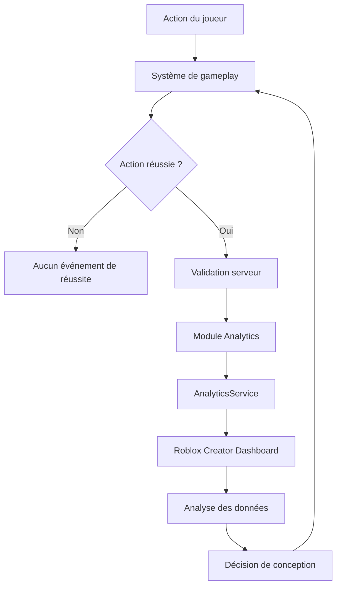

 <div align="center">


### Analytics and Data


</div>

---

<div align="center">



**Measure what matters. Understand player behavior. Make informed decisions.**

</div>

---

## 18.1. Objectif

Les analytics permettent de comprendre comment les joueurs utilisent réellement le jeu.

Ils aident à identifier :

- Les étapes que les joueurs terminent facilement.
- Les systèmes qu'ils utilisent le plus.
- Les endroits où ils ralentissent ou abandonnent.
- Les fonctionnalités qu'ils ignorent.
- Les changements qui améliorent ou détériorent leur expérience.
- Les éventuels déséquilibres dans l'économie et la progression.

L'objectif n'est pas de collecter le maximum de données. Il est de collecter suffisamment d'informations pour répondre à des questions précises.

> Une statistique n'a de valeur que si elle permet de mieux comprendre un problème ou de prendre une décision.

---

## 18.2. Les grandes catégories de données

Un tycoon peut produire beaucoup de données différentes. Il faut les organiser pour éviter de mélanger des phénomènes qui n'ont pas la même signification.

| Catégorie | Ce qu'elle permet de comprendre | Exemples |
|---|---|---|
| Acquisition | Comment les joueurs découvrent le jeu | Nouveaux joueurs, sources de trafic |
| Engagement | Comment les joueurs utilisent le jeu | Durée des sessions, fréquence de connexion |
| Progression | Comment les joueurs avancent | Machines débloquées, zones atteintes |
| Rétention | Si les joueurs reviennent | D1, D7, D30 |
| Économie | Comment les ressources circulent | Revenus, dépenses, soldes |
| Monétisation | Comment les achats facultatifs fonctionnent | Conversion, revenus, produits achetés |
| Technique | Si le jeu fonctionne correctement | Erreurs, performances, problèmes de sauvegarde |
| Social | Comment les joueurs interagissent | Visites, coopération, participation |

Ces catégories ne doivent pas toutes être instrumentées dès le premier prototype.

Commence par les données nécessaires pour comprendre la boucle principale du jeu.


## 18.3. Définir les questions avant les métriques

Avant d'ajouter un événement analytique, formule une question.

| Question | Donnée utile | Décision possible |
|---|---|---|
| Les nouveaux joueurs comprennent-ils le jeu ? | Tutoriel commencé et terminé | Améliorer les premières instructions |
| Le premier achat arrive-t-il assez tôt ? | Temps jusqu'au premier achat | Ajuster le prix ou le revenu initial |
| Les joueurs comprennent-ils les upgrades ? | Upgrades achetés | Clarifier leur effet |
| Une zone est-elle trop difficile à atteindre ? | Déblocages par zone | Rééquilibrer les coûts |
| Le rebirth est-il compris ? | Rebirth commencé et terminé | Améliorer sa présentation |
| Les joueurs utilisent-ils une fonctionnalité ? | Utilisation de cette fonctionnalité | La modifier ou la simplifier |

Une bonne question doit être suffisamment précise pour conduire à une action.

Évite les objectifs vagues comme « améliorer l'engagement » sans identifier ce que tu souhaites comprendre.

---

## 18.4. Les événements à instrumenter

Un événement représente une action ou un résultat important dans le jeu.

Pour Roblox Tycoon Blueprint, les événements prioritaires peuvent être organisés ainsi :

| Événement | Moment de déclenchement | Utilité |
|---|---|---|
| `TutorialStarted` | Début du tutoriel | Mesurer le démarrage |
| `TutorialCompleted` | Fin du tutoriel | Mesurer sa complétion |
| `FirstPurchase` | Premier achat réussi | Comprendre la première conversion de progression |
| `UpgradePurchased` | Upgrade acheté avec succès | Analyser les améliorations |
| `ZoneUnlocked` | Zone débloquée | Suivre la progression spatiale |
| `RebirthCompleted` | Rebirth terminé | Mesurer l'accès au système de prestige |
| `OptionalPurchaseCompleted` | Achat facultatif confirmé | Comprendre la monétisation |
| `QuestCompleted` | Quête terminée | Mesurer l'utilisation des objectifs |

Ces noms sont des conventions proposées pour le projet, pas des noms imposés par Roblox.

### Bonnes pratiques

- Déclenche un événement après la réussite réelle de l'action.
- Ne déclenche pas un achat réussi lorsqu'un joueur clique simplement sur un bouton.
- Évite de compter plusieurs fois la même action.
- Utilise des noms cohérents.
- Ne crée pas un événement pour chaque interaction sans objectif analytique.
- Évite les identifiants ou valeurs uniques inutiles dans les champs personnalisés.

Un événement doit représenter une information exploitable.

---

## 18.5. Concevoir les funnels

Un funnel représente une succession d'étapes que le joueur peut accomplir.

Il permet de repérer à quel moment les joueurs quittent un parcours.

### Exemple : premier démarrage

```text
JOINED GAME
     |
     v
TUTORIAL STARTED
     |
     v
FIRST MACHINE USED
     |
     v
FIRST PURCHASE
     |
     v
FIRST UPGRADE
     |
     v
FIRST ZONE UNLOCKED
```

Chaque étape représente une progression identifiable.

### Exemple de tableau

| Étape | Joueurs fictifs | Conversion depuis l'étape précédente |
|---|---:|---:|
| Arrivée | 1 000 | 100 % |
| Tutoriel commencé | 850 | 85 % |
| Première machine utilisée | 700 | 82,4 % |
| Premier achat | 560 | 80 % |
| Premier upgrade | 420 | 75 % |
| Première zone débloquée | 210 | 50 % |

<sub>Les chiffres sont des exemples fictifs destinés à illustrer le calcul.</sub>

La conversion entre deux étapes se calcule ainsi :

\[
\text{Conversion} =
\frac{\text{Joueurs à l'étape suivante}}
{\text{Joueurs à l'étape précédente}}
\times 100
\]

Dans cet exemple, seule la moitié des joueurs ayant acheté leur premier upgrade atteint la première zone.

Cela peut indiquer un problème de coût, de compréhension ou de motivation. Les données ne permettent pas, à elles seules, de déterminer la cause.

### Règles de conception

- Les étapes doivent être ordonnées.
- Chaque étape doit avoir une condition claire.
- Les événements doivent être envoyés au moment approprié.
- Un même parcours doit utiliser une convention de nommage cohérente.
- Les parcours récurrents, comme les achats ou les upgrades, doivent pouvoir distinguer leurs différentes tentatives.

Roblox propose les événements de funnel avec `AnalyticsService:LogFunnelStepEvent()`.

---

## 18.6. Comprendre les cohortes

Une cohorte est un groupe de joueurs regroupés selon un point commun.

Par exemple, les joueurs ayant commencé à jouer pendant la même période constituent une cohorte d'acquisition.

Les cohortes permettent de comparer des groupes sans confondre les joueurs arrivés à des moments différents.

### Exemple

| Cohorte | Nouveaux joueurs | Rétention D1 | Rétention D7 |
|---|---:|---:|---:|
| Semaine A | 1 000 | 25 % | 9 % |
| Semaine B | 1 200 | 30 % | 12 % |
| Semaine C | 900 | 22 % | 8 % |

Ces chiffres sont fictifs.

La semaine B semble obtenir de meilleurs résultats. Il faut toutefois vérifier les différences de contenu, de source d'acquisition, de plateforme et de période avant d'attribuer cette amélioration à une modification précise.

### Pourquoi les cohortes sont importantes

Une moyenne globale peut cacher des problèmes.

Par exemple, une mise à jour peut améliorer l'expérience des nouveaux joueurs tout en compliquant celle des joueurs avancés.

En séparant les cohortes, tu peux mieux comprendre les effets de chaque changement.

---

## 18.7. Les métriques de rétention

La rétention mesure la proportion de joueurs qui reviennent après leur première visite.

Les indicateurs les plus courants sont :

| Indicateur | Signification |
|---|---|
| D1 | Joueurs revenus le lendemain |
| D7 | Joueurs revenus après sept jours |
| D30 | Joueurs revenus après trente jours |

La formule générale est :

\[
\text{Rétention} =
\frac{\text{Joueurs de la cohorte revenus à la période étudiée}}
{\text{Joueurs initiaux de la cohorte}}
\times 100
\]

La rétention doit être interprétée avec le contexte du jeu.

Une baisse peut provenir d'un tutoriel incomplet, d'une progression trop lente, d'un problème technique ou d'un manque d'objectifs. Il faut chercher la cause avant de modifier le système.

**Attention :** les données D7 et D30 ne sont disponibles que lorsque suffisamment de temps s'est écoulé depuis l'arrivée de la cohorte.

---

## 18.8. Mesurer la progression du tycoon

La progression doit être analysée à plusieurs niveaux.

### Progression initiale

- Temps jusqu'à la première machine.
- Temps jusqu'au premier achat.
- Temps jusqu'au premier upgrade.
- Taux de complétion du tutoriel.

### Progression intermédiaire

- Nombre de machines débloquées.
- Temps entre deux achats importants.
- Zones atteintes.
- Utilisation des améliorations.

### Progression avancée

- Joueurs ayant atteint le rebirth.
- Temps jusqu'au premier rebirth.
- Nombre de rebirths terminés.
- Utilisation des systèmes de prestige.
- Participation aux activités avancées.

### Exemple de suivi

| Indicateur | Valeur fictive | Question |
|---|---:|---|
| Temps moyen jusqu'au premier achat | 3 min | Est-ce trop long ? |
| Temps moyen jusqu'au premier upgrade | 7 min | Le premier objectif est-il clair ? |
| Joueurs ayant débloqué la zone 2 | 42 % | La progression est-elle équilibrée ? |
| Joueurs ayant terminé un rebirth | 8 % | Le système est-il suffisamment accessible ? |

Les valeurs ne doivent jamais être considérées comme des objectifs universels. Elles servent à suivre l'évolution de ton propre jeu.

---

## 18.9. Analyser l'économie

Les données économiques permettent de vérifier si les ressources circulent correctement.

Il faut distinguer :

- **Sources :** les mécanismes qui créent de la monnaie.
- **Dépenses :** les mécanismes qui retirent de la monnaie.
- **Solde :** la quantité de monnaie possédée par le joueur.
- **Progression :** les achats et améliorations rendus possibles par cette monnaie.

### Indicateurs utiles

| Indicateur | Utilité |
|---|---|
| Monnaie générée | Mesurer la production |
| Monnaie dépensée | Mesurer les achats |
| Solde moyen | Identifier une accumulation excessive |
| Temps avant achat | Vérifier le rythme économique |
| Achats par catégorie | Identifier les systèmes utilisés |
| Progression par tranche de temps | Détecter les ralentissements |

### Exemple

Un joueur génère beaucoup de monnaie, mais n'effectue presque aucun achat.

Plusieurs explications sont possibles :

- Les améliorations ne semblent pas intéressantes.
- Les prix sont trop élevés.
- Le joueur ne comprend pas les avantages.
- Le joueur économise pour un achat important.

Il faut croiser les données avant de modifier les prix.

---

## 18.10. Analyser la monétisation

Les données de monétisation doivent servir à comprendre les achats facultatifs, pas à dégrader l'expérience des joueurs qui ne dépensent pas.

Indicateurs possibles :

| Indicateur | Description |
|---|---|
| Conversion acheteur | Proportion de joueurs ayant effectué un achat |
| Revenus | Montant généré sur une période |
| ARPPU | Revenu moyen par joueur payant |
| ARPDAU | Revenu moyen par joueur actif quotidien |
| Produit acheté | Répartition des achats par produit |
| Utilisation après achat | Adoption de l'objet ou avantage acheté |

Les achats doivent être suivis après leur confirmation effective.

Ne confonds pas l'ouverture d'une fenêtre d'achat avec un achat terminé.

La monétisation doit rester transparente et ne pas devenir une condition nécessaire pour profiter du gameplay principal.

---

## 18.11. Utiliser les événements personnalisés Roblox

Roblox fournit `AnalyticsService`, qui permet notamment d'enregistrer des événements de progression, d'économie, de funnel et des événements personnalisés.

### Exemple : événement personnalisé

L'exemple suivant illustre l'enregistrement d'un événement après une action réussie.

```lua
local AnalyticsService = game:GetService("AnalyticsService")

local function recordFirstPurchase(player)
    AnalyticsService:LogCustomEvent(
        player,
        "FirstPurchase",
        1
    )
end
```

Cet exemple suppose que `recordFirstPurchase` est appelé par le serveur uniquement après la confirmation du premier achat.

Il ne constitue pas un système complet de détection des premiers achats. Cette détection doit être gérée séparément pour éviter les doublons.

### Exemple : étape d'un funnel

```lua
local AnalyticsService = game:GetService("AnalyticsService")

local function recordOnboardingStep(player, step, stepName)
    AnalyticsService:LogOnboardingFunnelStepEvent(
        player,
        step,
        stepName
    )
end
```

Les numéros d'étape doivent suivre une séquence cohérente dans le parcours d'intégration.

### Règles techniques importantes

- Les événements personnalisés Roblox doivent être envoyés depuis le serveur.
- Ils doivent être testés dans une expérience publiée.
- Les événements personnalisés ne sont pas envoyés depuis le client ou Roblox Studio.
- Les graphiques peuvent prendre jusqu'à 24 heures pour afficher les données agrégées.
- Les limites de volume et de nombre d'événements doivent être prises en compte.

Ne place pas les appels analytiques directement dans chaque bouton de l'interface. Le serveur doit enregistrer les résultats réels des actions.

---

## 18.12. Architecture analytique

L'architecture doit séparer les événements du gameplay et leur transmission vers Roblox.



### Organisation possible

```text
ServerScriptService/
└── Services/
    ├── AnalyticsService.lua
    ├── EconomyService.lua
    ├── ProgressionService.lua
    └── PurchaseService.lua
```

Cette arborescence est une proposition d'organisation pour le projet, pas une description de son état actuel.

### Responsabilités

| Module | Responsabilité |
|---|---|
| AnalyticsService | Centraliser les événements analytiques |
| EconomyService | Valider les changements économiques |
| ProgressionService | Confirmer les étapes de progression |
| PurchaseService | Confirmer les achats et leurs résultats |

Les systèmes de gameplay doivent rester fonctionnels même si un événement analytique ne peut pas être envoyé.

Les analytics ne doivent jamais devenir une dépendance critique du gameplay.

---

## 18.13. Confidentialité et minimisation des données

Les données collectées doivent avoir une utilité réelle.

Pour chaque donnée, demande-toi :

1. Pourquoi cette information est-elle nécessaire ?
2. Quelle décision permettra-t-elle de prendre ?
3. Peut-on répondre à la question avec une donnée moins précise ?
4. Combien de temps faut-il conserver cette information ?
5. Qui doit pouvoir y accéder ?

### À éviter

- Collecter des informations personnelles sans nécessité.
- Enregistrer des messages privés ou du contenu de conversation.
- Stocker des informations sensibles dans des champs personnalisés.
- Créer des identifiants uniques pour des événements qui n'en ont pas besoin.
- Exposer les données analytiques aux clients.
- Utiliser des données pour manipuler les joueurs.

Privilégie les statistiques agrégées et les catégories limitées.

Respecte les règles Roblox applicables ainsi que les obligations légales pertinentes.

---

## 18.14. Interpréter les résultats correctement

Une corrélation ne démontre pas automatiquement une causalité.

Exemple :

Une mise à jour sort le lundi. La rétention augmente le mardi.

Cela ne prouve pas que la mise à jour est responsable de cette augmentation.

D'autres facteurs peuvent intervenir :

- Une campagne de découverte.
- Un événement temporaire.
- Une variation du nombre de nouveaux joueurs.
- Une différence entre les plateformes.
- Une période de vacances.
- Une modification externe à ton jeu.

### Méthode d'analyse

```text
OBSERVATION
     |
     v
FORMULER UNE HYPOTHÈSE
     |
     v
CHOISIR UNE MÉTRIQUE
     |
     v
COLLECTER LES DONNÉES
     |
     v
COMPARER LES RÉSULTATS
     |
     v
ÉVALUER LES AUTRES EXPLICATIONS
     |
     v
PRENDRE UNE DÉCISION
```

Documente toujours les limites de ton analyse.

---

## 18.15. Expérimentations et tests A/B

Un test A/B compare deux variantes d'un même système.

Exemple :

- Variante A : le premier upgrade coûte 100 pièces.
- Variante B : le premier upgrade coûte 80 pièces.

Les joueurs sont répartis entre les deux variantes selon une méthode d'expérimentation adaptée.

Tu peux ensuite comparer :

- Le taux d'achat.
- Le temps jusqu'au premier upgrade.
- La progression après l'achat.
- La rétention.
- Les éventuels effets négatifs sur l'économie.

### Conditions d'un test utile

- Une hypothèse clairement formulée.
- Une seule variable principale modifiée.
- Des groupes comparables.
- Une métrique principale définie à l'avance.
- Une durée suffisante.
- Un volume de données raisonnable.
- Une vérification des effets secondaires.

Ne conclus pas à partir de quelques joueurs.

Si l'échantillon est trop petit, le résultat doit être considéré comme incertain.

---

## 18.16. Vérifier la qualité des événements

Une donnée incorrecte peut conduire à une mauvaise décision.

Avant de faire confiance à un graphique, vérifie :

| Contrôle | Question |
|---|---|
| Déclenchement | L'événement part-il au bon moment ? |
| Doublons | Une action est-elle comptée plusieurs fois ? |
| Serveur | L'événement est-il envoyé depuis le bon contexte ? |
| Nom | Les noms sont-ils cohérents ? |
| Valeur | La valeur enregistrée correspond-elle au résultat réel ? |
| Volume | Le nombre d'événements est-il plausible ? |
| Disponibilité | Les données ont-elles eu le temps d'être agrégées ? |

Roblox propose un outil de visualisation des événements récents dans les pages analytiques correspondantes.

Il faut l'utiliser pour vérifier l'instrumentation avant d'interpréter les graphiques.

---

## 18.17. Tableau de bord interne du projet

Pour garder une vision claire du jeu, définis un petit ensemble d'indicateurs principaux.

| Priorité | Indicateur | Fréquence de suivi |
|---|---|---|
| Haute | Rétention D1 | Après chaque période de collecte suffisante |
| Haute | Temps jusqu'au premier achat | Après les changements du début de jeu |
| Haute | Complétion du tutoriel | Après les changements du tutoriel |
| Haute | Conversion des funnels | Après les changements de progression |
| Moyenne | Rétention D7 | Hebdomadaire |
| Moyenne | Progression par zone | Après les changements économiques |
| Moyenne | Sources et dépenses de monnaie | Après les changements économiques |
| Moyenne | Utilisation des fonctionnalités | Après les nouvelles fonctionnalités |
| Selon besoin | Conversion des achats | Après les changements de boutique |

Ne cherche pas à suivre toutes les métriques chaque jour.

Concentre-toi sur les indicateurs qui correspondent aux priorités de développement.

---

## 18.18. Erreurs fréquentes

| Erreur | Conséquence | Solution |
|---|---|---|
| Collecter trop de données | Analyse difficile | Commencer par quelques questions |
| Optimiser une seule métrique | Dégradation d'autres aspects | Suivre plusieurs indicateurs complémentaires |
| Ignorer les cohortes | Comparaisons trompeuses | Séparer les groupes de joueurs |
| Déclencher les événements trop tôt | Données incorrectes | Confirmer l'action côté serveur |
| Compter les clics comme des achats | Conversion artificiellement élevée | Mesurer les achats confirmés |
| Modifier plusieurs systèmes à la fois | Cause difficile à identifier | Isoler les changements |
| Conclure avec trop peu de données | Décisions peu fiables | Documenter l'incertitude |
| Ignorer la confidentialité | Collecte inutile ou risquée | Minimiser les données |

---

## 18.19. Version minimale à développer

La première version analytique ne doit pas être complexe.

Pour le MVP, concentre-toi sur :

- Le démarrage du tutoriel.
- La fin du tutoriel.
- Le premier achat.
- Le premier upgrade.
- Le déblocage de la première zone.
- Le premier rebirth, lorsqu'il existe.
- Les achats facultatifs confirmés, lorsque la boutique existe.

Ajoute ensuite les métriques économiques, sociales et avancées selon les besoins du jeu.

Le but est d'obtenir des données fiables sur les premières étapes de l'expérience avant de développer un système analytique plus important.

---

## 18.20. Fiche de conception

À remplir pour chaque nouvel événement ou système analytique.

| Élément | Description |
|---|---|
| Nom de l'événement | |
| Question à laquelle il répond | |
| Action observée | |
| Condition de déclenchement | |
| Source de l'événement | |
| Valeur enregistrée | |
| Fréquence attendue | |
| Métrique associée | |
| Décision possible | |
| Risques de doublons | |
| Données inutiles à éviter | |

### Exemple

| Élément | Exemple |
|---|---|
| Nom | `FirstPurchase` |
| Question | Les joueurs atteignent-ils rapidement leur premier achat ? |
| Action | Premier achat réussi |
| Déclenchement | Après validation serveur |
| Métrique | Temps jusqu'au premier achat |
| Décision | Ajuster le revenu initial ou le prix |
| Risque | Compter plusieurs achats comme le premier |

---

## 18.21. Definition of Done

La conception analytique est prête lorsque :

- [ ] Les questions à analyser sont clairement définies.
- [ ] Les événements importants sont identifiés.
- [ ] Les conditions de déclenchement sont documentées.
- [ ] Les événements de réussite sont confirmés côté serveur.
- [ ] Les funnels possèdent des étapes cohérentes.
- [ ] Les métriques principales sont définies.
- [ ] Les cohortes peuvent être comparées correctement.
- [ ] Les événements ont été vérifiés dans les outils Roblox disponibles.
- [ ] Les doublons et données incohérentes sont contrôlés.
- [ ] La collecte respecte le principe de minimisation des données.
- [ ] Les limites des analyses sont documentées.
- [ ] Chaque changement important peut être relié à une hypothèse et à un indicateur.

---

## 18.22. Questions à documenter

Pour chaque système du jeu :

- Quel problème du joueur ce système résout-il ?
- Quelle est la version minimale à tester ?
- Quel est le coût technique et de maintenance ?
- Comment le système fonctionne-t-il pour un joueur gratuit ?
- Quelles données permettent de vérifier son utilité ?
- Quel événement confirme que l'action a réellement réussi ?
- Quelle métrique permettra d'évaluer le résultat ?
- Quelles autres explications pourraient influencer cette métrique ?
- Quelles données ne sont pas nécessaires ?

---

## 18.23. Documentation officielle

- [Roblox Creator Hub](https://create.roblox.com/docs)
- [Roblox Analytics](https://create.roblox.com/docs/production/analytics)
- [Get Started with Analytics](https://create.roblox.com/docs/production/analytics/get-started)
- [Analytics Dashboard](https://create.roblox.com/docs/production/analytics/analytics-dashboard)
- [Event Types](https://create.roblox.com/docs/production/analytics/event-types)
- [Funnel Events](https://create.roblox.com/docs/production/analytics/funnel-events)
- [Custom Events](https://create.roblox.com/docs/production/analytics/custom-events)
- [Retention](https://create.roblox.com/docs/production/analytics/retention)
- [AnalyticsService API Reference](https://create.roblox.com/docs/reference/engine/classes/AnalyticsService)

---

<div align="center">


### Acknowledgements

Built with documentation and resources from:

[Roblox Creator Hub](https://create.roblox.com/docs) · [Roblox Creator Documentation](https://create.roblox.com/docs/production) · [Shields.io](https://shields.io/) · [Mermaid](https://mermaid.js.org/)


<sub>Document: `18-Analytics-And-Data/README.md` · Part of Roblox Tycoon Blueprint</sub>

</div>
