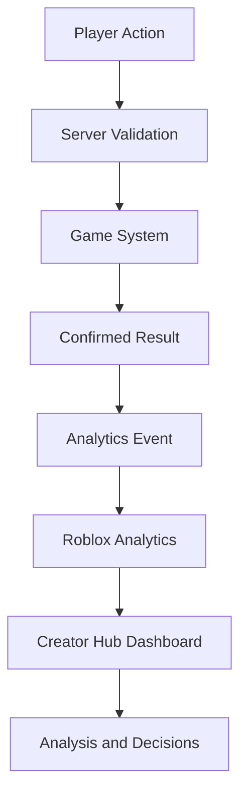

<div align="center">


### Readme


</div>

---

# Readme\n\n# Technical Quality

## Objectif

Une architecture serveur fiable protège l'économie, les sauvegardes et les achats. Le client affiche l'interface mais ne décide jamais de l'argent réel du joueur.

## Ce qu'il faut concevoir
 <div align="center">


### ANALYTICS AND DATA


</div>

---

<div align="center">


**Understand the players. Measure the experience. Improve with evidence.**

</div>

---

## 18.1 - Objectif

Les analytics permettent de comprendre comment les joueurs découvrent, utilisent et quittent le jeu.

Ils ne servent pas uniquement à produire des graphiques. Leur objectif est de répondre à des questions concrètes :

- Les nouveaux joueurs comprennent-ils le fonctionnement du tycoon ?
- À quel moment effectuent-ils leur premier achat ?
- Quelles améliorations sont réellement utilisées ?
- À quelle étape les joueurs abandonnent-ils leur progression ?
- Les joueurs reviennent-ils après leur première session ?
- Une mise à jour améliore-t-elle réellement l'expérience ?

Une donnée n'a de valeur que si elle aide à prendre une décision.

## 18.2 - Les grandes catégories de données

Un tycoon peut exploiter plusieurs catégories d'analytics.

| Catégorie | Ce qu'elle permet de comprendre | Exemple |
|---|---|---|
| Onboarding | La découverte du jeu | Tutoriel terminé |
| Progression | L'avancement du joueur | Première zone débloquée |
| Économie | Les entrées et sorties de ressources | Pièces gagnées et dépensées |
| Engagement | L'utilisation des systèmes | Machines améliorées |
| Rétention | Le retour des joueurs | Retour après 1 ou 7 jours |
| Monétisation | L'utilisation des achats facultatifs | Achat d'un Developer Product |
| Technique | La stabilité de l'expérience | Erreurs et échecs de sauvegarde |

Ne cherche pas à tout mesurer dès le début. Commence par les événements qui correspondent directement à la boucle de gameplay.

## 18.3 - Définir les événements importants

Un événement représente une action ou une étape significative.

Pour le projet, les événements prioritaires peuvent être :

| Événement | Déclencheur | Question |
|---|---|---|
| `TutorialStarted` | Début du tutoriel | Les joueurs commencent-ils le parcours ? |
| `TutorialCompleted` | Fin du tutoriel | Le tutoriel est-il terminé ? |
| `FirstPurchase` | Premier achat en jeu | Le joueur comprend-il l'économie ? |
| `FirstUpgrade` | Première amélioration | Le système d'amélioration est-il utilisé ? |
| `FirstZoneUnlocked` | Première zone débloquée | La progression est-elle suffisamment claire ? |
| `FirstRebirth` | Premier rebirth | Les joueurs atteignent-ils le système avancé ? |
| `OptionalPurchase` | Achat facultatif confirmé | Le système d'achat est-il utilisé ? |

Ces noms sont des conventions internes proposées pour le projet. Ils ne représentent pas des événements Roblox prédéfinis.

**Règle :** un événement doit correspondre à une action réellement terminée. Ne compte pas un bouton pressé comme un achat réussi.

## 18.4 - Funnels : comprendre les abandons

Un funnel représente une succession d'étapes qu'un joueur peut parcourir.

Exemple de funnel d'onboarding :

```text
JOINED
   |
   v
TUTORIAL_STARTED
   |
   v
FIRST_MACHINE_USED
   |
   v
FIRST_PURCHASE
   |
   v
FIRST_UPGRADE
   |
   v
FIRST_ZONE_UNLOCKED
```

À chaque étape, compare le nombre de joueurs qui continuent avec ceux qui ont commencé le parcours.

Formule de conversion :

\[
Conversion = \frac{Joueurs\ à\ l'étape\ suivante}{Joueurs\ à\ l'étape\ précédente}\times100
\]

Exemple fictif :

| Étape | Joueurs | Conversion |
|---|---:|---:|
| Rejoignent le jeu | 1 000 | 100 % |
| Commencent le tutoriel | 850 | 85 % |
| Utilisent une machine | 700 | 82,4 % |
| Effectuent un achat | 560 | 80 % |
| Achètent une amélioration | 420 | 75 % |

Dans cet exemple, 150 joueurs ne commencent pas le tutoriel. Cela mérite une investigation, mais ne prouve pas à lui seul que le tutoriel est mauvais.

Roblox propose des funnel events pour suivre les étapes de progression dans Creator Hub.

## 18.5 - Mesurer la progression

Les données de progression permettent de repérer les étapes trop faciles, trop difficiles ou mal expliquées.

Indicateurs possibles :

- Temps médian avant le premier achat.
- Temps médian avant la première amélioration.
- Pourcentage de joueurs atteignant chaque zone.
- Nombre moyen d'améliorations achetées.
- Pourcentage de joueurs atteignant le premier rebirth.
- Temps entre deux étapes importantes.

Exemple de tableau de progression :

| Indicateur | Résultat fictif | Interprétation à vérifier |
|---|---:|---|
| Premier achat | 2 min 30 | Le début est-il suffisamment rapide ? |
| Première amélioration | 6 min | Le coût est-il compréhensible ? |
| Première zone | 24 min | Le rythme est-il adapté ? |
| Premier rebirth | 4 h 20 | Le système arrive-t-il au bon moment ? |

Les valeurs sont illustratives. Elles ne constituent pas des objectifs officiels.

## 18.6 - Économie : sources et dépenses

Les analytics économiques servent à comprendre comment les ressources circulent.

Deux notions sont essentielles :

- **Sources** : actions qui créent de la monnaie.
- **Dépenses** : actions qui retirent de la monnaie.

Exemple :

| Source | Dépense |
|---|---|
| Production des machines | Achat de machines |
| Récompenses de quêtes | Améliorations |
| Récompenses d'événements | Déblocage de zones |
| Bonus de progression | Services ou objets facultatifs |

Surveille notamment :

- La quantité moyenne de monnaie détenue.
- Les principales sources de revenus.
- Les principales dépenses.
- Les achats les plus fréquents.
- Les ressources qui s'accumulent sans utilité.
- Les systèmes qui créent trop ou trop peu de monnaie.

Une économie peut sembler équilibrée au début tout en devenant instable après plusieurs heures de progression.

## 18.7 - Rétention : mesurer les retours

La rétention mesure le retour des joueurs après leur première visite.

Les indicateurs courants sont :

| Indicateur | Signification |
|---|---|
| D1 | Retour le jour suivant |
| D7 | Retour environ une semaine après |
| D30 | Retour environ un mois après |

Une bonne analyse ne se limite pas à une moyenne globale.

Compare les cohortes : groupes de joueurs ayant commencé pendant une même période ou dans des conditions comparables.

Exemple :

- Cohorte A : joueurs ayant rejoint avant une mise à jour.
- Cohorte B : joueurs ayant rejoint après cette mise à jour.

Il faut vérifier que les périodes, les sources d'acquisition et les populations comparées sont suffisamment proches avant de tirer une conclusion.

## 18.8 - Monétisation et achats facultatifs

Les données de monétisation doivent aider à comprendre les achats, pas à pousser artificiellement les joueurs à payer.

Indicateurs possibles :

- Nombre de joueurs ayant effectué un achat.
- Conversion des joueurs en acheteurs.
- Produits les plus achetés.
- Revenus par période.
- Abandon du parcours d'achat.
- Répartition entre achats ponctuels et avantages permanents.

Ne confonds pas une hausse des revenus avec une amélioration générale de l'expérience.

Un achat facultatif ne doit pas être nécessaire pour profiter normalement du jeu.

## 18.9 - Métriques à ne pas interpréter seules

Une métrique isolée peut donner une image trompeuse.

| Métrique | Risque d'interprétation |
|---|---|
| Temps de session | Une session longue peut aussi signaler un joueur bloqué |
| Nombre de clics | Beaucoup de clics ne signifient pas une bonne interface |
| Revenus | Une hausse peut masquer une expérience dégradée |
| Nombre de joueurs | Ne révèle pas la satisfaction |
| Rétention | Ne révèle pas à elle seule pourquoi les joueurs reviennent |

Associe les métriques quantitatives à des tests utilisateurs, des retours et des observations.

## 18.10 - Formuler une hypothèse

Chaque amélioration importante devrait commencer par une hypothèse vérifiable.

Structure recommandée :

```text
PROBLÈME OBSERVÉ
Les joueurs quittent souvent le jeu avant leur premier achat.

HYPOTHÈSE
Le premier objectif économique n'est pas assez visible.

CHANGEMENT PROPOSÉ
Afficher le coût de la prochaine machine et la monnaie disponible.

MÉTRIQUE PRINCIPALE
Pourcentage de joueurs effectuant leur premier achat.

MÉTRIQUES DE CONTRÔLE
Temps avant le premier achat et taux de sortie.

RÉSULTAT ATTENDU
Une progression initiale plus compréhensible.
```

Une hypothèse doit pouvoir être confirmée ou infirmée par les résultats.

## 18.11 - Comparer des variantes

Les tests comparatifs peuvent aider à évaluer deux versions d'un système.

Exemple :

- Variante A : objectif affiché dans un panneau.
- Variante B : objectif affiché directement près de la machine.

Pour comparer correctement :

1. Définis une seule différence principale.
2. Détermine la métrique avant le test.
3. Utilise des groupes suffisamment importants.
4. Laisse le test durer assez longtemps.
5. Vérifie que les groupes sont comparables.
6. Documente les limites et les résultats.

Ne déclare pas une variante gagnante à partir de quelques joueurs.

Les expériences Roblox et les outils disponibles dépendent des fonctionnalités accessibles à l'expérience et des conditions d'éligibilité.

## 18.12 - Respect de la vie privée

Collecte uniquement les données nécessaires à l'amélioration du jeu.

Bonnes pratiques :

- Évite de collecter des informations personnelles inutiles.
- N'enregistre pas de mots de passe ou de données sensibles.
- Ne place jamais de secrets dans les événements envoyés par le client.
- Limite les champs personnalisés aux informations utiles.
- Évite les identifiants ou valeurs uniques inutiles.
- Consulte les règles Roblox applicables à la collecte et à l'utilisation des données.

Les analytics doivent mesurer l'expérience, pas surveiller inutilement les joueurs.

## 18.13 - Architecture des analytics

Les événements importants doivent être déclenchés à partir de systèmes fiables.



Le serveur doit confirmer le résultat avant de signaler un événement important.

Par exemple, un clic sur un bouton d'achat ne doit pas déclencher `FirstPurchase`. L'événement doit être envoyé après validation et réalisation effective de l'achat.

## 18.14 - Fréquence et limites

Les événements analytics consomment des ressources et sont soumis à des limites.

La documentation Roblox indique notamment une limite globale de requêtes AnalyticsService par minute qui dépend du nombre de joueurs connectés simultanément. Certaines catégories disposent également de limites sur le nombre de funnels, d'étapes et de champs personnalisés.

Conséquences pratiques :

- Ne déclenche pas un événement à chaque frame.
- Ne transforme pas chaque clic en événement personnalisé.
- Regroupe les données lorsque cela est pertinent.
- Utilise des noms d'événements cohérents.
- Contrôle les erreurs de transmission.
- Consulte les limites officielles avant d'augmenter l'instrumentation.

## 18.15 - Méthode de travail

| Étape | Travail |
|---|---|
| 01 | Identifier un problème réel |
| 02 | Formuler une hypothèse |
| 03 | Choisir une métrique principale |
| 04 | Ajouter les événements nécessaires |
| 05 | Vérifier leur déclenchement |
| 06 | Collecter suffisamment de données |
| 07 | Analyser les résultats |
| 08 | Documenter la décision |

## 18.16 - Erreurs fréquentes

- Mesurer trop d'éléments dès le départ.
- Confondre corrélation et causalité.
- Optimiser uniquement les revenus ou le temps de session.
- Modifier plusieurs systèmes en même temps sans isoler les changements.
- Prendre une petite variation pour une preuve.
- Déclencher des événements avant la validation serveur.
- Collecter des informations inutiles.
- Ne jamais consulter les données après leur mise en place.

## 18.17 - Version minimale à développer

Pour le premier prototype, commence avec un petit ensemble d'événements :

- Tutoriel commencé.
- Tutoriel terminé.
- Premier achat.
- Première amélioration.
- Première zone débloquée.

Ajoute ensuite les événements économiques, de rétention et de monétisation lorsque les systèmes correspondants sont suffisamment stables.

## 18.18 - Design Worksheet

| Question | Décision |
|---|---|
| Quel comportement veut-on comprendre ? | |
| Quel événement représente ce comportement ? | |
| À quel moment l'événement est-il confirmé ? | |
| Quelle métrique sera analysée ? | |
| Quelle population sera comparée ? | |
| Quelle quantité de données est nécessaire ? | |
| Quelles sont les limites de l'analyse ? | |
| Quelle décision pourrait découler du résultat ? | |

## 18.19 - Definition of Done

- [ ] Les événements correspondent à des actions réellement terminées.
- [ ] Les étapes importantes de progression sont mesurables.
- [ ] Les funnels ont des étapes clairement définies.
- [ ] Les événements économiques distinguent sources et dépenses.
- [ ] Les métriques ont une définition documentée.
- [ ] Les résultats peuvent être interprétés sans supposition excessive.
- [ ] Les limites de collecte et d'analyse sont connues.
- [ ] Aucune donnée personnelle inutile n'est collectée.
- [ ] Les événements importants sont déclenchés après validation serveur.

## 18.20 - Questions à documenter

- Quel problème du joueur ce système permet-il de comprendre ?
- Quelle est la version minimale à tester ?
- Quel est le coût technique et de maintenance ?
- Comment les données sont-elles utilisées pour les joueurs gratuits et payants ?
- Quelles données permettent de vérifier l'utilité d'une modification ?
- Quelles limites pourraient fausser l'interprétation ?

## 18.21 - Références officielles

- [Roblox Creator Hub](https://create.roblox.com/docs)
- [Roblox Analytics](https://create.roblox.com/docs/production/analytics)
- [Analytics Event Types](https://create.roblox.com/docs/production/analytics/event-types)
- [Funnel Events](https://create.roblox.com/docs/production/analytics/funnel-events)
- [AnalyticsService API](https://create.roblox.com/docs/reference/engine/classes/AnalyticsService)

---

<div align="center">


### Acknowledgements

Built with documentation and tools from:

[Roblox](https://www.roblox.com/) · [Roblox Creator Hub](https://create.roblox.com/docs) · [Shields.io](https://shields.io/) · [Mermaid](https://mermaid.js.org/)


<sub>Document: `18-Analytics-And-Data/README.md` · Part of Roblox Tycoon Blueprint</sub>

</div>
Centralise la logique d'économie côté serveur. Valide chaque RemoteEvent, limite les fréquences, vérifie la propriété du tycoon, utilise pcall pour les DataStores et traite les reçus Developer Products avec ProcessReceipt. Teste les cas de déconnexion et de double requête.

## Erreurs fréquentes

Faire confiance aux valeurs envoyées par le client, sauvegarder à chaque frame, ou attribuer un achat avant validation Roblox.

## Méthode de travail

Utilise Server & Clients dans Studio, tests de charge, logs d'erreur et tests de réouverture de session. Ne publie pas avec des erreurs critiques.

## Critère de validation

Un client modifié ne peut pas créer de monnaie, acheter sans fonds ou réclamer plusieurs fois un produit.

## Questions à documenter

- Quel problème du joueur ce système résout-il ?
- Quelle est la version minimale à tester ?
- Quel est le coût technique et de maintenance ?
- Comment le système fonctionne-t-il pour un joueur gratuit ?
- Quelles données permettent de vérifier son utilité ?

## Liens de référence

- [Roblox Creator Hub](https://create.roblox.com/docs)
- [Roblox Creator Documentation](https://create.roblox.com/docs/production)

---

<div align="center">


<sub>Document: `19-Technical-Quality/README.md` · Part of Roblox Tycoon Blueprint</sub>

</div>
