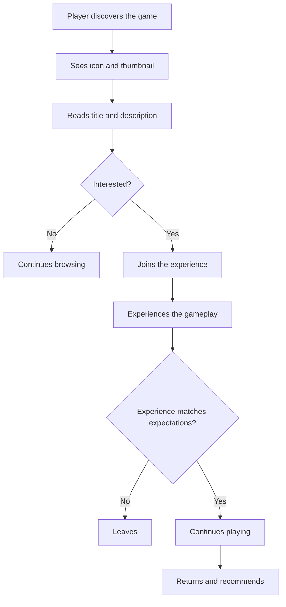
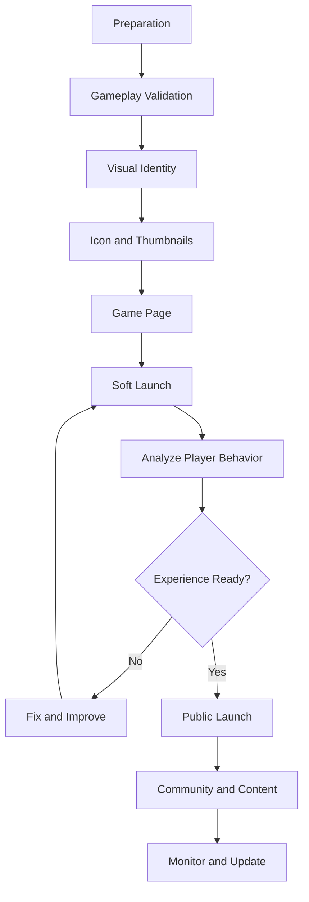

<div align="center">


### MARKETING AND DISCOVERY


</div>

---

<div align="center">



**Make the game discoverable. Set clear expectations. Earn attention.**

</div>

---

## 20.1 - Objectif

Le marketing et la découverte permettent de présenter le jeu aux personnes susceptibles de l'apprécier.

Le travail commence avant la publication et continue après le lancement.

Il faut notamment :

- Donner envie de découvrir le jeu.
- Expliquer rapidement son concept.
- Montrer son véritable gameplay.
- Attirer un public adapté à l'expérience.
- Comprendre d'où viennent les joueurs.
- Améliorer progressivement la présentation.
- Construire une communauté autour du projet.

L'objectif n'est pas simplement d'obtenir le plus de clics possible.

Un joueur attiré par une promesse trompeuse risque de quitter rapidement le jeu. Une bonne présentation doit attirer les bons joueurs, pas seulement beaucoup de joueurs.

## 20.2 - Les trois étapes de la découverte

La découverte peut être comprise comme trois étapes successives.

| Étape | Question du joueur | Objectif |
|---|---|---|
| Découverte | Qu'est-ce que ce jeu ? | Attirer son attention |
| Décision | Est-ce que cela m'intéresse ? | Donner envie d'essayer |
| Expérience | Est-ce que j'ai envie de continuer ? | Confirmer la promesse |



Chaque étape doit être cohérente avec la suivante.

Une miniature spectaculaire qui montre un contenu absent peut améliorer les clics à court terme, mais dégrader l'expérience réelle.

## 20.3 - Identifier le public cible

Avant de créer des visuels ou une campagne, définis les joueurs auxquels le jeu s'adresse.

Pour un tycoon Roblox, plusieurs profils peuvent exister :

| Profil | Ce qu'il recherche |
|---|---|
| Casual | Une expérience facile à comprendre |
| Builder | Construire et personnaliser |
| Optimizer | Améliorer son rendement |
| Collector | Débloquer et collectionner |
| Social | Visiter et jouer avec ses amis |
| Progression | Atteindre des objectifs à long terme |

Ces profils ne sont pas exclusifs. Un joueur peut appartenir à plusieurs catégories.

Questions à se poser :

- Pourquoi un joueur choisirait-il ce tycoon plutôt qu'un autre ?
- Quel système rend l'expérience différente ?
- Le jeu est-il plutôt calme, compétitif, social ou stratégique ?
- Quelle est la principale satisfaction offerte ?
- À quel type de joueur le jeu risque-t-il de ne pas plaire ?

La présentation doit refléter les caractéristiques réelles de l'expérience.

## 20.4 - Définir la proposition de valeur

La proposition de valeur est la raison principale pour laquelle un joueur devrait essayer le jeu.

Elle doit être courte et compréhensible.

Structure possible :

```text
TYPE DE JEU
Un tycoon de construction et de progression.

ACTIVITÉ PRINCIPALE
Construire une usine et améliorer sa production.

DIFFÉRENCE PRINCIPALE
Un système de progression qui transforme progressivement le tycoon.

OBJECTIF DU JOUEUR
Développer sa base et débloquer de nouvelles possibilités.
```

Évite les promesses vagues :

- Le meilleur jeu Roblox.
- Le tycoon ultime.
- Une expérience jamais vue.
- Des récompenses incroyables.

Préfère expliquer ce que le joueur pourra réellement faire.

## 20.5 - L'icône du jeu

L'icône représente le jeu dans les interfaces Roblox.

Elle doit rester compréhensible même lorsqu'elle est affichée en petit.

Une bonne icône doit :

- Présenter un élément reconnaissable.
- Mettre en avant un sujet principal.
- Utiliser une composition lisible.
- Posséder un contraste suffisant.
- Être cohérente avec l'identité visuelle.
- Éviter les détails inutiles.
- Représenter fidèlement le jeu.

### Méthode de conception

1. Choisir le sujet principal.
2. Définir une composition simple.
3. Tester plusieurs cadrages.
4. Vérifier la lisibilité à petite taille.
5. Comparer plusieurs variantes.
6. Vérifier que le visuel correspond au gameplay.

Une icône n'a pas besoin de montrer tous les systèmes du jeu.

Elle doit surtout permettre de reconnaître rapidement son identité.

## 20.6 - Les miniatures

Les miniatures doivent donner un aperçu attractif et fidèle de l'expérience.

Exemples de scènes adaptées à un tycoon :

| Concept | Élément mis en avant |
|---|---|
| Factory Showcase | Une usine développée |
| Progression | Une base avant et après amélioration |
| Machine Reveal | Une machine importante |
| World Expansion | Une nouvelle zone |
| Multiplayer | Plusieurs joueurs dans une même base |
| Rebirth | Une transformation importante du tycoon |

Chaque miniature doit présenter une raison différente de découvrir le jeu.

### Composition visuelle

Une miniature efficace peut utiliser :

- Un sujet principal clairement identifiable.
- Un arrière-plan qui soutient le sujet.
- Une profondeur visuelle.
- Des couleurs cohérentes.
- Un éclairage qui met en valeur l'action.
- Une quantité limitée de texte.

Évite les compositions trop chargées.

### Gameplay réel et illustrations

Il est possible d'utiliser des illustrations ou des rendus promotionnels, mais ils doivent représenter fidèlement les possibilités du jeu.

Ne présente pas une fonctionnalité future comme déjà disponible.

Ne montre pas de récompenses, de zones ou de machines qui n'existent pas dans la version accessible aux joueurs.

## 20.7 - Vidéos de présentation

Une vidéo peut montrer rapidement ce que le joueur fera réellement.

Exemple de structure :

| Moment | Contenu |
|---|---|
| 0-3 secondes | Présentation du tycoon |
| 3-7 secondes | Production des premières ressources |
| 7-12 secondes | Achat et amélioration |
| 12-17 secondes | Développement de la base |
| 17-22 secondes | Présentation d'une fonctionnalité distinctive |
| 22-25 secondes | Nom du jeu et invitation à essayer |

Ce découpage est un exemple de format court, pas une règle obligatoire.

La vidéo doit :

- Montrer le gameplay réel.
- Éviter les longues introductions.
- Mettre en avant les moments intéressants.
- Être compréhensible sans explication complexe.
- Utiliser une qualité d'image adaptée aux plateformes.
- Éviter les effets qui masquent le gameplay.

## 20.8 - Titre et description

Le titre et la description permettent aux joueurs de comprendre rapidement le concept.

### Titre

Un bon titre doit être :

- Facile à retenir.
- Facile à lire.
- Distinct des autres expériences.
- Cohérent avec le jeu.
- Suffisamment descriptif.

Évite les répétitions artificielles de mots-clés et les promesses trompeuses.

### Description

Structure recommandée :

```text
[INTRODUCTION]

Présente le concept du jeu en une ou deux phrases.

[GAMEPLAY]

Explique ce que le joueur peut construire,
améliorer ou débloquer.

[FEATURES]

- Fonctionnalité principale
- Progression
- Machines et améliorations
- Systèmes sociaux ou événements

[UPDATES]

Présente les nouveautés réellement disponibles.

[COMMUNITY]

Ajoute les liens communautaires officiels
si ces espaces existent.
```

La description doit être régulièrement actualisée lorsque le jeu évolue.

## 20.9 - Métadonnées et découverte Roblox

Les métadonnées aident Roblox et les joueurs à comprendre le contenu de l'expérience.

Elles comprennent notamment :

- Le titre.
- La description.
- Les icônes.
- Les miniatures.
- Les vidéos.
- Les informations de catégorie et de genre disponibles.

Bonnes pratiques :

1. Utiliser des informations exactes.
2. Employer des termes réellement liés au gameplay.
3. Éviter les répétitions de mots-clés.
4. Utiliser des visuels originaux.
5. Garder une cohérence entre la page et le jeu.
6. Mettre à jour les informations lorsque le contenu change.

Roblox recommande des métadonnées uniques et fidèles au contenu. Des informations trompeuses ou trop similaires à celles d'autres expériences peuvent limiter la visibilité. 

La plateforme peut également réduire l'exposition d'une expérience dont le contenu ou les métadonnées ne respectent pas ses bonnes pratiques de découverte.

## 20.10 - Comprendre la découverte organique

La découverte organique correspond aux joueurs qui trouvent le jeu sans campagne publicitaire payante directe.

Sur Roblox, plusieurs sources peuvent contribuer à l'acquisition :

| Source | Description |
|---|---|
| Home Recommendations | Recommandations sur la page d'accueil |
| Search | Recherche Roblox |
| Charts | Classements |
| Friends | Activité des amis |
| Sponsored Ads | Publicités sponsorisées |
| External Sources | Réseaux sociaux et liens externes |
| Teleport | Arrivée depuis une autre expérience |

Les recommandations de la page d'accueil utilisent plusieurs signaux de comportement.

Ils comprennent notamment :

- Le taux de passage après exposition.
- Le taux de rebond lors de la première session.
- Les jours de jeu par utilisateur.
- Le temps de jeu par utilisateur.
- Les sessions avec des amis.
- Les sessions de jeu qualifiées.
- Les comportements liés aux dépenses.

Il n'existe pas de métrique unique qui garantit une meilleure visibilité.

La priorité reste la qualité de l'expérience, la rétention et la cohérence des métadonnées.

## 20.11 - Comprendre le taux de passage au jeu

Le taux de passage au jeu, ou Play Through Rate (PTR), permet de comprendre combien de personnes commencent à jouer après avoir vu une recommandation.

Formule simplifiée :

\[
PTR = \frac{Joueurs\ ayant\ rejoint}{Impressions}\times100
\]

Exemple fictif :

| Variante | Impressions | Joueurs | PTR |
|---|---:|---:|---:|
| Icône A | 10 000 | 600 | 6 % |
| Icône B | 10 000 | 850 | 8,5 % |
| Icône C | 10 000 | 700 | 7 % |

Dans cet exemple, la variante B obtient le meilleur taux de passage.

Cela ne signifie pas automatiquement qu'elle est la meilleure à long terme.

Il faut également observer :

- Le taux de rebond initial.
- Le temps de session.
- La rétention.
- La satisfaction des joueurs.
- La qualité des joueurs attirés.

Une présentation très attirante mais trompeuse peut obtenir beaucoup de clics sans attirer un public adapté.

## 20.12 - Acquisition et rétention

L'acquisition et la rétention doivent être analysées ensemble.

| Situation | Interprétation possible |
|---|---|
| Beaucoup d'impressions, peu de joueurs | Présentation peu convaincante |
| Beaucoup de joueurs, départs rapides | Promesse ou onboarding à revoir |
| Peu de nouveaux joueurs, bonne rétention | Problème possible de visibilité |
| Beaucoup de joueurs, bonne rétention | Acquisition et expérience cohérentes |
| Trafic publicitaire élevé, faible rétention | Public ou campagne mal ciblé |

Ces interprétations sont des pistes de diagnostic, pas des conclusions automatiques.

Utilise les données de la section 18 pour identifier les véritables problèmes.

## 20.13 - Tester plusieurs concepts visuels

Il est possible de comparer plusieurs icônes ou miniatures.

Exemple :

- Concept A : mettre en avant une usine.
- Concept B : montrer une transformation de la base.
- Concept C : présenter une machine distinctive.

Méthode :

1. Définir une hypothèse.
2. Créer plusieurs variantes.
3. Identifier la différence principale.
4. Choisir une période de comparaison.
5. Mesurer les résultats.
6. Examiner les effets sur la qualité des sessions.
7. Documenter la décision.

Évite de changer simultanément le titre, l'icône, la miniature et la description si tu veux comprendre précisément l'effet de chaque modification.

Utilise les outils de test et de comparaison disponibles dans Creator Hub lorsque ton expérience y est éligible.

## 20.14 - Réseaux sociaux

Les réseaux sociaux peuvent permettre de présenter le développement et les nouveautés.

Plateformes possibles :

| Plateforme | Contenu adapté |
|---|---|
| YouTube | Vidéos de gameplay et présentations |
| TikTok | Clips courts et moments visuels |
| Instagram | Visuels, annonces et extraits |
| Discord | Communauté et retours |
| X | Actualités et communications |

Ne cherche pas à être présent partout dès le lancement.

Commence par les plateformes qui correspondent à tes moyens et à ton public.

### Types de publications

- Présentation du gameplay.
- Développement d'une nouvelle machine.
- Avant/après d'une amélioration.
- Aperçu d'une nouvelle zone.
- Démonstration d'une fonctionnalité.
- Journal de développement.
- Annonce de mise à jour.
- Réponse aux retours de la communauté.

Chaque publication doit apporter une information ou un aperçu intéressant.

## 20.15 - Créateurs de contenu et partenariats

Les créateurs de contenu peuvent faire découvrir le jeu à leur audience.

Avant de contacter quelqu'un :

- Étudie son contenu.
- Vérifie que son audience correspond au jeu.
- Regarde ses expériences Roblox précédentes.
- Prépare une présentation claire.
- Propose un accès au jeu fonctionnel.
- Explique ce qui rend l'expérience intéressante.

Un partenariat doit être transparent.

Si une publication est sponsorisée ou rémunérée, respecte les règles de divulgation applicables.

Ne suppose pas qu'un créateur populaire attirera automatiquement les bons joueurs.

## 20.16 - Publicité payante

Les publicités peuvent apporter de la visibilité, mais elles ne remplacent pas une expérience de qualité.

Avant de dépenser des Robux :

1. Vérifie que le jeu fonctionne correctement.
2. Termine l'onboarding.
3. Contrôle la rétention initiale.
4. Prépare plusieurs visuels.
5. Définis un budget limité.
6. Identifie la source des nouveaux joueurs.
7. Compare le comportement des joueurs acquis.

Ne dépense pas un budget important pour compenser un problème de gameplay.

### Mesures à suivre

| Indicateur | Question |
|---|---|
| Impressions | Combien de personnes voient la publicité ? |
| Visites | Combien rejoignent le jeu ? |
| Coût d'acquisition | Combien coûte chaque nouveau joueur ? |
| Temps de session | Les joueurs restent-ils ? |
| Rétention D1 | Reviennent-ils le lendemain ? |
| Rétention D7 | Reviennent-ils après une semaine ? |

Les résultats doivent être comparés selon les sources d'acquisition.

## 20.17 - Communauté et bouche-à-oreille

Une communauté active peut contribuer à la découverte du jeu.

Elle permet également de recueillir des retours et de comprendre les attentes des joueurs.

Systèmes possibles :

- Groupe Roblox officiel.
- Serveur communautaire.
- Publications régulières.
- Événements.
- Sondages.
- Suggestions.
- Annonces de mises à jour.

Ne récompense pas le spam ou les invitations forcées.

Les joueurs doivent pouvoir profiter du jeu sans devoir inviter leurs amis.

## 20.18 - Partage et moments mémorables

Un jeu est plus facile à partager lorsqu'il contient des moments intéressants à montrer.

Pour un tycoon, ces moments peuvent être :

- Une usine qui fonctionne à grande échelle.
- Une transformation spectaculaire.
- Une machine rare.
- Une nouvelle zone.
- Une base personnalisée.
- Une coopération réussie.
- Un rebirth important.

Facilite le partage sans l'imposer.

Le meilleur résultat est qu'un joueur ait naturellement envie de montrer ce qu'il a construit.

## 20.19 - Mesurer les performances marketing

Les indicateurs doivent être reliés aux objectifs.

| Objectif | Indicateur |
|---|---|
| Améliorer la présentation | Taux de passage au jeu |
| Comprendre l'acquisition | Nouveaux joueurs par source |
| Améliorer l'expérience initiale | Taux de rebond initial |
| Améliorer l'engagement | Temps de session |
| Favoriser les retours | Rétention D1, D7, D30 |
| Évaluer les campagnes | Coût par nouveau joueur |
| Développer la communauté | Participation et interactions |

Ne considère pas le nombre de visites comme l'unique mesure de réussite.

## 20.20 - Plan de lancement

Un lancement peut être organisé en plusieurs étapes.



### Avant le lancement

- Tester le gameplay.
- Vérifier la stabilité.
- Préparer l'icône.
- Créer les miniatures.
- Rédiger le titre et la description.
- Préparer les premiers contenus promotionnels.
- Configurer les analytics.

### Pendant le lancement

- Vérifier que les joueurs peuvent rejoindre.
- Surveiller les erreurs.
- Observer les premières sessions.
- Identifier les problèmes d'onboarding.
- Communiquer les problèmes connus.

### Après le lancement

- Étudier les sources d'acquisition.
- Examiner les retours.
- Améliorer les visuels si nécessaire.
- Corriger les problèmes de gameplay.
- Publier des mises à jour utiles.
- Communiquer les changements.

## 20.21 - Erreurs fréquentes

- Utiliser des images qui ne représentent pas le jeu.
- Promettre des fonctionnalités absentes.
- Répéter artificiellement des mots-clés.
- Copier les miniatures d'autres expériences.
- Acheter du trafic avant de vérifier la rétention.
- Modifier plusieurs éléments sans méthode de comparaison.
- Confondre visites et joueurs satisfaits.
- Négliger les retours de la communauté.
- Publier du contenu promotionnel sans maintenir le jeu.
- Chercher à attirer tout le monde au lieu de viser le bon public.

## 20.22 - Version minimale à développer

Pour le premier lancement, prépare :

1. Une icône lisible.
2. Deux ou trois miniatures représentatives.
3. Un titre compréhensible.
4. Une description structurée.
5. Une vidéo courte de gameplay.
6. Une page de jeu cohérente avec le contenu réel.
7. Un suivi des sources d'acquisition.
8. Un processus de collecte des retours.

Les campagnes publicitaires et partenariats peuvent venir ensuite.

## 20.23 - Marketing Worksheet

| Question | Décision |
|---|---|
| Quel est le public cible ? | |
| Quelle est la proposition de valeur ? | |
| Quelle fonctionnalité différencie le jeu ? | |
| Quel élément doit apparaître sur l'icône ? | |
| Quels moments doivent être montrés en miniature ? | |
| Quel message doit transmettre le titre ? | |
| Quelle est la promesse de la description ? | |
| Quelles plateformes seront utilisées ? | |
| Quel budget peut être consacré à la promotion ? | |
| Quels indicateurs permettront d'évaluer les résultats ? | |

## 20.24 - Definition of Done

- [ ] Le public cible est défini.
- [ ] La proposition de valeur est claire.
- [ ] Le titre représente fidèlement le jeu.
- [ ] L'icône reste lisible en petit.
- [ ] Les miniatures montrent du contenu réel.
- [ ] La description explique les principales fonctionnalités.
- [ ] Les métadonnées sont exactes et cohérentes.
- [ ] Les sources d'acquisition peuvent être analysées.
- [ ] Les performances de la présentation peuvent être comparées.
- [ ] La rétention est surveillée après le lancement.
- [ ] Les publications communautaires sont préparées.
- [ ] Les promesses marketing correspondent au jeu disponible.

## 20.25 - Questions à documenter

- Quel problème du joueur ce système résout-il ?
- Quelle est la version minimale à tester ?
- Quel est le coût technique et de maintenance ?
- Comment le système fonctionne-t-il pour un joueur gratuit ?
- Quelles données permettent de vérifier son utilité ?
- Quel public souhaite-t-on réellement attirer ?
- Qu'est-ce qui différencie le jeu des autres tycoons ?
- Comment vérifier que la présentation correspond au gameplay ?
- Quelle source d'acquisition apporte les joueurs les plus engagés ?

## 20.26 - Références officielles

- [Roblox Creator Hub](https://create.roblox.com/docs)
- [Discovery](https://create.roblox.com/docs/discovery)
- [Discovery FAQ](https://create.roblox.com/docs/discovery-faq)
- [Recommended Strategies](https://create.roblox.com/docs/get-started/strategies)
- [Creator Analytics](https://create.roblox.com/docs/production/analytics)
- [Acquisition Analytics](https://create.roblox.com/docs/production/analytics/acquisition)
- [Roblox Community Standards](https://www.roblox.com/info/terms)

---

<div align="center">


### Acknowledgements

Built with documentation and tools from:

[Roblox](https://www.roblox.com/) · [Roblox Creator Hub](https://create.roblox.com/docs) · [Shields.io](https://shields.io/) · [Mermaid](https://mermaid.js.org/)


<sub>Document: `20-Marketing-And-Discovery/README.md` · Part of Roblox Tycoon Blueprint</sub>

</div>
