<div align="center">


# ROBLOX TYCOON BLUEPRINT

### A practical knowledge base for designing, building, testing and growing Roblox tycoon experiences.


**DESIGN WITH INTENT. BUILD WITH CARE. IMPROVE WITH EVIDENCE.**

*A structured reference for creators who want to build original, enjoyable and sustainable Roblox tycoon games.*

</div>

---

## 1. Project overview

Roblox-Tycoon-Blueprint is a practical documentation project dedicated to the design and development of Roblox tycoon experiences.
It gathers design principles, implementation patterns, production advice, economy models, player-experience considerations and technical checklists.
Its purpose is to help a developer move from an initial idea to a tested and maintainable game.
It is not a promise of virality, revenue or a guaranteed position in Roblox discovery.
No design formula can guarantee that an experience will become popular.
The useful objective is to make better decisions, test assumptions and improve the experience using evidence.

A tycoon is often introduced as a game in which players purchase machines, generate currency and expand a base.
That description explains the visible actions, but it does not explain why the game is enjoyable.
The deeper experience is a sequence of goals, decisions, feedback, unlocks and mastery.
The player sees a possibility, understands what is required, performs an action and receives a result.
The result should create a new possibility rather than simply repeat the same action with a larger number.
A well-designed tycoon therefore combines economy, pacing, world design, interaction, presentation and technical reliability.

This repository treats those systems as connected disciplines.
A change to machine output affects the economy.
A change to the economy affects progression speed.
A change to progression speed affects session length and the timing of unlocks.
A new unlock affects the map, user interface, tutorial and save data.
A monetization offer can affect perceived fairness and player trust.
A technical shortcut can affect performance, security and the reliability of purchases.
Design decisions should be evaluated in the context of the complete experience.

### 1.1 What this repository is

- A learning resource for Roblox tycoon design.
- A planning reference for a new project.
- A collection of practical questions to ask before implementing a feature.
- A starting point for economy and progression balancing.
- A guide to common Roblox Studio architecture patterns.
- A source of checklists for testing, security and release preparation.
- A place to document experiments and lessons learned.
- A framework for analyzing other games without copying them.

### 1.2 What this repository is not

- It is not a guarantee that a game will become viral.
- It is not a replacement for Roblox Creator Hub documentation.
- It is not a finished commercial tycoon framework.
- It is not a collection of exploit techniques.
- It is not a reason to copy another developer's assets or distinctive game identity.
- It is not financial advice or a promise of income.
- It is not a claim that every listed mechanic belongs in every tycoon.
- It is not a substitute for playtesting on supported devices.

### 1.3 Intended audience

The material is useful to a beginner who needs to understand the full development process.
It is also useful to an experienced creator who wants a structured review of a design.
A programmer can use the implementation sections to plan modules and server responsibilities.
A designer can use the progression and economy sections to document player-facing systems.
A builder can use the world and machine sections to plan physical layouts.
A project lead can use the roadmap, analytics and release sections to organize work.
A small team can use the templates to share assumptions and decisions.

### 1.4 How to interpret recommendations

Not every recommendation has the same level of certainty.
Roblox platform behavior should be checked against current official documentation.
A result observed in one game is an observation, not a universal rule.
A proposed explanation for player behavior is a hypothesis until tested.
A suggested mechanic is a design recommendation, not a guaranteed improvement.
A measured result can still be misleading if the sample is small or the test conditions changed.
When documenting a conclusion, record the evidence and the limitations.

Use these labels in research notes:

| Label | Meaning | Example |
|---|---|---|
| Verified fact | Supported by a current authoritative source | A Roblox API behaves as described in its official reference |
| Observation | Seen in a specific game or playtest | Testers ignored a side corridor |
| Hypothesis | An explanation that still needs evidence | The corridor was missed because its entrance lacked contrast |
| Recommendation | A proposed design decision | Add a landmark and test navigation again |
| Open question | A decision that has not been resolved | Should the second zone require a rebirth? |

---

## 2. Design philosophy

A strong tycoon gives players a reason to care about what they are building.
It should make the current action understandable and the next objective desirable.
It should reward attention, planning and experimentation.
It should not rely exclusively on waiting, inflated prices or repeated purchase prompts.
The player should feel that progress comes from playing and making decisions.
Optional purchases can support development, but the free experience should remain coherent.

### 2.1 The player promise

Write one sentence that explains the experience.
The sentence should describe what the player does and what makes the activity distinctive.
Avoid vague promises such as "the best simulator ever".
Prefer a concrete statement such as "Build a moving factory, optimize production lines and turn a small workshop into an automated industrial city".
The promise should be visible in the first session.
If the actual game does not deliver the promise, revise the concept or the presentation.

### 2.2 The core loop

A basic tycoon loop can be represented as:

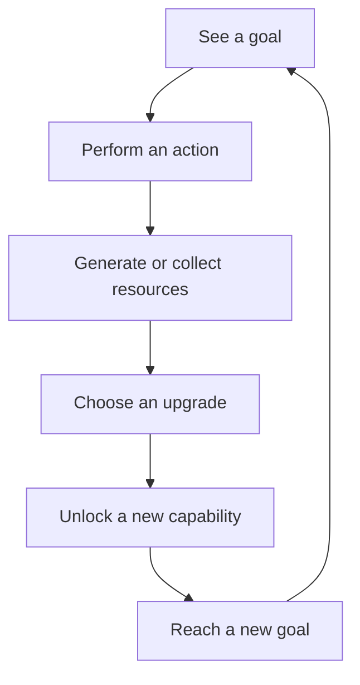

The loop is only a starting point.
A mature game adds decisions, exploration, mastery and social activity.
The player should not be required to wait passively for every meaningful event.
Consider adding choices about production priorities, machine specializations or optional challenges.
The best variation depends on the theme and target audience.

### 2.3 The three time horizons

A player needs goals at different scales.
Short goals make each minute feel useful.
Medium goals create a reason to continue a session.
Long goals give returning players a direction.

| Horizon | Typical examples | Design question |
|---|---|---|
| Immediate | Collect a payout, buy a first button, complete a tutorial action | Does the player understand the next action? |
| Session | Unlock a machine, finish a quest, open a new room | Is the reward worth the time invested? |
| Long term | Complete a factory wing, prestige, collect rare skins | Does the goal remain meaningful after several sessions? |

The exact timing should be tested.
Do not assume that every player has the same available session length.
Do not make the long-term goal the only interesting goal.
A player who cannot see progress for several minutes may leave before understanding the deeper systems.

### 2.4 The player experience principles

**Clarity:** the player can understand what an object does and why an action is available.
**Agency:** the player has meaningful choices rather than only one mandatory purchase path.
**Feedback:** important actions produce immediate and understandable responses.
**Fairness:** costs, rewards and purchase contents are transparent.
**Mastery:** players can learn systems and improve their decisions.
**Discovery:** exploration reveals useful, surprising or entertaining content.
**Reliability:** progress and purchases behave consistently.
**Respect:** the game does not punish a player for having a life outside the experience.

### 2.5 The classic Roblox visual direction

This repository uses a classic Roblox-inspired identity rather than the violet terminal style of a personal profile.
The design is based on a bold red accent, charcoal surfaces, white text and neutral greys.
The red is used for important emphasis, not every paragraph or every control.
The dark background is intended for the repository's SVG identity, while Markdown remains readable on GitHub's light and dark themes.
The blue accent is reserved for technical references and Luau-related labels.

| Token | Hex value | Intended use |
|---|---|---|
| Classic red | `#E2231A` | Primary accent, important highlights |
| Dark charcoal | `#171717` | SVG backgrounds and dark panels |
| Secondary charcoal | `#303030` | Depth and visual separation |
| White | `#FFFFFF` | High-contrast text on dark assets |
| Light grey | `#D4D4D4` | Secondary text |
| Mid grey | `#777777` | Muted labels and dividers |
| Classic blue | `#0055BF` | Technical accent and Luau reference |

---

## 3. The complete knowledge framework

The repository is organized into twenty knowledge areas.
Each area has a dedicated folder with a focused explanation.
The README provides the high-level framework and links to the deeper topic pages.
The topic pages should evolve as research, playtests and implementation experience accumulate.

### 01. Game Concept

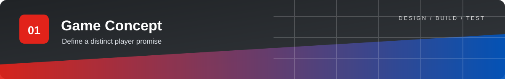

[Open the complete topic guide](01-Game-Concept/README.md)

**Purpose:** Define the experience before building content.

A concept is a promise to the player.
It identifies the fantasy, the central activity and the difference from other tycoons.
A good concept is specific enough to guide production decisions.
It is not simply a theme pasted onto a generic dropper loop.

**Design and implementation checklist**

- Describe the fantasy in one sentence.
- Identify the intended audience and the devices they are likely to use.
- List the three most important player actions.
- Define the unique mechanic or combination of mechanics.
- Write down what the game will deliberately not include in its first release.
- Compare competing experiences to understand genre conventions.
- Avoid copying names, maps, icons, art or distinctive progression structures.
- Build a small prototype that demonstrates the central promise.

**Validation questions**

- Can a new tester explain the game after a short introduction?
- Does the unique mechanic appear during the first session?
- Can the concept be built by the available team?
- Does the first version have a clear beginning and a clear next goal?

**Expected documentation for this topic**

- A short statement of the intended player outcome.
- A diagram or flow description where the system has multiple states.
- A list of configuration values and their default assumptions.
- At least one edge case and how it should be handled.
- A playtest or technical validation plan.
- Links to authoritative platform documentation where relevant.

---

### 02. First Five Minutes

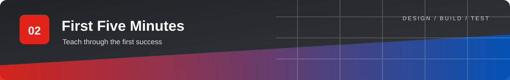

[Open the complete topic guide](02-First-5-Minutes/README.md)

**Purpose:** Design the first session as a complete, guided experience.

The first five minutes are not a place to explain every system.
They are a chance to let the player act, understand the main reward and see a reason to continue.
The player should reach a meaningful first success quickly.
The tutorial should teach by doing whenever possible.

**Design and implementation checklist**

- Spawn the player somewhere safe and visually understandable.
- Show one clear objective rather than a wall of instructions.
- Guide the player to the first interaction.
- Make the first reward visible and understandable.
- Introduce the first purchase after the player has earned or received enough currency.
- Show the effect of the first upgrade immediately.
- Preview one future unlock to create direction.
- Allow experienced players to skip repeated explanations where appropriate.
- Keep mobile controls and screen layout in mind.
- Record where players hesitate or leave.

**Validation questions**

- Can a new player identify the first action without asking for help?
- Does the player understand how the main currency is earned?
- Does the first purchase create visible progress?
- Is there a clear next objective when the tutorial ends?

**Expected documentation for this topic**

- A short statement of the intended player outcome.
- A diagram or flow description where the system has multiple states.
- A list of configuration values and their default assumptions.
- At least one edge case and how it should be handled.
- A playtest or technical validation plan.
- Links to authoritative platform documentation where relevant.

---

### 03. Core Gameplay Loop

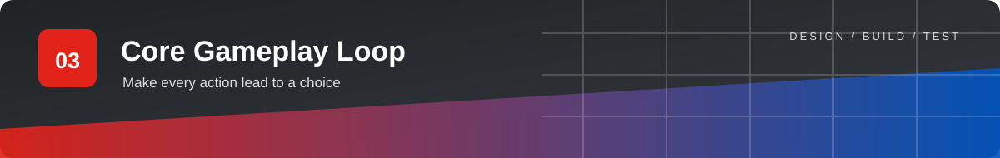

[Open the complete topic guide](03-Core-Gameplay-Loop/README.md)

**Purpose:** Make repeated actions satisfying, understandable and progressively varied.

The core loop is the repeated sequence that defines moment-to-moment play.
A basic loop can involve producing, collecting, spending and upgrading.
A stronger loop gives the player a decision at one or more points.
Variation should come from new capabilities, not only larger numbers.

**Design and implementation checklist**

- Map the loop from player input to reward.
- Identify which steps are active and which are automatic.
- Reduce unnecessary walking and menu friction.
- Make production feedback visible without overwhelming the screen.
- Introduce meaningful choices at a controlled pace.
- Ensure the loop still works when the player is alone.
- Avoid making every reward depend on a long wait.
- Add optional activities that complement rather than replace the main loop.
- Review the loop after each major progression milestone.

**Validation questions**

- Can the player explain the loop in their own words?
- Does each repetition feel useful?
- Does the loop evolve as new machines are unlocked?
- Are there moments where the player has nothing meaningful to do?

**Expected documentation for this topic**

- A short statement of the intended player outcome.
- A diagram or flow description where the system has multiple states.
- A list of configuration values and their default assumptions.
- At least one edge case and how it should be handled.
- A playtest or technical validation plan.
- Links to authoritative platform documentation where relevant.

---

### 04. Progression System


[Open the complete topic guide](04-Progression-System/README.md)

**Purpose:** Create a progression path with clear milestones and meaningful unlocks.

Progression gives structure to the player's effort.
A level, button or currency increase is not automatically meaningful.
A milestone should unlock a capability, a new choice, a visual transformation or a new challenge.
The pace should be tested across different play styles.

**Design and implementation checklist**

- Separate short, medium and long-term goals.
- Use milestones to introduce one system at a time.
- Show locked content and its requirements clearly.
- Make unlocks change the player's available actions.
- Avoid long stretches where only a price increases.
- Give returning players a visible path forward.
- Ensure new content does not invalidate all earlier choices instantly.
- Document the expected time to each major milestone.
- Test progression with players who optimize and players who explore.

**Validation questions**

- Can the player identify the next milestone?
- Does each major milestone add something new?
- Are progression gaps intentional and tested?
- Can a player recover from a suboptimal early purchase?

**Expected documentation for this topic**

- A short statement of the intended player outcome.
- A diagram or flow description where the system has multiple states.
- A list of configuration values and their default assumptions.
- At least one edge case and how it should be handled.
- A playtest or technical validation plan.
- Links to authoritative platform documentation where relevant.

---

### 05. Economy Design

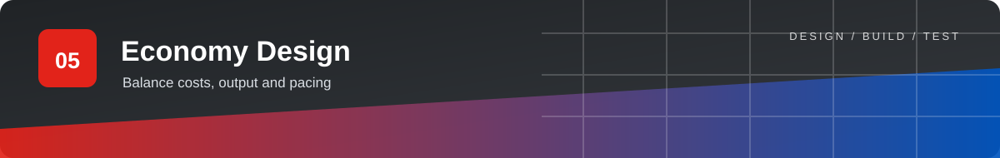

[Open the complete topic guide](05-Economy-Design/README.md)

**Purpose:** Balance currency sources, costs, rewards and purchasing decisions.

The economy controls how quickly the player can make progress.
Every currency needs a clear purpose.
Every source adds value to the economy and every sink removes value.
Costs should be evaluated against the actual income rate, not selected at random.

**Design and implementation checklist**

- Start with one primary currency unless a second currency has a clear role.
- List all sources of currency.
- List all sinks and recurring costs.
- Calculate income per second or per action.
- Calculate the payback time of each upgrade.
- Model prices across the early, middle and late game.
- Use caps or diminishing returns where runaway values are a risk.
- Avoid introducing extra currencies only to create more shop pages.
- Keep the economy understandable to a new player.
- Test both active and less active play patterns.

**Validation questions**

- Can players understand where currency comes from and where it goes?
- Are important purchases reachable at the intended time?
- Does one strategy dominate every other strategy?
- Does inflation make old rewards meaningless?

**Expected documentation for this topic**

- A short statement of the intended player outcome.
- A diagram or flow description where the system has multiple states.
- A list of configuration values and their default assumptions.
- At least one edge case and how it should be handled.
- A playtest or technical validation plan.
- Links to authoritative platform documentation where relevant.

---

### 06. Tycoon Mechanics

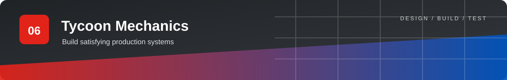

[Open the complete topic guide](06-Tycoon-Mechanics/README.md)

**Purpose:** Give each machine a distinct production role and readable effect.

Machines make the tycoon tangible.
Droppers, conveyors, processors, storage and collectors can form a satisfying production line.
The visual simulation should support the gameplay and not become a performance problem.
A machine is more interesting when its role changes the player's decisions.

**Design and implementation checklist**

- Define the role of each machine before modeling it.
- Separate production rate, item value and storage capacity.
- Use clear visual states for locked, active, upgraded and disabled machines.
- Make purchase buttons communicate the machine they unlock.
- Use physical parts only when they add visible value.
- Consider server-side numerical production for large factories.
- Keep machine configuration in data rather than duplicated scripts.
- Make upgrades visibly alter the machine where possible.
- Test collision, ownership and interaction distance.
- Profile the cost of many active machines.

**Validation questions**

- Can players tell what each machine contributes?
- Does upgrading a machine have an observable effect?
- Does the system remain performant with a large factory?
- Can the server validate every purchase?

**Expected documentation for this topic**

- A short statement of the intended player outcome.
- A diagram or flow description where the system has multiple states.
- A list of configuration values and their default assumptions.
- At least one edge case and how it should be handled.
- A playtest or technical validation plan.
- Links to authoritative platform documentation where relevant.

---

### 07. Player Psychology


[Open the complete topic guide](07-Player-Psychology/README.md)

**Purpose:** Understand motivation while avoiding manipulative design.

Players are motivated by different things.
Some enjoy optimizing systems, others enjoy collecting, exploring, building or socializing.
Good design supports autonomy, a sense of competence and meaningful social connection.
Psychology should help create satisfying play, not pressure players into purchases.

**Design and implementation checklist**

- Offer choices that support different play styles.
- Make feedback specific and proportional to the action.
- Let players understand how to improve.
- Use curiosity and discovery without hiding essential information.
- Recognize effort and mastery.
- Avoid shame, guilt or public pressure to spend.
- Avoid fake urgency and misleading countdowns.
- Make the game enjoyable without purchases.
- Ask players what they found satisfying or frustrating.
- Treat session length as one signal, not proof of enjoyment.

**Validation questions**

- Do players feel in control of their decisions?
- Can non-paying players complete the core experience?
- Do rewards feel earned and understandable?
- Are return systems respectful of player time?

**Expected documentation for this topic**

- A short statement of the intended player outcome.
- A diagram or flow description where the system has multiple states.
- A list of configuration values and their default assumptions.
- At least one edge case and how it should be handled.
- A playtest or technical validation plan.
- Links to authoritative platform documentation where relevant.

---

### 08. Retention Systems

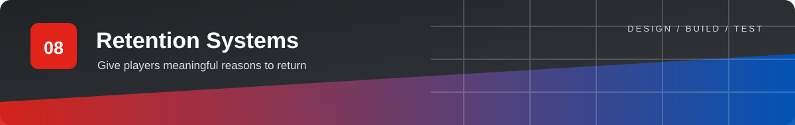

[Open the complete topic guide](08-Retention-Systems/README.md)

**Purpose:** Give players good reasons to return without punishing absence.

Retention describes whether players return over time.
It is affected by the quality of the core experience, progression, social play and updates.
Daily rewards are only one possible tool and cannot repair a weak game loop.
A sustainable system creates new goals without creating obligation.

**Design and implementation checklist**

- Create goals that can be completed across several sessions.
- Use weekly objectives with flexible completion windows.
- Offer collections and mastery goals.
- Make event schedules clear and reasonable.
- Avoid destructive login streaks.
- Provide a useful returning-player summary.
- Use analytics to locate where players stop progressing.
- Segment new, returning and experienced players.
- Ask inactive players for feedback only through appropriate channels.
- Do not equate forced daily activity with loyalty.

**Validation questions**

- Do players return because there is something they want to do?
- Can missed days be recovered from?
- Do updates improve the experience for existing players?
- Are retention changes measured by cohort?

**Expected documentation for this topic**

- A short statement of the intended player outcome.
- A diagram or flow description where the system has multiple states.
- A list of configuration values and their default assumptions.
- At least one edge case and how it should be handled.
- A playtest or technical validation plan.
- Links to authoritative platform documentation where relevant.

---

### 09. Social Gameplay

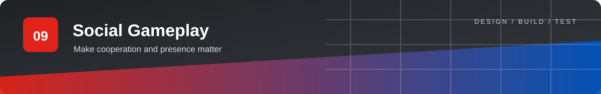

[Open the complete topic guide](09-Social-Gameplay/README.md)

**Purpose:** Make playing with other people useful, optional and enjoyable.

Social systems can turn a solo factory into a shared experience.
Cooperation, visits, friendly competition and shared goals can create memorable moments.
Social mechanics should not force spam or expose players to avoidable abuse.
The solo experience should remain viable.

**Design and implementation checklist**

- Support visiting other players' tycoons.
- Create optional cooperative milestones.
- Use leaderboards that reward understandable achievements.
- Provide privacy and interaction controls.
- Avoid requiring players to invite friends to progress.
- Secure trading if trading exists at all.
- Make group rewards modest and transparent.
- Prevent easy reward duplication through alternate accounts.
- Test with strangers as well as friends.
- Moderate names, chat surfaces and user-generated content appropriately.

**Validation questions**

- Does multiplayer add something beyond extra currency?
- Can a player enjoy the game alone?
- Are social actions safe and understandable?
- Can competitive systems avoid pay-to-win dominance?

**Expected documentation for this topic**

- A short statement of the intended player outcome.
- A diagram or flow description where the system has multiple states.
- A list of configuration values and their default assumptions.
- At least one edge case and how it should be handled.
- A playtest or technical validation plan.
- Links to authoritative platform documentation where relevant.

---

### 10. World Design

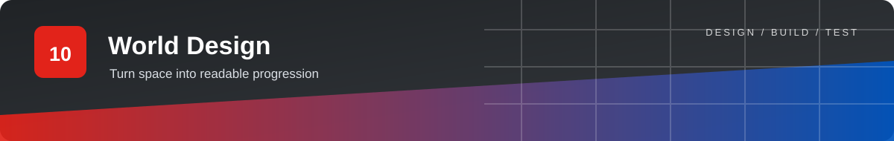

[Open the complete topic guide](10-World-Design/README.md)

**Purpose:** Build a readable world that supports navigation and discovery.

The world is both a functional layout and part of the game's identity.
A map should guide the player toward useful places without making exploration feel like work.
New zones should introduce a visual or mechanical change.
Large empty spaces are not automatically a sign of scale.

**Design and implementation checklist**

- Create a simple blockout before detailed modeling.
- Use landmarks to communicate direction.
- Make paths and interactable objects visually distinct.
- Keep essential routes short and readable.
- Give each zone a distinct identity.
- Use secrets as optional discoveries rather than mandatory progression blockers.
- Plan spawn points and safe areas.
- Check sightlines on mobile screens.
- Avoid excessive decorative geometry.
- Profile lighting, particles and moving objects.

**Validation questions**

- Can a new player find the main objective?
- Does each zone have a reason to exist?
- Are distances appropriate for the pace?
- Can the map run on the target device range?

**Expected documentation for this topic**

- A short statement of the intended player outcome.
- A diagram or flow description where the system has multiple states.
- A list of configuration values and their default assumptions.
- At least one edge case and how it should be handled.
- A playtest or technical validation plan.
- Links to authoritative platform documentation where relevant.

---

### 11. Quests and Achievements

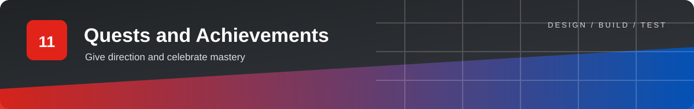

[Open the complete topic guide](11-Quests-And-Achievements/README.md)

**Purpose:** Create objectives that teach, guide and celebrate different kinds of play.

Quests give players a concrete task.
Achievements recognize a milestone or style of play.
A good objective is clear, measurable and connected to the game's identity.
Rewards should support the economy rather than destabilize it.

**Design and implementation checklist**

- Use early quests to teach the main mechanics.
- Mix production, exploration, collection and mastery goals.
- Show exact requirements and current progress.
- Explain rewards before the player commits.
- Avoid objectives that require excessive repetition.
- Create optional achievements for unusual play styles.
- Use server validation for completion.
- Persist progress safely.
- Review quest difficulty for new and returning players.
- Do not make every achievement a currency reward.

**Validation questions**

- Can the player understand what counts toward completion?
- Does each quest teach or celebrate something?
- Are rewards proportionate?
- Can progress survive reconnecting?

**Expected documentation for this topic**

- A short statement of the intended player outcome.
- A diagram or flow description where the system has multiple states.
- A list of configuration values and their default assumptions.
- At least one edge case and how it should be handled.
- A playtest or technical validation plan.
- Links to authoritative platform documentation where relevant.

---

### 12. Rebirth and Prestige

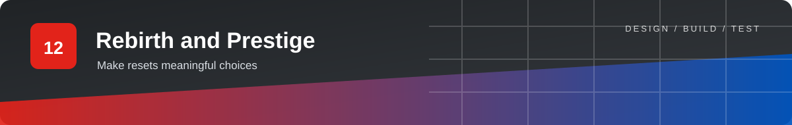

[Open the complete topic guide](12-Rebirth-And-Prestige/README.md)

**Purpose:** Extend progression by exchanging some progress for a lasting new path.

Prestige systems create a second layer of progression.
A reset should be a meaningful choice, not a hidden punishment or arbitrary gate.
The player must understand what is lost, what is retained and what is gained.
A prestige reward should change future decisions.

**Design and implementation checklist**

- List exactly what resets.
- List exactly what is retained.
- Preview the reward before confirmation.
- Give prestige currency a clear use.
- Offer permanent upgrades or new content paths.
- Avoid making the first rebirth excessively distant.
- Ensure the base game remains meaningful after prestige.
- Use confirmation for irreversible resets.
- Test multiple prestige cycles, not only the first.
- Prevent reset exploits and save inconsistencies.

**Validation questions**

- Does the player understand the trade-off?
- Does prestige change the next run?
- Are rewards useful without becoming mandatory?
- Can a failed or interrupted reset be recovered safely?

**Expected documentation for this topic**

- A short statement of the intended player outcome.
- A diagram or flow description where the system has multiple states.
- A list of configuration values and their default assumptions.
- At least one edge case and how it should be handled.
- A playtest or technical validation plan.
- Links to authoritative platform documentation where relevant.

---

### 13. Monetization

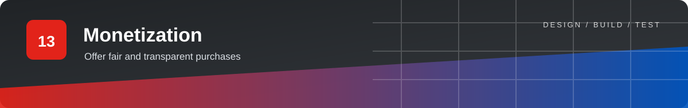

[Open the complete topic guide](13-Monetization/README.md)

**Purpose:** Build optional purchases that are transparent and compatible with a complete free experience.

Monetization can support development when it respects player trust.
Roblox provides different purchase mechanisms for permanent entitlements and repeatable products.
A purchase should clearly describe its contents and should be delivered reliably.
A player who never pays should still be able to enjoy the core game.

**Design and implementation checklist**

- Separate permanent Pass benefits from repeatable Developer Products.
- Consider cosmetics, themes, emotes and convenience features.
- Display exact purchase contents before prompting.
- Keep prices and value propositions clear.
- Avoid accidental purchase layouts.
- Do not make essential progression dependent on payment.
- Use server-side receipt processing for Developer Products.
- Test cancellation, retry and duplicate receipt behavior.
- Avoid manipulative urgency or shame-based prompts.
- Review Roblox policies before releasing monetization.

**Validation questions**

- Can the game be completed without spending?
- Does every product deliver exactly what it promises?
- Are purchases processed and granted securely?
- Would a non-paying player describe the game as fair?

**Expected documentation for this topic**

- A short statement of the intended player outcome.
- A diagram or flow description where the system has multiple states.
- A list of configuration values and their default assumptions.
- At least one edge case and how it should be handled.
- A playtest or technical validation plan.
- Links to authoritative platform documentation where relevant.

---

### 14. Viral Growth

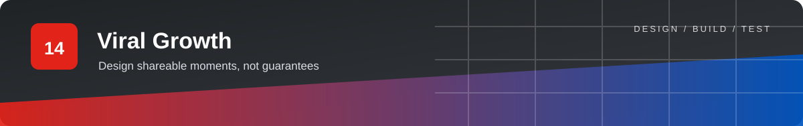

[Open the complete topic guide](14-Viral-Growth/README.md)

**Purpose:** Create moments that players naturally want to share.

Organic growth is not a button or a guaranteed formula.
Players share experiences when something is entertaining, surprising, expressive or meaningful to their group.
The game can make those moments easier to notice and share.
Growth tactics should not become spam or misleading promotion.

**Design and implementation checklist**

- Identify moments that are naturally screenshot-worthy.
- Give players expressive bases, skins or production layouts.
- Make visiting a friend's factory meaningful.
- Support community challenges with clear rules.
- Avoid spammy invitation rewards.
- Use accurate thumbnails and descriptions.
- Observe what players show to friends without prompting.
- Make shareable content work for solo players too.
- Track discovery and conversion signals carefully.
- Treat growth experiments as hypotheses.

**Validation questions**

- Do players voluntarily show the game to others?
- Does shared content represent the real experience?
- Do invited players enjoy the game after joining?
- Are social incentives modest and non-coercive?

**Expected documentation for this topic**

- A short statement of the intended player outcome.
- A diagram or flow description where the system has multiple states.
- A list of configuration values and their default assumptions.
- At least one edge case and how it should be handled.
- A playtest or technical validation plan.
- Links to authoritative platform documentation where relevant.

---

### 15. UI and UX Design


[Open the complete topic guide](15-UI-UX-Design/README.md)

**Purpose:** Make the interface readable, consistent and usable across devices.

The interface explains the game and gives access to important actions.
A clear hierarchy helps players understand currency, goals and available upgrades.
The interface should support the world rather than obscure it.
A design that works with a mouse may fail on a phone or controller.

**Design and implementation checklist**

- Prioritize currency, current objective and next action.
- Use consistent button states and interaction patterns.
- Make text readable at common screen sizes.
- Use large enough touch targets.
- Avoid unnecessary modal windows.
- Explain disabled buttons.
- Confirm irreversible actions.
- Use color with text or icons, not color alone.
- Provide settings for audio and visual intensity.
- Test with keyboard, touch and controller.

**Validation questions**

- Can players complete common tasks without help?
- Is the interface readable on a small screen?
- Do prompts appear at the right time?
- Can players recover from accidental menu actions?

**Expected documentation for this topic**

- A short statement of the intended player outcome.
- A diagram or flow description where the system has multiple states.
- A list of configuration values and their default assumptions.
- At least one edge case and how it should be handled.
- A playtest or technical validation plan.
- Links to authoritative platform documentation where relevant.

---

### 16. Audio and Visuals

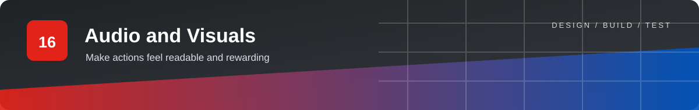

[Open the complete topic guide](16-Audio-And-Visuals/README.md)

**Purpose:** Use audiovisual feedback to make the game feel responsive and recognizable.

Visual and audio effects communicate state and reward.
A purchase can change a machine, a quest can show progress and a new area can feel distinct.
Effects should reinforce information rather than compete with it.
Performance and accessibility must be considered from the beginning.

**Design and implementation checklist**

- Define a small set of visual rules and reuse them.
- Give important actions distinct but restrained feedback.
- Use sound to confirm state changes.
- Keep volume levels consistent.
- Avoid excessive flashing and screen shake.
- Provide settings for sound and intense effects.
- Use assets that you have permission to use.
- Optimize particles and moving objects.
- Check contrast and text legibility.
- Review effects on low-end devices.

**Validation questions**

- Does feedback make actions easier to understand?
- Is the visual identity consistent?
- Can players reduce disruptive effects?
- Does the scene remain performant?

**Expected documentation for this topic**

- A short statement of the intended player outcome.
- A diagram or flow description where the system has multiple states.
- A list of configuration values and their default assumptions.
- At least one edge case and how it should be handled.
- A playtest or technical validation plan.
- Links to authoritative platform documentation where relevant.

---

### 17. Live Operations and Updates

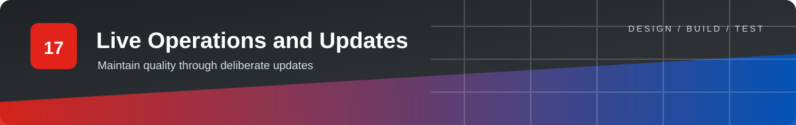

[Open the complete topic guide](17-Live-Ops-And-Updates/README.md)

**Purpose:** Plan a sustainable update cadence and maintain the experience after launch.

Live operations include updates, events, bug fixes and community communication.
A reliable small update is more valuable than a promised large update that never arrives.
Every new feature increases maintenance and testing needs.
Updates should improve the game without destabilizing existing progress.

**Design and implementation checklist**

- Separate bug fixes from new content in planning.
- Keep a realistic roadmap.
- Publish concise and accurate changelogs.
- Test save compatibility before data migrations.
- Keep rollback plans for risky releases.
- Use events that fit the game's theme.
- Do not overpromise release dates.
- Prioritize issues that block progress or purchases.
- Collect feedback in appropriate community spaces.
- Reserve development time for maintenance.

**Validation questions**

- Can the team maintain the promised cadence?
- Are old saves compatible?
- Do updates solve known player problems?
- Can a broken release be rolled back or mitigated?

**Expected documentation for this topic**

- A short statement of the intended player outcome.
- A diagram or flow description where the system has multiple states.
- A list of configuration values and their default assumptions.
- At least one edge case and how it should be handled.
- A playtest or technical validation plan.
- Links to authoritative platform documentation where relevant.

---

### 18. Analytics and Data


[Open the complete topic guide](18-Analytics-And-Data/README.md)

**Purpose:** Use player behavior data to identify friction and evaluate design changes.

Analytics can show where players progress, stop or return.
A metric is useful only when it relates to a clear question.
Averages can hide differences between new players, returning players and highly engaged players.
Data should guide investigation, not replace direct observation.

**Design and implementation checklist**

- Define the question before selecting a metric.
- Track meaningful funnel events.
- Compare cohorts rather than only global averages.
- Record update dates and experiment conditions.
- Avoid collecting unnecessary personal information.
- Use sample sizes appropriate to the question.
- Pair quantitative data with playtest observations.
- Document uncertainty and alternative explanations.
- Review retention and progression together.
- Do not optimize a metric at the expense of player trust.

**Validation questions**

- Can each metric be connected to a decision?
- Are comparisons made under similar conditions?
- Are conclusions proportional to the evidence?
- Is data collection appropriate and documented?

**Expected documentation for this topic**

- A short statement of the intended player outcome.
- A diagram or flow description where the system has multiple states.
- A list of configuration values and their default assumptions.
- At least one edge case and how it should be handled.
- A playtest or technical validation plan.
- Links to authoritative platform documentation where relevant.

---

### 19. Technical Quality

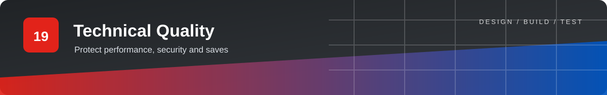

[Open the complete topic guide](19-Technical-Quality/README.md)

**Purpose:** Build a secure, maintainable and performant Roblox architecture.

The server should own valuable game state.
The client can request an action and display the result, but it must not decide how much currency exists.
Remote communication must be validated.
Persistence and purchase processing must handle failures and repeated requests.

**Design and implementation checklist**

- Separate server scripts, client scripts and shared modules.
- Keep authoritative economy logic on the server.
- Validate RemoteEvent arguments and request frequency.
- Check player ownership before changing a tycoon.
- Use DataStoreService carefully with error handling.
- Use ProcessReceipt for Developer Product grants.
- Make receipt handling idempotent.
- Profile before optimizing blindly.
- Test multiple clients and reconnects.
- Keep configuration and source control organized.

**Validation questions**

- Can an exploiter change currency by editing the client?
- Can a purchase be granted twice?
- Can data loss or a failed request be handled safely?
- Does the game meet performance targets on supported devices?

**Expected documentation for this topic**

- A short statement of the intended player outcome.
- A diagram or flow description where the system has multiple states.
- A list of configuration values and their default assumptions.
- At least one edge case and how it should be handled.
- A playtest or technical validation plan.
- Links to authoritative platform documentation where relevant.

---

### 20. Marketing and Discovery

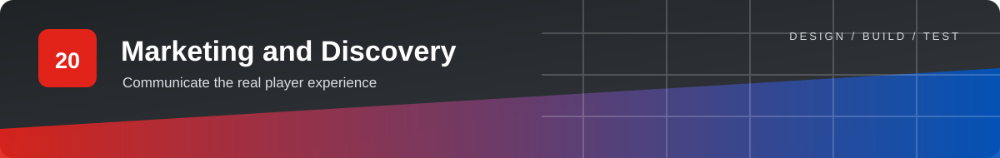

[Open the complete topic guide](20-Marketing-And-Discovery/README.md)

**Purpose:** Present the real game clearly and help the right players discover it.

The game page is part of the player experience.
An icon and thumbnail should communicate the actual gameplay.
A title and description should set accurate expectations.
Discovery results change over time and should be measured using current Roblox tools.

**Design and implementation checklist**

- Create an icon that remains legible at small sizes.
- Use thumbnails that show actual gameplay or accurate representations.
- Write a concise description of the main activity.
- Explain the distinctive mechanic early.
- Avoid misleading claims and keyword stuffing.
- Localize only when the translation is accurate and maintained.
- Test presentation concepts with people unfamiliar with the project.
- Review available discovery analytics.
- Compare click-through and early-session behavior together.
- Update the page when the game changes materially.

**Validation questions**

- Does the page accurately represent the experience?
- Can a player understand the premise from the icon and description?
- Do attracted players enjoy the actual game?
- Are changes evaluated with current analytics?

**Expected documentation for this topic**

- A short statement of the intended player outcome.
- A diagram or flow description where the system has multiple states.
- A list of configuration values and their default assumptions.
- At least one edge case and how it should be handled.
- A playtest or technical validation plan.
- Links to authoritative platform documentation where relevant.

---

## 4. Building the tycoon: systems in detail

This section connects the design framework to concrete tycoon systems.
The examples are conceptual unless a source file is explicitly included in `studio-template`.
Do not assume that every feature should be implemented in the first release.
Choose a small vertical slice, make it reliable and expand only after it has been tested.

### 4.1 Plot ownership

A plot is the area that belongs to a player.
The server should assign ownership and keep the authoritative owner identifier.
A client should never be able to claim another player's plot by changing a local value.
A plot should have a clear unclaimed state, claimed state and release state.
When a player leaves, the server should clean up temporary state and release the plot according to the game's save model.
If a player reconnects, the server can attempt to restore the player's progress.
The restore process must not duplicate machines or currency.
If no plot is available, the game should communicate that clearly or provide a safe queue/alternative.

Recommended plot data:
- Plot identifier.
- Owner UserId.
- Spawn location.
- Build bounds.
- Purchased machine identifiers.
- Current machine levels.
- Unlocked buttons.
- Plot theme or cosmetic selection.
- Version of the saved plot data.

Ownership validation should happen on every server action that modifies a plot.
Distance validation should also be considered for physical purchase buttons.
The server should verify that the requested machine belongs to the player's plot.
Never rely on a client-provided plot owner name as proof of ownership.

### 4.2 Purchase buttons

A purchase button is an interface to a server-side transaction.
The client can detect that a player interacted with a button and send a machine identifier.
The server looks up the machine definition, checks ownership, checks prerequisites, checks the player's balance and performs the purchase.
The client must not choose the price.
The client must not tell the server how much money to subtract.
The client must not tell the server which reward to grant.
After a successful transaction, the server replicates the resulting state.
The interface can then show the updated balance and unlock animation.

A robust purchase flow:

1. Player interacts with the button.
2. Client sends a request containing a known machine identifier.
3. Server validates the identifier and request rate.
4. Server verifies that the player owns the plot.
5. Server checks prerequisites and whether the item is already purchased.
6. Server reads the authoritative price from configuration.
7. Server checks the player's currency.
8. Server deducts the cost and records the purchase.
9. Server creates or enables the machine.
10. Server sends a result event or replicates the state.
11. Client displays a clear success or failure message.
12. The save system records the updated state at an appropriate time.

### 4.3 Machine categories

| Category | Primary purpose | Example upgrade |
|---|---|---|
| Dropper | Creates resources | Production interval |
| Conveyor | Moves resources | Transport speed |
| Processor | Changes resource value or type | Processing yield |
| Multiplier | Modifies output value | Multiplier strength |
| Storage | Holds resources | Capacity |
| Collector | Converts output into currency | Collection efficiency |
| Generator | Supplies energy or another input | Output rate |
| Research station | Unlocks technology | Research duration |
| Decorator | Changes appearance | Cosmetic variants |
| Automation controller | Reduces repeated player input | Automation tier |

A machine should have a readable role.
If two machines do exactly the same thing, consider combining them or giving each a distinct trade-off.
Do not add a new machine solely to create another purchase button.
The machine should contribute to a decision, a visual transformation or a new part of the production chain.

### 4.4 Production models

There are two broad ways to represent production.
A physical model spawns parts that move through the factory.
A numerical model calculates production as values and displays only selected visual effects.
A hybrid model uses numerical production for the economy and physical objects for nearby feedback.
The best approach depends on the number of machines, the target devices and the value of physical simulation to the experience.

Physical production can be satisfying because players see objects move.
It can also create physics, replication and instance-count costs.
Numerical production is easier to scale and balance.
It can feel abstract if there is no visual feedback.
A hybrid approach can preserve the fantasy while limiting unnecessary parts.

Do not spawn an unlimited number of physical objects.
Set a maximum number of active objects per plot.
Clean up objects after collection or timeout.
Use simple collision settings when full physics are not needed.
Profile the game with a realistic number of players and machines.

### 4.5 Upgrade design

An upgrade should communicate three things:
- What changes?
- How much does it cost?
- Why might the player want it?

Useful upgrade dimensions include:
- Speed: more production cycles per second.
- Value: more currency per produced item.
- Capacity: more items held before collection.
- Efficiency: less waste or lower operating cost.
- Automation: fewer repeated manual actions.
- Range: larger interaction or effect radius.
- Quality: access to higher-value recipes.
- Specialization: stronger performance in one production path.
- Cosmetic: a different appearance without economic advantage.

An upgrade should be compared by its actual effect.
A displayed `+25%` is not useful if the underlying machine is already capped.
Show the before and after values where practical.
If an upgrade changes several statistics, explain the most important one.
Do not use confusing abbreviations for new players.

### 4.6 Upgrade choice patterns

**Linear upgrades** are easy to understand.
They are appropriate for early progression but can become repetitive.
**Branching upgrades** let players specialize.
They create more interesting decisions but require more balancing.
**Trade-off upgrades** improve one statistic while weakening another.
They support strategic choices but need clear explanations.
**Situational upgrades** are useful in a particular zone or challenge.
They encourage adaptation but should not become mandatory chores.
**Cosmetic upgrades** support self-expression.
They are useful monetization candidates when they do not hide essential gameplay behind payment.

### 4.7 Rebirth and prestige

A prestige system should be designed around a clear exchange.
The player gives up some short-term progress in return for a persistent benefit or a new progression layer.
The interface must preview the reset.
It must explain which currencies, machines, quests and unlocks are affected.
The player should confirm an irreversible reset.
The server should validate the request and update the save data atomically as far as the platform's data model allows.
Test interrupted requests and reconnects carefully.

Possible prestige rewards:
- A permanent but balanced production multiplier.
- A new technology tree.
- Access to a new world.
- A special machine family.
- A cosmetic title or base theme.
- A new challenge mode.
- Additional build choices.
- A collection page.

Avoid making prestige a compulsory reset every few minutes.
If the player feels that all progress is temporary and meaningless, the system may undermine investment in the factory.
The reward should make the next run meaningfully different.

### 4.8 Offline production

Offline production can make a tycoon feel alive between sessions.
It also introduces economy and persistence risks.
Use a capped duration rather than unlimited accumulation.
Explain the calculation and cap.
Do not calculate offline time from a client-provided clock.
Use server-side timestamps stored with the player's data.
Validate unusually large time differences.
Decide how offline rewards interact with boosts, prestige and events.
Do not let offline income become so strong that active play feels pointless.

### 4.9 Quests and events

Quests should teach or celebrate mechanics.
An event should add a temporary activity or theme without breaking the core economy.
The player should understand the start and end time.
If rewards are limited, communicate that honestly.
Do not make an event require excessive daily attendance.
Consider catch-up windows for players who cannot play every day.
Events should be tested for server load and reward duplication.

### 4.10 Social features

Social systems should be optional and safe.
Visiting another player's tycoon can be a meaningful activity.
Cooperative production goals can encourage teamwork.
Friendly leaderboards can celebrate a range of achievements.
Avoid leaderboards that only reward total spending.
If trading exists, it needs server-side validation, clear confirmation and protection against duplication or misleading trades.
Do not build trading simply because another tycoon has it.
Trading creates a large security and moderation burden.

---

## 5. Economy design workbook

An economy should be modeled before it is tuned.
The first version can use a small spreadsheet.
List each machine, cost, output, upgrade effect and expected time to purchase.
Keep assumptions visible.
Do not bury important balance values inside dozens of scripts.

### 5.1 Basic formulas

**Production per second**

`production_per_second = output_per_cycle / cycle_duration`

**Income per second**

`income_per_second = production_per_second * value_per_item`

**Upgrade payback time**

`payback_seconds = upgrade_cost / additional_income_per_second`

**Simple cost growth**

`next_cost = base_cost * growth_rate ^ current_level`

These formulas are simplified.
They do not account for every interaction, cap, bonus or source of income.
Use them as a first estimate and validate with actual playtests.

### 5.2 Example machine calculation

Assume a machine produces one item every two seconds.
Assume each item is worth four coins.
Its base output is therefore two coins per second.
An upgrade costs 120 coins and increases output to three coins per second.
The additional output is one coin per second.
The simple payback time is 120 seconds.
This does not mean the upgrade is automatically good.
The player may have other goals, the machine may be inactive, or a different purchase may be more valuable.
The calculation is a tool for comparing choices, not a substitute for testing.

### 5.3 Economy worksheet

| Field | Description |
|---|---|
| Machine ID | Stable identifier used by configuration |
| Unlock requirement | Previous machine, quest or zone |
| Purchase cost | Server-authoritative cost |
| Base output | Output before upgrades |
| Cycle duration | Time between production cycles |
| Item value | Currency value of one output |
| Upgrade effect | Exact change produced by the upgrade |
| New output | Output after upgrade |
| Payback estimate | Cost divided by additional income |
| Intended player moment | When this purchase should become reachable |
| Test result | Observed time and player feedback |

### 5.4 Sources and sinks

A source adds currency.
Examples include machine output, quest rewards, event rewards and achievement rewards.
A sink removes currency.
Examples include machine purchases, upgrades, zone unlocks, cosmetics and optional construction choices.
An economy with too many sources can inflate rapidly.
An economy with too many sinks can feel restrictive.
The goal is not to remove all surplus.
The goal is to make currency useful while allowing players to feel progress.

### 5.5 Preventing runaway scaling

Large multipliers can create values that become difficult to display and balance.
Use controlled growth.
Consider diminishing returns for repeatable bonuses.
Keep late-game costs tied to late-game income.
Avoid multiplying every source without considering the combined effect.
Test the maximum plausible stack of boosts.
Use integer or appropriately bounded numeric representations for persistent currency.
Do not assume that a value safe in a small prototype remains safe after many progression layers.

### 5.6 Balance test cases

- New player who follows the intended tutorial.
- New player who ignores the tutorial.
- Player who buys the cheapest upgrades first.
- Player who saves for the most expensive upgrade.
- Player who explores before buying.
- Returning player with a partially upgraded plot.
- Player with every permitted free bonus.
- Player who reconnects after an interruption.
- Player who reaches the late game much faster than expected.
- Player who never purchases Robux products.

---

## 6. Ethical monetization and player support

Monetization is part of product design.
It affects player trust, perceived fairness and the long-term reputation of the experience.
The strongest baseline is a complete and enjoyable free game with optional purchases that add expression, convenience or support.
A purchase should never be disguised as a required step if it is optional.
The game should clearly distinguish an in-game currency from Robux.
The interface should show the purchase contents before the Roblox purchase prompt.

### 6.1 Passes and Developer Products

A Pass is generally suited to a permanent entitlement.
A Developer Product is generally suited to a repeatable purchase.
The current Roblox documentation is the authority for the exact platform behavior and implementation requirements.
Do not infer purchase completion from a client event.
Use the server receipt-processing flow for Developer Products.
Make the grant logic safe against repeated receipt processing.
Keep a record of processed purchase identifiers where required by the implementation pattern.
If receipt processing fails, do not falsely acknowledge a successful grant.

### 6.2 Support button concept

A support button can be placed in a clearly labeled menu.
The label should say `Support the Developers` or another direct phrase.
It should not imitate a required upgrade button.
The player should be able to close the support panel without penalty.
The panel should explain that the purchase is optional.
It should list the exact contents of each product.
It should avoid fake scarcity, guilt or repeated interruption.

### 6.3 Support reward ideas

| Support level | Example thank-you | Gameplay impact |
|---|---|---|
| Small | Supporter title or profile decoration | Cosmetic only |
| Medium | Alternate machine skin | Cosmetic only |
| Large | Base theme or visual effect pack | Cosmetic only |
| Community goal | Shared server decoration or event progress | Shared and capped |

A public donor leaderboard can create social pressure.
If one exists, make it opt-in or provide privacy controls where possible.
Do not use the leaderboard to shame non-buyers.
A private thank-you message is often enough.
The reward should be described accurately before the purchase.

### 6.4 Cosmetic monetization

Cosmetics are a strong fit for tycoons because players often value the appearance of their factory.
Possible products include:
- Conveyor skins.
- Dropper models.
- Machine color themes.
- Factory lighting themes.
- Collection effects.
- Character emotes.
- Nameplate styles.
- Decorative signs.
- Spawn animations.
- Vehicle skins if vehicles exist.
- Seasonal visual sets.
- Music or ambient sound themes where permitted.

Cosmetics should not reduce visibility or create a competitive advantage.
Avoid visual effects that obscure production status or other players.
Offer a preview when possible.
Use assets that the development team has permission to distribute.

### 6.5 Convenience purchases

Convenience features can be fair when they save repetitive time without removing the core game.
Examples might include an additional cosmetic loadout slot or a non-essential interface shortcut.
A boost should have a clear duration and effect.
Do not sell a solution to a problem intentionally created to frustrate the player.
Do not make a paid convenience feature the only reasonable way to play.

### 6.6 Purchase safety checklist

- The product description matches the delivered reward.
- The purchase prompt is opened through the supported Roblox API.
- The server processes the receipt.
- The server validates the product identifier.
- The grant function is safe to call more than once.
- The game does not trust a client claim that payment succeeded.
- The player receives a clear confirmation after the server grants the item.
- Failure cases are logged and can be investigated.
- The product is tested in the appropriate Roblox test environment.
- The experience follows current Roblox policies.

---

## 7. Player retention without manipulation

Retention is a result of the experience over time.
A player returns because there is something they want to do, because they enjoy the community or because the game provides a meaningful long-term goal.
A login reward may remind a player that the game exists, but it cannot replace a satisfying core loop.
The design should respect the player's freedom to stop playing.

### 7.1 Healthy return mechanics

- Weekly goals with flexible completion.
- Collections with visible missing items.
- Long-term construction projects.
- Optional seasonal events.
- New machine specializations.
- Cooperative milestones.
- Mastery challenges.
- Progress summaries after returning.
- New zones that change the gameplay.
- Community showcases.

### 7.2 Mechanics to avoid

- Streaks that erase substantial progress after one missed day.
- Repeated popups that interrupt normal play.
- Fake timers or fake limited stock.
- Rewards that require excessive daily attendance.
- Public humiliation for not buying.
- Artificially slow progression designed only to sell boosts.
- Misleading purchase labels.
- Unclear odds or reward conditions.
- Social systems that pressure players to spam friends.
- A design that treats every minute away as a failure.

### 7.3 Retention analysis

Review new-player and returning-player cohorts separately.
A high session length does not automatically mean a good experience.
A player can spend a long time confused or waiting.
Pair analytics with observation and direct feedback.
Document what changed between cohorts.
Do not attribute a retention change to one feature if multiple systems changed at the same time.

---

## 8. Roblox Studio architecture

The following structure is a proposed teaching architecture.
It is not an official Roblox requirement.
The actual game can use different names or services if the responsibilities remain clear.
The important principle is separation of responsibilities and server authority.

### 8.1 Suggested Explorer hierarchy

```text
Workspace
└── World
    ├── SpawnPoints
    ├── Lobby
    ├── TycoonPlots
    │   ├── Plot_01
    │   │   ├── BuildArea
    │   │   ├── Spawn
    │   │   ├── PurchaseButtons
    │   │   ├── Machines
    │   │   └── Decorations
    │   └── Plot_02
    └── WorldInteractions

ReplicatedStorage
├── Shared
│   ├── Config
│   ├── Types
│   └── Constants
└── Remotes
    ├── RequestPurchase
    ├── RequestUpgrade
    ├── RequestCollect
    └── NotifyClient

ServerScriptService
└── Server
    ├── Bootstrap.server.lua
    ├── Services
    │   ├── PlayerDataService
    │   ├── PlotService
    │   ├── EconomyService
    │   ├── MachineService
    │   ├── UpgradeService
    │   ├── QuestService
    │   └── MonetizationService
    └── Systems
        ├── ProductionSystem
        ├── RebirthSystem
        └── AnalyticsSystem

ServerStorage
├── MachineModels
├── PlotTemplates
└── ServerOnlyAssets

StarterGui
└── MainHUD
    ├── CurrencyPanel
    ├── ObjectivePanel
    ├── UpgradePanel
    ├── ShopPanel
    └── Notifications

StarterPlayer
└── StarterPlayerScripts
    ├── ClientBootstrap.client.lua
    ├── Controllers
    │   ├── HUDController
    │   ├── InteractionController
    │   └── CameraController
    └── Effects

SoundService
└── GameAudio

Lighting
└── EnvironmentSettings
```

### 8.2 Responsibility by service

| Service or folder | Responsibility | Must not do |
|---|---|---|
| Workspace | Visible world and physical instances | Decide trusted currency values |
| ReplicatedStorage | Shared modules and remotes | Store secrets or server-only authority |
| ServerScriptService | Trusted game logic | Depend on client claims |
| ServerStorage | Server-only models and assets | Expose hidden templates to clients |
| StarterGui | User interface | Decide purchase prices |
| StarterPlayerScripts | Local controls and presentation | Grant currency directly |
| DataStoreService | Persistent data | Be called every frame |
| MarketplaceService | Purchase prompts and receipts | Trust client-only purchase claims |

### 8.3 Naming conventions

Use stable identifiers without spaces for configuration keys.
Use clear names for Roblox instances.
Use a consistent suffix for script types where it improves clarity.
Avoid renaming identifiers after they have been written into persistent data unless a migration is planned.
Document any identifier that is part of a saved data schema.

Examples:
- `StarterDropper`
- `BasicConveyor`
- `SteelProcessor`
- `RequestUpgrade`
- `PlayerDataService`
- `Bootstrap.server.lua`
- `TycoonClient.client.lua`

### 8.4 Client and server boundary

The client is responsible for input, interface, camera and local presentation.
The server is responsible for ownership, currency, purchases, production rewards, progression and saved data.
A RemoteEvent is a communication mechanism, not a security boundary by itself.
Every request must be treated as untrusted input.
Validate types, lengths, ranges, ownership, prerequisites and request frequency.
The server should calculate the outcome from trusted configuration.

Bad pattern:
`RemoteEvent:FireServer("GiveMe", 999999999)`

Better pattern:
`RemoteEvent:FireServer("StarterDropper")`

The server then looks up the item, validates the player and determines the price and reward.
Do not accept a client-provided price or reward amount.

### 8.5 RemoteEvent validation

For every remote, document:
- Which client action sends it.
- Which arguments are accepted.
- Which argument types are valid.
- Which player state is required.
- Which ownership checks are required.
- Which rate limit applies.
- Which server service handles the request.
- Which success and failure responses are possible.
- Whether the action can be repeated safely.

Reject unknown identifiers.
Reject unexpected tables or instances.
Reject values outside the expected range.
Avoid returning sensitive server state to the client.
Rate limits should protect expensive operations without making normal interaction unreliable.

### 8.6 Data persistence

Persistent data needs a schema and a version.
Use `pcall` around DataStore operations.
Plan for temporary failures and throttling.
Do not save every frame.
Save at meaningful checkpoints and when the player leaves, while recognizing that shutdown and network failures can interrupt work.
Use a strategy for retries and session conflicts appropriate to the game's complexity.
Validate loaded values before using them.
Do not assume saved data is always complete or current.
Keep a migration plan when the schema changes.
Test with a separate published test experience and test data.

Example data shape:

```lua
local defaultData = {
    DataVersion = 1,
    Coins = 0,
    Rebirths = 0,
    PurchasedMachines = {},
    MachineLevels = {},
    UnlockedZones = {},
    CompletedQuests = {},
    Cosmetics = {},
    LastSeen = 0,
}
```

This is an illustrative schema, not a complete persistence implementation.
The data should be validated and migrated before use.
Do not store Roblox service objects or Instances in a DataStore.
Store serializable values such as numbers, strings, booleans and tables supported by the service.

### 8.7 Save reliability checklist

- Load data before allowing purchases.
- Define behavior when data cannot be loaded.
- Do not overwrite valid data with an empty default after a failed load.
- Validate every field.
- Clamp values to reasonable bounds.
- Version the schema.
- Test migration from earlier versions.
- Avoid concurrent writes that overwrite newer data.
- Handle player departure and server shutdown.
- Test reconnects and network interruptions.
- Keep a clear log of save failures.
- Never expose private data in client messages.

### 8.8 Performance architecture

Use the MicroProfiler and current Roblox performance guidance.
Profile realistic sessions, not only an empty test place.
Measure server and client performance.
Reduce unnecessary physical objects and frequent remote traffic.
Avoid expensive loops that scan every object every frame.
Use event-driven logic where appropriate.
Clean up temporary connections and instances.
Keep UI updates proportional to actual state changes.
Test on lower-end supported devices.
Do not optimize based on guesses alone.

---

## 9. Roblox Studio implementation starter

The `studio-template/` folder contains a small starter example.
It demonstrates configuration-driven prices, server-side currency checks and a client request that sends a machine identifier.
It is intentionally incomplete.
It does not yet provide persistent saves, plot ownership, full production, a complete user interface or production-ready purchase processing.
Use it to understand separation of responsibilities, not as a finished framework.

### 9.1 Required instance creation

Create the following instances in Studio:
- `ReplicatedStorage` / `TycoonShared` as a Folder.
- `ReplicatedStorage` / `TycoonShared` / `Config` as a ModuleScript.
- `ReplicatedStorage` / `TycoonShared` / `Remotes` as a Folder.
- `RequestUpgrade` as a RemoteEvent inside `Remotes`.
- `NotifyPlayer` as a RemoteEvent inside `Remotes`.
- `ServerScriptService` / `TycoonServer` as a Folder.
- `Bootstrap.server.lua` as a Script inside `TycoonServer`.
- `Services` as a Folder inside `TycoonServer`.
- `EconomyService` and `MachineService` as ModuleScripts inside `Services`.
- `StarterPlayer` / `StarterPlayerScripts` / `TycoonClient.client.lua` as a LocalScript.

Copy each source file from `studio-template/` into the matching object.
Names and paths must match.
If a path differs, update the corresponding `WaitForChild` calls.
Use the Studio Output window to inspect errors.
Test with multiple clients using Studio's server/client testing tools.

### 9.2 What the starter demonstrates

- Shared configuration for costs and production values.
- Server-owned in-memory currency.
- Server-owned machine levels.
- A client request that sends only a machine identifier.
- A basic request cooldown.
- A server-side check for available currency.
- A server response for success, insufficient funds or maximum level.

### 9.3 What must be added before public release

- Plot assignment and ownership validation.
- Distance checks for physical purchase buttons.
- Persistent data loading and saving.
- Data schema validation and migration.
- Production loops and cleanup.
- A complete user interface.
- Purchase receipt handling for Developer Products.
- Pass entitlement checks.
- Analytics events where appropriate.
- Error handling and monitoring.
- Exploit-minded testing.
- Performance testing with realistic player counts.

### 9.4 Why prices belong on the server

If a client sends the price, an exploiter can attempt to send a smaller price.
If a client sends the reward, an exploiter can attempt to send a larger reward.
The server must look up the cost and reward from trusted configuration.
The client should request an action by identifier.
The server decides whether the action is valid.
The client displays the result.

---

## 10. User interface design system

A tycoon interface should communicate the current state without hiding the game.
The HUD should prioritize information that helps the player make the next decision.
Do not show every statistic at once.
Reveal advanced information when the player unlocks the related system.

### 10.1 Recommended HUD hierarchy

1. Primary currency.
2. Current objective.
3. Next available upgrade or progress hint.
4. Important notifications.
5. Secondary currencies and advanced statistics.
6. Optional menus and settings.

### 10.2 Interface states

Every interactive control should define:
- Default state.
- Hover or focus state where supported.
- Pressed state.
- Disabled state.
- Loading state.
- Success state.
- Error state.
- Locked state.

The disabled state should explain why the action is unavailable.
A button that silently does nothing creates confusion.
A purchase failure should tell the player whether the issue is insufficient currency, a missing prerequisite or a temporary error.

### 10.3 Mobile and controller support

Do not assume that a mouse is available.
Touch targets should be large enough for reliable interaction.
Avoid placing critical controls under platform interface elements.
Check text scaling.
Keep important actions reachable.
Controller navigation should have a clear focus order.
Test the full purchase and upgrade flow with touch and controller input.

### 10.4 Accessibility

Use readable text sizes.
Use contrast that works in bright and dark scenes.
Do not rely on color alone to communicate success or failure.
Provide settings for music and sound effects.
Avoid excessive flashing and camera shake.
Keep essential instructions concise.
Allow players to understand an objective without needing to hear an audio cue.
Consider players who use different input devices.

---

## 11. World and factory design

The factory should communicate progress visually.
A player should be able to look at the base and understand that it has changed.
The map should make the factory the center of the experience.
Expansion should reveal new silhouettes, colors, materials and production ideas.
Avoid filling the world with decorative objects that obstruct movement or reduce performance.

### 11.1 Layout planning

Start with a blockout.
Use simple parts to test distances and routes.
Place important interactions where they can be seen.
Keep purchase buttons close to the machine or system they unlock.
Make the spawn location safe and readable.
Avoid long walks between frequently used stations.
Plan where the camera will look when a player joins.
Consider the height and width of machines on mobile screens.

### 11.2 Visual progression

A factory can evolve through:
- More complex machine silhouettes.
- New materials and lighting.
- Additional production floors.
- New conveyor layouts.
- More visible automation.
- New environmental themes.
- Larger storage and processing areas.
- Decorative personalization.

Visual progression should correspond to actual progress.
Do not make an expensive upgrade visually identical unless the upgrade is intentionally numerical and clearly explained.

### 11.3 Exploration

Exploration should reveal something worthwhile.
A hidden room might contain lore, a cosmetic, a challenge or a shortcut.
Not every secret needs to grant currency.
Some discoveries can exist for curiosity and identity.
Do not hide essential progression behind an obscure secret unless the game teaches the required clue.

---

## 12. Testing strategy

Testing should begin before the game looks finished.
A greybox can reveal problems with the core loop.
A polished game can still be confusing, insecure or unbalanced.
Test design, technical behavior and presentation separately, then test them together.

### 12.1 Test categories

| Test type | Main question |
|---|---|
| Functional | Does the feature work as intended? |
| Progression | Can players reach the next milestone? |
| Economy | Are costs and rewards balanced? |
| Multiplayer | Does ownership remain correct with multiple players? |
| Security | Can a client manipulate trusted state? |
| Persistence | Does progress survive reconnecting? |
| Performance | Does the game remain responsive under load? |
| Usability | Can a new player understand the interface? |
| Accessibility | Can supported input and presentation needs be met? |
| Monetization | Are purchases transparent and reliably delivered? |

### 12.2 New-player playtest

Give a tester no instructions beyond joining the game.
Observe the first actions.
Record where the player pauses, asks a question or makes an unintended purchase.
Do not immediately explain the solution.
The purpose is to find gaps in the game itself.
After the session, ask what the player thought the goal was.
Ask what they expected each machine to do.
Ask which moment felt most satisfying.
Ask where they felt confused or bored.

### 12.3 Exploit-minded test

Attempt to send invalid identifiers.
Attempt to request upgrades without owning a plot.
Attempt to purchase the same machine repeatedly.
Attempt to send unexpected argument types.
Attempt to spam remotes.
Attempt to collect a reward from another player's machine.
Attempt to manipulate client-side displayed currency.
Attempt to reconnect during save operations.
Attempt to trigger duplicate purchase grants in a test environment.
Document the expected server response for every case.

### 12.4 Release checklist

- [ ] The first five minutes are understandable.
- [ ] The core loop works in a fresh server.
- [ ] Plot ownership is server-validated.
- [ ] Purchases are server-validated.
- [ ] Economy values are configured centrally.
- [ ] Data loading and saving have been tested.
- [ ] Failed data loads do not overwrite valid data.
- [ ] Developer Product receipts are handled on the server.
- [ ] Purchase rewards cannot be duplicated.
- [ ] The interface works on target devices.
- [ ] Audio and visual settings work.
- [ ] The game has no known progression-blocking bugs.
- [ ] Performance has been profiled with realistic content.
- [ ] The icon and thumbnails represent the real game.
- [ ] The description accurately explains the experience.
- [ ] Current Roblox policies and platform documentation have been reviewed.
- [ ] A rollback or mitigation plan exists for risky changes.

---

## 13. Analytics and improvement

Analytics should answer questions.
Do not add events simply because an analytics system can record them.
Before adding an event, write down the decision it might support.
Avoid collecting personal information that is not needed.
Use Roblox's current analytics documentation and available creator tools.

### 13.1 Useful questions

- How many players begin the tutorial?
- How many complete the first objective?
- How many reach the first purchase?
- Where do players stop progressing?
- Which machines are rarely purchased?
- Which upgrades are selected most often?
- How many players return after their first session?
- Do players visit other plots?
- Which update changed the progression funnel?
- Do players who purchase cosmetics also enjoy the core loop?
- Are players leaving because of technical errors or design friction?

### 13.2 Example event plan

| Event | When to record | Possible use |
|---|---|---|
| TutorialStarted | Player begins onboarding | Measure tutorial entry |
| TutorialCompleted | Player completes onboarding | Find onboarding friction |
| FirstMachinePurchased | First valid machine purchase | Measure early progression |
| UpgradePurchased | Successful upgrade | Understand upgrade choices |
| ZoneUnlocked | Server confirms unlock | Measure progression |
| RebirthCompleted | Server confirms prestige | Understand endgame entry |
| QuestCompleted | Server validates completion | Evaluate quest participation |
| SupportPurchaseGranted | Receipt is processed | Confirm purchase fulfillment |

Event names and payloads should follow the current analytics system's requirements.
Do not send unnecessary identifiers or sensitive information.
Do not treat purchase events as proof that the game is enjoyable.

### 13.3 Experiment documentation

For every experiment, record:
- The problem being investigated.
- The current behavior.
- The hypothesis.
- The change being tested.
- The metric or observation.
- The test period.
- The sample limitations.
- The result.
- The decision.
- The next question.

A failed experiment is still useful when it eliminates an assumption.
Do not hide negative results.
Do not change multiple major systems at once if the purpose is to understand one variable.

---

## 14. Project planning and development roadmap

A small first release should be narrow enough to finish and reliable enough to maintain.
The roadmap below is an example structure, not a schedule guarantee.
Adjust it to team size, experience and available time.

### Phase 1 - Prototype

Goal: prove the central activity.
- One compact map area.
- One player plot.
- One resource.
- One generator.
- One purchase button.
- One upgrade.
- One visible objective.
- Basic server validation.
- A short playtest.

Exit condition: a new tester can understand and enjoy the basic loop.

### Phase 2 - Vertical slice

Goal: prove the complete first-session experience.
- A short onboarding sequence.
- Several machine types.
- A small progression chain.
- Basic economy balancing.
- A readable HUD.
- Initial sound and visual feedback.
- Multiplayer plot assignment.
- Basic data persistence plan.
- Performance test.

Exit condition: the first session feels like a small complete game rather than a disconnected prototype.

### Phase 3 - First public version

Goal: deliver a stable and understandable experience.
- Core progression content.
- Save/load behavior.
- Security review.
- Mobile and controller testing.
- Accurate game page.
- Support and purchase systems only if ready.
- Bug reporting process.
- Release checklist.
- Monitoring and rollback plan.

Exit condition: no known critical issues block normal play.

### Phase 4 - Long-term development

Goal: expand without damaging the core.
- New machine families.
- Additional zones.
- Prestige progression.
- More quests.
- Social features.
- Cosmetic collections.
- Seasonal content.
- Analytics-driven improvements.
- Community feedback.
- Regular maintenance.

Exit condition: each update has a clear purpose and does not create unmanageable technical debt.

---

## 15. Researching successful tycoon games

Analyzing an existing game is useful when the goal is to understand design decisions.
It is not a license to copy the game's assets, maps, names or distinctive expression.
Record the date and version when making observations because games change.
Separate what is visible from what you infer.

### 15.1 Analysis framework

For each game, record:
- Game title and creator.
- Date of observation.
- Platform and input device.
- Main player promise.
- First action after joining.
- First reward.
- Core loop.
- Machine categories.
- Currency sources and sinks.
- Upgrade structure.
- First major milestone.
- Rebirth or prestige structure.
- Social features.
- Monetization categories.
- Visual identity.
- Update cadence observed.
- Technical issues observed.
- What seems effective.
- What is uncertain.
- What could inspire an original alternative.

### 15.2 Questions to ask

What does the game teach first?
How quickly does the player understand the goal?
What makes the first purchase satisfying?
Does the factory visibly change?
Are there choices beyond buying the next button?
How does the game prevent the late game from becoming empty?
Can a player enjoy it without spending?
What makes playing with friends useful?
What is the game's strongest visual identity?
What does the game do that is unusual for its genre?
Which conclusions are supported by direct observation?
Which conclusions are only guesses?

### 15.3 Do not copy blindly

A mechanic can work because of the context around it.
The same mechanic may fail in a different theme or audience.
A successful game may also have weaknesses that are not visible from its popularity.
Use analysis to generate testable ideas.
Build original assets and a coherent identity.
Respect intellectual property, asset permissions and platform rules.

---

## 16. Documentation conventions

The repository should remain useful as it grows.
Each topic page should explain the problem, the design choices, the trade-offs and the validation method.
Avoid unsupported statements such as "this always increases retention".
Prefer precise wording such as "this may improve early clarity; validate it with a first-session playtest".

### 16.1 Recommended topic page structure

1. Objective.
2. Why the system matters.
3. Player-facing behavior.
4. Design principles.
5. Implementation considerations.
6. Common failure modes.
7. Testing method.
8. Metrics or observations.
9. Accessibility and fairness considerations.
10. Security considerations where relevant.
11. Official references.
12. Open questions.

### 16.2 Source quality

Prefer official Roblox documentation for API behavior and platform rules.
Use primary sources for technical claims.
Use developer postmortems and talks as experience reports, not universal evidence.
Use community discussions to identify questions and common pain points, then verify claims independently.
Record access dates for pages likely to change.
Do not cite a search result title as if it were a full technical source.
Do not copy large portions of other documentation.

### 16.3 Updating the repository

When a Roblox API or policy changes, update the affected topic.
When a recommendation becomes outdated, explain why it changed.
When an implementation example is incomplete, label it clearly.
When a new experiment contradicts an earlier assumption, preserve the learning.
A living document should show how knowledge evolves rather than pretending that every page is final.

---

## 17. Repository structure

```text
Roblox-Tycoon-Blueprint/
├── README.md
├── assets/
│   ├── header.svg
│   └── footer.svg
├── 01-Game-Concept/
│   └── README.md
├── 02-First-5-Minutes/
│   └── README.md
├── 03-Core-Gameplay-Loop/
│   └── README.md
├── 04-Progression-System/
│   └── README.md
├── 05-Economy-Design/
│   └── README.md
├── 06-Tycoon-Mechanics/
│   └── README.md
├── 07-Player-Psychology/
│   └── README.md
├── 08-Retention-Systems/
│   └── README.md
├── 09-Social-Gameplay/
│   └── README.md
├── 10-World-Design/
│   └── README.md
├── 11-Quests-And-Achievements/
│   └── README.md
├── 12-Rebirth-And-Prestige/
│   └── README.md
├── 13-Monetization/
│   └── README.md
├── 14-Viral-Growth/
│   └── README.md
├── 15-UI-UX-Design/
│   └── README.md
├── 16-Audio-And-Visuals/
│   └── README.md
├── 17-Live-Ops-And-Updates/
│   └── README.md
├── 18-Analytics-And-Data/
│   └── README.md
├── 19-Technical-Quality/
│   └── README.md
├── 20-Marketing-And-Discovery/
│   └── README.md
├── docs/
│   ├── ROBLOX-STUDIO-STRUCTURE.md
│   ├── MACHINES-AND-PRODUCTION.md
│   ├── UPGRADES-AND-CHOICES.md
│   ├── DONATIONS-AND-SUPPORT.md
│   ├── RETENTION-WITHOUT-PRESSURE.md
│   └── SECURITY-CHECKLIST.md
├── templates/
│   └── feature-checklist.md
└── studio-template/
    ├── README.md
    ├── ReplicatedStorage/
    ├── ServerScriptService/
    └── StarterPlayer/
```

The tree describes the intended repository layout.
The actual files should be checked before referencing a path.
The `studio-template` folder is a starting example and should not be confused with a complete game framework.

---

## 18. Official resources

Use official documentation as the source of truth for current APIs, platform requirements and creator features.
Links can change as Roblox updates its documentation.
Check the relevant page before implementing a platform-dependent system.

### Roblox development

- [Roblox Creator Hub](https://create.roblox.com/docs) - Main development documentation.
- [Roblox Studio](https://create.roblox.com/docs/studio) - Studio tools and workflows.
- [Luau documentation](https://luau.org/) - Language reference.
- [Roblox API reference](https://create.roblox.com/docs/reference/engine) - Engine classes and methods.

### Multiplayer and scripting

- [Client-server runtime](https://create.roblox.com/docs/projects/client-server) - Understand the client/server model.
- [Remote events](https://create.roblox.com/docs/scripting/events/remote) - Client/server communication.
- [Data stores](https://create.roblox.com/docs/cloud-services/data-stores) - Persistent player data.
- [Security and cheat mitigation](https://create.roblox.com/docs/scripting/security/security-tactics) - Security principles.
- [Performance optimization](https://create.roblox.com/docs/performance-optimization) - Performance guidance.

### Economy and monetization

- [Monetization documentation](https://create.roblox.com/docs/production/monetization) - Monetization overview.
- [Passes](https://create.roblox.com/docs/production/monetization/passes) - Permanent entitlements.
- [Developer Products](https://create.roblox.com/docs/production/monetization/developer-products) - Repeatable purchases.
- [MarketplaceService](https://create.roblox.com/docs/reference/engine/classes/MarketplaceService) - Purchase-related API reference.

### Analytics and discovery

- [Analytics](https://create.roblox.com/docs/production/analytics) - Creator analytics.
- [Discovery](https://create.roblox.com/docs/discovery) - Discovery guidance.
- [Creator Dashboard](https://create.roblox.com/dashboard/creations) - Manage experiences and creator tools.

These links are starting points, not a substitute for checking current platform requirements.
If a URL redirects or a page is reorganized, use the Creator Hub search to locate the current equivalent.

---

## 19. Contribution guidelines

Contributions should make the knowledge base more accurate, useful and practical.
A contribution can be a new explanation, an implementation example, a playtest report, a correction or a reference.
Keep the writing direct.
Explain why a recommendation is useful and when it may not apply.
Do not present personal preference as a platform rule.

### 19.1 Before contributing

- Read the relevant topic page.
- Check whether the information already exists.
- Verify technical claims against current documentation.
- Identify whether the statement is a fact, observation, hypothesis or recommendation.
- Include the context in which the advice applies.
- Consider accessibility, security and fairness.
- Avoid copying third-party text or assets.
- Preserve existing acknowledgements and credits.

### 19.2 Writing quality

Use descriptive headings.
Prefer short paragraphs with one main idea.
Use tables only when they improve comparison.
Use code blocks for code and exact folder structures.
Explain abbreviations when first introduced.
Avoid exaggerated claims.
Avoid treating popularity as proof of good design.
Include trade-offs and limitations.
Keep examples internally consistent.

### 19.3 Implementation examples

Every code example should identify where it belongs in Roblox Studio.
State whether it is a Script, LocalScript or ModuleScript.
List required instances and exact names.
Explain the server/client boundary.
Document assumptions and missing production safeguards.
Do not claim code was tested unless it was actually executed in Roblox Studio.
Never include secrets, private keys or account credentials.

---

## 20. Limitations and responsible use

Roblox platform behavior, policies, discovery systems and APIs can change.
Always check the current Creator Hub documentation before release.
A recommendation that worked in one genre or audience may not work in another.
A successful game can have advantages that are not visible from public metrics.
A playtest with a few people can reveal usability problems but cannot prove broad market demand.
Analytics can show correlations without proving causation.
The starter scripts are educational examples and are not production-ready.
Monetization must comply with current Roblox rules and applicable laws.
Use only assets that you own, created or have permission to use.
Do not use manipulative mechanics to pressure younger players into purchases.
Respect privacy and collect only data that is necessary for the experience.

---

## 21. Acknowledgements

This project relies on the work and documentation of the Roblox creator ecosystem.
The following resources are credited as foundational references:

- [Roblox](https://www.roblox.com/) - Platform and creator ecosystem.
- [Roblox Creator Hub](https://create.roblox.com/docs) - Official development documentation.
- [Luau](https://luau.org/) - Language reference and scripting documentation.
- [Shields.io](https://shields.io/) - README status and technology badges.
- [GitHub](https://github.com/) - Repository hosting and collaboration platform.
- [Markdown Guide](https://www.markdownguide.org/) - Markdown syntax reference.

Additional creators, asset authors, research sources and community contributors should be credited on the relevant page when their work is used.
Preserve the original license and attribution requirements of every third-party resource.
Do not add an asset to the project merely because it is publicly visible online.

---

## 22. License

No license has been selected in this repository yet.
Until a license is added, do not assume that other users have permission to reuse, redistribute or modify the project's original content.
Choose a license deliberately before accepting external contributions.
Third-party assets and references remain subject to their own terms.

---

<div align="center">


**BUILD. LEARN. TEST. IMPROVE.**

*The goal is not to copy the games that succeeded. It is to understand the decisions behind them and create something worth playing.*

</div>

## A. Pre-production brief

### A.1 What is the one-sentence player promise?

Record the current decision, the reason for it, the evidence available and the next validation step. If the answer is unknown, mark it as an open question instead of inventing a requirement.

### A.2 What is the target audience and which devices are supported?

Record the current decision, the reason for it, the evidence available and the next validation step. If the answer is unknown, mark it as an open question instead of inventing a requirement.

### A.3 What is the core activity during the first minute?

Record the current decision, the reason for it, the evidence available and the next validation step. If the answer is unknown, mark it as an open question instead of inventing a requirement.

### A.4 What is the first visible reward?

Record the current decision, the reason for it, the evidence available and the next validation step. If the answer is unknown, mark it as an open question instead of inventing a requirement.

### A.5 What makes the concept different from existing tycoons?

Record the current decision, the reason for it, the evidence available and the next validation step. If the answer is unknown, mark it as an open question instead of inventing a requirement.

### A.6 What is deliberately excluded from the first release?

Record the current decision, the reason for it, the evidence available and the next validation step. If the answer is unknown, mark it as an open question instead of inventing a requirement.

### A.7 What is the smallest playable prototype?

Record the current decision, the reason for it, the evidence available and the next validation step. If the answer is unknown, mark it as an open question instead of inventing a requirement.

### A.8 What must be true before production expands?

Record the current decision, the reason for it, the evidence available and the next validation step. If the answer is unknown, mark it as an open question instead of inventing a requirement.


## B. Feature design record

### B.1 What player problem or desire does the feature address?

Record the current decision, the reason for it, the evidence available and the next validation step. If the answer is unknown, mark it as an open question instead of inventing a requirement.

### B.2 Which player action starts the feature?

Record the current decision, the reason for it, the evidence available and the next validation step. If the answer is unknown, mark it as an open question instead of inventing a requirement.

### B.3 What state changes when the feature succeeds?

Record the current decision, the reason for it, the evidence available and the next validation step. If the answer is unknown, mark it as an open question instead of inventing a requirement.

### B.4 What feedback does the player receive?

Record the current decision, the reason for it, the evidence available and the next validation step. If the answer is unknown, mark it as an open question instead of inventing a requirement.

### B.5 What happens if the player cancels?

Record the current decision, the reason for it, the evidence available and the next validation step. If the answer is unknown, mark it as an open question instead of inventing a requirement.

### B.6 What happens if the player disconnects?

Record the current decision, the reason for it, the evidence available and the next validation step. If the answer is unknown, mark it as an open question instead of inventing a requirement.

### B.7 What happens if the request is sent twice?

Record the current decision, the reason for it, the evidence available and the next validation step. If the answer is unknown, mark it as an open question instead of inventing a requirement.

### B.8 What data must be saved?

Record the current decision, the reason for it, the evidence available and the next validation step. If the answer is unknown, mark it as an open question instead of inventing a requirement.

### B.9 What can be exploited?

Record the current decision, the reason for it, the evidence available and the next validation step. If the answer is unknown, mark it as an open question instead of inventing a requirement.

### B.10 What is the fallback if a service fails?

Record the current decision, the reason for it, the evidence available and the next validation step. If the answer is unknown, mark it as an open question instead of inventing a requirement.

### B.11 What is the minimum test that proves the feature works?

Record the current decision, the reason for it, the evidence available and the next validation step. If the answer is unknown, mark it as an open question instead of inventing a requirement.


## C. Economy review

### C.1 Are all currency sources documented?

Record the current decision, the reason for it, the evidence available and the next validation step. If the answer is unknown, mark it as an open question instead of inventing a requirement.

### C.2 Are all currency sinks documented?

Record the current decision, the reason for it, the evidence available and the next validation step. If the answer is unknown, mark it as an open question instead of inventing a requirement.

### C.3 Are upgrade costs server-authoritative?

Record the current decision, the reason for it, the evidence available and the next validation step. If the answer is unknown, mark it as an open question instead of inventing a requirement.

### C.4 Are payback estimates based on incremental output?

Record the current decision, the reason for it, the evidence available and the next validation step. If the answer is unknown, mark it as an open question instead of inventing a requirement.

### C.5 Are bonuses multiplicative or additive, and is that explicit?

Record the current decision, the reason for it, the evidence available and the next validation step. If the answer is unknown, mark it as an open question instead of inventing a requirement.

### C.6 Can values overflow or become difficult to display?

Record the current decision, the reason for it, the evidence available and the next validation step. If the answer is unknown, mark it as an open question instead of inventing a requirement.

### C.7 Does a free player have a reasonable progression path?

Record the current decision, the reason for it, the evidence available and the next validation step. If the answer is unknown, mark it as an open question instead of inventing a requirement.

### C.8 Does prestige preserve the intended balance?

Record the current decision, the reason for it, the evidence available and the next validation step. If the answer is unknown, mark it as an open question instead of inventing a requirement.

### C.9 Are event rewards temporary or permanent?

Record the current decision, the reason for it, the evidence available and the next validation step. If the answer is unknown, mark it as an open question instead of inventing a requirement.

### C.10 Can a duplicated reward damage the economy?

Record the current decision, the reason for it, the evidence available and the next validation step. If the answer is unknown, mark it as an open question instead of inventing a requirement.


## D. Machine review

### D.1 Does the machine have one clear role?

Record the current decision, the reason for it, the evidence available and the next validation step. If the answer is unknown, mark it as an open question instead of inventing a requirement.

### D.2 Can the player identify its input and output?

Record the current decision, the reason for it, the evidence available and the next validation step. If the answer is unknown, mark it as an open question instead of inventing a requirement.

### D.3 Does the machine need physical simulation?

Record the current decision, the reason for it, the evidence available and the next validation step. If the answer is unknown, mark it as an open question instead of inventing a requirement.

### D.4 Can the machine be represented numerically?

Record the current decision, the reason for it, the evidence available and the next validation step. If the answer is unknown, mark it as an open question instead of inventing a requirement.

### D.5 Does the machine have a maximum level?

Record the current decision, the reason for it, the evidence available and the next validation step. If the answer is unknown, mark it as an open question instead of inventing a requirement.

### D.6 Are upgrade effects visible?

Record the current decision, the reason for it, the evidence available and the next validation step. If the answer is unknown, mark it as an open question instead of inventing a requirement.

### D.7 Does the machine need an ownership check?

Record the current decision, the reason for it, the evidence available and the next validation step. If the answer is unknown, mark it as an open question instead of inventing a requirement.

### D.8 How is the machine cleaned up?

Record the current decision, the reason for it, the evidence available and the next validation step. If the answer is unknown, mark it as an open question instead of inventing a requirement.

### D.9 How does the machine behave after a reset?

Record the current decision, the reason for it, the evidence available and the next validation step. If the answer is unknown, mark it as an open question instead of inventing a requirement.

### D.10 How does the machine behave after data migration?

Record the current decision, the reason for it, the evidence available and the next validation step. If the answer is unknown, mark it as an open question instead of inventing a requirement.


## E. Monetization review

### E.1 Is the product optional?

Record the current decision, the reason for it, the evidence available and the next validation step. If the answer is unknown, mark it as an open question instead of inventing a requirement.

### E.2 Is the purchase content described before prompting?

Record the current decision, the reason for it, the evidence available and the next validation step. If the answer is unknown, mark it as an open question instead of inventing a requirement.

### E.3 Does the free game remain complete?

Record the current decision, the reason for it, the evidence available and the next validation step. If the answer is unknown, mark it as an open question instead of inventing a requirement.

### E.4 Is the product a Pass or Developer Product?

Record the current decision, the reason for it, the evidence available and the next validation step. If the answer is unknown, mark it as an open question instead of inventing a requirement.

### E.5 Does the server validate the entitlement or receipt?

Record the current decision, the reason for it, the evidence available and the next validation step. If the answer is unknown, mark it as an open question instead of inventing a requirement.

### E.6 Can the grant function safely run more than once?

Record the current decision, the reason for it, the evidence available and the next validation step. If the answer is unknown, mark it as an open question instead of inventing a requirement.

### E.7 Is the purchase UI clear and non-intrusive?

Record the current decision, the reason for it, the evidence available and the next validation step. If the answer is unknown, mark it as an open question instead of inventing a requirement.

### E.8 Are cosmetics visible without obscuring gameplay?

Record the current decision, the reason for it, the evidence available and the next validation step. If the answer is unknown, mark it as an open question instead of inventing a requirement.

### E.9 Are rewards balanced for non-paying players?

Record the current decision, the reason for it, the evidence available and the next validation step. If the answer is unknown, mark it as an open question instead of inventing a requirement.

### E.10 Does the design avoid shame, false urgency and misleading claims?

Record the current decision, the reason for it, the evidence available and the next validation step. If the answer is unknown, mark it as an open question instead of inventing a requirement.


## F. Release review

### F.1 Can a new player complete onboarding?

Record the current decision, the reason for it, the evidence available and the next validation step. If the answer is unknown, mark it as an open question instead of inventing a requirement.

### F.2 Can a player claim and use a plot?

Record the current decision, the reason for it, the evidence available and the next validation step. If the answer is unknown, mark it as an open question instead of inventing a requirement.

### F.3 Can a player buy and upgrade machines?

Record the current decision, the reason for it, the evidence available and the next validation step. If the answer is unknown, mark it as an open question instead of inventing a requirement.

### F.4 Can two players use separate plots without interference?

Record the current decision, the reason for it, the evidence available and the next validation step. If the answer is unknown, mark it as an open question instead of inventing a requirement.

### F.5 Does the game save and load correctly?

Record the current decision, the reason for it, the evidence available and the next validation step. If the answer is unknown, mark it as an open question instead of inventing a requirement.

### F.6 Does a failed load avoid overwriting valid data?

Record the current decision, the reason for it, the evidence available and the next validation step. If the answer is unknown, mark it as an open question instead of inventing a requirement.

### F.7 Are remote requests validated?

Record the current decision, the reason for it, the evidence available and the next validation step. If the answer is unknown, mark it as an open question instead of inventing a requirement.

### F.8 Are purchases granted only after server receipt processing?

Record the current decision, the reason for it, the evidence available and the next validation step. If the answer is unknown, mark it as an open question instead of inventing a requirement.

### F.9 Does the game perform acceptably on target devices?

Record the current decision, the reason for it, the evidence available and the next validation step. If the answer is unknown, mark it as an open question instead of inventing a requirement.

### F.10 Do the icon and thumbnails represent the real experience?

Record the current decision, the reason for it, the evidence available and the next validation step. If the answer is unknown, mark it as an open question instead of inventing a requirement.

### F.11 Is there a plan for bug reports and urgent fixes?

Record the current decision, the reason for it, the evidence available and the next validation step. If the answer is unknown, mark it as an open question instead of inventing a requirement.


---

## Visual identity assets

The `assets/` directory contains the repository banner, footer and twenty individual thematic SVG panels.
The thematic panels are embedded in the knowledge framework above so long sections have clear visual breaks.
Each SVG includes a descriptive title and description for accessibility.
The palette uses a classic Roblox-inspired red, blue, charcoal and light-grey direction; it is a project identity choice, not a claim about official Roblox brand colors.

- `assets/header.svg` - main repository banner.
- `assets/footer.svg` - main repository footer.
- `assets/theme-01-concept.svg` through `assets/theme-20-discovery.svg` - individual topic illustrations.
