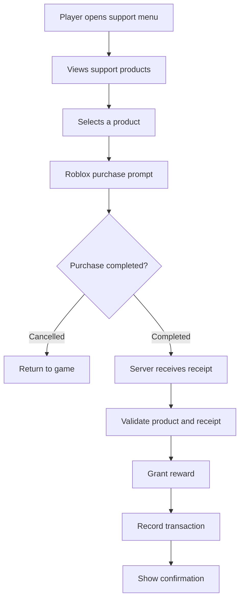

<div align="center">


### DONATIONS AND SUPPORT


</div>

---

<div align="center">



**Support development. Reward generosity. Respect every player.**

</div>

---

# Donations and Support

## 1. Objectif

Le système de soutien permet aux joueurs qui apprécient le jeu de contribuer financièrement à son développement en effectuant des achats facultatifs avec des Robux.

Il doit rester indépendant de la progression principale.

Un joueur qui ne dépense aucun Robux doit pouvoir profiter de l'expérience complète, progresser normalement et accéder aux systèmes essentiels.

Le système doit respecter cinq principes :

- Participation entièrement facultative.
- Prix et récompenses clairement affichés.
- Achats confirmés par les services Roblox.
- Récompenses effectivement attribuées.
- Aucun désavantage imposé aux joueurs qui ne paient pas.

**Important :** un achat de soutien effectué avec un Developer Product est une transaction Roblox. Il ne représente pas un transfert direct de Robux vers un autre joueur ou développeur.

## 2. Developer Products et Game Passes

Le choix du produit dépend de la récompense proposée.

| Type | Utilisation | Exemple |
|---|---|---|
| Developer Product | Achat répétable | Soutien ponctuel de 50 Robux |
| Developer Product | Achat consommable | Effet temporaire |
| Game Pass | Avantage permanent | Pack cosmétique permanent |
| Game Pass | Accès permanent | Zone décorative réservée aux détenteurs |

Pour notre système, les Developer Products sont adaptés aux différents montants de soutien.

Un Game Pass peut être utilisé si une récompense permanente doit être achetée une seule fois et rester associée au compte du joueur.

Évite de vendre plusieurs fois un avantage permanent sous forme de Developer Product sans prévoir un système qui vérifie les droits déjà possédés.

## 3. Présentation du système

Le système doit être accessible sans interrompre le gameplay.

Emplacements possibles :

- Menu principal.
- Menu des paramètres.
- Interface sociale.
- Panneau communautaire dans le lobby.
- Section dédiée dans la boutique.

Nom proposé pour le bouton :

`Support the Developers`

Une fois le bouton sélectionné, le joueur peut consulter les différentes offres.

Exemple de présentation :

```text
-----------------------------------------
           SUPPORT THE DEVELOPERS
-----------------------------------------

  Enjoying the game?

  Your optional support helps us
  continue developing new content.

  [ Small Support ]       25 R$

  [ Medium Support ]      50 R$

  [ Large Support ]      100 R$

  [ Community Support ]  250 R$

  Supporting is completely optional.

-----------------------------------------
```

Les montants sont des exemples de conception. Les prix définitifs doivent être configurés dans le Creator Hub et affichés à partir des informations réelles des produits.

## 4. Les niveaux de soutien

Les différentes offres peuvent être présentées sous forme de niveaux.

| Niveau | Exemple de prix | Remerciement possible |
|---|---:|---|
| Small Support | 25 R$ | Message de remerciement |
| Medium Support | 50 R$ | Effet cosmétique |
| Large Support | 100 R$ | Pack décoratif |
| Community Support | 250 R$ | Pack cosmétique étendu |

Ces niveaux ne doivent pas créer une hiérarchie sociale entre les joueurs.

Le montant dépensé ne doit pas déterminer la valeur d'un joueur dans la communauté.

### Règles de conception

- Afficher les prix réels.
- Décrire les récompenses avant l'achat.
- Ne pas utiliser de faux compte à rebours.
- Ne pas présenter une offre comme obligatoire.
- Ne pas cacher les conditions d'obtention.
- Ne pas promettre de récompense non développée.

## 5. Récompenses possibles

Les récompenses doivent renforcer l'identité du joueur sans déséquilibrer l'économie.

| Récompense | Type | Impact |
|---|---|---|
| Message de remerciement | Social | Aucun avantage économique |
| Titre décoratif | Cosmétique | Aucun |
| Couleur de pseudo locale | Cosmétique | Aucun |
| Skin de machine | Cosmétique | Aucun |
| Effet de collecte | Cosmétique | Aucun |
| Emote | Cosmétique | Aucun |
| Pack de décoration | Cosmétique | Aucun |

Une distinction est nécessaire entre un effet local et un véritable avantage permanent enregistré sur le compte.

Par exemple, une couleur de pseudo affichée uniquement dans une interface locale ne nécessite pas le même système qu'un titre permanent visible par les autres joueurs.

Les récompenses permanentes doivent être sauvegardées ou vérifiées à partir d'une source fiable.

## 6. Soutien communautaire

Une autre possibilité consiste à proposer un objectif collectif.

Exemple :

```text
-----------------------------------------
             COMMUNITY GOAL
-----------------------------------------

  Help us reach our next milestone.

  Community Support Progress:

  [########------------] 40%

  Next milestone:
  New decorative lobby theme

-----------------------------------------
```

Le système peut afficher une progression collective si les contributions sont réellement enregistrées et peuvent être vérifiées.

Règles :

- Le joueur doit connaître l'objectif.
- La progression affichée doit être exacte.
- La récompense collective doit être clairement définie.
- Les joueurs ne doivent pas être obligés de participer.
- L'objectif ne doit pas bloquer le contenu normal.

Ne présente pas une contribution comme une garantie de financement ou un investissement dans le jeu.

## 7. Expérience d'achat

Le parcours doit être simple et transparent.



Le jeu ne doit jamais considérer une simple sélection de produit comme un achat réussi.

La confirmation doit être affichée après la validation du traitement serveur.

## 8. Implémentation avec MarketplaceService

Roblox fournit `MarketplaceService` pour gérer les transactions dans une expérience.

Les deux parties principales sont :

- `PromptProductPurchase()` : affiche l'invite d'achat Roblox.
- `ProcessReceipt` : traite les reçus côté serveur.

### 8.1 - Configuration des produits

Crée les Developer Products dans le Creator Hub.

Pour chaque produit, conserve :

| Champ | Description |
|---|---|
| ProductId | Identifiant Roblox du produit |
| Name | Nom affiché |
| Price | Prix configuré |
| RewardType | Type de récompense |
| Description | Contenu réellement fourni |

Les identifiants doivent être configurés dans le projet et ne doivent pas être inventés.

Exemple de configuration Luau :

```lua
local SupportProducts = {
    [PRODUCT_ID_SMALL] = {
        Name = "Small Support",
        RewardType = "ThankYou"
    },

    [PRODUCT_ID_MEDIUM] = {
        Name = "Medium Support",
        RewardType = "CosmeticEffect"
    },

    [PRODUCT_ID_LARGE] = {
        Name = "Large Support",
        RewardType = "CosmeticPack"
    }
}

return SupportProducts
```

`PRODUCT_ID_SMALL`, `PRODUCT_ID_MEDIUM` et `PRODUCT_ID_LARGE` sont des placeholders à remplacer par les identifiants numériques des produits créés dans le Creator Hub.

### 8.2 - Afficher l'invite d'achat

L'invite d'achat peut être ouverte depuis un LocalScript lorsque le joueur sélectionne un produit.

Exemple :

```lua
local MarketplaceService = game:GetService("MarketplaceService")
local Players = game:GetService("Players")

local player = Players.LocalPlayer

local PRODUCT_ID = 1234567890

local function promptSupportPurchase()
    MarketplaceService:PromptProductPurchase(
        player,
        PRODUCT_ID
    )
end

promptSupportPurchase()
```

L'identifiant est fictif et doit être remplacé par celui du produit réel.

Le client peut demander l'ouverture de l'invite, mais il ne doit jamais accorder lui-même la récompense.

### 8.3 - Traitement du reçu côté serveur

Le serveur doit traiter les reçus avec `MarketplaceService.ProcessReceipt`.

Le traitement doit notamment :

1. Identifier le joueur.
2. Vérifier le ProductId.
3. Identifier le PurchaseId.
4. Vérifier si le reçu a déjà été traité.
5. Accorder la récompense.
6. Enregistrer le traitement.
7. Confirmer le reçu à Roblox.

Exemple de structure conceptuelle :

```lua
local MarketplaceService = game:GetService("MarketplaceService")
local Players = game:GetService("Players")

local function processReceipt(receiptInfo)
    local player = Players:GetPlayerByUserId(
        receiptInfo.PlayerId
    )

    if not player then
        return Enum.ProductPurchaseDecision.NotProcessedYet
    end

    local productId = receiptInfo.ProductId
    local purchaseId = receiptInfo.PurchaseId

    local product = SupportProducts[productId]

    if not product then
        warn("Unknown support product:", productId)

        return Enum.ProductPurchaseDecision.NotProcessedYet
    end

    -- Check the receipt against persistent purchase records.
    -- Grant the reward exactly once.
    -- Save the receipt status before acknowledging it.

    local success = grantSupportReward(
        player,
        product,
        purchaseId
    )

    if not success then
        return Enum.ProductPurchaseDecision.NotProcessedYet
    end

    return Enum.ProductPurchaseDecision.PurchaseGranted
end

MarketplaceService.ProcessReceipt = processReceipt
```

Les fonctions `SupportProducts` et `grantSupportReward` représentent des composants à intégrer au projet.

Cet exemple n'est pas un gestionnaire de reçus complet prêt à publier. Il manque notamment l'implémentation persistante de l'idempotence et la gestion des erreurs de sauvegarde.

**Attention :** ne déclare le callback `ProcessReceipt` qu'une seule fois dans un Script serveur. Il doit gérer tous les Developer Products de l'expérience, pas seulement les produits de soutien.

## 9. Éviter les doubles récompenses

Un même reçu peut être présenté de nouveau si son traitement n'a pas été confirmé.

Le système doit donc empêcher qu'un joueur obtienne plusieurs récompenses pour un seul achat.

Utilise `PurchaseId` comme identifiant unique de transaction.

Le principe :

```text
RECEIPT RECEIVED
       |
       v
CHECK PURCHASE ID
       |
       v
ALREADY PROCESSED?
   /          \
 YES          NO
  |            |
  v            v
DO NOT       GRANT REWARD
GRANT AGAIN       |
  |               v
  |          SAVE RECEIPT
  |               |
  v               v
CONFIRM       CONFIRM
RECEIPT       RECEIPT
```

Le traitement doit être conçu pour rester correct en cas de nouvelle tentative ou de changement de serveur.

Une simple table en mémoire ne suffit pas pour garantir l'unicité entre plusieurs sessions.

## 10. Séparer les récompenses permanentes et temporaires

Toutes les récompenses ne doivent pas être enregistrées de la même manière.

| Type | Exemple | Stockage |
|---|---|---|
| Message temporaire | Remerciement | Aucun stockage permanent nécessaire |
| Effet de session | Animation spéciale | État de session |
| Cosmétique permanent | Skin de machine | Données persistantes |
| Titre permanent | Supporter | Données persistantes |
| Game Pass | Accès permanent | Vérification de propriété du Pass |

La méthode de stockage dépend du type de récompense et de la manière dont elle est utilisée dans le jeu.

Pour un avantage permanent, assure-toi que le joueur ne le perd pas après une déconnexion ou un changement de serveur.

## 11. Interface et accessibilité

L'interface de soutien doit rester secondaire par rapport au gameplay.

Bonnes pratiques :

- Bouton discret.
- Texte lisible.
- Prix visibles.
- Descriptions courtes.
- Bouton de fermeture évident.
- Navigation adaptée au mobile.
- Confirmation visuelle après traitement réussi.
- Aucune fenêtre répétitive.

Le menu ne doit pas interrompre automatiquement le joueur pendant une action importante.

## 12. Ce qu'il ne faut pas faire

Évite les pratiques suivantes :

- Faire croire que le paiement est obligatoire.
- Faire honte aux joueurs qui ne paient pas.
- Bloquer la progression derrière un achat de soutien.
- Utiliser de faux comptes à rebours.
- Afficher de fausses promotions.
- Promettre une récompense inexistante.
- Accorder une récompense à partir d'un signal client.
- Utiliser `PromptProductPurchaseFinished` comme preuve de paiement.
- Accorder plusieurs fois un même reçu.
- Donner un avantage économique excessif aux soutiens.

Le système doit rester transparent et facultatif.

## 13. Tests à effectuer

Avant publication, teste les scénarios suivants :

| Test | Résultat attendu |
|---|---|
| Ouvrir le menu | Interface correctement affichée |
| Fermer le menu | Retour normal au jeu |
| Sélectionner un produit | Invite Roblox affichée |
| Annuler l'achat | Aucune récompense attribuée |
| Acheter un produit | Reçu traité côté serveur |
| Rejoindre après un achat non traité | Reçu toujours traitable |
| Recevoir deux fois le même reçu | Une seule récompense |
| ProductId inconnu | Transaction non attribuée |
| Échec DataStore | Reçu non confirmé prématurément |
| Changer de serveur | Récompense permanente conservée |

Les tests doivent être réalisés dans un environnement de développement configuré pour les achats de test.

## 14. Definition of Done

- [ ] Le système est entièrement facultatif.
- [ ] Les produits sont configurés dans le Creator Hub.
- [ ] Les prix réels sont affichés.
- [ ] Les récompenses sont décrites avant l'achat.
- [ ] L'invite Roblox est utilisée.
- [ ] Les reçus sont traités côté serveur.
- [ ] Les reçus sont identifiés avec PurchaseId.
- [ ] Les doubles attributions sont empêchées.
- [ ] Les récompenses permanentes sont sauvegardées.
- [ ] Les erreurs de traitement sont gérées.
- [ ] Les achats annulés ne donnent aucune récompense.
- [ ] Le jeu reste complet sans achat.
- [ ] Aucun message culpabilisant ou trompeur n'est utilisé.

## 15. Questions à documenter

- Pourquoi proposer un système de soutien ?
- Quels produits seront disponibles ?
- Quels sont leurs prix ?
- Quelles récompenses seront attribuées ?
- Les récompenses sont-elles temporaires ou permanentes ?
- Comment les reçus sont-ils enregistrés ?
- Comment éviter les doubles attributions ?
- Que se passe-t-il si une sauvegarde échoue ?
- Comment garantir une expérience complète aux joueurs gratuits ?

## 16. Références officielles

- [Roblox Creator Hub](https://create.roblox.com/docs)
- [Developer Products](https://create.roblox.com/docs/production/monetization/developer-products)
- [MarketplaceService API](https://create.roblox.com/docs/reference/engine/classes/MarketplaceService)
- [Game Passes](https://create.roblox.com/docs/production/monetization/game-passes)
- [Securing the Client-Server Boundary](https://create.roblox.com/docs/scripting/security/client-server-boundary)

---

<div align="center">


### Acknowledgements

Built with documentation and tools from:

[Roblox](https://www.roblox.com/) · [Roblox Creator Hub](https://create.roblox.com/docs) · [Shields.io](https://shields.io/) · [Mermaid](https://mermaid.js.org/)


<sub>Document: `docs/DONATIONS-AND-SUPPORT.md` · Part of Roblox Tycoon Blueprint</sub>

</div>
