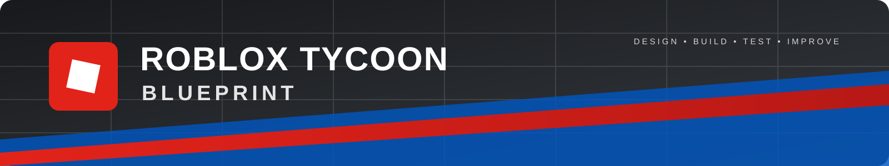

### Retention Without Pressure

---

# Retention Without Pressure\n\n# Rétention sans pression

La rétention vient d'abord d'une expérience intéressante. Les systèmes de retour doivent ajouter des objectifs, pas punir l'absence.

## Mécaniques utiles

- Quêtes quotidiennes renouvelées, avec plusieurs jours de marge.
- Objectifs hebdomadaires qui peuvent être terminés en plusieurs sessions.
- Collection de skins et variantes de machines.
- Événements saisonniers avec récompenses accessibles pendant une période raisonnable.
- Bonus de retour modestes, sans perdre une série en cas d'absence.
- Journal des nouveautés pour expliquer ce qui a changé.

## À mesurer

Observe les cohortes D1, D7 et D30, mais analyse aussi le moment où les joueurs quittent le tutoriel, achètent leur première machine ou débloquent une zone. Un chiffre isolé ne dit pas pourquoi les joueurs partent.

---

Document: `docs/RETENTION-WITHOUT-PRESSURE.md` · Part of Roblox Tycoon Blueprint

