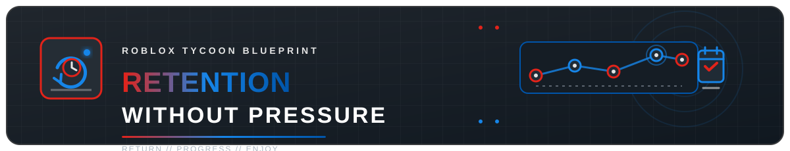
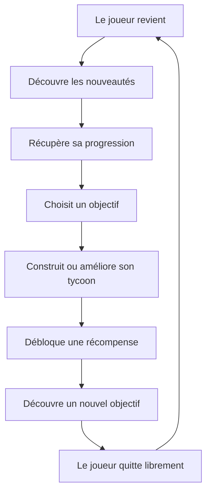

 

### Retention Without Pressure

---

# Retention Without Pressure

## Rétention sans pression

La rétention mesure la capacité d'un jeu à donner envie aux joueurs de revenir. Dans un tycoon, cette envie doit venir de la progression, de la découverte et du plaisir de construire, pas de la peur de perdre quelque chose.

Un bon système de rétention propose de nouveaux objectifs sans transformer l'absence en punition.

L'objectif est simple : donner aux joueurs une raison de revenir, tout en respectant leur temps.

## 1. Principes fondamentaux

Un système de rétention sain repose sur plusieurs principes :

- **Liberté :** le joueur choisit quand il souhaite jouer.
- **Progression :** chaque session peut apporter quelque chose.
- **Flexibilité :** les objectifs ne nécessitent pas une connexion quotidienne obligatoire.
- **Lisibilité :** les récompenses et les conditions sont clairement expliquées.
- **Équilibre :** les joueurs réguliers sont récompensés sans désavantager excessivement les autres.
- **Durabilité :** les systèmes restent intéressants après plusieurs semaines.

La rétention ne doit jamais devenir une obligation.

## 2. Mécaniques de rétention

### 2.1 Quêtes quotidiennes flexibles

Les quêtes quotidiennes donnent aux joueurs des objectifs courts à accomplir pendant une session.

Exemples :

- Construire une nouvelle machine.
- Collecter une certaine quantité de ressources.
- Améliorer une installation.
- Produire un nombre défini de ressources.
- Visiter une nouvelle zone.

**Bonne pratique :** prévoir plusieurs jours de marge ou permettre de conserver quelques quêtes non terminées.

Un joueur qui manque une journée ne devrait pas perdre toute sa progression.

### 2.2 Objectifs hebdomadaires

Les objectifs hebdomadaires encouragent les joueurs à revenir plusieurs fois sans imposer un rythme quotidien.

Exemples :

- Produire 50 000 ressources.
- Acheter cinq améliorations.
- Terminer dix quêtes.
- Débloquer une nouvelle machine.
- Participer à un événement.

Ces objectifs doivent être réalisables sur plusieurs sessions.

### 2.3 Collections et cosmétiques

Les collections donnent une raison supplémentaire de développer son tycoon.

Exemples :

- Skins de machines.
- Variantes de convoyeurs.
- Effets visuels de production.
- Décorations pour la base.
- Titres et éléments cosmétiques.
- Objets associés à des événements.

Les collections peuvent proposer des objectifs à long terme sans rendre les récompenses indispensables à la progression.

### 2.4 Événements saisonniers

Les événements donnent une identité temporaire au jeu et permettent de renouveler l'expérience.

Exemples :

- Événement d'hiver.
- Festival d'été.
- Semaine spéciale de production.
- Événement communautaire.
- Défi collectif.

Un événement doit proposer une période raisonnable pour obtenir ses récompenses.

**À éviter :** créer une récompense presque impossible à obtenir pour les joueurs qui ne peuvent pas se connecter tous les jours.

### 2.5 Bonus de retour

Un bonus de retour peut accueillir les joueurs après une période d'absence.

Exemples :

- Petite quantité de monnaie.
- Ressource temporaire.
- Bonus de production limité.
- Objet cosmétique occasionnel.

Le bonus doit rester modeste et ne pas devenir une source obligatoire de progression.

Ne retire jamais une récompense déjà obtenue simplement parce que le joueur s'est absenté.

### 2.6 Journal des nouveautés

Un journal des nouveautés explique ce qui a changé depuis la dernière session.

Il peut présenter :

- Les nouvelles machines.
- Les zones ajoutées.
- Les événements actifs.
- Les corrections importantes.
- Les nouveaux objets.
- Les améliorations de gameplay.

Le joueur doit pouvoir consulter ces informations sans être obligé de parcourir plusieurs fenêtres.

## 3. Progression entre les sessions

La progression hors ligne peut compléter l'expérience d'un tycoon.

Elle permet au joueur de retrouver une partie de sa production lorsqu'il revient.

Quelques règles :

- Définir une durée maximale de production hors ligne.
- Éviter de générer une quantité disproportionnée de ressources.
- Afficher clairement le temps pris en compte.
- Expliquer les éventuelles limites.
- Ne pas rendre les améliorations hors ligne indispensables.

Le système doit préserver l'intérêt de la production active.

## 4. Construire une boucle de retour

Une bonne boucle de retour propose un objectif compréhensible à chaque visite.

Cette boucle doit rester naturelle. Le joueur peut arrêter sa session sans perdre sa progression ou subir une pénalité.

## 5. Mesurer la rétention

Les statistiques permettent de comprendre si les joueurs trouvent une raison de revenir.

### 5.1 Indicateurs principaux

| Indicateur | Signification |
|---|---|
| D1 Retention | Pourcentage de joueurs qui reviennent après environ un jour |
| D7 Retention | Pourcentage de joueurs qui reviennent après environ sept jours |
| D30 Retention | Pourcentage de joueurs qui reviennent après environ trente jours |
| Session Length | Durée moyenne d'une session |
| Session Frequency | Fréquence des sessions |
| Churn | Part des joueurs qui cessent de revenir |

Les périodes et les règles de calcul doivent rester cohérentes entre les analyses.

### 5.2 Analyse par cohorte

Une cohorte regroupe des joueurs selon un point commun, par exemple leur date de première connexion.

Comparer les cohortes permet de vérifier si une mise à jour améliore réellement la rétention.

Exemple :

- Cohorte A : joueurs arrivés avant une mise à jour.
- Cohorte B : joueurs arrivés après la mise à jour.
- Comparaison : retours à D1, D7 et D30.

Ne compare pas directement des groupes ayant des périodes d'observation différentes.

### 5.3 Identifier les moments d'abandon

Un taux de rétention ne suffit pas à expliquer pourquoi les joueurs quittent le jeu.

Il faut observer les étapes importantes :

- Début du tutoriel.
- Fin du tutoriel.
- Achat de la première machine.
- Première amélioration.
- Déblocage de la première zone.
- Première session terminée.
- Retour après la première absence.

Ces étapes permettent de repérer les passages où les joueurs rencontrent des difficultés.

## 6. Construire un parcours de progression mesurable

Un parcours simple permet de comprendre comment les joueurs découvrent le jeu.

| Étape | Événement à observer |
|---|---|
| Découverte | Première connexion |
| Apprentissage | Début et fin du tutoriel |
| Engagement | Première machine achetée |
| Progression | Première amélioration |
| Exploration | Première zone débloquée |
| Retour | Deuxième session |
| Fidélisation | Retour à D7 et D30 |

Les événements doivent être définis clairement avant de comparer les résultats.

## 7. Éviter les mécaniques frustrantes

Certaines mécaniques peuvent augmenter temporairement les connexions, mais dégrader l'expérience à long terme.

| Mauvaise pratique | Alternative |
|---|---|
| Perdre une série quotidienne | Permettre des jours de marge |
| Récompenses limitées à quelques heures | Fenêtre de récupération raisonnable |
| Notifications répétitives | Notifications utiles et limitées |
| Progression bloquée par l'absence | Progression conservée |
| Récompenses indispensables à durée limitée | Récompenses alternatives |
| Bonus de connexion excessifs | Bonus de retour modestes |
| Événements impossibles à terminer | Objectifs progressifs et accessibles |

La pression artificielle ne remplace pas un gameplay intéressant.

## 8. Notifications et communication

Les notifications peuvent rappeler l'existence du jeu, mais elles doivent rester utiles.

Bonnes pratiques :

- Informer d'une mise à jour importante.
- Présenter un événement réellement nouveau.
- Éviter les messages répétitifs.
- Ne pas utiliser de formulations culpabilisantes.
- Respecter les paramètres et les possibilités de communication de Roblox.

Le journal des nouveautés peut également servir de point d'information au retour du joueur.

## 9. Plan de mise en place

Pour un premier tycoon, il n'est pas nécessaire d'implémenter tous les systèmes immédiatement.

| Phase | Système | Priorité |
|---|---|---|
| MVP | Progression persistante | Essentielle |
| MVP | Objectifs de progression | Essentielle |
| MVP | Feedback après une session | Haute |
| Première mise à jour | Quêtes quotidiennes flexibles | Haute |
| Première mise à jour | Journal des nouveautés | Moyenne |
| Mise à jour suivante | Collections cosmétiques | Moyenne |
| Mise à jour suivante | Objectifs hebdomadaires | Moyenne |
| Long terme | Événements saisonniers | Variable |
| Long terme | Analyse approfondie des cohortes | Haute |

La priorité est de créer une expérience suffisamment intéressante pour donner naturellement envie de revenir.

## 10. Checklist de validation

- [ ] La progression est conservée entre les sessions.
- [ ] Les joueurs ne perdent pas leurs récompenses en cas d'absence.
- [ ] Les objectifs sont réalisables sur plusieurs sessions.
- [ ] Les quêtes ne bloquent pas la progression principale.
- [ ] Les récompenses sont clairement expliquées.
- [ ] Les événements disposent d'une durée raisonnable.
- [ ] Les bonus de retour restent équilibrés.
- [ ] Le journal des nouveautés est accessible.
- [ ] Les événements analytiques sont cohérents.
- [ ] Les cohortes peuvent être comparées.
- [ ] Les étapes importantes du tutoriel sont mesurées.
- [ ] Les notifications ne deviennent pas intrusives.

## 11. Definition of Done

Le système de rétention est prêt lorsque :

1. Le joueur peut quitter librement sans pénalité artificielle.
2. La progression est sauvegardée correctement.
3. Plusieurs objectifs peuvent être poursuivis à son rythme.
4. Les récompenses ne créent pas de désavantage excessif pour les joueurs occasionnels.
5. Les événements et quêtes sont compréhensibles.
6. Les indicateurs permettent d'identifier les problèmes de progression.
7. Les données collectées permettent de comparer les cohortes.
8. Le système a été vérifié sur plusieurs sessions.

## 12. Questions de conception

Avant d'ajouter une mécanique de rétention, pose-toi ces questions :

- Cette mécanique rend-elle le jeu plus intéressant ?
- Le joueur peut-il l'ignorer sans être pénalisé ?
- Est-elle accessible aux joueurs occasionnels ?
- La récompense est-elle utile sans être obligatoire ?
- Le système reste-t-il intéressant après plusieurs semaines ?
- Les données permettront-elles de mesurer son efficacité ?

Si une mécanique repose principalement sur la peur de manquer une récompense, elle mérite d'être repensée.

## Acknowledgements

Ce document fait partie de **Roblox Tycoon Blueprint**, un guide communautaire consacré à la conception et au développement de jeux tycoon sur Roblox.

- Roblox Creator Documentation : https://create.roblox.com/docs
- Roblox Creator Hub : https://create.roblox.com/
- Roblox Analytics : https://create.roblox.com/docs/production/analytics

Merci aux développeurs et créateurs qui partagent leurs connaissances sur la conception de jeux, l'analyse du comportement des joueurs et les systèmes de progression.

---

Document: `docs/RETENTION-WITHOUT-PRESSURE.md` · Part of Roblox Tycoon Blueprint

