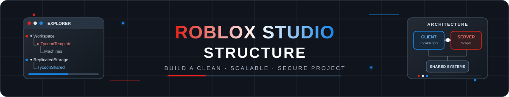
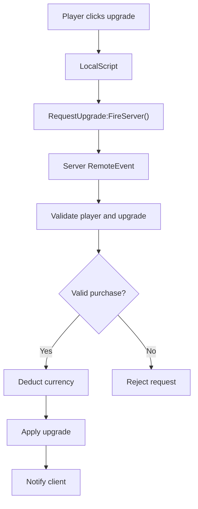
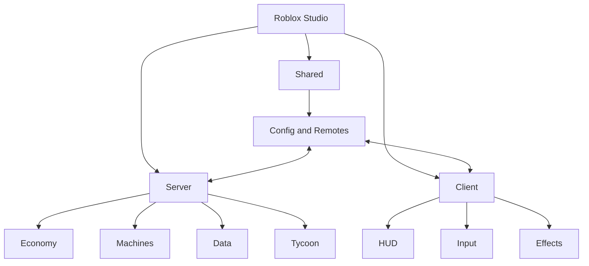

<div align="center">





</div>

---


# Roblox Studio Structure

## Architecture à reproduire dans Roblox Studio

Cette section définit une architecture de départ pour construire un tycoon dans Roblox Studio.

L'objectif est de séparer clairement les éléments du monde, les ressources partagées, la logique serveur, les interactions client et les données persistantes.

Une structure organisée facilite le développement, le débogage et l'ajout de nouvelles fonctionnalités.

**Important :** cette arborescence est un modèle pédagogique. Elle doit être adaptée au fonctionnement réel du jeu et ne constitue pas une architecture complète prête à publier.

## 01. Architecture générale

L'architecture proposée utilise les principaux services de Roblox Studio.

```text
Workspace
└── TycoonTemplate (Model)
    ├── Base (Part ou Model)
    ├── Spawn (SpawnLocation)
    ├── Machines (Folder)
    │   ├── StarterDropper (Model)
    │   └── BasicConveyor (Model)
    └── PurchaseButtons (Folder)

ReplicatedStorage
└── TycoonShared (Folder)
    ├── Config (ModuleScript)
    └── Remotes (Folder)
        ├── RequestUpgrade (RemoteEvent)
        └── NotifyPlayer (RemoteEvent)

ServerScriptService
└── TycoonServer (Folder)
    ├── Bootstrap.server.lua (Script)
    └── Services (Folder)
        ├── EconomyService (ModuleScript)
        ├── MachineService (ModuleScript)
        └── DataService (ModuleScript)

ServerStorage
└── TycoonAssets (Folder)
    ├── MachineModels (Folder)
    └── Templates (Folder)

StarterGui
└── TycoonHUD (ScreenGui)
    └── Main (Frame)

StarterPlayer
└── StarterPlayerScripts
    └── TycoonClient.client.lua (LocalScript)
```

Cette organisation sépare les responsabilités sans multiplier inutilement les scripts.

## 02. Rôle de chaque service

### Workspace

Contient le monde 3D visible et les objets avec lesquels les joueurs interagissent.

Exemples :

- Bases des joueurs.
- Machines installées.
- Convoyeurs.
- Boutons d'achat.
- Points d'apparition.
- Décorations et éléments du monde.

Les objets présents dans Workspace sont généralement répliqués aux clients.

Évite d'y placer toute la logique du jeu. Les systèmes importants doivent être centralisés dans des modules et scripts adaptés.

### ReplicatedStorage

Contient les ressources accessibles au serveur et aux clients.

Exemples :

- ModuleScripts partagés.
- Configurations non sensibles.
- RemoteEvents.
- Effets visuels partagés.
- Ressources nécessaires à l'interface.

**Attention :** le contenu de ReplicatedStorage est répliqué aux clients. N'y place jamais de logique secrète, de clés privées ou de données sensibles.

### ServerScriptService

Contient la logique exécutée exclusivement sur le serveur.

Exemples :

- Gestion de l'économie.
- Validation des achats.
- Production des machines.
- Attribution des récompenses.
- Chargement et sauvegarde des données.
- Attribution des tycoons.

C'est l'emplacement principal des scripts serveur.

### ServerStorage

Contient des ressources qui doivent rester accessibles uniquement au serveur.

Exemples :

- Modèles de machines non encore débloqués.
- Modèles de tycoon à cloner.
- Templates de construction.
- Ressources qui ne doivent pas être répliquées immédiatement.

Les scripts ne s'exécutent pas directement depuis ServerStorage.

### StarterGui

Contient les interfaces qui seront copiées dans le PlayerGui de chaque joueur.

Exemples :

- HUD.
- Affichage de la monnaie.
- Menus d'amélioration.
- Fenêtres de confirmation.
- Notifications.

### StarterPlayerScripts

Contient les scripts client qui doivent fonctionner pendant toute la session du joueur.

Exemples :

- Gestion des interactions locales.
- Contrôle de l'interface.
- Effets visuels.
- Réactions aux événements du serveur.

Un LocalScript placé ici est copié dans PlayerScripts du joueur.

## 03. Comprendre les types de scripts

Roblox propose trois types principaux de scripts.

| Type | Fonction | Utilisation |
|---|---|---|
| Script | Exécution serveur ou client selon son contexte et son emplacement | Logique du jeu |
| LocalScript | Exécution côté client | Interface et interactions locales |
| ModuleScript | Code réutilisable chargé avec `require()` | Services, fonctions et configurations |

### Script

Un Script peut exécuter de la logique serveur ou client selon sa propriété `RunContext` et son emplacement.

Dans cette architecture, les scripts serveur sont placés dans ServerScriptService.

```lua
-- ServerScriptService/TycoonServer/Bootstrap.server.lua

print("Tycoon server initialized")
```

### LocalScript

Un LocalScript s'exécute uniquement sur le client.

Il convient notamment à la gestion des interfaces et aux interactions locales.

```lua
-- StarterPlayerScripts/TycoonClient.client.lua

local Players = game:GetService("Players")

local player = Players.LocalPlayer

print("Client initialized for " .. player.Name)
```

### ModuleScript

Un ModuleScript permet de partager du code entre plusieurs scripts.

Il retourne une valeur que les autres scripts récupèrent avec `require()`.

```lua
-- ReplicatedStorage/TycoonShared/Config

local Config = {}

Config.StartingCash = 100
Config.DefaultMachineCost = 50

return Config
```

Utilisation :

```lua
local ReplicatedStorage = game:GetService("ReplicatedStorage")

local Config = require(
    ReplicatedStorage.TycoonShared.Config
)

print(Config.StartingCash)
```

Un ModuleScript peut être utilisé côté serveur ou client. Son emplacement détermine qui peut y accéder.

Ne place pas de logique serveur sensible dans un module accessible au client.

## 04. Communication entre le client et le serveur

Roblox utilise une architecture client-serveur.

Le client gère principalement l'expérience locale. Le serveur doit conserver l'autorité sur les données importantes du jeu.

Les deux côtés peuvent communiquer à travers des objets RemoteEvent et RemoteFunction.

### Exemple : achat d'une amélioration

Le joueur clique sur un bouton.

1. Le client détecte le clic.
2. Le client envoie une demande au serveur.
3. Le serveur identifie le joueur.
4. Le serveur vérifie le coût et les conditions.
5. Le serveur effectue l'achat si la demande est valide.
6. Le serveur communique le résultat au client.



### Exemple de demande client

```lua
-- LocalScript

local ReplicatedStorage = game:GetService("ReplicatedStorage")

local RequestUpgrade = ReplicatedStorage
    :WaitForChild("TycoonShared")
    :WaitForChild("Remotes")
    :WaitForChild("RequestUpgrade")

local function requestUpgrade(upgradeId)
    RequestUpgrade:FireServer(upgradeId)
end
```

### Exemple de validation serveur

```lua
-- Script serveur

local ReplicatedStorage = game:GetService("ReplicatedStorage")

local RequestUpgrade = ReplicatedStorage
    :WaitForChild("TycoonShared")
    :WaitForChild("Remotes")
    :WaitForChild("RequestUpgrade")

RequestUpgrade.OnServerEvent:Connect(function(player, upgradeId)

    if typeof(upgradeId) ~= "string" then
        return
    end

    -- Vérifier que l'amélioration existe.
    -- Vérifier que le joueur possède le tycoon.
    -- Vérifier les prérequis.
    -- Calculer le prix côté serveur.
    -- Vérifier le solde du joueur.
    -- Déduire la monnaie et appliquer l'amélioration.

end)
```

Ce code illustre uniquement le flux de communication. Les validations et la logique économique doivent être implémentées avant utilisation en production.

## 05. Règles de sécurité

Le client ne doit jamais être considéré comme une source fiable.

Un exploiteur peut modifier les données locales et envoyer des demandes arbitraires au serveur.

Le serveur doit donc vérifier chaque action importante.

| Action | Autorité |
|---|---|
| Afficher une interface | Client |
| Jouer une animation locale | Client |
| Demander un achat | Client |
| Vérifier le prix | Serveur |
| Déduire la monnaie | Serveur |
| Débloquer une machine | Serveur |
| Calculer la production | Serveur |
| Sauvegarder la progression | Serveur |

### Règles obligatoires

- Ne jamais accepter un prix envoyé par le client.
- Ne jamais accepter directement un montant de monnaie à créditer.
- Vérifier que l'amélioration demandée existe.
- Vérifier que le joueur possède bien le tycoon concerné.
- Vérifier les prérequis avant chaque achat.
- Limiter la fréquence des demandes.
- Rejeter les arguments incorrects.
- Ne jamais exposer de secrets dans ReplicatedStorage.
- Ne pas faire confiance aux événements déclenchés uniquement par le client.

Un RemoteEvent n'est pas une autorisation d'effectuer une action. C'est uniquement un moyen de communication.

## 06. Organisation des services

Les services permettent de séparer les responsabilités du système.

| Module | Responsabilité |
|---|---|
| EconomyService | Argent, coûts et transactions |
| MachineService | Machines, améliorations et production |
| DataService | Chargement et sauvegarde |
| TycoonService | Attribution et gestion des bases |
| UpgradeService | Déblocage et validation des améliorations |
| NotificationService | Messages et retours au joueur |

Tous ces modules ne sont pas nécessaires au premier prototype.

Commence avec les services essentiels, puis sépare les responsabilités lorsque le projet grandit.

## 07. Organisation des ressources partagées

Une configuration commune évite de répéter les mêmes valeurs dans plusieurs scripts.

```text
ReplicatedStorage
└── TycoonShared
    ├── Config
    │   ├── EconomyConfig
    │   └── MachineConfig
    ├── Remotes
    │   ├── RequestUpgrade
    │   └── NotifyPlayer
    └── SharedModules
        └── FormatNumber
```

Les configurations partagées ne doivent contenir aucune information confidentielle.

Si une valeur doit être protégée contre les modifications ou la consultation du client, conserve sa source de vérité côté serveur.

## 08. Sauvegarde des données

Les données persistantes doivent être gérées côté serveur avec DataStoreService.

Exemples de données :

- Monnaie.
- Machines débloquées.
- Améliorations achetées.
- Niveau du tycoon.
- Progression.
- Paramètres de jeu.

Exemple de structure logique :

```lua
local PlayerData = {
    Cash = 100,
    Rebirths = 0,

    UnlockedMachines = {
        "StarterDropper"
    },

    Upgrades = {
        ProductionLevel = 1
    }
}
```

Cette table est un exemple de modèle de données. Elle ne constitue pas une implémentation complète de sauvegarde.

### Bonnes pratiques

- Charger les données à l'arrivée du joueur.
- Prévoir des valeurs par défaut.
- Gérer les erreurs de lecture et d'écriture.
- Utiliser des sauvegardes contrôlées.
- Éviter les appels inutiles aux DataStores.
- Gérer les versions du format de données.
- Prévoir les joueurs qui quittent pendant une sauvegarde.
- Tester les cas de données manquantes ou corrompues.

**Important :** les DataStores sont accessibles uniquement depuis des scripts serveur. Pour tester leur accès dans Studio, l'expérience doit être publiée et l'accès API activé dans un environnement de test séparé. Évite d'utiliser les données de production pendant les tests.

## 09. Où créer les objets dans Roblox Studio

1. Ouvre Roblox Studio.
2. Ouvre l'onglet `View`.
3. Active `Explorer` et `Properties`.
4. Crée les dossiers et objets de l'arborescence.
5. Respecte exactement les noms utilisés par les scripts.
6. Crée les Script, LocalScript et ModuleScript dans leurs emplacements respectifs.
7. Copie le contenu des fichiers du dossier `studio-template` dans les objets correspondants.
8. Vérifie les références avec `WaitForChild()` lorsque nécessaire.
9. Lance un test avec plusieurs clients.

Les noms sont importants : `WaitForChild("RequestUpgrade")` ne trouvera pas un objet nommé `RequestUpgrades`.

## 10. Vérification dans Explorer

Avant de développer les systèmes du jeu, vérifie que les services et dossiers sont correctement organisés.

- [ ] Workspace contient le modèle de tycoon.
- [ ] Les machines sont regroupées.
- [ ] ReplicatedStorage contient les ressources partagées.
- [ ] Les RemoteEvents sont présents.
- [ ] ServerScriptService contient les scripts serveur.
- [ ] ServerStorage contient les modèles privés.
- [ ] StarterGui contient l'interface.
- [ ] StarterPlayerScripts contient le script client.
- [ ] Les noms correspondent aux références des scripts.
- [ ] Aucune donnée sensible n'est accessible au client.

## 11. Tests à effectuer

Une architecture correctement organisée doit être testée avant d'ajouter les systèmes complexes.

| Test | Résultat attendu |
|---|---|
| Démarrage du serveur | Les services s'initialisent |
| Connexion d'un joueur | Les données sont chargées |
| Achat valide | Le serveur applique l'achat |
| Achat sans monnaie | La demande est refusée |
| Identifiant incorrect | La demande est rejetée |
| Demandes répétées | La fréquence est contrôlée |
| Deux joueurs connectés | Les données restent séparées |
| Déconnexion | La sauvegarde est gérée |
| Reconnexion | La progression est restaurée |

Utilise les modes de test serveur et clients de Roblox Studio pour vérifier le comportement multijoueur.

## 12. Erreurs d'architecture à éviter

| Erreur | Conséquence |
|---|---|
| Tout placer dans Workspace | Organisation difficile |
| Mettre la logique économique côté client | Exploitation possible |
| Placer des secrets dans ReplicatedStorage | Exposition aux clients |
| Créer un RemoteEvent pour chaque petite action | Communication difficile à maintenir |
| Dupliquer les mêmes fonctions | Maintenance compliquée |
| Sauvegarder sans gestion d'erreur | Risque de perte de données |
| Mélanger interface et logique serveur | Responsabilités confuses |
| Multiplier les modules sans raison | Complexité inutile |

## 13. Architecture évolutive

Pour le premier prototype, conserve une architecture simple.

Ajoute progressivement des systèmes lorsque le jeu en a réellement besoin.



Cette séparation permet de développer les fonctionnalités indépendamment tout en conservant une organisation claire.

## 14. Definition of Done

Cette architecture de départ est prête lorsque :

1. Les principaux services sont correctement organisés.
2. Les scripts se trouvent dans des emplacements adaptés.
3. Les modules partagés sont accessibles aux bons scripts.
4. La logique importante reste côté serveur.
5. Les demandes client sont validées.
6. Les RemoteEvents sont protégés contre les abus.
7. Les données persistantes sont gérées côté serveur.
8. Le jeu fonctionne avec plusieurs clients en mode test.
9. Les erreurs d'initialisation sont identifiables.
10. Les noms et chemins correspondent à la documentation du projet.


## References

Documentation officielle Roblox :

- [Script types and locations](https://create.roblox.com/docs/scripting/locations)
- [Data model](https://create.roblox.com/docs/projects/data-model)
- [Reuse code with ModuleScripts](https://create.roblox.com/docs/scripting/module)
- [Access control and confidentiality](https://create.roblox.com/docs/scripting/security/access-control)
- [Security and cheat mitigation tactics](https://create.roblox.com/docs/scripting/security/security-tactics)
- [Data stores](https://create.roblox.com/docs/cloud-services/data-stores)

## Acknowledgements

Ce document fait partie de **Roblox Tycoon Blueprint**, un guide communautaire consacré à la conception et au développement de jeux tycoon sur Roblox.

Merci à Roblox et à sa communauté de développeurs pour la documentation technique et les ressources qui permettent de mieux comprendre l'architecture de la plateforme.

---

<div align="center">


<sub>Document: `docs/ROBLOX-STUDIO-STRUCTURE.md` · Part of Roblox Tycoon Blueprint</sub>

</div>
