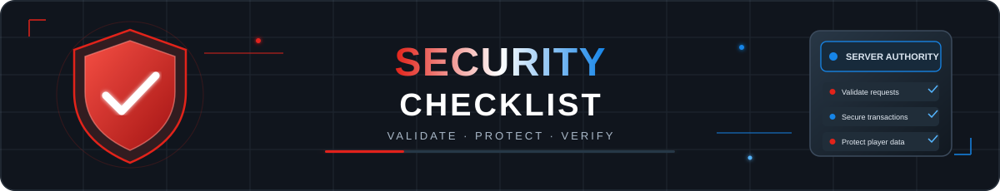
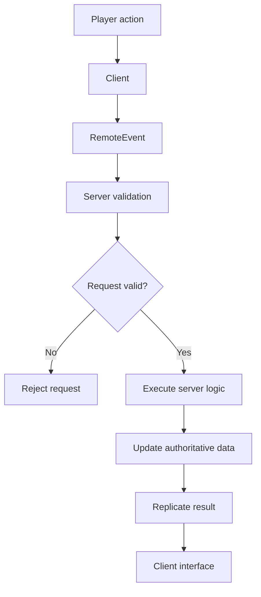
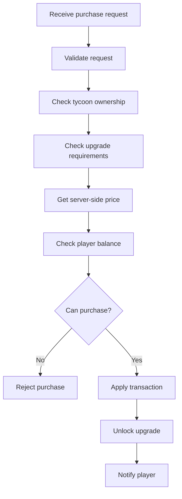

<div align="center">





</div>

---


# Security Checklist

## Sécuriser un jeu Roblox Tycoon

La sécurité doit être intégrée dès les premières étapes du développement.

Dans un jeu multijoueur Roblox, le client ne doit jamais être considéré comme une source fiable. Un joueur malveillant peut modifier son environnement local, envoyer des requêtes arbitraires et tenter de manipuler les systèmes économiques du jeu.

Cette checklist définit les vérifications à effectuer avant de considérer les principaux systèmes comme suffisamment sécurisés.

**Principe fondamental : le serveur décide, le client demande.**

## 01. Architecture de sécurité

Le serveur doit conserver l'autorité sur les éléments importants du jeu.

| Système | Responsabilité |
|---|---|
| Monnaie | Calcul et modification côté serveur |
| Achats | Validation côté serveur |
| Améliorations | Vérification des conditions côté serveur |
| Production | Calcul et attribution côté serveur |
| Propriété du tycoon | Vérification côté serveur |
| Sauvegardes | Accès côté serveur |
| Achats Robux | Traitement des reçus côté serveur |
| Interface | Affichage et interactions côté client |

### Flux sécurisé



Le client peut envoyer une intention, mais ne doit jamais décider du résultat économique ou de progression.


## 02. Monnaie et économie

La monnaie est une cible privilégiée des exploitations dans un tycoon.

Le serveur doit être le seul à pouvoir décider combien un joueur possède et combien il gagne ou dépense.

### Checklist

- [ ] Le serveur initialise la monnaie du joueur.
- [ ] Le serveur calcule les revenus des machines.
- [ ] Le serveur valide chaque récompense.
- [ ] Le serveur effectue les débits et crédits.
- [ ] Le client ne peut pas choisir le montant à recevoir.
- [ ] Le client ne peut pas définir le prix d'un achat.
- [ ] Les valeurs négatives sont rejetées lorsqu'elles sont interdites.
- [ ] Les valeurs infinies et `NaN` sont rejetées.
- [ ] Les opérations économiques sont cohérentes en cas de requêtes simultanées.
- [ ] Les modifications importantes sont sauvegardées correctement.

### Exemple incorrect

```lua
-- Ne jamais faire confiance à cette logique côté serveur.

RequestMoney.OnServerEvent:Connect(function(player, amount)
    player.leaderstats.Cash.Value += amount
end)
```

Le joueur pourrait envoyer une valeur arbitrairement élevée.

### Exemple de validation

```lua
local function isValidPositiveAmount(amount)
    return typeof(amount) == "number"
        and amount == amount
        and amount > 0
        and amount < math.huge
end
```

`amount == amount` permet notamment de rejeter `NaN`, car cette valeur n'est pas égale à elle-même.

La validation doit ensuite être complétée par des limites adaptées au système concerné.


## 03. Propriété du Tycoon

Chaque joueur doit uniquement pouvoir modifier les éléments qu'il possède ou auxquels il a accès.

### Checklist

- [ ] Le serveur attribue les bases aux joueurs.
- [ ] Le serveur conserve une référence fiable au propriétaire.
- [ ] Chaque achat vérifie le propriétaire du tycoon.
- [ ] Un joueur ne peut pas acheter une amélioration sur la base d'un autre joueur.
- [ ] Les machines appartiennent à la bonne base.
- [ ] Les récompenses sont attribuées au bon joueur.
- [ ] Les interactions vérifient la distance lorsque nécessaire.
- [ ] Les changements de propriétaire sont contrôlés.
- [ ] La base est correctement libérée lorsque le joueur quitte.

### Exemple de vérification

```lua
local function ownsTycoon(player, tycoon)
    if not player or not tycoon then
        return false
    end

    local owner = tycoon:FindFirstChild("Owner")

    if not owner then
        return false
    end

    return owner.Value == player
end
```

Ce code suppose que chaque tycoon possède un objet `Owner` adapté, par exemple un ObjectValue. Le système d'attribution doit lui-même être contrôlé par le serveur.


## 04. RemoteEvents et RemoteFunctions

Les événements réseau permettent au client de demander des actions au serveur.

Ils constituent également une surface d'attaque importante.

Un exploiteur peut envoyer des arguments incorrects, répéter une demande ou appeler un RemoteEvent sans utiliser l'interface prévue.

### Checklist

- [ ] Chaque RemoteEvent possède une responsabilité précise.
- [ ] Les arguments sont vérifiés côté serveur.
- [ ] Les types des arguments sont vérifiés.
- [ ] Les identifiants correspondent à des éléments existants.
- [ ] Les valeurs numériques sont contrôlées.
- [ ] Les demandes sont limitées en fréquence.
- [ ] Les demandes répétées ne créent pas de récompenses supplémentaires.
- [ ] Le serveur ne fait pas confiance aux données envoyées par le client.
- [ ] Les RemoteFunctions ne permettent pas d'obtenir des données privées.
- [ ] Les erreurs de requête sont gérées proprement.

### Vérifier les arguments

```lua
local function isValidUpgradeRequest(upgradeId)
    if typeof(upgradeId) ~= "string" then
        return false
    end

    if #upgradeId == 0 or #upgradeId > 50 then
        return false
    end

    return true
end
```

La vérification du type ne suffit pas. L'identifiant doit également exister dans une configuration autorisée par le serveur.

### Limiter la fréquence des requêtes

Exemple simple de limitation par joueur :

```lua
local Players = game:GetService("Players")

local lastRequest = {}
local COOLDOWN = 0.5

local function canRequest(player)
    local now = os.clock()
    local previous = lastRequest[player.UserId] or 0

    if now - previous < COOLDOWN then
        return false
    end

    lastRequest[player.UserId] = now

    return true
end

Players.PlayerRemoving:Connect(function(player)
    lastRequest[player.UserId] = nil
end)
```

Utilisation :

```lua
RequestUpgrade.OnServerEvent:Connect(function(player, upgradeId)
    if not canRequest(player) then
        return
    end

    if not isValidUpgradeRequest(upgradeId) then
        return
    end

    -- Vérifier les conditions et effectuer l'achat côté serveur.
end)
```

Ce mécanisme est un exemple minimal. Un système de production peut nécessiter des limites distinctes par action, des compteurs à fenêtre glissante ou des jetons de débit.


## 05. Achats et améliorations

Un achat doit être une opération contrôlée de bout en bout.

Le serveur doit déterminer le prix, vérifier les conditions, vérifier les fonds et appliquer le résultat.

### Checklist

- [ ] Le prix est récupéré depuis une configuration serveur.
- [ ] L'identifiant de l'amélioration est vérifié.
- [ ] Le joueur possède le tycoon concerné.
- [ ] Les prérequis sont satisfaits.
- [ ] Le joueur possède suffisamment de monnaie.
- [ ] La monnaie est débitée côté serveur.
- [ ] L'amélioration est attribuée côté serveur.
- [ ] Une amélioration déjà achetée ne peut pas être achetée une seconde fois si elle est unique.
- [ ] Deux requêtes simultanées ne permettent pas un double achat.
- [ ] Le résultat est communiqué au client après validation.

### Ordre recommandé



**Attention :** si plusieurs achats peuvent être traités simultanément, les opérations économiques doivent être conçues pour éviter les courses critiques. Une simple vérification du solde suivie d'un débit n'est pas toujours suffisante si plusieurs scripts peuvent modifier le même solde en parallèle.


## 06. MarketplaceService et achats Robux

Les achats de Developer Products doivent être traités à partir de reçus validés par Roblox.

Le serveur utilise `MarketplaceService.ProcessReceipt` ou l'alternative plus récente `MarketplaceService:BindReceiptHandler()`.

### Checklist

- [ ] Les achats sont initiés avec les méthodes appropriées de MarketplaceService.
- [ ] Le traitement des reçus est configuré côté serveur.
- [ ] Chaque `ProductId` est reconnu.
- [ ] Le joueur associé au reçu est retrouvé.
- [ ] Les récompenses sont accordées uniquement après validation du reçu.
- [ ] Le `PurchaseId` est utilisé pour identifier chaque achat.
- [ ] Un même reçu ne peut pas accorder deux fois la même récompense.
- [ ] Les erreurs de DataStore sont gérées.
- [ ] Un reçu non traité reste en attente de traitement.
- [ ] Un seul système cohérent gère les reçus de l'expérience.

### Point essentiel

Ne jamais utiliser `PromptProductPurchaseFinished` comme preuve qu'un achat a été effectué.

Cet événement indique que la fenêtre d'achat s'est fermée. Il ne confirme pas à lui seul que la transaction a été correctement traitée.

La récompense doit être attribuée à partir du traitement serveur du reçu.

### Idempotence des reçus

Un reçu peut être livré à nouveau. Le système doit donc être conçu pour reconnaître un `PurchaseId` déjà traité.

L'objectif est de garantir qu'une même transaction ne produit pas plusieurs récompenses.

Pour cela :

1. Identifier le reçu avec son `PurchaseId`.
2. Vérifier si ce reçu a déjà été traité.
3. Enregistrer durablement son traitement.
4. Accorder la récompense selon une stratégie cohérente avec les données persistantes du joueur.
5. Retourner le résultat approprié à Roblox.

Il faut également tenir compte des exécutions concurrentes sur plusieurs serveurs. Une simple table Lua en mémoire ne garantit pas l'idempotence globale.


## 07. DataStores et sauvegardes

Les DataStores contiennent des informations importantes sur la progression du joueur.

Une erreur de sauvegarde peut entraîner une perte de progression ou des incohérences économiques.

### Checklist

- [ ] Les DataStores sont utilisés uniquement côté serveur.
- [ ] Les appels réseau sont protégés avec `pcall`.
- [ ] Les données récupérées sont validées.
- [ ] Les valeurs par défaut sont définies.
- [ ] Les erreurs sont journalisées.
- [ ] Les nouvelles tentatives sont limitées.
- [ ] Les délais de nouvelle tentative augmentent progressivement.
- [ ] Les écritures concurrentes sont prises en compte.
- [ ] `UpdateAsync` est utilisé lorsque la mise à jour dépend de la valeur existante ou peut entrer en concurrence.
- [ ] Les données importantes sont sauvegardées avant la fermeture du serveur lorsque possible.
- [ ] Les versions du format de sauvegarde sont gérées.
- [ ] Les tests utilisent un environnement distinct de la production.

### Exemple de lecture protégée

```lua
local DataStoreService = game:GetService("DataStoreService")

local PlayerStore = DataStoreService:GetDataStore("PlayerData")

local function loadPlayerData(userId)
    local success, result = pcall(function()
        return PlayerStore:GetAsync("Player_" .. userId)
    end)

    if not success then
        warn("Failed to load player data:", userId)
        return nil
    end

    return result
end
```

Ce code montre uniquement la protection de l'appel. Les données retournées doivent être validées avant d'être utilisées.

### Nouvelle tentative

Une stratégie de nouvelle tentative doit :

- Ne pas recommencer indéfiniment.
- Utiliser des délais progressifs.
- Ajouter une variation aléatoire aux délais.
- Éviter de répéter les opérations invalides.
- Prévenir les écritures anciennes qui écrasent des données plus récentes.

Ne considère jamais un appel DataStore comme infaillible.


## 08. Validation des données

Les données provenant du client ou d'une sauvegarde doivent être contrôlées avant utilisation.

### Checklist

- [ ] Les types des valeurs sont vérifiés.
- [ ] Les chaînes possèdent une longueur maximale.
- [ ] Les nombres sont finis.
- [ ] Les valeurs négatives interdites sont rejetées.
- [ ] Les tables possèdent une structure attendue.
- [ ] Les identifiants correspondent à des objets autorisés.
- [ ] Les données sauvegardées sont vérifiées avant application.
- [ ] Les versions anciennes de sauvegarde sont gérées.
- [ ] Les valeurs inconnues ne sont pas exécutées comme du code.
- [ ] Les données ne sont jamais utilisées sans validation.

### Exemple de validation numérique

```lua
local function isValidNumber(value, minimum, maximum)
    return typeof(value) == "number"
        and value == value
        and value > -math.huge
        and value < math.huge
        and value >= minimum
        and value <= maximum
end
```

### Exemple de validation d'identifiant

```lua
local MachineConfig = {
    StarterDropper = {
        Cost = 100
    },

    AdvancedDropper = {
        Cost = 500
    }
}

local function getMachineConfig(machineId)
    if typeof(machineId) ~= "string" then
        return nil
    end

    return MachineConfig[machineId]
end
```

Le serveur ne doit utiliser que les machines présentes dans sa configuration autorisée.


## 09. Physique, interactions et distance

Les interactions physiques ne doivent pas être considérées comme automatiquement fiables.

Un client peut manipuler certains aspects de son personnage et de la physique des objets dont il possède le contrôle réseau.

Les événements tels que `Touched` ou les activations de `ProximityPrompt` ne remplacent pas une validation serveur.

### Checklist

- [ ] Les interactions importantes sont vérifiées côté serveur.
- [ ] Les distances sont contrôlées lorsque nécessaire.
- [ ] Les objets concernés appartiennent au bon système.
- [ ] Les récompenses ne sont pas attribuées uniquement sur la base d'un événement client.
- [ ] Les téléportations importantes sont validées.
- [ ] Les déplacements anormaux sont pris en compte pour les actions sensibles.
- [ ] La propriété réseau des objets physiques est réfléchie.
- [ ] Les événements physiques ne peuvent pas accorder plusieurs récompenses involontairement.

Pour un tycoon, une interaction avec un bouton d'achat doit notamment vérifier le joueur, la base concernée, la distance et les conditions d'achat.


## 10. Journalisation et erreurs

Les erreurs doivent pouvoir être identifiées sans exposer d'informations sensibles.

### Checklist

- [ ] Les erreurs de sauvegarde sont journalisées.
- [ ] Les achats refusés peuvent être diagnostiqués.
- [ ] Les requêtes invalides sont comptabilisées si nécessaire.
- [ ] Les erreurs serveur sont identifiables.
- [ ] Les données personnelles ne sont pas inutilement affichées dans les logs.
- [ ] Les secrets et identifiants sensibles ne sont jamais exposés.
- [ ] Les messages destinés aux joueurs ne révèlent pas les détails internes du système.
- [ ] Les logs ne sont pas utilisés comme seul mécanisme de sécurité.

Une journalisation utile doit permettre de comprendre ce qui s'est passé sans exposer les informations qui permettraient de contourner les protections.


## 11. Tests de sécurité

La sécurité doit être testée avec plusieurs clients et dans des situations inhabituelles.

| Scénario | Résultat attendu |
|---|---|
| Achat sans monnaie | Refus |
| Achat sur le tycoon d'un autre joueur | Refus |
| Identifiant d'amélioration inexistant | Refus |
| Montant négatif | Refus |
| Montant `NaN` | Refus |
| Montant infini | Refus |
| Spam de RemoteEvent | Limitation |
| Achat simultané | Pas de double débit ou attribution |
| Reçu déjà traité | Pas de double récompense |
| DataStore indisponible | Erreur gérée |
| Données sauvegardées incorrectes | Données rejetées ou corrigées |
| Déconnexion pendant une opération | État cohérent |
| Plusieurs joueurs connectés | Données séparées |

### Checklist finale de tests

- [ ] Tester avec deux clients minimum.
- [ ] Tester les interactions entre deux tycoons.
- [ ] Tester les achats simultanés.
- [ ] Tester les RemoteEvents avec des arguments incorrects.
- [ ] Tester les requêtes répétées.
- [ ] Tester les déconnexions pendant les opérations.
- [ ] Tester les erreurs de sauvegarde.
- [ ] Tester les reçus en attente.
- [ ] Vérifier les logs serveur.
- [ ] Vérifier que les clients ne peuvent pas modifier les données importantes.


## 12. Definition of Done

Le système de sécurité de base est prêt lorsque :

1. Le serveur conserve l'autorité sur l'économie.
2. Les achats sont validés côté serveur.
3. La propriété du tycoon est vérifiée.
4. Les RemoteEvents contrôlent leurs arguments.
5. Les requêtes sont limitées en fréquence.
6. Les données sont validées avant utilisation.
7. Les reçus Marketplace sont traités correctement.
8. Les récompenses de reçus sont idempotentes.
9. Les sauvegardes gèrent les erreurs et les conflits.
10. Les interactions physiques sensibles sont vérifiées.
11. Les tests multijoueurs ont été effectués.
12. Les erreurs sont journalisées sans divulguer de données sensibles.

## 13. Questions de revue

Avant chaque mise à jour importante, pose-toi les questions suivantes :

- Un client peut-il modifier directement une valeur importante ?
- Un joueur peut-il acheter sur la base d'un autre ?
- Une requête répétée peut-elle générer plusieurs récompenses ?
- Un achat peut-il être accordé sans reçu valide ?
- Une erreur de sauvegarde peut-elle provoquer une duplication ?
- Deux serveurs peuvent-ils modifier la même donnée simultanément ?
- Les données reçues sont-elles validées avant utilisation ?
- Les interactions physiques sont-elles contrôlées côté serveur ?
- Les erreurs peuvent-elles être diagnostiquées sans exposer d'informations sensibles ?

Si une réponse révèle une possibilité d'exploitation, le système doit être corrigé avant publication.


## References

Documentation officielle Roblox :

- [Security and cheat mitigation tactics](https://create.roblox.com/docs/scripting/security/security-tactics)
- [Securing the client-server boundary](https://create.roblox.com/docs/scripting/security/client-server-boundary)
- [Access control and confidentiality](https://create.roblox.com/docs/scripting/security/access-control)
- [MarketplaceService](https://create.roblox.com/docs/reference/engine/classes/MarketplaceService)
- [Data stores](https://create.roblox.com/docs/cloud-services/data-stores)
- [Data store best practices](https://create.roblox.com/docs/cloud-services/data-stores/best-practices)
- [Data store error codes and limits](https://create.roblox.com/docs/cloud-services/data-stores/error-codes-and-limits)

## Acknowledgements

Ce document fait partie de **Roblox Tycoon Blueprint**, un guide communautaire consacré à la conception, au développement et à la sécurisation de jeux tycoon sur Roblox.

Merci à Roblox pour sa documentation officielle sur la sécurité client-serveur, les transactions Marketplace et les systèmes de sauvegarde.

---

<div align="center">


<sub>Document: `docs/SECURITY-CHECKLIST.md` · Part of Roblox Tycoon Blueprint</sub>

</div>
