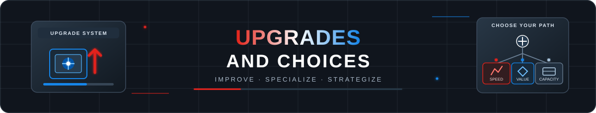

<div align="center">





</div>

---


# Upgrades And Choices

## Concevoir des améliorations intéressantes

Les améliorations sont au cœur de la progression d'un jeu tycoon.

Elles permettent au joueur de développer sa production, d'améliorer ses machines, de débloquer de nouvelles possibilités et de ressentir concrètement sa progression.

Cependant, un bon système d'amélioration ne consiste pas simplement à augmenter tous les nombres.

Chaque amélioration doit avoir une utilité compréhensible, un effet visible et une place cohérente dans l'économie du jeu.

**Principe fondamental : une amélioration doit apporter une décision intéressante, pas seulement un nombre plus élevé.**

## 01. Les objectifs d'une amélioration

Une amélioration efficace doit remplir plusieurs conditions :

- Le joueur comprend immédiatement ce qu'elle apporte.
- Son effet est suffisamment important pour être perceptible.
- Son coût correspond à sa puissance.
- Elle s'intègre dans la progression générale.
- Elle donne envie de continuer à développer le tycoon.
- Elle ne rend pas automatiquement toutes les autres améliorations inutiles.

Une amélioration qui coûte beaucoup mais n'apporte presque aucun changement risque de frustrer le joueur.

À l'inverse, une amélioration trop puissante peut détruire l'équilibrage de l'économie.

### Les quatre questions essentielles

Avant d'ajouter une amélioration, demande-toi :

1. Quel problème ou quelle limite résout-elle ?
2. Quel changement concret apporte-t-elle ?
3. Combien de temps faut-il pour rentabiliser son coût ?
4. Pourquoi le joueur devrait-il la choisir plutôt qu'une autre ?


## 02. Les familles d'améliorations

Chaque famille doit avoir une fonction distincte dans le gameplay.

| Famille | Effet | Exemple |
|---|---|---|
| Speed | Augmente la cadence | Produit plus souvent |
| Value | Augmente la valeur | Chaque ressource rapporte davantage |
| Capacity | Augmente le stockage | Contient davantage de ressources |
| Efficiency | Améliore le rendement | Réduit les dépenses de production |
| Automation | Automatise une action | Collecte automatiquement |
| Range | Étend une zone d'effet | Atteint davantage de machines |
| Specialization | Spécialise une production | Bonus sur un type de machine |
| Cosmetic | Modifie l'apparence | Nouveau skin de machine |

### 2.1 Speed

Les améliorations de vitesse augmentent la fréquence de production.

Exemple :

- Niveau 1 : une ressource toutes les 4 secondes.
- Niveau 2 : une ressource toutes les 3 secondes.
- Niveau 3 : une ressource toutes les 2 secondes.
- Niveau 4 : une ressource toutes les 1,5 seconde.

Une amélioration de vitesse doit rester compatible avec les limites techniques du jeu.

Augmenter indéfiniment la cadence peut créer trop d'objets physiques et dégrader les performances.

### 2.2 Value

Les améliorations de valeur augmentent les revenus générés par chaque ressource.

Exemple :

- Niveau 1 : 5 crédits par ressource.
- Niveau 2 : 8 crédits par ressource.
- Niveau 3 : 12 crédits par ressource.
- Niveau 4 : 18 crédits par ressource.

Cette famille est particulièrement intéressante lorsqu'elle peut être comparée à une amélioration de vitesse.

Le joueur doit pouvoir choisir entre produire plus souvent et gagner davantage par ressource.

### 2.3 Capacity

Les améliorations de capacité augmentent la quantité de ressources pouvant être stockées.

Elles peuvent être utiles lorsque :

- Le joueur ne collecte pas immédiatement.
- Les machines produisent plus rapidement.
- Le stockage constitue une limite volontaire.
- Le joueur doit optimiser la gestion de sa production.

La capacité ne doit pas être artificiellement limitée uniquement pour forcer des achats.

### 2.4 Efficiency

Les améliorations d'efficacité améliorent le rapport entre les ressources utilisées et les revenus générés.

Exemples :

- Réduction des dépenses d'entretien.
- Réduction du coût de fonctionnement.
- Augmentation du rendement.
- Diminution des pertes de production.

Elles deviennent particulièrement intéressantes dans les systèmes économiques plus avancés.

### 2.5 Automation

Les améliorations d'automatisation suppriment certaines actions répétitives.

Exemples :

- Collecte automatique.
- Activation automatique des machines.
- Transport automatique des ressources.
- Réinvestissement automatique.
- Gestion automatique du stockage.

L'automatisation doit donner une véritable sensation de progression.

Le joueur passe progressivement de la gestion manuelle à un tycoon capable de fonctionner avec moins d'interventions.

### 2.6 Range

Les améliorations de portée étendent la zone dans laquelle une machine ou un système peut fonctionner.

Exemples :

- Collecteur couvrant une zone plus large.
- Machine pouvant alimenter plusieurs convoyeurs.
- Bonus appliqué aux machines proches.
- Réseau de production étendu.

La portée doit avoir une représentation claire dans le monde du jeu.

### 2.7 Specialization

La spécialisation permet de renforcer une catégorie de machines ou une stratégie particulière.

Exemples :

- Machines rapides.
- Machines à haute valeur.
- Production spécialisée dans une ressource.
- Machines optimisées pour les longues sessions.

Cette famille peut créer des différences réelles entre les façons de développer un tycoon.

### 2.8 Cosmetic

Les améliorations cosmétiques modifient l'apparence sans donner d'avantage économique.

Exemples :

- Couleurs de machines.
- Effets de particules.
- Animations alternatives.
- Skins de convoyeurs.
- Apparence personnalisée du tycoon.

Elles permettent de récompenser la progression et de proposer de la personnalisation sans déséquilibrer l'économie.


## 03. Donner de vrais choix au joueur

Un système d'amélioration intéressant propose plusieurs stratégies viables.

Imagine trois améliorations disponibles au même moment :

<details>
<summary><strong>Option A : Production rapide</strong></summary>

Augmente la fréquence de production.

Avantages :
- Davantage de ressources produites.
- Progression plus dynamique.
- Intéressante lorsque les ressources ont une valeur élevée.

Limites :
- Peut augmenter les besoins en stockage.
- Peut demander davantage de capacité de traitement.

</details>

<details>
<summary><strong>Option B : Production de valeur</strong></summary>

Augmente la valeur de chaque ressource.

Avantages :
- Revenus plus importants par ressource.
- Peut améliorer la rentabilité sans multiplier les objets physiques.
- Intéressante lorsque la production est déjà rapide.

Limites :
- N'augmente pas directement le nombre de ressources.
- Peut être moins intéressante si la cadence est très faible.

</details>

<details>
<summary><strong>Option C : Stockage avancé</strong></summary>

Augmente la capacité de stockage.

Avantages :
- Réduit les problèmes de saturation.
- Permet de conserver davantage de ressources.
- Complète les machines très productives.

Limites :
- Ne génère pas directement davantage de revenus.
- Sa valeur dépend du fonctionnement de la collecte.

</details>

Ces trois améliorations ont des objectifs différents.

Le choix dépend de la situation du joueur, de son style de jeu et de la configuration de son tycoon.

### Checklist des choix

- [ ] Plusieurs stratégies sont viables.
- [ ] Les améliorations ont des effets distincts.
- [ ] Une seule amélioration ne domine pas systématiquement les autres.
- [ ] Les avantages et les limites sont compréhensibles.
- [ ] Les choix restent intéressants à différents stades du jeu.
- [ ] Les améliorations peuvent se compléter sans rendre les autres inutiles.


## 04. Améliorations permanentes et temporaires

Toutes les améliorations ne doivent pas nécessairement fonctionner de la même manière.

| Type | Durée | Exemple |
|---|---|---|
| Permanent | Jusqu'à réinitialisation ou suppression | Niveau d'une machine |
| Temporaire | Durée définie | Bonus de production |
| Conditionnel | Tant qu'une condition est remplie | Bonus de proximité |
| Débloquable | Accès permanent à une fonctionnalité | Nouvelle machine |
| Cosmétique | Tant que l'objet est équipé | Skin de convoyeur |

### Permanent

Les améliorations permanentes représentent la progression principale.

Elles doivent être sauvegardées si le jeu conserve la progression entre les sessions.

### Temporaire

Les bonus temporaires peuvent être utilisés pour créer des moments de progression accélérée.

Exemples :

- Double production pendant une durée limitée.
- Vitesse augmentée pendant un événement.
- Bonus de valeur temporaire.

Le joueur doit toujours connaître la durée restante et les conditions du bonus.

### Conditionnel

Un bonus conditionnel dépend de la situation.

Exemples :

- Bonus lorsque plusieurs machines sont connectées.
- Rendement supplémentaire lorsque le stockage est presque vide.
- Production améliorée dans une zone particulière.

Ces systèmes peuvent rendre la gestion du tycoon plus stratégique.


## 05. Construire une progression cohérente

Les améliorations doivent évoluer avec le joueur.

Une amélioration adaptée au début du jeu peut devenir insignifiante en fin de progression.

Il faut donc prévoir une évolution des possibilités, des coûts et des décisions.

| Phase | Type d'amélioration | Objectif |
|---|---|---|
| Début | Speed et Value | Comprendre la production |
| Début intermédiaire | Capacity et Automation | Réduire les tâches répétitives |
| Milieu | Efficiency et Specialization | Optimiser l'économie |
| Avancé | Synergies et améliorations combinées | Construire une stratégie |
| Endgame | Upgrades rares et prestige | Continuer la progression |

### Début de partie

Le joueur doit rapidement comprendre le fonctionnement des améliorations.

Privilégie :

- Des effets simples.
- Des prix accessibles.
- Des changements visibles.
- Des décisions faciles à comprendre.

### Milieu de partie

Le joueur connaît déjà les mécaniques principales.

Introduis :

- Des améliorations complémentaires.
- Des spécialisations.
- Des systèmes d'automatisation.
- Des choix économiques plus intéressants.

### Fin de partie

Les améliorations peuvent devenir plus complexes.

Introduis progressivement :

- Des synergies entre machines.
- Des améliorations rares.
- Des bonus conditionnels.
- Des optimisations spécialisées.
- Des systèmes de prestige si le jeu en possède.

Ne rends pas simplement les coûts astronomiques pour prolonger artificiellement la progression.


## 06. Équilibrer les améliorations

Le coût d'une amélioration doit être cohérent avec le bénéfice qu'elle apporte.

Une méthode simple consiste à calculer le temps nécessaire pour rentabiliser l'investissement.

### Formule de rentabilité

\[
T_{\text{retour}} =
\frac{\text{Coût de l'amélioration}}
{\text{Gain supplémentaire par seconde}}
\]

Exemple :

- Coût : 500 crédits.
- Production actuelle : 10 crédits/seconde.
- Nouvelle production : 15 crédits/seconde.
- Gain supplémentaire : 5 crédits/seconde.

\[
T_{\text{retour}} = \frac{500}{5} = 100 \text{ secondes}
\]

Le joueur récupère donc son investissement après 100 secondes de production supplémentaire, si les conditions de production restent constantes.

### Comparer plusieurs améliorations

| Amélioration | Coût | Gain supplémentaire | Retour |
|---|---:|---:|---:|
| Speed | 300 | 3/s | 100 s |
| Value | 500 | 5/s | 100 s |
| Efficiency | 700 | 7/s | 100 s |

Ces chiffres sont uniquement illustratifs.

Même si les trois améliorations ont le même temps de retour, elles ne proposent pas nécessairement la même expérience.

Il faut également prendre en compte :

- Le stockage disponible.
- La cadence réelle des machines.
- Les interactions avec les autres améliorations.
- Les coûts futurs.
- Les éventuelles limites de production.
- Le temps réellement passé dans le jeu.

### Checklist d'équilibrage

- [ ] Les coûts augmentent de manière cohérente.
- [ ] Les bénéfices sont mesurables.
- [ ] Les temps de retour sont adaptés à la phase de jeu.
- [ ] Les améliorations ne deviennent pas immédiatement inutiles.
- [ ] Les spécialisations possèdent des avantages et des limites.
- [ ] Les bonus cumulés sont contrôlés.
- [ ] Les améliorations sont testées dans différentes configurations.


## 07. Synergies entre améliorations

Les synergies permettent de créer des stratégies plus intéressantes.

Une amélioration peut devenir plus utile lorsqu'elle est associée à une autre.

Exemple :

| Amélioration | Effet individuel | Synergie |
|---|---|---|
| Speed | Production plus rapide | Augmente l'intérêt d'une grande capacité |
| Value | Ressources plus rentables | Augmente l'intérêt d'une cadence élevée |
| Capacity | Stockage plus important | Réduit les problèmes de saturation |
| Automation | Collecte automatique | Facilite les productions intensives |
| Efficiency | Meilleur rendement | Améliore les systèmes coûteux |

### Exemple de combinaison

Un joueur peut choisir :

1. Une machine rapide.
2. Un stockage plus important.
3. Une collecte automatisée.

Cette combinaison favorise une production continue.

Un autre joueur peut préférer :

1. Une machine à haute valeur.
2. Une spécialisation économique.
3. Une réduction des dépenses.

Cette combinaison favorise une production moins intensive mais plus rentable par ressource.

L'objectif est de permettre différentes stratégies sans qu'une combinaison soit systématiquement supérieure dans toutes les situations.


## 08. Feedback visuel et sonore

Une amélioration doit être immédiatement perceptible.

Le joueur doit comprendre qu'il vient de progresser.

### Après chaque achat

1. Afficher le nouveau niveau.
2. Montrer la nouvelle statistique.
3. Mettre à jour le prochain coût.
4. Animer brièvement la machine.
5. Jouer un son discret.
6. Afficher une confirmation visuelle.

### Exemple de feedback

<details>
<summary><strong>Avant l'amélioration</strong></summary>

- Production : 5 ressources/minute.
- Niveau : 1.
- Couleur de machine : standard.
- Animation : cadence normale.

</details>

<details>
<summary><strong>Après l'amélioration</strong></summary>

- Production : 8 ressources/minute.
- Niveau : 2.
- Couleur de machine : indicateur de niveau.
- Animation : cadence accélérée.
- Notification : amélioration achetée.

</details>

### Checklist du feedback

- [ ] Le changement de statistique est visible.
- [ ] Le niveau actuel est affiché.
- [ ] Le prochain coût est actualisé.
- [ ] L'animation reste courte.
- [ ] Le son n'est pas agressif.
- [ ] L'interface ne bloque pas les achats successifs.
- [ ] Les informations importantes restent lisibles sur mobile.

Évite les animations trop longues qui ralentissent la progression.


## 09. Organisation technique dans Roblox

Les améliorations doivent être définies dans des configurations contrôlées par le serveur.

Exemple de configuration :

```lua
local UpgradeConfig = {
    Speed = {
        Name = "Production Speed",

        Levels = {
            [1] = {
                Cost = 100,
                Interval = 4
            },

            [2] = {
                Cost = 250,
                Interval = 3
            },

            [3] = {
                Cost = 500,
                Interval = 2
            }
        }
    },

    Value = {
        Name = "Resource Value",

        Levels = {
            [1] = {
                Cost = 100,
                Value = 5
            },

            [2] = {
                Cost = 300,
                Value = 8
            },

            [3] = {
                Cost = 600,
                Value = 12
            }
        }
    }
}

return UpgradeConfig
```

Ce module représente un exemple de structure de configuration. Les valeurs sont fictives et doivent être adaptées à l'économie réelle du jeu.

### Organisation possible

```text
ServerScriptService
└── TycoonServer
    └── Services
        └── UpgradeService

ReplicatedStorage
└── TycoonShared
    └── Config
        └── UpgradeConfig
```

### Responsabilités du serveur

Le serveur doit :

- Charger la configuration autorisée.
- Vérifier l'identifiant de l'amélioration.
- Vérifier le niveau actuel.
- Calculer le prix.
- Vérifier le solde du joueur.
- Déduire la monnaie.
- Appliquer l'amélioration.
- Mettre à jour les données.
- Communiquer le résultat au client.

Le client ne doit jamais transmettre un prix final ou décider du niveau obtenu.

### Exemple de validation serveur

```lua
local UpgradeConfig = require(
    game.ReplicatedStorage
        .TycoonShared
        .Config
        .UpgradeConfig
)

local function getUpgradeData(upgradeId, level)
    if typeof(upgradeId) ~= "string" then
        return nil
    end

    if typeof(level) ~= "number" then
        return nil
    end

    local upgrade = UpgradeConfig[upgradeId]

    if not upgrade then
        return nil
    end

    return upgrade.Levels[level]
end
```

Cette fonction vérifie que l'amélioration et le niveau existent dans la configuration. Elle ne remplace pas les autres vérifications nécessaires avant un achat.


## 10. Sauvegarde des améliorations

Les améliorations permanentes doivent être conservées si la progression du joueur est persistante.

Exemple de structure :

```lua
local PlayerData = {
    Cash = 500,

    Upgrades = {
        Speed = 2,
        Value = 1,
        Capacity = 1,
        Efficiency = 0
    }
}
```

Cette structure est un exemple de données et non une implémentation complète de sauvegarde.

### Checklist

- [ ] Les niveaux sont sauvegardés côté serveur.
- [ ] Les valeurs sont validées au chargement.
- [ ] Les niveaux impossibles sont rejetés.
- [ ] Les améliorations débloquées sont restaurées.
- [ ] Les données sont compatibles avec les versions précédentes.
- [ ] Les sauvegardes gèrent les erreurs.
- [ ] Les achats ne sont pas perdus en cas de déconnexion.

Ne sauvegarde pas simplement une valeur envoyée par le client.


## 11. Erreurs de conception à éviter

| Erreur | Conséquence |
|---|---|
| Toutes les améliorations augmentent uniquement les revenus | Choix répétitifs |
| Une amélioration est toujours supérieure aux autres | Stratégie dominante |
| Les prix augmentent sans logique | Progression frustrante |
| Les effets sont invisibles | Achats peu satisfaisants |
| Les bonus se cumulent sans limite | Économie déséquilibrée |
| Les améliorations sont trop nombreuses dès le début | Surcharge cognitive |
| Les cosmétiques donnent trop de puissance | Déséquilibre entre joueurs |
| Les achats bloquent l'interface | Expérience frustrante |
| Le client choisit les prix | Vulnérabilité économique |

## 12. Plan d'implémentation

Pour le premier prototype, commence avec un système limité.

### Phase 1 : système de base

- [ ] Créer une configuration d'améliorations.
- [ ] Ajouter les améliorations Speed et Value.
- [ ] Définir les coûts.
- [ ] Définir les effets.
- [ ] Créer la validation serveur.
- [ ] Ajouter les boutons d'achat.
- [ ] Afficher les niveaux.

### Phase 2 : progression

- [ ] Ajouter Capacity.
- [ ] Ajouter Efficiency.
- [ ] Introduire des prérequis.
- [ ] Ajouter plusieurs niveaux.
- [ ] Sauvegarder les améliorations.
- [ ] Ajouter les feedbacks visuels.

### Phase 3 : stratégies

- [ ] Ajouter Specialization.
- [ ] Introduire des synergies.
- [ ] Ajouter des améliorations conditionnelles.
- [ ] Tester différentes stratégies.
- [ ] Rééquilibrer les coûts et bénéfices.

### Phase 4 : finition

- [ ] Améliorer les animations.
- [ ] Ajouter des effets sonores.
- [ ] Vérifier l'expérience mobile.
- [ ] Tester les achats successifs.
- [ ] Vérifier la sécurité des transactions.
- [ ] Analyser les choix réellement effectués par les joueurs.


## 13. Definition of Done

Le système d'améliorations est prêt lorsque :

1. Chaque amélioration possède une fonction claire.
2. Les effets sont compréhensibles.
3. Les coûts sont cohérents avec les bénéfices.
4. Plusieurs stratégies sont viables.
5. Les améliorations s'intègrent dans la progression.
6. Les achats sont validés côté serveur.
7. Les niveaux sont sauvegardés correctement.
8. Les changements sont visibles dans le jeu.
9. Les animations ne ralentissent pas les achats.
10. Le système a été testé avec plusieurs configurations de production.

## 14. Questions de conception

Avant d'ajouter une amélioration, réponds à ces questions :

- Quel problème résout-elle ?
- Quel changement apporte-t-elle ?
- Est-elle utile au début, au milieu ou en fin de partie ?
- Quelle autre amélioration peut la compléter ?
- Quelle est sa limite ?
- Son coût est-il cohérent ?
- Son effet est-il visible ?
- Peut-elle créer une stratégie différente ?
- Peut-elle être exploitée ou cumulée de manière abusive ?

Si une amélioration n'apporte aucune décision intéressante, il faut probablement revoir sa fonction.


## References

Ressources officielles Roblox :

- [Roblox Creator Documentation](https://create.roblox.com/docs)
- [Scripting](https://create.roblox.com/docs/scripting)
- [ModuleScripts](https://create.roblox.com/docs/scripting/module)
- [Client-server boundary](https://create.roblox.com/docs/scripting/security/client-server-boundary)
- [Data stores](https://create.roblox.com/docs/cloud-services/data-stores)

## Acknowledgements

Ce document fait partie de **Roblox Tycoon Blueprint**, un guide communautaire consacré à la conception et au développement de jeux tycoon sur Roblox.

Merci à Roblox et à sa communauté de développeurs pour les ressources, les outils et la documentation qui permettent d'explorer les systèmes de progression, d'économie et de gameplay.

---

<div align="center">


<sub>Document: `docs/UPGRADES-AND-CHOICES.md` · Part of Roblox Tycoon Blueprint</sub>

</div>
