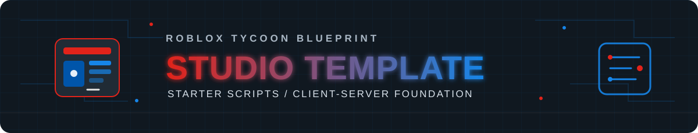
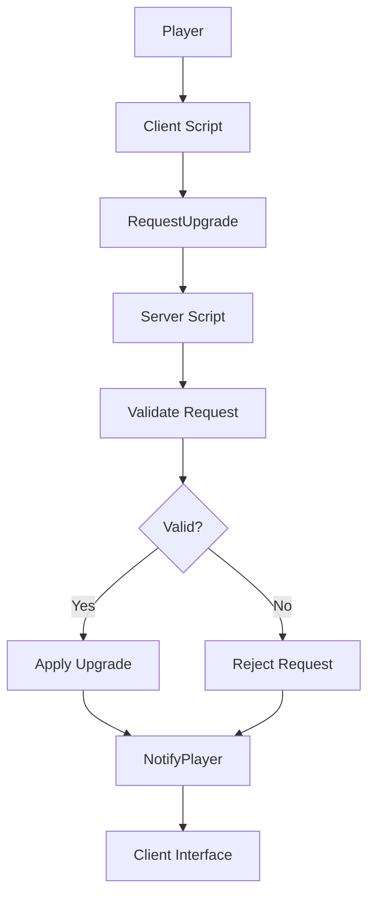

 

---

# Studio Template

## Overview

Le dossier `studio-template/` contient des scripts Luau de départ destinés à être intégrés manuellement dans Roblox Studio.

Il sert de base technique au développement d'un tycoon Roblox. Son objectif est de fournir une première organisation du projet et de montrer comment séparer les responsabilités entre le client et le serveur.

Ce template est volontairement minimal. Il ne constitue pas encore un système de tycoon complet ou prêt à être publié.

## Objectives

Ce template permet de commencer à construire une architecture organisée autour de plusieurs principes :

- Séparation entre logique client et logique serveur.
- Communication contrôlée avec les `RemoteEvent`.
- Organisation des scripts par responsabilité.
- Centralisation progressive de la configuration.
- Préparation à l'ajout d'un système d'améliorations.
- Base pour intégrer ultérieurement la sauvegarde des données.

## Roblox Studio setup

Les scripts ne sont pas automatiquement installés dans une expérience Roblox.

Il faut créer les objets nécessaires dans Roblox Studio, puis placer chaque fichier dans l'objet correspondant.

### Required instances

Dans l'Explorer, crée les éléments suivants :

| Emplacement | Objet | Type |
|---|---|---|
| `ReplicatedStorage` | `TycoonShared` | Folder |
| `TycoonShared` | `Remotes` | Folder |
| `Remotes` | `RequestUpgrade` | RemoteEvent |
| `Remotes` | `NotifyPlayer` | RemoteEvent |

Les noms doivent correspondre exactement à ceux utilisés dans les scripts.

<strong>Créer les objets dans Roblox Studio</strong>

1. Ouvre ton expérience dans Roblox Studio.
2. Affiche le panneau `Explorer`.
3. Repère `ReplicatedStorage`.
4. Ajoute un `Folder` nommé `TycoonShared`.
5. Dans ce dossier, ajoute un autre `Folder` nommé `Remotes`.
6. Dans `Remotes`, ajoute deux `RemoteEvent`.
7. Renomme-les respectivement `RequestUpgrade` et `NotifyPlayer`.
8. Vérifie les noms et les emplacements avant de lancer un test.

## RemoteEvents

Les deux événements réseau ont des responsabilités différentes.

| RemoteEvent | Responsabilité |
|---|---|
| `RequestUpgrade` | Permet au client de demander une amélioration |
| `NotifyPlayer` | Permet au serveur d'envoyer une notification au client |

Le client ne doit jamais décider lui-même du prix d'une amélioration, du montant à débiter ou du niveau final.

Le serveur doit recevoir la demande, vérifier les conditions et décider si l'action est autorisée.

### RequestUpgrade

Flux général :

1. Le joueur déclenche une amélioration depuis l'interface.
2. Le client envoie une demande au serveur.
3. Le serveur vérifie l'identité du joueur et les paramètres reçus.
4. Le serveur récupère le prix depuis sa propre configuration.
5. Le serveur vérifie les fonds et les conditions.
6. Le serveur applique l'amélioration si elle est valide.
7. Le serveur informe le client du résultat.

### NotifyPlayer

Cet événement sert à transmettre des informations d'affichage, par exemple :

- Amélioration achetée.
- Fonds insuffisants.
- Action refusée.
- Erreur temporaire.
- Notification de progression.

Une notification ne doit pas être considérée comme une preuve qu'une opération économique a été effectuée correctement.

## Client-server architecture

Le serveur conserve l'autorité sur les données importantes.

Le client s'occupe principalement de l'interface, des interactions et de l'affichage des informations.

## Security requirements

Avant d'utiliser ce template dans une expérience publique, ajoute les protections suivantes :

| Vérification | Pourquoi ? |
|---|---|
| Propriété du tycoon | Empêcher un joueur de modifier le terrain d'un autre |
| Distance | Empêcher les interactions à distance avec des objets |
| Type des arguments | Refuser les valeurs inattendues |
| Valeurs numériques | Refuser les nombres négatifs, infinis ou excessifs |
| Fréquence des demandes | Limiter les abus de RemoteEvent |
| Fonds disponibles | Empêcher les achats sans argent suffisant |
| Coûts côté serveur | Empêcher le client de choisir son propre prix |
| Niveau maximum | Empêcher les améliorations au-delà des limites prévues |

Ne fais jamais confiance à une valeur économique envoyée par le client.

Les prix, les récompenses, les niveaux et les décisions d'achat doivent être calculés ou validés côté serveur.

## Current limitations

Le template présente plusieurs limites qu'il faut comprendre avant de l'utiliser.

### Data and persistence

- L'argent et les niveaux sont uniquement conservés en mémoire.
- Les données sont perdues lorsque le serveur ferme ou que le joueur se déconnecte.
- Aucun système de sauvegarde avec `DataStoreService` n'est encore intégré.
- Il n'y a pas de gestion complète des erreurs de chargement ou de sauvegarde.

### Tycoon management

- Aucun système d'attribution de terrain ou de tycoon n'est encore fourni.
- Les propriétaires des terrains ne sont pas encore gérés.
- Les vérifications de propriété et de distance restent à implémenter.
- Le système de production n'est pas encore une boucle de production complète.

### Purchases

- Aucun identifiant de produit Roblox n'est fourni.
- Aucun système d'achat complet n'est prêt à être publié.
- Les achats de Developer Products doivent être traités côté serveur avec `MarketplaceService.ProcessReceipt`.
- Les récompenses doivent être attribuées de manière idempotente afin d'éviter les doubles attributions.

### Production

- La structure de production est un exemple pédagogique.
- La génération automatique de ressources, leur déplacement et leur collecte doivent être développés et testés séparément.
- Les performances doivent être mesurées avant d'ajouter un grand nombre d'objets physiques.

## DataStore preparation

Avant toute publication, ajoute un système de sauvegarde fiable.

Les données importantes peuvent notamment inclure :

- Argent du joueur.
- Niveaux des machines.
- Améliorations achetées.
- Progression du tycoon.
- Récompenses permanentes.
- Version du format de sauvegarde.

Précautions nécessaires :

- Utiliser `pcall` pour gérer les erreurs des appels DataStore.
- Prévoir une stratégie de nouvelles tentatives raisonnable.
- Valider les données avant de les charger ou de les utiliser.
- Prévoir une version de structure pour les migrations.
- Éviter les sauvegardes trop fréquentes.
- Ne jamais considérer une sauvegarde comme réussie sans vérifier le résultat.

Pour tester les DataStores, publie une expérience de test distincte et active l'accès aux services API dans ses paramètres. Évite d'utiliser les données d'une expérience de production pendant les essais.

## Recommended development order

Pour faire évoluer ce template sans mélanger toutes les fonctionnalités, suis un ordre de développement progressif :

| Étape | Fonctionnalité | Objectif |
|---|---|---|
| 01 | Script initialization | Vérifier que les scripts démarrent correctement |
| 02 | Player data | Créer les données temporaires du joueur |
| 03 | Tycoon ownership | Attribuer un terrain à chaque joueur |
| 04 | Economy | Gérer l'argent et les transactions |
| 05 | Upgrade system | Acheter et appliquer des améliorations |
| 06 | Production | Générer et collecter des ressources |
| 07 | DataStore | Sauvegarder et charger les données |
| 08 | Security | Renforcer les validations côté serveur |
| 09 | Testing | Tester les interactions avec plusieurs joueurs |

## Testing checklist

Avant de considérer le template comme une base fonctionnelle :

- [ ] Tous les objets requis existent dans l'Explorer.
- [ ] Les noms des objets correspondent aux scripts.
- [ ] Les scripts démarrent sans erreur.
- [ ] Les RemoteEvents sont accessibles aux bons emplacements.
- [ ] Les demandes d'amélioration sont vérifiées côté serveur.
- [ ] Les valeurs économiques ne sont jamais acceptées sans validation.
- [ ] Un joueur ne peut pas modifier le tycoon d'un autre.
- [ ] Les demandes répétées sont limitées.
- [ ] Les erreurs sont enregistrées sans exposer de données sensibles.
- [ ] Les tests sont effectués avec plusieurs clients.
- [ ] Les déconnexions pendant une opération sont testées.
- [ ] La sauvegarde est testée dans un environnement séparé avant publication.

## Definition of Done

Le template peut être considéré comme une base technique exploitable lorsque :

- Les scripts sont placés dans les bons services.
- La communication client-serveur fonctionne.
- Les opérations importantes sont contrôlées par le serveur.
- Les systèmes incomplets sont clairement identifiés.
- Les limites du template sont documentées.
- Les tests de base ne révèlent pas d'erreurs bloquantes.

Cela ne signifie pas que le jeu est prêt à être publié. Les systèmes de sauvegarde, de propriété, de production et de sécurité doivent encore être développés et validés.

## Official documentation

- [Roblox Creator Hub](https://create.roblox.com/docs)
- [Client-server runtime](https://create.roblox.com/docs/projects/client-server)
- [Remote events and callbacks](https://create.roblox.com/docs/scripting/events/remote)
- [Script types and locations](https://create.roblox.com/docs/scripting/locations)
- [Security and cheat mitigation](https://create.roblox.com/docs/scripting/security/security-tactics)
- [Data stores](https://create.roblox.com/docs/cloud-services/data-stores)
- [MarketplaceService](https://create.roblox.com/docs/reference/engine/classes/MarketplaceService)

## Acknowledgements

This template is part of **Roblox Tycoon Blueprint**, a project documenting the design and development of Roblox tycoon experiences.

- [Roblox Creator Hub](https://create.roblox.com/docs) for official platform documentation.
- [Roblox Studio](https://www.roblox.com/create) for the development environment.
- [Luau](https://luau.org/) for the scripting language and its documentation.

---

Document: `studio-template/README.md` · Part of Roblox Tycoon Blueprint

