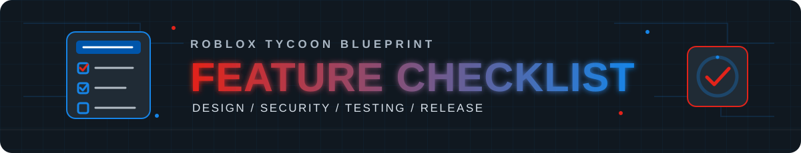

---

# Feature Checklist

## 01. Purpose

Cette checklist sert à évaluer une fonctionnalité avant, pendant et après son développement.

Elle permet de vérifier qu'une fonctionnalité :

- Répond à un besoin réel du joueur.
- Correspond à l'identité du jeu.
- Possède des règles de fonctionnement clairement définies.
- Respecte l'équilibre de progression et d'économie.
- Fonctionne correctement sur les plateformes ciblées.
- Ne crée pas de failles de sécurité.
- Peut être maintenue et améliorée après sa sortie.

Elle peut être utilisée pour les petites fonctionnalités comme pour les systèmes majeurs : machines, améliorations, quêtes, rebirth, événements, sauvegarde ou monétisation.

## 02. Feature information

Avant de commencer, complète les informations suivantes.

| Information | Description |
|---|---|
| Feature name | Nom de la fonctionnalité |
| Category | Gameplay, UI, Economy, Social, Technical, etc. |
| Priority | Critical, High, Medium, Low |
| Status | Planned, In Progress, Testing, Completed |
| Owner | Personne responsable |
| Target version | Version ou mise à jour prévue |
| Dependencies | Systèmes nécessaires à son fonctionnement |

### Feature description

**Problem or desire**

Quel problème cette fonctionnalité résout-elle, ou quel besoin du joueur satisfait-elle ?

**Expected result**

Que doit pouvoir faire le joueur après son implémentation ?

**Success criteria**

Comment déterminer si la fonctionnalité fonctionne et apporte réellement quelque chose au jeu ?

## 03. Goal and player experience

- [ ] Le besoin ou le désir du joueur est clairement identifié.
- [ ] La fonctionnalité possède un objectif compréhensible.
- [ ] Elle correspond à l'identité du jeu.
- [ ] Elle apporte une valeur réelle à l'expérience.
- [ ] Elle s'intègre naturellement à la boucle de gameplay.
- [ ] Elle ne rend pas inutile une fonctionnalité existante.
- [ ] L'expérience des joueurs gratuits reste complète.
- [ ] Elle ne crée pas de frustration artificielle pour encourager un achat.
- [ ] Son intérêt reste compréhensible pour un nouveau joueur.
- [ ] Son utilité à long terme est définie.

## 04. Game design

- [ ] La boucle principale de la fonctionnalité est documentée.
- [ ] Les conditions de déblocage sont définies.
- [ ] Les coûts sont définis.
- [ ] Les récompenses sont définies.
- [ ] Les temps d'attente et cooldowns sont définis.
- [ ] Les limites et plafonds sont définis.
- [ ] Les interactions avec les autres systèmes sont documentées.
- [ ] Les cas particuliers sont identifiés.
- [ ] Les conséquences d'une interruption sont prévues.
- [ ] La fonctionnalité ne crée pas de stratégie dominante involontaire.
- [ ] La progression reste cohérente avec le reste du jeu.

### Edge cases

Vérifie notamment les situations suivantes lorsqu'elles sont pertinentes :

- [ ] Le joueur quitte pendant une interaction.
- [ ] Le joueur rejoint avec des données déjà sauvegardées.
- [ ] Deux joueurs tentent d'effectuer la même action simultanément.
- [ ] Le joueur ne possède pas les ressources nécessaires.
- [ ] Le joueur atteint une limite maximale.
- [ ] Une dépendance est indisponible.
- [ ] Une action est répétée rapidement.
- [ ] Une erreur survient pendant une sauvegarde.

## 05. Economy and progression

Pour toute fonctionnalité ayant un impact économique :

- [ ] Les coûts sont cohérents avec la progression.
- [ ] Les récompenses sont équilibrées.
- [ ] Les gains par minute ou par heure sont estimés.
- [ ] Les interactions avec les multiplicateurs sont vérifiées.
- [ ] Les effets sur les joueurs débutants sont évalués.
- [ ] Les effets sur les joueurs avancés sont évalués.
- [ ] Les risques d'inflation économique sont étudiés.
- [ ] Les interactions avec le rebirth sont vérifiées.
- [ ] Les achats payants ne rendent pas la progression gratuite obsolète.
- [ ] Les valeurs extrêmes sont testées.

## 06. User interface and accessibility

- [ ] L'interface explique clairement la fonctionnalité.
- [ ] Les boutons indiquent leur action.
- [ ] Les coûts et récompenses sont visibles avant confirmation.
- [ ] Les états de chargement sont prévus.
- [ ] Les erreurs sont compréhensibles.
- [ ] Le joueur reçoit un retour après une action réussie.
- [ ] Les animations ne ralentissent pas inutilement l'interaction.
- [ ] Les informations importantes ne reposent pas uniquement sur la couleur.
- [ ] Les textes restent lisibles sur les petits écrans.
- [ ] Les interactions sont adaptées aux appareils tactiles.
- [ ] Les contrôles clavier et manette sont considérés.
- [ ] Les éléments interactifs possèdent des zones de sélection adaptées.

## 07. Technical architecture

- [ ] Les responsabilités client et serveur sont séparées.
- [ ] Le serveur conserve l'autorité sur les données importantes.
- [ ] Les RemoteEvents sont validés côté serveur.
- [ ] Les arguments reçus sont contrôlés.
- [ ] Les demandes réseau sont limitées en fréquence.
- [ ] Les coûts et récompenses sont calculés côté serveur.
- [ ] Les accès aux données sont contrôlés.
- [ ] Les erreurs sont gérées proprement.
- [ ] Les dépendances sont identifiées.
- [ ] Les scripts sont organisés par responsabilité.
- [ ] Les configurations importantes sont centralisées.
- [ ] Les changements sont compatibles avec les systèmes existants.

### Security review

- [ ] Un client ne peut pas s'attribuer de monnaie.
- [ ] Un client ne peut pas choisir librement le prix d'une amélioration.
- [ ] Un client ne peut pas modifier directement son niveau.
- [ ] La propriété des objets et terrains est vérifiée.
- [ ] Les distances et conditions d'interaction sont vérifiées.
- [ ] Les valeurs numériques sont bornées et validées.
- [ ] Les demandes répétées ne permettent pas de contourner les règles.
- [ ] Les récompenses ne peuvent pas être attribuées plusieurs fois par erreur.
- [ ] Aucune donnée sensible n'est exposée au client.

## 08. Data and persistence

Lorsque la fonctionnalité utilise des données sauvegardées :

- [ ] Les données nécessaires sont identifiées.
- [ ] Les champs sauvegardés sont documentés.
- [ ] Les valeurs sont validées lors du chargement.
- [ ] Les données anciennes sont prises en compte.
- [ ] Le comportement en cas d'échec de chargement est défini.
- [ ] Le comportement en cas d'échec de sauvegarde est défini.
- [ ] Les sauvegardes répétées sont limitées.
- [ ] Les modifications de structure sont versionnées.
- [ ] Les données ne peuvent pas être corrompues par une entrée invalide.
- [ ] Les tests sont réalisés dans un environnement séparé.

## 09. Performance

- [ ] Le coût CPU est évalué.
- [ ] La consommation mémoire est évaluée.
- [ ] Le nombre d'instances créées est contrôlé.
- [ ] Les connexions aux événements sont correctement gérées.
- [ ] Les boucles permanentes sont justifiées.
- [ ] Les opérations coûteuses sont limitées.
- [ ] Les effets visuels sont adaptés aux appareils moins puissants.
- [ ] Le comportement avec plusieurs joueurs est testé.
- [ ] Les performances mobiles sont vérifiées.
- [ ] Aucun problème majeur de latence n'est identifié.

## 10. Testing

### Functional tests

- [ ] Le test avec un nouveau joueur est terminé.
- [ ] Le test avec un joueur ayant déjà progressé est terminé.
- [ ] Les conditions normales de fonctionnement sont vérifiées.
- [ ] Les cas limites sont testés.
- [ ] Les erreurs attendues sont correctement gérées.
- [ ] Les interactions avec les autres fonctionnalités sont vérifiées.

### Multiplayer tests

- [ ] Plusieurs joueurs peuvent utiliser la fonctionnalité simultanément.
- [ ] Les données d'un joueur ne peuvent pas être modifiées par un autre.
- [ ] Les interactions concurrentes sont vérifiées.
- [ ] Les déconnexions sont testées.
- [ ] Les changements de serveur sont pris en compte si nécessaire.

### Exploit-minded tests

- [ ] Les RemoteEvents sont testés avec des arguments invalides.
- [ ] Les demandes répétées sont testées.
- [ ] Les valeurs négatives ou excessives sont rejetées.
- [ ] Les tentatives d'accès à des objets non autorisés sont rejetées.
- [ ] Les tentatives de contournement des conditions sont testées.
- [ ] Les récompenses et transactions sont vérifiées côté serveur.

## 11. Release readiness

Avant de rendre la fonctionnalité accessible aux joueurs :

- [ ] Le code est relu.
- [ ] Les tests importants sont terminés.
- [ ] Les erreurs bloquantes sont corrigées.
- [ ] Les problèmes connus sont documentés.
- [ ] Les performances sont acceptables.
- [ ] Les textes et éléments visuels sont finalisés.
- [ ] Les interactions mobiles sont vérifiées.
- [ ] Les changements de données sont compatibles.
- [ ] La documentation est mise à jour.
- [ ] Les changements sont intégrés dans la bonne version.
- [ ] Un plan de retour arrière existe si nécessaire.

## 12. Results and unresolved issues

Après les tests, consigne les résultats.

| Field | Result |
|---|---|
| Functional tests | Not tested |
| Multiplayer tests | Not tested |
| Security review | Not tested |
| Performance review | Not tested |
| Mobile compatibility | Not tested |
| Known issues | Not documented |
| Final decision | Pending |

### Known issues

Liste les problèmes qui restent à résoudre :

- Issue 1:
- Issue 2:
- Issue 3:

### Final decision

Choisis un statut :

- [ ] Approved
- [ ] Approved with known issues
- [ ] Requires changes
- [ ] Rejected
- [ ] Deferred

## 13. Definition of Done

Une fonctionnalité est considérée comme terminée lorsque :

1. Son objectif et son comportement sont documentés.
2. Les règles de gameplay et les cas limites sont définis.
3. Le code est intégré à l'architecture du projet.
4. Les contrôles de sécurité nécessaires sont présents.
5. Les tests fonctionnels et multijoueurs sont réalisés.
6. Les performances sont acceptables.
7. Les problèmes connus sont documentés.
8. La documentation du projet est mise à jour.

Une fonctionnalité qui fonctionne uniquement dans une situation idéale ne doit pas être considérée comme terminée.

## 14. Usage guidelines

Cette checklist est un modèle réutilisable.

Pour chaque nouvelle fonctionnalité :

1. Copie ce fichier dans le dossier de documentation approprié.
2. Renomme-le avec le nom de la fonctionnalité.
3. Complète les informations générales.
4. Coche uniquement les éléments réellement vérifiés.
5. Documente les problèmes et les tests non réalisés.
6. Mets à jour le statut après chaque étape importante.

Ne coche pas une case simplement parce qu'une fonctionnalité a été développée. Une case doit correspondre à une vérification réellement effectuée.

## References

- [Roblox Creator Hub](https://create.roblox.com/docs)
- [Roblox client-server runtime](https://create.roblox.com/docs/projects/client-server)
- [Roblox security tactics](https://create.roblox.com/docs/scripting/security/security-tactics)
- [Roblox Data Stores](https://create.roblox.com/docs/cloud-services/data-stores)
- [Roblox performance optimization](https://create.roblox.com/docs/performance-optimization)

## Acknowledgements

This checklist is part of **Roblox Tycoon Blueprint**, a project documenting the design, architecture and development of Roblox tycoon experiences.

- [Roblox Creator Hub](https://create.roblox.com/docs) for official development documentation.
- [Roblox Studio](https://www.roblox.com/create) for the development environment.
- [Luau](https://luau.org/) for the scripting language.

---

Document: `templates/feature-checklist.md` · Part of Roblox Tycoon Blueprint

